# TiviBro user guide

Everything TiviBro does, on the TV and from your computer.  Every picture here comes from a made-up demo provider, so the channel names are invented.

**On the TV:** [First start](#first-start) · [The set-up tour](#the-set-up-tour) · [Channel logos](#channel-logos) · [The remote](#the-remote) · [The guide](#the-guide) · [Groups and the menu](#groups-and-the-menu) · [Watching fullscreen](#watching-fullscreen) · [Other versions of a channel](#other-versions-of-a-channel) · [Event channels](#event-channels-pay-per-view-and-sports-passes) · [Catch-up](#catch-up) · [Movies and shows](#movies-and-shows) · [Search](#search) · [Multiview](#multiview) · [Favorites, hiding and your own groups](#favorites-hiding-and-your-own-groups) · [Reminders](#reminders) · [Settings](#settings) · [Updates](#updates) · [Parental controls](#parental-controls)

**Every setting:** [Playback and buffering](#settings-playback-and-buffering) · [Remote control](#settings-remote-control) · [Playlists and guide](#settings-playlists-and-guide) · [Groups, sorting, hidden](#settings-groups-sorting-hidden) · [Guide, start screen, reminders](#settings-guide-start-screen-reminders) · [Appearance](#settings-appearance) · [Parental controls](#settings-parental-controls) · [Edit on a phone or computer](#settings-edit-on-a-phone-or-computer) · [Updates and about](#settings-updates-and-about) · [Diagnostics](#settings-diagnostics)

**From your computer:** [Turning on the web editor](#turning-on-the-web-editor) · [Drafts and Send to TV](#drafts-and-send-to-tv) · [Groups and channels](#groups-and-channels) · [Smart clean-up](#smart-clean-up) · [Channel names](#channel-names) · [The programme guide](#the-programme-guide) · [Playlists](#playlists) · [Backup and restore](#backup-and-restore)

**When something is off:** [Troubleshooting](#troubleshooting)

> Click any picture to open it full size.  Every animation also has a sharp MP4 version linked under it.

---

## On the TV

### First start

A brand-new TiviBro opens on **Add your playlist**.  You have two ways in:

- **Scan the QR code with your phone.**  It sits beside the form and opens the web editor on your phone, already signed in: type your login there with a real keyboard, or restore a backup from another TV.  The address and password are under the code, for a computer on the same network.  The TV moves on by itself when you finish, then shows the [set-up tour](#the-set-up-tour).  (**Set up or restore from a phone or computer** shows the same code on a screen of its own.)
- **Type it on the TV.**  Pick Xtream Codes or M3U, then fill in the server, username and password (or the M3U address).  A guide address is optional.  **Test connection** checks everything before you save; **Connect** saves and loads your channels.

  
  

<a href="media/firstrun.mp4">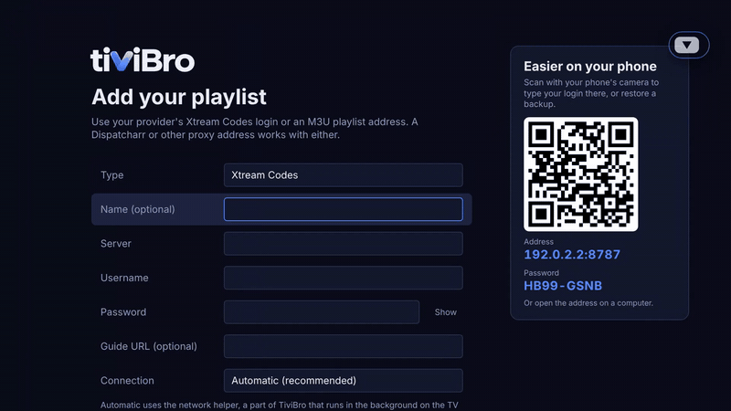</a>

<a href="media/firstrun.mp4">Watch the MP4</a>

Once your channels load, the [set-up tour](#the-set-up-tour) starts.

Restoring a backup onto a fresh TV, start to finish:

<a href="media/restore.mp4">Watch the MP4</a>

### The set-up tour

Right after a new playlist connects, TiviBro shows what it has and walks you through making it yours, one screen at a time with the remote.  It only asks about what your playlist actually has, so a list with no local stations never shows the city step.  Nothing changes until the last screen, and a restore point is saved first, so the web editor can put everything back.

  
  

The first screen counts your channels, groups, countries, event channels, East and West copies, local cities, extra copies and whether there are movies and shows.  Then:

- **Tidy up here, step by step** goes through the screens below.  The chip in the top corner keeps a running count ("Keeps 3,632 of 9,808 channels").
- **Tidy up on a phone or computer** shows a QR code.  Scan it with your phone's camera and the web editor opens on [Smart clean-up](#smart-clean-up), already signed in.  The address and password are there too, for a computer.
- **Skip, start watching** changes nothing.

| Screen | What you pick |
|---|---|
| **Countries** | Each country and region in the list, biggest first, with how many channels it has.  The TV's own country is ticked; **Keep every country** and **Keep only** the biggest are one press.  Groups with no country (sports, events, 24/7) are kept unless you say otherwise. |
| **Channel names** | Name clean-up on or off, group names too, and every rule, with your own channels shown before and after. |
| **East or West?** | Keep East feeds, West feeds or both, and whether to hide groups named West (or East).  Examples from your list. |
| **Your local channels** | Every city your provider's local groups carry, A to Z, with the networks in each.  **OK** ticks a city; ◀ ▶ jump between letters.  The other cities' stations are hidden in every local group.  **Put them together in "Local channels"** (on) makes one group with your stations, by city and network, and **Then hide the network groups** (on) puts ABC Locals, CBS Locals and the rest out of the way so each station shows up once. |
| **Sports and pay-per-view** | [Event channels](#event-channels-pay-per-view-and-sports-passes): reading events from names, short names, Events by time, the time zone for names without one, and **Hide channels with nothing on**.  The next events are listed. |
| **Clear the clutter** | Divider groups, empty groups, the same channel more than once (keep Full HD, the default, or the best, HD, SD or every copy; hidden copies stay under hold OK > Other versions), groups with words like PPV or Adult, and whether groups the provider adds later show up. |
| **Channel logos** | The [logo library](#channel-logos), its style, and which logo wins when the playlist and the guide both have one, with logos it found for your channels. |
| **Make it yours** | Accent colour, background, text size, start screen, turning on the last channel at launch, the preview in the list, and what happens when a channel stops working.  Colours change as you pick them. |
| **All set** | How many channels and groups you keep and hide, **Your choices** (one line per screen, like "Detroit in Local channels, network groups hidden": **OK** on one goes back to that screen, and **Skip to the summary** comes back), **Apply and start watching**, and a few things worth knowing. |

  
  
  

  
  
  

  
  
  

Everything the tour hides stays one press away: Settings > Groups, sorting, hidden, or hold **OK** on a channel.  Run it again any time from **Settings > Playlists and guide > your playlist > Set-up tour**.  It works on the same engine as the web editor's Smart clean-up, so both always agree.

### Channel logos

Providers often leave logos out, or send some that no longer load.  The **logo library** fills them in from two open projects:

- **[iptv-org](https://github.com/iptv-org/database)**: each channel's own logo, for about 28,000 channels in 230 countries.
- **[tv-logos](https://github.com/tv-logo/tv-logos)**: one matching style made for dark screens, for about 7,700 channels.

TiviBro hosts no logo images.  It downloads a small list of where the logos are, only for the countries in your playlist, and each logo loads from its own project, the way your provider's logos do.  The list is kept on the TV for a week.

Channels are matched by their guide id ("CNN.us"), then by their cleaned name in their own country, then by a local station's call sign ("WXYZ") or, for a local station with no logo of its own, its network.  Event channels are left alone, since their names are games.  A provider logo that fails to load is replaced by the library's.

Turn it on in the set-up tour or in **Settings > Appearance > Logo library**:

- **Off**: only the playlist's and the guide's logos.
- **Fill in missing logos**: the library's logo for channels that have none.
- **Use for every channel it knows**: the library's logo everywhere it has one, so the whole list matches.

**Logo library style** picks **Matching set** (tv-logos) or **Original logos** (iptv-org); each falls back to the other.  On a real 9,800-channel playlist it found logos for about 3,600 channels.

### The remote

TiviBro works with the standard LG remote and the Magic Remote.  With the Magic Remote you can also point, click and scroll on every screen.  A legend at the bottom of each screen always tells you what the buttons do right there.

| Button | In the guide | Watching fullscreen |
|---|---|---|
| **OK** | First OK previews in the window, second goes fullscreen | Quick menu |
| **Hold OK** | Programme and channel options | Channel list over the video |
| **Red** | Programme and channel options | Options for the channel |
| **Info** | Programme and channel options | Programme details |
| **▲ ▼** | Move between channels | Channel up and down |
| **◀ ▶** | Move through time (◀ on "now" opens the groups) | ◀ rewind or last channel, ▶ info |
| **CH + / CH −** | Page up and down | Channel up and down |
| **⏪ ⏩** | Jump through time, into the past on catch-up channels | Skip in catch-up and movies |
| **▶ Play** / **❙❙ Pause** | Watch the previewed channel fullscreen | Play only plays and Pause only pauses; a single Play/Pause button switches between them.  Live TV can be paused too. |
| **Green** | Channel list | Guide over the video |
| **Yellow** | Groups | Last channel |
| **Blue** | Settings | Multiview |
| **Back** | Back to now, then the groups | Back to the guide |
| **0 to 9** | Jump to a channel number (at once when no longer number starts with what you typed, otherwise after a short pause) | Jump to a channel number, the same way |

A few things work the way you would guess from other TV apps:

- Channel lists wrap around: **▲** on the first channel goes to the last.  Holding an arrow stops at the end instead of flying past it.  Group lists don't wrap.
- **▲** at the top of a list never opens the menu by surprise.  **◀** or **Back** does.
- **Leaving TiviBro:** press **Back** until the groups show on the home screen; it says **Press Back again to exit**, and one more **Back** closes the app.  The first screen works the same way.
- In a confirmation ("Delete this playlist?"), **Cancel** is selected first, so a stray **OK** never deletes anything.
- With the Magic Remote, clicking outside a pop-up closes it, clicking the progress bar in a movie or catch-up jumps there, and on Settings rows you can click the **‹ ›** arrows to change a value.

Buttons can be remapped under **Settings > Remote control**, including keys TiviBro does not know yet (**Learn a button**).  **Button tester** shows what the TV sends for each key.  Every button, its default and the actions you can give it are listed in [Settings: Remote control](#settings-remote-control).

  
  <a href="screenshots/tv-set-quick-menu.png">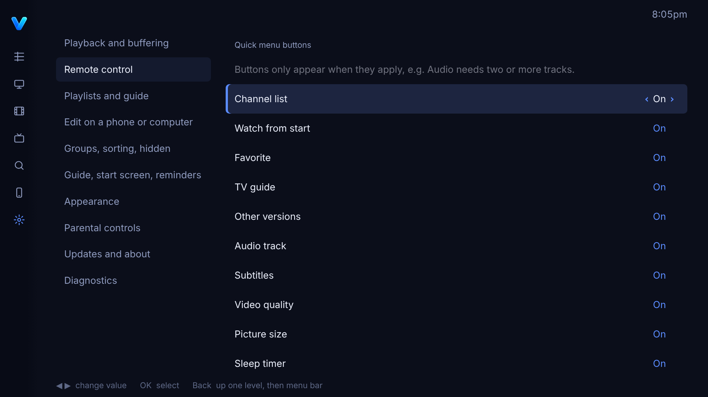</a>

### The guide

The guide is the home screen.  The channel you are on plays in the window at the top left, with the programme details beside it.

- **OK** on a channel previews it in the window.  **OK again** (or **▶ Play**) goes fullscreen.  If you prefer one press, set **Settings > Guide, start screen, reminders > OK on a channel in the Guide** to *Fullscreen right away*.
- **▶** moves forward in time; **◀** moves back, and on "now" it opens the groups.
- Programmes you can replay carry a **↺** catch-up mark.
- **OK** on a future programme sets a reminder; on a past catch-up programme it replays it.
- **Hold OK** opens: Watch fullscreen, Play in the window, Earlier programmes, Remind me, Jump to now, and Channel options (favorite, copy to group, hide, rename).

<a href="media/guide.mp4">Watch the MP4</a>

<b>More guide screenshots</b>

  
  

Guide options are under [Settings: Guide, start screen, reminders](#settings-guide-start-screen-reminders): two-line programmes, dimming past programmes, how "now" is marked, logos only or names too, and catch-up marks.  Where your playlist has the same channel more than once, a small quality tag (**FHD**, **HD**, **SD**, **4K**) tells the copies apart.

### Groups and the menu

Your groups sit right beside the guide: **Favorites** and your own groups first, then **All channels**, then your provider's groups.  Moving through the list updates the guide behind it.  **OK** or **▶** opens a group; **Hold OK** gives group options (rename, hide, sort, block).

**◀** or **Back** from the groups opens the menu: **Guide, Channels, Movies, Shows, Search, Edit on phone, Settings**.  Movies and Shows appear only when your provider has them.  **Edit on phone** isn't a screen: it turns on the [web editor](#turning-on-the-web-editor) and shows its QR code over whatever you're watching.

<a href="media/groups.mp4">Watch the MP4</a>

<b>Screenshots</b>

  
  

The **Channels** screen is the same list in TiviMate's classic layout: groups on the left, channels in the middle, the preview and details on the right.  Resting on a channel plays it in the preview (**Preview in channel list**); **OK** goes fullscreen.  Pick which screen opens first with **Start screen**.

  

### Watching fullscreen

- **▲ ▼** or **CH + / CH −** change channel.  An info bar shows the channel, what's on now and next, and how far into the programme you are.
- **▶** shows the full programme info.  **Yellow** jumps back to the last channel.  **Green** lays the guide over the video.
- **Green** (or **OK > Channel list**) lays the channel list over the video.  **OK** on another channel switches to it and keeps the list open so you can keep browsing; **OK** on the channel that's already playing closes the list.  **◀ ▶** change group.
- **OK** opens the **quick menu**: Channel list, From start (catch-up channels), Favorite, TV guide, Other versions (when the channel has them), Picture size, Multiview, Sleep timer, Stream info and Reconnect.  Pick which buttons appear under **Settings > Remote control > Quick menu buttons**.
- **Red** opens options for the channel: favorite, copy to group, other versions, watch from start, catch-up, rename, assign guide, hide, picture size and sleep timer.  **Hold OK** opens the channel list over the video.
- **Stream info** (quick menu) shows the channel, the player in use, the picture size, how much is buffered, the bitrate and catch-up.  **Sleep timer** stops playback after 15 minutes to 2 hours.  **Picture** sets Normal, Stretch or Zoom for this channel, or for all of them.

<a href="media/zap.mp4">Watch the MP4</a>

<b>Screenshots</b>

  
  
  
  

The options menu, stream info, sleep timer and picture size:

<a href="media/options.mp4">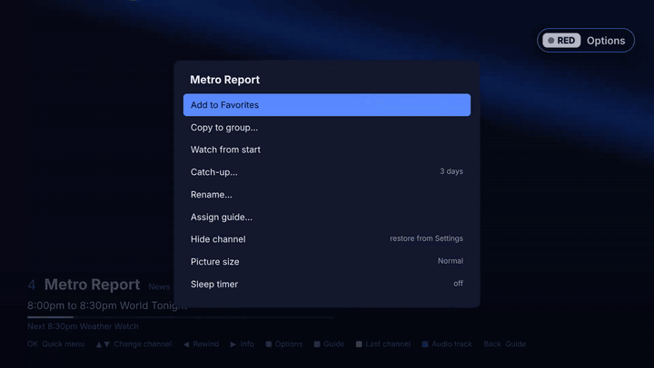</a>

<a href="media/options.mp4">Watch the MP4</a>

<b>Screenshots</b>

  
  
  
  <a href="screenshots/tv-picture.png">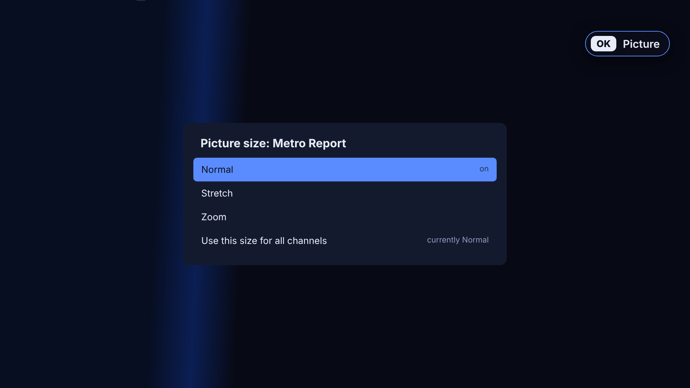</a>

**Smooth playback.**  TiviBro picks a player per stream (MPEG-TS, the TV's own player, or HLS) and falls back automatically if one struggles.  It watches for frozen pictures and reconnects on its own, with a short wait that grows between tries.  On a channel that keeps running dry it holds a bigger cushion before playing again (shown as *Buffering NN%*), and lets it shrink back once the stream settles.  It also rides out providers that jump their timestamps, briefly refuse connections, or send corrupted data.  If a provider is slow or your Wi-Fi is weak, try **Settings > Playback and buffering > Buffer profile**, or switch the **Stream format** between MPEG-TS and HLS.

It tries hard never to just stop:

- **Wi-Fi drops:** it waits for the network ("No network.  Waiting for it to come back") without using up its retries, and reconnects the moment the TV is back online.
- **A channel keeps failing:** it tries the TV's own player and the provider's HLS version of the channel, then keeps retrying with a message on screen (every 6 seconds for the first few minutes, then every 15, for up to 20 minutes), so a channel that comes back after a provider hiccup recovers by itself.
- **A channel stops working for good:** if your playlist has the same channel more than once (in another quality, another group, or a copy you hid), TiviBro switches to the next version and tells you, steadiest quality first: Full HD, HD, unmarked, 4K, then SD.  If every version fails, the provider itself is probably down, so it goes back to the channel you chose and keeps retrying.  Set this under **Settings > Playback and buffering > When a channel stops working**: switch by itself, ask you, or just keep retrying.  More in [Other versions of a channel](#other-versions-of-a-channel).
- **A channel never starts:** after a couple of quick retries it says plainly whether the provider is refusing it or the TV can't decode it.  **OK** tries again.
- **Paused live TV:** a short pause carries on where you left off.  After a long pause TiviBro lets the connection go (the provider would drop it anyway) and **Play** brings you back to live.
- **Movies and catch-up** pick up from the same spot after a dropped connection, and when you leave TiviBro (Home button, another input) and come back.

**HDR, Dolby Vision and sound formats.**  TiviBro reads what each stream is before the picture starts: from the HLS playlist, from the MPEG-TS stream, or for movies from your provider's details.  The info panel shows it, for example *4K  HEVC  Dolby Vision 8  E-AC-3 5.1*, and movie details show it before you press play.

- **Dolby Vision** plays through the TV's own player, which switches the screen into Dolby Vision itself.
- **HDR10 and HLG** stay on TiviBro's built-in player by default, for its steadier buffering.  If HDR pictures look grey or washed out, set **Settings > Playback and buffering > HDR and Dolby Vision** to *TV player for all HDR*.
- **HEVC, AV1, AAC, Dolby Digital (AC-3) and Dolby Digital Plus (E-AC-3, Atmos)** play on webOS 6 and later TVs.  Anything the built-in player can't decode moves to the TV's player automatically.
- **DTS:** LG TVs from 2020, 2021 and 2022 (including the C1 and C2) can't play DTS sound.  TiviBro warns you when a movie only has DTS, so pick another audio track under **Options** if there is one.
- **Settings > Diagnostics > What this TV can play** lists every format and which player handles it on your TV.

### Other versions of a channel

Many playlists carry the same channel several times: in Full HD, HD and SD, in two groups, or as a backup copy.  TiviBro recognises them by name and treats them as versions of one channel.

- Lists and the guide show a quality tag (**FHD**, **HD**, **SD**, **4K**) beside each copy.
- **Other versions…** (**Hold OK** on a channel, or the **Red** options while watching) lists the other copies with their quality and group, hidden copies included.  The quick menu has an **Other versions** button too.  **OK** switches to one.
- **When a channel stops working,** TiviBro switches to the next version by itself and says so ("Nova News 24 isn't working.  Switched to Nova News 24 (HD)"), steadiest quality first: Full HD, HD, unmarked, 4K, then SD.  This only happens once the player has run out of retries, so a short hiccup never moves you.  If every version fails, the provider itself is probably down: TiviBro goes back to the channel you chose and keeps retrying until it returns.
- **Settings > Playback and buffering > When a channel stops working** chooses between switching by itself, asking you first, or just retrying.

<a href="media/versions.mp4">Watch the MP4</a>

  
  
  

### Event channels: pay-per-view and sports passes

Pay-per-view, league passes (NFL, NBA, NHL, MLB), college sports and one-off match channels often have no guide at all.  The provider writes the whole listing into the channel name instead: "NCAAB 001 | NORTH FLORIDA @ CHARLESTON SOUTHERN (M) | 12.18 11:00 AM | ESPN+".  That is long, gets cut off, and is hard to read in a list.

TiviBro reads those names:

- **Short channel names.**  The list shows the channel's own tag, "NCAAB 001", "PPV 03", "BigTen 01" or "ESPN+ 20", with the event on the line under it.
- **The event in the guide, at its time.**  Before it starts the guide says **Starts 7:30 PM: Kings vs Pelicans** (or **Starts Sat 9:00 PM** later in the week); during it, the matchup; for a few hours after, **Ended:**.  The info panel shows the details (league, sport, network) and the full original name.  A real guide for the channel always wins.
- **Events by time,** a group at the top of the list with every event channel that is on now or starts in the next two weeks, soonest first: what's on next, across all your passes, in one place.  **Hold OK** on it to turn it off.
- **Times are converted to your TV's time.**  Names that say ET, EDT, PT, CT, MT, UK, GMT, BST or CET are read in that zone ("2:00AM UK/9:00PM ET" uses the ET one), with daylight saving.  Names without a zone are read in the provider's time zone, or the one you pick in **Settings > Playlists and guide > the playlist > Event channels**.

It understands the usual ways providers write these: "Oct 29 7:30 PM", "Sat 15th Aug 8:00PM", "Saturday, 31 October 2026 12:30", "12.18 11:00 AM", "14/08", "2026-02-08 10:40", a time on its own for today, and a time between two teams ("Stoke City 15:00 Swansea City").  On a real provider it read 1,250 event channels this way.  Your own channel names (**Rename**) always win.

  
  

### Catch-up

Channels marked **↺** keep recent programmes on your provider's servers.

1. In the guide, press **⏪** (or **◀** past "now") to go back in time.
2. **OK** on a past programme replays it from the start.  **Hold OK** for more choices, including **Earlier programmes…** for a list by day.
3. While replaying: **◀ ▶** skip 30 seconds (keep pressing and each press jumps further), **▲ ▼** skip 5 minutes, **⏪ ⏩** jump further, **❙❙** pauses, and **Yellow** or **Back** returns to live.

From live TV, **From start** in the quick menu restarts the current programme.  Step sizes are under **Settings > Playback and buffering > Catch-up, movies and shows**.

<a href="media/catchup.mp4">Watch the MP4</a>

<b>Screenshots</b>

  
  
  

### Movies and shows

If your Xtream provider offers video on demand, **Movies** and **Shows** appear in the menu.

- Categories on the left (**Continue watching**, **My list**, **All movies**, then your provider's), titles in the middle, details and poster on the right.
- **OK** plays a movie or opens a show's seasons and episodes.  **Hold OK** adds a title to **My list**.
- **Info** or **Hold OK** opens a title's options.  **CH + / CH −** page through long category lists.
- While watching, **◀ ▶** skip 30 seconds.  Keep pressing and each press jumps further (twice, four, then eight times as far); the info panel shows where you'll land and when the movie will end, and playback jumps there once you stop pressing.  **Back** cancels a jump you haven't landed yet.  **▲ ▼** skip 10 minutes.
- TiviBro remembers where you stopped and offers to resume.  The next episode can start by itself (**Play next episode automatically**).

<a href="media/vod.mp4">Watch the MP4</a>

<b>Screenshots</b>

  
  

### Search

**Search** in the menu finds channels, programmes in the guide (now, later and on catch-up), movies and shows as you type.  **OK** watches, replays or sets a reminder depending on the result; **Hold OK** gives channel options.

<a href="media/search.mp4">Watch the MP4</a>

  

### Multiview

**Blue** while watching (or **Multiview** in the quick menu) puts two channels side by side, or four if your TV can handle it (**Settings > Playback and buffering > Multiview**).

- **OK** on an empty screen picks a channel; on a playing screen it goes fullscreen with that channel.
- The focused screen has the sound.  Move with the arrows.
- **Red** adds, changes or removes a screen.  **Back** leaves multiview.

Many webOS TVs can decode only two streams at once, and some providers limit connections, so two screens is the safe default.

<a href="media/multiview.mp4">Watch the MP4</a>

  

### Favorites, hiding and your own groups

**Hold OK** on any channel (in the guide, the channel list or fullscreen with **Red**):

- **Add to Favorites** puts it in Favorites.
- **Select multiple…** (in the channel list) lets you copy, favorite or hide several channels at once.
- **Copy to group** adds it to one of your own groups (make one under **Settings > Groups, sorting, hidden > New group…**).
- **Hide channel** removes it from the lists.  Hidden items come back from **Settings > Groups, sorting, hidden**, or show them dimmed with **Show hidden items in lists**.
- **Rename…** and **Assign guide…** fix a name or a missing guide for that one channel.
- **Other versions…** lists the same channel in its other qualities and copies, hidden ones included, to switch to one directly.

**Manage groups** in Settings shows every group in one list to switch on or off, like TiviMate.  For hundreds of groups the [web editor](#groups-and-channels) is much faster.  Sorting, the Recent and Favorites groups, and getting hidden items back are in [Settings: Groups, sorting, hidden](#settings-groups-sorting-hidden).

<a href="media/channels.mp4">Watch the MP4</a>

  
  <a href="screenshots/tv-copy-to-group.png">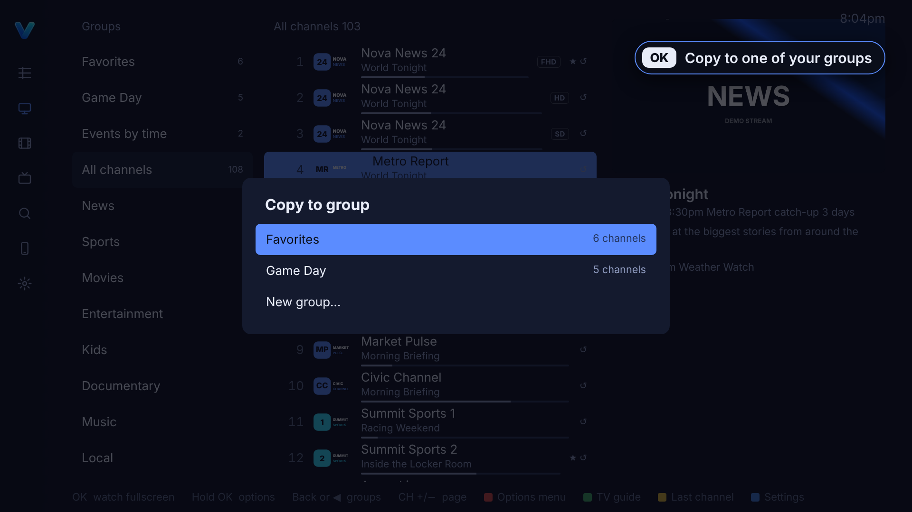</a>
  <a href="screenshots/tv-set-manage-groups.png">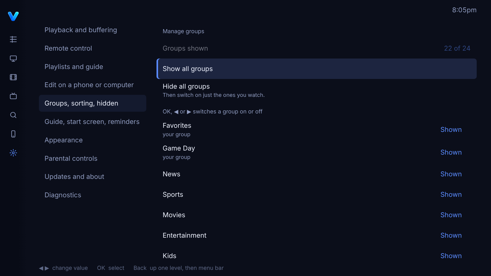</a>

### Reminders

**OK** (or **Hold OK > Remind me**) on a future programme in the guide or in search.  When it starts, TiviBro asks **Watch** or **Dismiss**, or switches by itself if you set **When a reminder starts** that way.  You can be reminded a few minutes early.  Timing and behaviour are under [Settings: Guide, start screen, reminders](#settings-guide-start-screen-reminders), which also lists your reminders (**OK** removes one).

<a href="media/reminders.mp4">Watch the MP4</a>

  
  

### Settings

**Blue** in the guide, or **Settings** in the menu.  On a row with a choice, the focused row shows **‹ ›**: **◀ ▶** change it.  Colour rows show a swatch of the colour.  Every option is explained, with its default, in [Every setting](#every-setting).  The sections:

| Section | What's in it |
|---|---|
| [**Playback and buffering**](#settings-playback-and-buffering) | Buffer profile, player engine, MPEG-TS or HLS, network helper, HDR and Dolby Vision, picture size, catch-up skip steps, info panel when switching, subtitles, next episode, multiview screens |
| [**Remote control**](#settings-remote-control) | Remap buttons in the player and lists, quick menu buttons, learn a button, button tester |
| [**Playlists and guide**](#settings-playlists-and-guide) | Add and switch playlists, reload schedules, User-Agent, provider guide mode and offset, extra guide sources, channel name editor, subscription expiry and connections |
| [**Groups, sorting, hidden**](#settings-groups-sorting-hidden) | Manage groups, sort orders, your groups first, Recent and Favorites, new groups, hidden groups and channels |
| [**Guide, start screen, reminders**](#settings-guide-start-screen-reminders) | Start screen, OK in the guide, guide layout, catch-up marks, reminders |
| [**Appearance**](#settings-appearance) | Accent color (twelve presets or your own from a hue and brightness), background (Midnight, Black OLED, Slate, Ocean, Forest, Plum, Mocha, High contrast, Classic), focus style (add a white outline to whatever is selected), text size, panel transparency, logos, clock, channel numbers |
| [**Parental controls**](#settings-parental-controls) | PIN, what it protects, blocked groups and channels |
| [**Edit on a phone or computer**](#settings-edit-on-a-phone-or-computer) | The web editor switch, its address and password |
| [**Updates and about**](#settings-updates-and-about) | Your version, check for updates, install an update (rooted TVs), what's new, automatic checks, test versions |
| [**Diagnostics**](#settings-diagnostics) | Connection test, app and helper logs, detailed logging, what this TV can play, what's playing now, status |

<a href="media/settings.mp4">Watch the MP4</a>

<b>Screenshots</b>

  
  

### Updates

**Settings > Updates and about** shows your version and checks GitHub for a newer one.  TiviBro also checks by itself once a day and shows a short note when there is an update; nothing is installed without you.

- **Install** (rooted TVs with the Homebrew Channel): downloads the new version, checks its fingerprint, installs it, and restarts TiviBro with all your settings.
- **What's new** lists the changes in that version.
- **Include test versions** also offers alpha and beta builds.  It is on when you are running one.
- On TVs that aren't rooted, the page tells you the new version is out; install it from a computer as before.

  

### Parental controls

Set a PIN under **Settings > Parental controls**, then **Hold OK** on any channel or group and choose **Block channel** (or block a whole group from its options).  Decide whether the PIN guards blocked channels, Settings, or both, and whether it stays unlocked until TiviBro restarts.  **Lock now** locks it again straight away.  Blocked channels show **Locked** instead of their programme, and blocking the channel that's playing stops it.  All options: [Settings: Parental controls](#settings-parental-controls).

<a href="media/parental.mp4">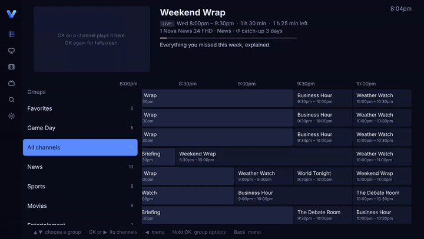</a>

<a href="media/parental.mp4">Watch the MP4</a>

  
  

---

## Every setting

Every option in **Settings**, section by section, with its choices and what it does.  The default is in **bold**.  Changes take effect straight away; nothing needs a restart.

On a row with a choice, **◀ ▶** change it (with the Magic Remote, click the **‹ ›** arrows).  **OK** opens a row that leads to a page (marked **›**) or runs an action.  **Back** goes up a page, then to the section list, then to the menu.

### Settings: Playback and buffering

How channels start, how much video TiviBro holds, which player it uses, and what it does when a stream struggles.

  
  <a href="screenshots/tv-set-playback-2.png">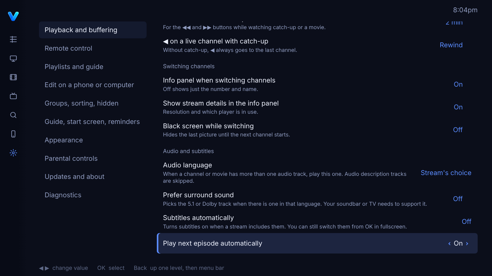</a>

| Setting | Choices | What it does |
|---|---|---|
| **Buffer profile** | Fast zapping · **Balanced** · Smooth · Rock solid · Custom | How much video is held before a channel starts and while it plays.  More buffer rides out a shaky provider or Wi-Fi; less starts channels sooner.  The profiles: *Fast zapping* starts at 0.5 s and reads 10 s ahead; *Balanced* 2 s and 30 s; *Smooth* 4 s and 45 s; *Rock solid* 8 s and 60 s.  Bigger profiles also wait longer before treating a frozen picture as stuck, and retry more times.  Previews in the guide window always start quickly; the full profile applies in fullscreen. |
| **Profile details** | (information) | What the chosen profile does: how much it buffers before starting, how far it reads ahead, and the level it refills to after running dry. |
| **Start-up buffer** *(Custom only)* | 0.5 s to 15 s, **3 s** | Seconds of video buffered before a channel starts playing. |
| **Read-ahead** *(Custom only)* | 10 s to 120 s, **30 s** | How far ahead the player downloads while playing. |
| **Keep behind playhead** *(Custom only)* | 2 s to 30 s, **8 s** | Video kept behind what you are watching.  Lower saves TV memory on long sessions. |
| **Freeze detection** *(Custom only)* | 3 s to 20 s, **6 s** | How long a frozen picture is tolerated before the player recovers it. |
| **Reconnect attempts** *(Custom only)* | 3 to 50, **8** | Tries before the player gives up on a channel.  The count starts again after 30 seconds of clean playback. |
| **Player engine** | **Automatic** · Built-in demuxer · TV player | *Automatic* uses TiviBro's built-in player (fine buffer control, steady on sloppy streams) and moves to the TV's own player when a server blocks it or the stream needs it.  *TV player* uses the least CPU but ignores the buffer settings.  Every choice decodes in the TV's hardware. |
| **Stream format** *(Xtream playlists)* | **MPEG-TS** · HLS | MPEG-TS usually switches channels faster.  HLS copes better with a weak connection and some providers prefer it. |
| **Connection** | **Automatic (recommended)** · Direct | *Automatic* sends provider requests through the [network helper](#what-is-the-network-helper), which webOS needs for most providers (it adds the headers the TV insists on, unzips guides, and works around sloppy servers).  *Direct* only works with servers that allow app requests. |
| **Network helper** | (information) | Whether the helper is running.  **Settings > Diagnostics** shows its port and its log. |
| **Buffer meter** | **When low** · Always · Off | A small gauge in fullscreen showing how many seconds of video are banked. |
| **Preview in channel list** | **On** · Off | Plays the channel you rest on in the Channels screen.  Turn it off on very slow TVs for the snappiest list. |
| **When a channel stops working** | **Switch to another version** · Ask me · Keep retrying | When a channel has run out of retries and your playlist has it more than once (another quality, another group, or a copy you hid), TiviBro switches to the next version, steadiest first: Full HD, HD, unmarked, 4K, then SD.  *Ask me* asks before switching.  See [Other versions of a channel](#other-versions-of-a-channel). |
| **Turn on last channel at launch** | **On** · Off | Starts the channel you watched last when TiviBro opens. |
| **HDR and Dolby Vision** | **Automatic** · TV player for all HDR · Built-in player | *Automatic* plays Dolby Vision through the TV player (which switches the screen into Dolby Vision itself) and keeps HDR10 and HLG on the built-in player for steadier buffering.  Pick *TV player for all HDR* if HDR pictures look grey or washed out. |
| **Picture** | **Normal** · Stretch · Zoom | Picture size for every channel.  A single channel can have its own size from the quick menu (**Picture**). |
| **Skip step** | 10 s · 15 s · **30 s** · 1 min · 2 min | How far **◀ ▶** jump while watching catch-up or a movie.  Pressing again quickly jumps further each time. |
| **Rewind / fast forward step** | 30 s · 1 min · **2 min** · 5 min · 10 min | How far **⏪ ⏩** jump while watching catch-up or a movie. |
| **◀ on a live channel with catch-up** | **Rewind** · Last channel | On a catch-up channel, **◀** rewinds into the current programme.  Without catch-up, **◀** always goes to the last channel. |
| **Info panel when switching channels** | **On** · Off | Off shows just the channel number and name when you change channel. |
| **Show stream details in the info panel** | **On** · Off | Adds the resolution, codecs and which player is in use. |
| **Black screen while switching** | On · **Off** | Hides the last picture until the next channel starts, instead of leaving it frozen. |
| **Subtitles on automatically** | On · **Off** | Turns subtitles on when a stream has them.  You can still switch them from the quick menu. |
| **Play next episode automatically** | **On** · Off | When an episode ends, the next one starts. |
| **Screens** *(Multiview)* | **Up to 2** · Up to 4 | How many channels multiview can show.  Many webOS TVs decode only two streams at once, and providers often limit connections. |

### Settings: Remote control

Remap any button, choose the quick menu's buttons, and teach TiviBro keys it doesn't know.

  <a href="screenshots/tv-set-remote.png">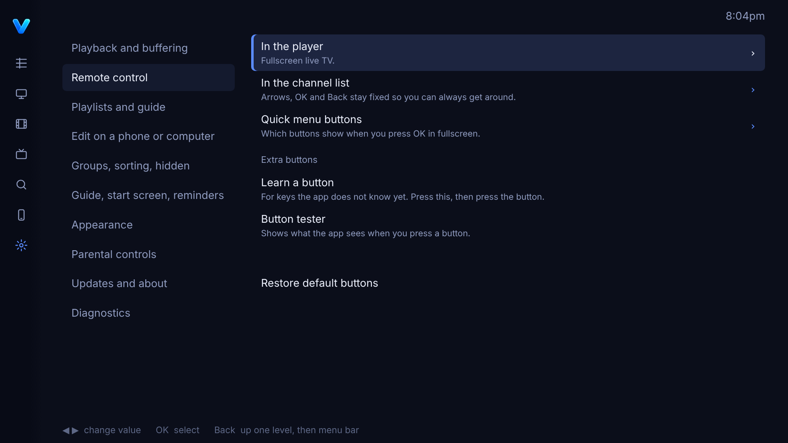</a>
  
  

| Setting | What it does |
|---|---|
| **In the player ›** | What each button does while watching live TV fullscreen.  Every button has a press and a **Hold** action.  **OK** opens a list of actions to pick from. |
| **In the channel list ›** | The same for the guide and the Channels screen.  Arrows, **OK**, **Back** and **CH + / −** stay fixed there so you can always get around. |
| **Quick menu buttons ›** | Switch each quick menu button on or off: Channel list, Watch from start, Favorite, TV guide, Other versions, Audio track, Subtitles, Video quality, Picture size, Multiview, Sleep timer, Stream info, Reconnect.  All are on by default; a button only appears when it applies (Audio needs two or more tracks, for example). |
| **Learn a button** | For keys TiviBro doesn't know yet (some LG remotes have extras).  Press this, then the button; it then appears in the two button pages to assign. |
| **Button tester** | Shows the key code the TV sends for the next button you press, and what it does in TiviBro. |
| **Restore default buttons** | Puts every button back the way it came.  Each button page also has **Restore defaults for this screen**. |

The buttons and their defaults:

| Button | In the player | In the channel list |
|---|---|---|
| **OK** | Quick menu | (fixed) |
| **Hold OK** | Channel list over the video | Options menu |
| **▲ ▼** | Previous / next channel | (fixed) |
| **◀** | Rewind (catch-up), else last channel | (fixed) |
| **▶** | Show info panel | (fixed) |
| **CH + / CH −** | Next / previous channel | (fixed) |
| **Red** | Options menu | Options menu |
| **Green** | TV guide | TV guide |
| **Yellow** | Last channel | Last channel |
| **Blue** | Multiview | Settings |
| **Play / Pause** | Play / pause | Nothing |
| **Stop** | Leave fullscreen | Nothing |
| **⏪ Rewind** | Rewind (catch-up), else last channel | Nothing |
| **⏩ Fast forward** | Nothing | Nothing |
| **Info** | Show info panel | Options menu |
| **Back** | (fixed: leaves fullscreen) | (fixed) |

Actions you can give a button in the player: nothing, quick menu, channel list over the video, info panel, options menu, next, previous or last channel, rewind, watch from start, play/pause, TV guide, search, Settings, leave fullscreen, add or remove favorite, open Favorites, open Recent channels, multiview, change picture mode, audio track, sleep timer and reconnect.  In the channel list: nothing, options menu, last channel, TV guide, search, Settings, favorite, open Favorites, open Recent channels, Movies, Shows and play/pause.  Catch-up and movie playback keep fixed seek buttons so they always behave the same.

### Settings: Playlists and guide

Your playlists, how often they reload, and where the programme guide comes from.  **OK** on a playlist opens its page.

  <a href="screenshots/tv-set-playlists.png">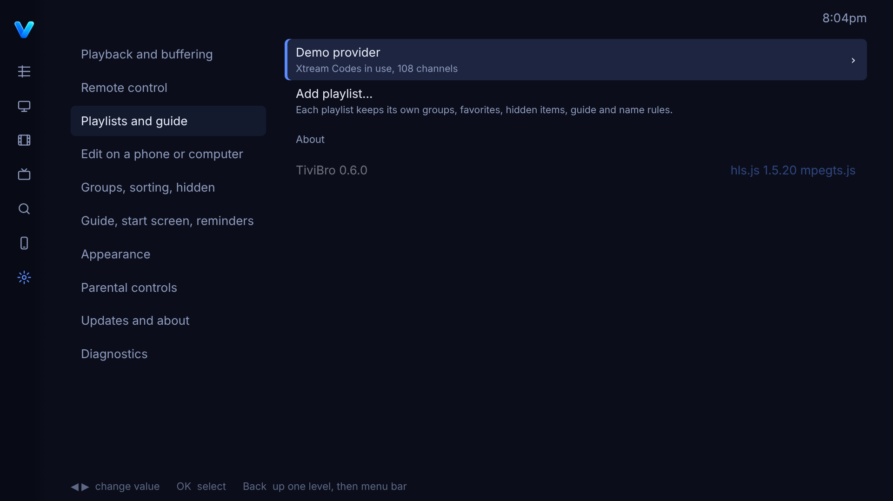</a>
  
  <a href="screenshots/tv-set-playlist-2.png">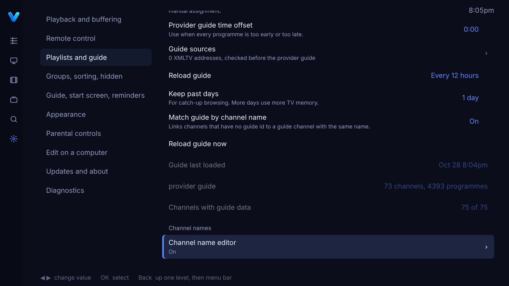</a>

| Setting | Choices | What it does |
|---|---|---|
| *(each playlist)* | | Its name and type, and for the one in use, how many channels it has.  **OK** opens its page (below). |
| **Add playlist…** | | Opens the setup screen for another Xtream Codes or M3U playlist.  Each playlist keeps its own groups, favorites, hidden items, guide and name rules. |

On a playlist's page:

| Setting | Choices | What it does |
|---|---|---|
| **Use this playlist** | | Switches the TV to this playlist (shown when it isn't the one in use). |
| **Name** | | The name shown in Settings and the web editor. |
| **Connection** | | Server, username and password (or the M3U address).  Opens the setup screen, which tests the login before saving. |
| **User-Agent** | **Default** or your own | Only if your provider asks for a specific one (TiviMate's "User-Agent" setting).  The network helper sends it for this playlist. |
| **Reload channel list** | Every app start · Every 6 hours · **Every 12 hours** · Every day · Every 2 days · Every week · Only when I ask | How often the channel list is fetched again.  Your groups, renames and hidden items are always kept. |
| **Reload channels now** | | Fetches the channel list right away. |
| **Last reloaded**, **Subscription expires**, **Connections allowed** | (information) | From your provider, when it reports them. |
| **Provider guide** | Xtream: **Per channel** · Full XMLTV file · Off.  M3U: **From playlist** · Off | *Per channel* asks for each channel's programmes as you browse: light and fast.  *Full XMLTV file* downloads the provider's whole guide: days ahead, guide search and manual matching, but often 20 to 200 MB.  *Off* uses only your own guide sources. |
| **Provider guide time offset** | −12:00 to +12:00 in half hours, **0:00** | Use it when every programme from the provider guide is too early or too late. |
| **Guide sources ›** | | Extra XMLTV guides (`.xml` or `.xml.gz`), checked before the provider guide.  **OK** on one to edit its address, give it its own time offset, move it up or down (the first one wins when two cover a channel) or remove it.  **Add guide source…** adds one.  The [web editor](#the-programme-guide) has a list of free guides by region. |
| **Reload guide** | Same choices as the channel list, **Every 12 hours** | How often the guide is downloaded again. |
| **Keep past days** | 1 · **2** · 3 · 5 · 7 days | How far back the guide keeps programmes, for catch-up browsing.  More days use more TV memory. |
| **Match guide by channel name** | **On** · Off | Links channels that have no guide id to a guide channel with the same name. |
| **Reload guide now** | | Downloads the guide right away. |
| **Guide last loaded**, each source, **Channels with guide data** | (information) | When the guide loaded, how many channels and programmes each source gave, and how many of your channels have a guide. |
| **Assign guide to channels without one** | | Lists channels with no guide; pick one and search the guide for the right channel.  Also on any channel: **Hold OK > Assign guide…**. |
| **Set-up tour** *(playlist in use)* | | Runs the [set-up tour](#the-set-up-tour) again: countries, names, East or West, your city, event channels, clutter, logos and look.  Shows when you last applied it. |
| **Channel name editor ›** | | Cleans up channel names (below). |
| **Event channels ›** | | Reads pay-per-view and sports pass channels whose names carry the event and time (below). |
| **Delete this playlist** | | Removes the playlist with its groups, favorites, hidden items and cached data.  Shown when you have more than one. |

**Channel name editor.**  Rules that strip clutter from every name at once.  Your provider's names are never changed: switch a rule off and the original comes back.  Names you set by hand stay.

| Setting | Default | What it does |
|---|---|---|
| **Clean up channel names** | **On** | The master switch.  Off shows the original names. |
| **Hide channels with nothing on** | Off | Event channels the provider names "Off Air", "Offline" or "No Event Scheduled" between events stay out of the lists while they say so, and come back by themselves when an event is named on them.  Favorites keep theirs.  Works even with name clean-up off. |
| **Clean group names too** | **On** | Turns "USA \| Sports" into "Sports" in the group list. |
| **Enable recommended defaults** / **Turn all default rules off** | | Set every built-in rule at once.  Your own lists are kept. |
| **Country and region prefixes** | **On** | "USA \| ESPN" → "ESPN", "\|UK\| BBC One" → "BBC One", "CA: TSN 1" → "TSN 1", "UK◈ Sky Store" → "Sky Store".  About 250 country, region and language codes (CAR, ARG, CO, CA-FR, AFG, PK and so on), with any separator: \| : - • » ◈ ▶. |
| **Category and package prefixes** | **On** | "VIP \| AMC" → "AMC", "24/7 - Friends" → "Friends", "SPORTS: TNT" → "TNT", "DEP \| TUDN 01" → "TUDN 01".  Also Spanish ones (Deportes, Cine, Noticias, Infantil, Novelas) and package words like Gold or Max. |
| **Quality and format tags at the end** | **On** | "CNN FHD" → "CNN", "Nat Geo (1080p)" → "Nat Geo", "AMC \| RAW" → "AMC". |
| **Decorative symbols** | **On** | "Fox News ᴴᴰ" → "Fox News", "TNT ★" → "TNT", "⚽ EPL 1" → "EPL 1", "⫘⫘⫘ UK ⫘⫘⫘" → "UK", "Event 2026™: Final" → "Event 2026: Final", "EL NUEVE SD \*" → "EL NUEVE".  Emoji, sport symbols, circled letters, arrows and shapes. |
| **Time zone feeds** | Off | "HBO (East)" → "HBO", "Starz West" → "Starz".  Off by default because East and West feeds would end up with the same name. |
| **Any short bracketed tag at the ends** | Off | "[EN] Sky News" → "Sky News", "AMC (Backup)" → "AMC".  Off by default because it can remove useful text like "(Sports)". |
| **Free streaming service prefixes** | Off | "Pluto US \| CNN Headlines" → "CNN Headlines", "TUBI \| ION" → "ION", "Samsung TV Plus: Bob Ross" → "Bob Ross".  Pluto, Tubi, Plex, Samsung TV Plus, Roku, Xumo, Stirr, Distro, Local Now, LG Channels and more.  Off by default because a Pluto or Tubi copy then looks like the real channel. |
| **Country codes and names at the end** | Off | "CANAL 4 PAN" → "CANAL 4", "BEIN SPORTS 5 (USA)" → "BEIN SPORTS 5", "TN (Argentina)" → "TN".  Off by default because channels from different countries can end up with the same name. |
| **Status notes at the end** | Off | "FloHockey 39 - Off Air" → "FloHockey 39", "PPV 07 \| OFFLINE" → "PPV 07".  Off by default because the note tells you nothing is on; **Hide channels with nothing on** hides those channels instead. |
| **Your prefixes** / **Your suffixes** | empty | Your own text to remove from the start or end of names, any capitalisation.  Spaces count (shown as ·), so " HD" won't touch "WHD".  **Paste a comma separated list…** takes TiviMate's format, for example `US: , UK: , NOW \| `. |
| **Preview** | | Names from your channels before and after, the ones that change first. |

**Event channels.**  For pay-per-view, league passes and one-off games whose name carries the matchup, date and time (see [Event channels](#event-channels-pay-per-view-and-sports-passes)).

| Setting | Default | What it does |
|---|---|---|
| **Read events from channel names** | **On** | Shows the event from the name in the guide at its time, with "Starts 7:30 PM" before it and "Ended" after.  A real guide for the channel always wins. |
| **Short channel names** | **On** | "NCAAB 001 \| NORTH FLORIDA @ CHARLESTON SOUTHERN (M) \| 12.18 11:00 AM" shows as "NCAAB 001", with the game on the line under it. |
| **Events by time** | **On** | A group with every event channel that is on now or starts in the next two weeks, soonest first. |
| **Times with no time zone are in** | **The provider's time zone** | For names without ET, PT, UK and so on.  US Eastern, Central, Mountain or Pacific, UK, Central Europe, UTC, or this TV's time.  Times always show in the TV's own time. |
| *(list)* | | How many event channels the playlist has, and the next few events. |

### Settings: Groups, sorting, hidden

Which groups show, in what order, and getting hidden things back.

  
  <a href="screenshots/tv-set-groups-2.png">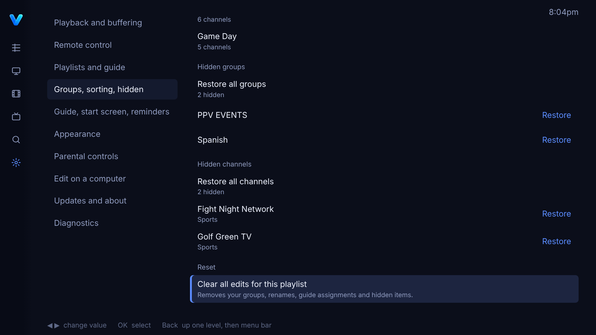</a>
  

| Setting | Choices | What it does |
|---|---|---|
| **Manage groups ›** | | Every group in one list, like TiviMate: **OK**, **◀** or **▶** switches a group on or off.  **Show all groups** and **Hide all groups** at the top (hide all, then switch on just the ones you watch).  For hundreds of groups the [web editor](#groups-and-channels) is faster. |
| **Show hidden items in lists** | On · **Off** | Hidden groups and channels appear dimmed, so you can unhide them from their own options. |
| **Channel order** | **Playlist order** · Channel number · Name · Most watched | For provider groups and All channels.  Your own groups keep the order you set. |
| **Group order** | **Playlist order** · Name | Groups you moved by hand stay where you put them. |
| **Your groups first** | **On** · Off | Favorites and your own groups above the provider's groups. |
| **Show All channels** | **On** · Off | The All channels group. |
| **Show Recent channels** | **On** · Off | A group with the channels you watched lately. |
| **Recent channels kept** | 10 · **20** · 30 · 50 | How many channels Recent remembers. |
| **Show Favorites group** | **On** · Off | The Favorites group. |
| **Groups your provider adds later** | **Show them** · Hide them | *Hide them* keeps a tidy list tidy after **Hide all groups**: new provider groups arrive hidden. |
| **All channels includes hidden groups** | On · **Off** | Channels from groups you hid still appear in All channels. |
| **Reset watch time** | | Clears the statistics behind *Most watched*. |
| **New group…** | | Creates one of your own groups.  Then **Hold OK** on any channel and choose **Copy to group…**. |
| *(each of your groups)* | | **OK** for Rename, Move up, Move down, Empty this group and Delete group (Favorites can't be renamed or deleted). |
| **Hidden groups**, **Hidden channels** | | Everything you hid, with **Restore** on each and **Restore all**. |
| **Clear all edits for this playlist** | | Removes your groups, renames, guide assignments and hidden items for this playlist.  It asks first. |

### Settings: Guide, start screen, reminders

How the guide looks and behaves, which screen TiviBro opens on, and reminders.

  
  <a href="screenshots/tv-set-guide-2.png">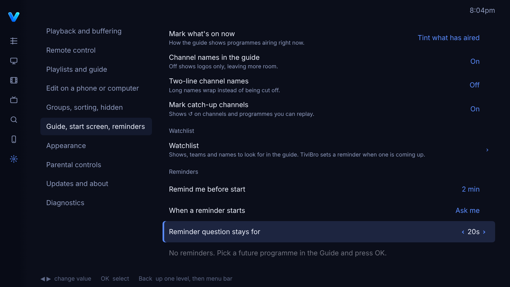</a>

| Setting | Choices | What it does |
|---|---|---|
| **Start screen** | **Guide** · Channels list | What TiviBro opens on, and where **Back** from other screens leads. |
| **OK on a channel in the Guide** | **Preview first, then fullscreen** · Fullscreen right away | Like TiviMate: the first **OK** plays the channel in the window, the second goes fullscreen.  Or go straight to fullscreen. |
| **Two-line programmes** | **On** · Off | Each programme's time under its title in the grid. |
| **Dim past programmes** | **On** · Off | Programmes that already ended look dimmer. |
| **Mark what's on now** | **Progress fill** · Colour · Off | How the guide shows programmes airing right now: a fill showing how far along they are, a colour, or nothing. |
| **Channel names in the guide** | **On** · Off | Off shows logos only, leaving more room for programmes. |
| **Two-line channel names** | On · **Off** | Long channel names wrap instead of being cut off. |
| **Mark catch-up channels** | **On** · Off | Shows **↺** on channels and programmes you can replay. |
| **Remind me before start** | At start · 1 min · **2 min** · 5 min · 10 min | How early a reminder comes up. |
| **When a reminder starts** | **Ask me** · Switch to the channel | *Ask me* shows **Watch** or **Dismiss**; *Switch* changes channel by itself. |
| **Reminder question stays for** | 10 s · **20 s** · 30 s · 1 min | How long the reminder waits for an answer. |
| *(each reminder)* | | Your reminders by time.  **OK** removes one. |

### Settings: Appearance

Colours, sizes and what's on screen.  Every change shows straight away.

  
  

| Setting | Choices | What it does |
|---|---|---|
| **Accent color** | **Electric blue** · Cyan · Violet · Lavender · Pink · Mint · Teal · Lime · Amber · Ember · Red · White · Custom | The colour of whatever is focused, and of progress bars.  A swatch shows it beside the name. |
| **Custom hue** *(Custom only)* | 0° to 350°, **210°** | Around the colour wheel: red, yellow, green, cyan, blue, magenta. |
| **Custom brightness** *(Custom only)* | Deep · Rich · **Normal** · Light · Pastel | How light the custom accent is. |
| **Background** | **Midnight** · Black (OLED) · Slate · Ocean · Forest · Plum · Mocha · High contrast · Classic (1.0) | The whole palette behind everything.  *Black* is true black for OLED TVs; *High contrast* is the easiest to read. |
| **Focus style** | **Filled** · Filled with outline | The outline adds a white ring to whatever is selected, easier to spot from across the room. |
| **Text size** | Small · **Medium** · Large | In the guide and channel lists. |
| **Panels over video** | Solid · **Normal** · See-through | How see-through the info panel, quick menu and channel list are in fullscreen. |
| **Channel logos** | **From the playlist** · From the guide | Which logo to use when both have one. |
| **Logo library** | **Off** · Fill in missing logos · Use for every channel it knows | Logos from iptv-org and tv-logos for channels with none, or for every channel.  See [Channel logos](#channel-logos).  The set-up tour offers *Fill in missing logos*. |
| **Logo library style** *(library on)* | **Matching set** · Original logos | One style for dark screens (tv-logos), or each channel's own logo (iptv-org).  Each falls back to the other. |
| **Logo library status** *(library on)* | | How many names it has, and for which countries. |
| **Show clock** | **On** · Off | The clock in the top right corner. |
| **Show the date with the clock** | On · **Off** | Adds the date beside the time. |
| **Show channel numbers** | **On** · Off | Numbers beside channel names in lists and the guide. |
| **Info panel stays for** | 3 s · **5 s** · 8 s · 12 s | How long the info panel stays up in fullscreen. |
| **Press Back twice to exit** | **On** · Off | Back to the groups on the home screen (or the first screen) shows **Press Back again to exit**; a second **Back** closes TiviBro.  Off: Back on the menu bar closes it at once. |

### Settings: Parental controls

A 4-digit PIN for blocked channels and groups, and optionally for Settings.  See [Parental controls](#parental-controls) for blocking.

  <a href="screenshots/tv-set-parental.png">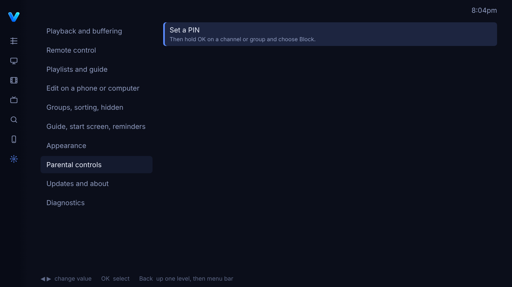</a>
  

| Setting | Choices | What it does |
|---|---|---|
| **Set a PIN** / **Change PIN** | | Choose a 4-digit PIN (typed twice).  Changing it asks for the current one first.  Type with the number keys, or pick each digit with **▲ ▼**. |
| **PIN required for** | **Blocked channels** · Settings · Both | What the PIN guards. |
| **Stay unlocked until the app restarts** | **On** · Off | On: after the PIN once, it isn't asked again until TiviBro restarts.  Off: asked every time. |
| **Lock now** | | Locks again straight away. |
| **Blocked in this playlist** | | Every blocked group and channel.  **OK** unblocks one. |
| **Remove PIN** | | Turns parental controls off (asks for the PIN). |

Five wrong PINs in a row lock the PIN for 30 seconds.

### Settings: Edit on a phone or computer

The [web editor](#turning-on-the-web-editor): organise groups and channels from a browser on your computer, phone or tablet.

  <a href="screenshots/tv-set-editor.png">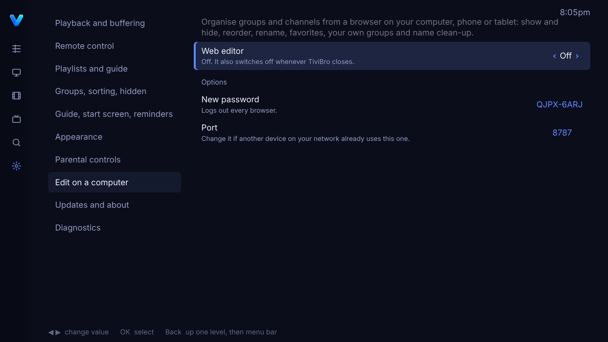</a>
  

| Setting | Choices | What it does |
|---|---|---|
| **Scan a QR code with your phone** | | Turns the editor on and shows the code for your phone, the same as **Edit on phone** in the side menu. |
| **Web editor** | On · **Off** | Starts the editor.  It switches off whenever TiviBro closes. |
| **Open this address**, **Password** | (information) | Shown while it runs: the address to open on a device on the same network, and the password to type. |
| **Browsers connected** | (information) | How many browsers are using the editor now. |
| **New password** | | Makes a new password and logs out every browser. |
| **Port** | **8787** · 8080 · 8000 · 9090 | Change it if another device on your network already uses this port. |

### Settings: Updates and about

Your version, and new versions from GitHub.  See [Updates](#updates).

| Setting | Choices | What it does |
|---|---|---|
| **TiviBro**, **Status** | (information) | The version you have (test versions are marked), and whether a newer one is out. |
| **Check for updates** | | Looks for a newer release now. |
| **Install … now** | | On a rooted TV with the Homebrew Channel: downloads the new version, checks its fingerprint, installs it and restarts TiviBro with all your settings.  Other TVs get a note to install it from a computer. |
| **What's new** | | The changes in the new version. |
| **Check automatically** | **On** · Off | Once a day when TiviBro starts.  Nothing is installed without asking you. |
| **Include test versions** | On · Off (**On** when you are running one) | Also offers alpha and beta builds: new features first, and some rough edges. |
| **Installing on this TV** | (information) | Whether this TV can install updates by itself. |

### Settings: Diagnostics

Finding out what's wrong, and what this TV can play.

  <a href="screenshots/tv-set-diag.png">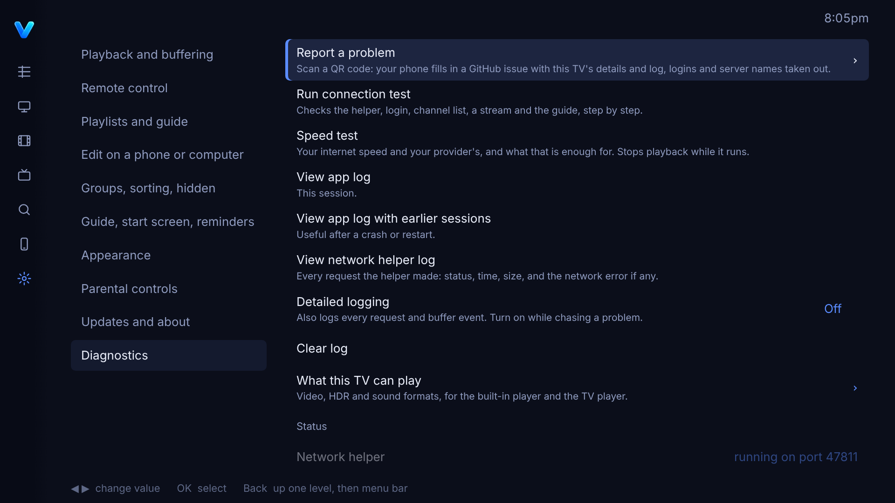</a>
  
  
  <a href="screenshots/tv-set-diag-log.png">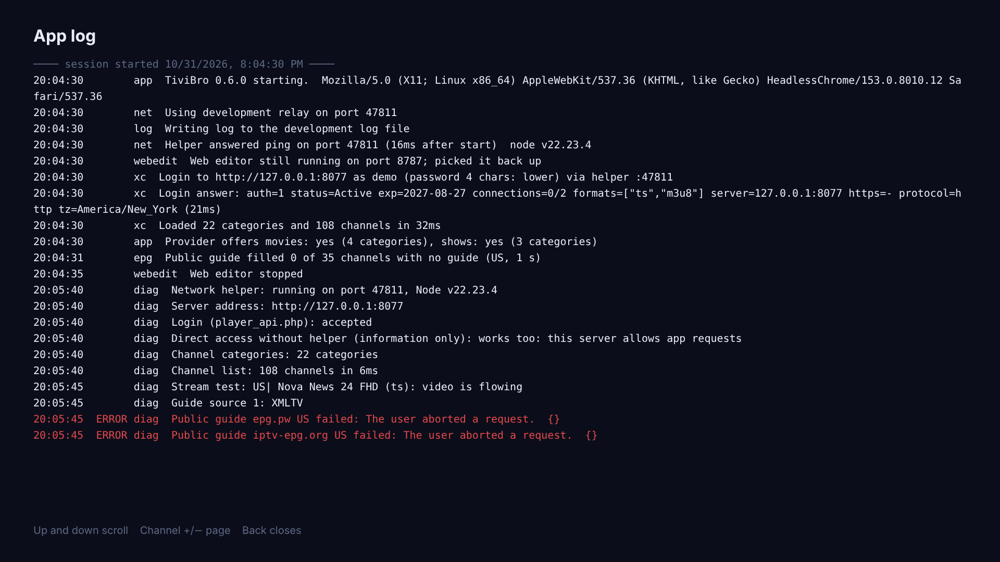</a>

| Setting | Choices | What it does |
|---|---|---|
| **Report a problem** | | Shows a QR code.  Scan it and your phone opens the web editor's **Report a problem** page: say what happened, read everything the TV adds (version, TV model, a few settings, the app and network helper logs, with logins and server names taken out), save the log file, and **Open the GitHub form** opens a bug report filled in for you.  Drag the log file into it and send.  You need a free GitHub account. |
| **Run connection test** | | Checks, step by step: the network helper, your login, the channel categories and list, a real stream, and each guide source.  Each step says what worked or what failed and why. |
| **View app log** | | What TiviBro did this session.  **▲ ▼** scroll, **CH + / −** page. |
| **View app log with earlier sessions** | | Includes the sessions before, useful after a crash or restart. |
| **View network helper log** | | Every request the helper made: status, time, size, and the network error if any. |
| **Detailed logging** | On · **Off** | Also logs every request and buffer event.  Turn it on while chasing a problem.  It stays on until you turn it off. |
| **Clear log** | | Empties the log. |
| **What this TV can play ›** | | Every video, HDR and sound format, and which player handles it on this TV.  It combines the TV's own answers with what LG TVs are known to do (Dolby Vision and DTS aren't always reported correctly). |
| **Playing now** | (information) | The current stream's format and player. |
| **Status** | (information) | The helper, the network setting, your TiviBro version, the browser engine, how many channels are loaded, and the command for debugging from a computer. |

Logs always mask usernames and passwords.

---

## From your computer: the web editor

Cleaning up hundreds of groups with a TV remote is painful.  The web editor does it from any browser on your network, while TiviBro stays open on the TV.

<a href="media/live-edit.mp4">Watch the MP4</a>

### Turning on the web editor

1. On the TV, open **Edit on phone** in the side menu (◀ from the groups).  It turns the editor on and shows a QR code, the address and the password.  The same panel is under hold OK on any group (**Edit on a phone or computer…**), in **Settings > Edit on a phone or computer**, and on any remote button you like (Settings > Remote control).  (On a brand-new TV: the first screen already shows the code.)
2. On a phone, scan the code with the camera: the editor opens signed in.  On a computer, open the address, like `http://192.168.1.20:8787`, and type the password.  Dashes and capitals don't matter.
3. **Done** closes the panel and leaves the editor running; **Turn the editor off** stops it.

The editor switches off every time TiviBro closes.  On a brand-new TV with no playlist it starts by itself, for the QR code on the first screen.  After five wrong passwords it locks for a minute.

**On a phone.**  The [set-up tour](#the-set-up-tour)'s QR code opens the editor signed in; any phone browser works with the address and password too.  On a phone the page name sits in the top bar (tap it for the list of pages), **Groups and channels** shows the groups first and a group's channels on their own screen (**‹ Groups** goes back), and **⋯** on a channel has Rename, Copy or move and Take out.  Dragging to reorder needs a computer.

  <a href="screenshots/editor-phone-tools.png">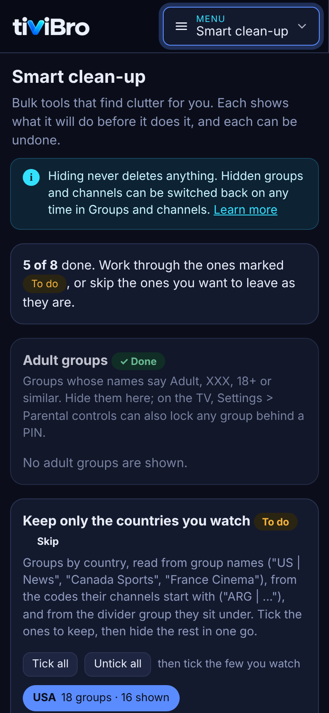</a>
  <a href="screenshots/editor-phone-channels.png">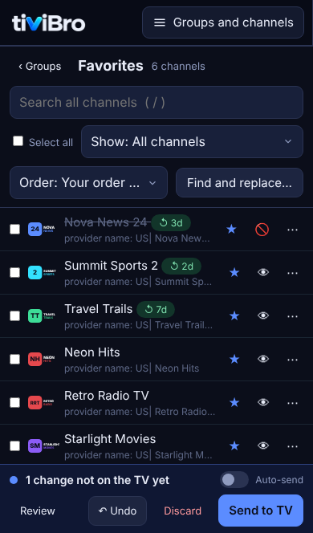</a>
  <a href="screenshots/editor-phone-channel-menu.png">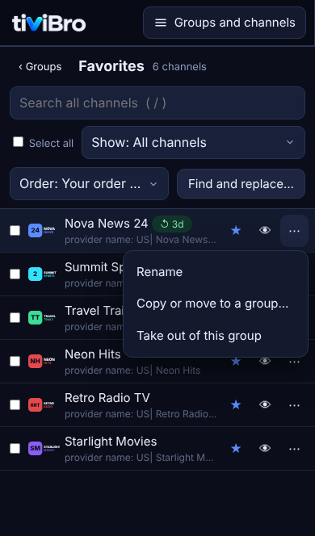</a>
  <a href="screenshots/editor-phone-pages.png">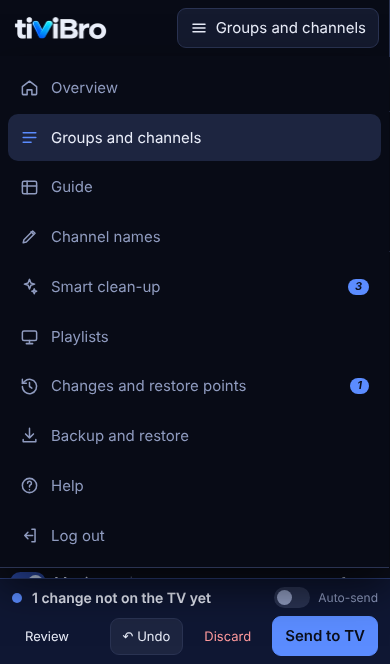</a>

  

The **Overview** shows how many channels and groups are on the TV, guide coverage, smart suggestions, and a short checklist for a first clean-up: Smart clean-up, then groups and favorites, channel names, the guide, then **Send to TV** and a backup.  **Help** in the editor explains every page.

### Drafts and Send to TV

Every change is a **draft** until you press **Send to TV** (or <kbd>Ctrl</kbd>+<kbd>S</kbd>).  A bar at the bottom counts what hasn't reached the TV, and turns green when the TV confirms.

- **Review** lists every change in plain words before sending.  **Send automatically** sends as you go.
- <kbd>Ctrl</kbd>+<kbd>Z</kbd> undoes, <kbd>Ctrl</kbd>+<kbd>Shift</kbd>+<kbd>Z</kbd> redoes, even after sending.
- **Restore points** live on the TV.  It makes one before applying each batch (keeps the last 15), and you can make named ones before big changes.  Restoring one is itself undoable.
- **Changes and restore points** lists what hasn't reached the TV yet, this session's changes (each with **Go back**), your draft history, and the restore points.

  

**You can't lose unsent work.**  An hour of clean-up shouldn't vanish because of a stray click, a refresh or a closed tab, so the editor saves your drafts twice:

- **In this browser,** the moment you make a change.
- **On the TV,** a few seconds later (at least every 30 seconds while you keep working).  The bar at the bottom says when: *Draft saved on the TV at 8:41*.  If the TV can't be reached it says so, and the browser copy still holds your work.

Reload the page, close the tab, or open the editor on another computer or your phone, and it asks whether to pick up your unsent changes, whichever copy is newer.  **Keep working on them** brings everything back; **Throw them away** clears them, but a copy stays in the draft history.

  <a href="screenshots/editor-recover.png">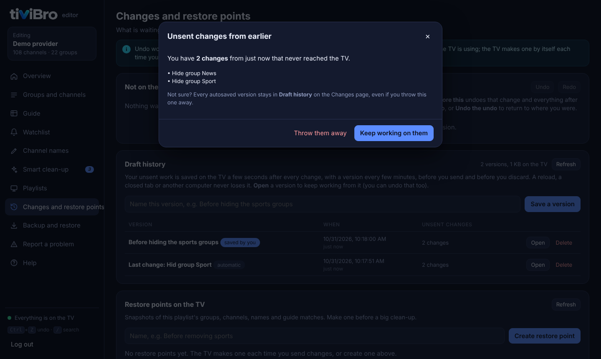</a>
  <a href="screenshots/editor-drafts.png">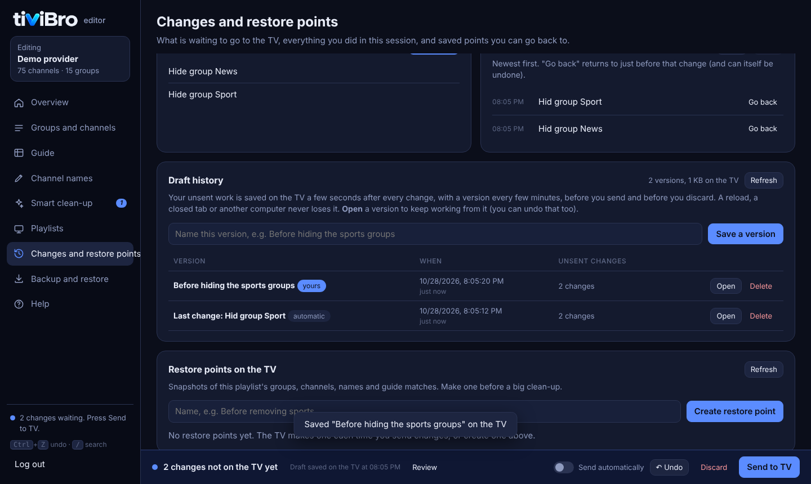</a>

**Draft history** (on **Changes and restore points**) keeps versions of your unsent work on the TV:

- one every few minutes, or every 20 changes, while you work;
- one just before you send, and one before you discard;
- and any you name with **Save a version** (for example *Before hiding the sports groups*).

**Open** goes back to a version and keeps working from there; it's an ordinary step, so **Undo** returns to where you were.  Versions that reached the TV are marked *sent to the TV*.  Each version holds only your edits (which groups and channels are hidden, renames, your groups and so on), not the channel list, so it's small: a few KB for a typical clean-up, about 200 KB for 12,000 changes on a 15,000-channel playlist.  The TV keeps up to 8 MB of draft history per playlist (40 automatic versions and 25 others), drops the oldest automatic ones first, and deletes a playlist's drafts with the playlist.

### Groups and channels

- The switch beside a group shows or hides it on the TV.  Drag **⠿** to reorder; your groups always come first.
- **✎** renames a group.  Renamed and edited groups are tagged so you can see what you changed.
- Tick channels, then **Copy or move to group**.  Any group works as the destination, yours or the provider's.  Copy keeps the channel where it was; Move takes it out.
- **Order** sorts the open group on the TV: provider order, A to Z, Z to A, channel number, or your own drag order for your groups.
- **👁** hides a channel everywhere; **★** adds it to Favorites.  Both work on many ticked channels at once.
- Your changes survive playlist refreshes.

  
  

### Smart clean-up

The same engine as the TV's [set-up tour](#the-set-up-tour), with more room: pick per channel, see every group, undo any step.  The tour's QR code opens this page signed in.

- **Keep only your countries** works out each group's country and keeps the ones you tick.  It reads codes at the start of group names ("US \| News", "[UK] Sports"), country words ("Canada Sports", "France Cinema", "Latino / Mexico"), the code most of a group's channels start with ("ARG \| ..."), and the divider group a group sits under ("⫘⫘⫘ CAN ⫘⫘⫘" then "TSN +").  Groups with no country, like sports and event groups, stay unless you tick **Also hide groups with no country**.
- **Same channel, more than once** finds a channel in several qualities and keeps one (Full HD first is a good balance).  It opens on **To check**: only the channels where two copies have the same quality, so TiviBro couldn't tell which to keep.  **All** shows every set, one line each, with a button per copy (FHD, HD, SD…): click the one to keep, and the others are struck through.  Type in **Find a channel** to narrow the list; **Hide extra copies** then works on just the channels found, or on all of them when the search is empty.
- **Hide by keyword** hides groups or channels with words like PPV or 24/7, with a preview.
- **Empty groups** hides groups with nothing left to watch.
- **East and West feeds** finds channels that come in both time zones ("HBO (EAST)" and "HBO (WEST)", "A&E" and "A&E (WEST)") and keeps the feed you pick, **Keep East** or **Keep West**.  The other copies are hidden in one step, and **Also hide groups named West** (or East) hides groups like "USA WEST" too.  Channels that only come in one feed are left alone.
- **Local channels: pick your city** reads the city out of every station in your local groups ("ABC Locals", "CBS Locals" and so on: ABC, CBS, NBC, FOX, CW, PBS, Telemundo, Univision, CBC, CTV, Global and more).  Type to find your city, tick it (or a few nearby, like Detroit and Lansing), and **Keep only these cities** hides every other city's stations in all the local groups at once.  **Keep stations with no city** leaves national feeds alone.  **Also put them together in one group called** ("Local channels", or a name of your own) copies the stations you keep into one group, by city and network, and **Then hide the network groups** hides ABC Locals, CBS Locals and the rest, so each station shows up once.  Running it again adds to the same group.
- **Divider groups** hides groups like "⫘⫘⫘ UK ⫘⫘⫘" or "===== SPORTS =====" that only split the provider's list into sections.
- **Channels with nothing on** is the same switch as **Hide channels with nothing on** on the TV: event channels named "Off Air", "Offline" or "No Event Scheduled" stay out of the lists while they say so.

Everything here only hides, never deletes, and each action is one undo step.

  
  

### Channel names

Rules strip clutter from every name at once: country prefixes like `US |`, quality tags like `FHD`, brackets and more.  Add your own prefixes and suffixes, and preview each name before and after.  Your provider's names are untouched, so switching a rule off brings the original back.  Names you set by hand stay.  The same rules are on the TV under **Settings > Playlists and guide > (your playlist) > Channel name editor** ([details](#settings-playlists-and-guide)).

  
  

### The programme guide

**Where it comes from.**  For Xtream providers:

- **Per channel** (recommended for most): the TV asks for each channel's next shows as you browse.  Fast and light.
- **Full XMLTV file**: the TV downloads your provider's whole guide.  Days ahead and manual matching, but files are often 20 to 200 MB.  Live progress (speed, percent, time left) shows in the editor and in the corner of the TV.
- **Off**: only your own sources.

M3U playlists can use the guide address inside the playlist.

**Extra sources.**  Add any `.xml` or `.xml.gz` guide.  Zipped guides work on every TV: the network helper unzips them as they download, and it also unzips provider guides that arrive gzipped.  **Recommended free guides** lists community guides by region (epgshare01, iptv-epg.org, i.mjh.nz for Pluto, Samsung TV Plus, Plex and Roku, and more), each with a one-click **Test**.  The first source in the list wins when two cover the same channel, and **Offset** fixes a guide that is an hour off.

**Smart match** fixes channels showing "No guide information".  It ignores clutter, understands country codes, East and West feeds, numbered channels and US call signs, then shows its best guess with a confidence score.  You approve or decline each one, and nothing changes until you press **Apply**.

  
  
  

### Playlists

Add Xtream Codes or M3U playlists, switch which one the TV uses, set reload schedules and the User-Agent, or change a login.  The TV tests every new login before saving.  **Logins never reach the editor**: it only ever sees server names.  Each playlist keeps its own groups, names and guide setup.

  

### Backup and restore

A backup is one file with everything: settings, every playlist **with its login**, each playlist's groups, favorites, names and guide matches, and its restore points.  Channel lists and guides aren't in it; they reload from your provider.

**Always locked.**  You choose a passphrase (or press **Suggest one**).  The TV makes the backup and locks it with AES-256-GCM before it leaves the TV, so the file on your computer is useless without the passphrase.  Nobody can recover a forgotten passphrase, so keep it in a password manager.

**Restoring, even on a brand-new TV:**

1. Install TiviBro and open it.  Choose **Set up or restore from a computer**.  (On a TV already set up: **Settings > Edit on a phone or computer**.)
2. Open the address shown on the TV and type the password.
3. **Restore a backup**, drop the file, type the passphrase and press **Unlock**.  The editor lists the playlists inside so you know it's the right file.
4. **Restore to the TV.**  TiviBro restarts with everything back, and the editor reconnects by itself.

<a href="screenshots/tv-restored.png">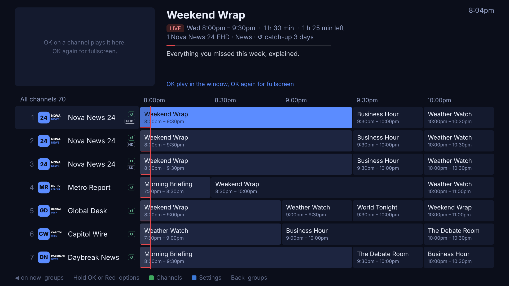</a>

---

## Troubleshooting

**Settings > Diagnostics > Run connection test** is the best first step when something doesn't work: it checks each part in turn and says what failed.

  

**What is the network helper?**  The **network helper** is a part of TiviBro that runs in the background on the TV.  It talks to your provider for the app: it fetches the channel list, the guide and the streams, sends the User-Agent your provider wants, unzips guides, and copes with servers that don't follow the rules.  webOS won't let an app talk to most IPTV servers directly, so TiviBro needs it.  It starts with TiviBro, runs only on the TV, and only ever contacts your own provider (and, if you turn them on, the logo projects).

You'll see it in three places: **Connection** on the first screen and in **Settings > Playback and buffering** (leave it on **Automatic**), **Network helper** in Settings and Diagnostics (it should say *running*), and the connection test.  If it says *not running*, restart TiviBro; if that doesn't help, **Settings > Diagnostics > View network helper log** shows why.

| Problem | Try this |
|---|---|
| A channel won't start or keeps buffering | **OK** on the error message, or **Reconnect** in the quick menu.  Then try **Stream format** HLS instead of MPEG-TS, or a bigger **Buffer profile**. |
| Every channel fails | **Settings > Diagnostics > Run connection test**.  It checks the [network helper](#what-is-the-network-helper), your login, the channel list, a stream and the guide, step by step. |
| "No guide information" | Use **Smart match** in the web editor, or **Hold OK > Assign guide** on the TV.  Add an extra guide source for your region. |
| Guide times are off by an hour | **Provider guide time offset** in Settings, or **Offset** on an extra source in the editor. |
| The guide seems stuck loading | Big XMLTV files take minutes on a TV; watch the progress bar.  If it stays at 0, **Test** the address. |
| The web editor says it can't reach the TV | TiviBro was closed or the TV went to sleep.  Open TiviBro; the editor reconnects and your drafts are safe. |
| Changes don't show on the TV | Check the bar at the bottom of the editor.  If it still counts changes, press **Send to TV**. |
| Wrong editor password | It's on the TV under **Settings > Edit on a phone or computer**.  After five wrong tries, wait a minute. |
| HDR looks grey or washed out | **Settings > Playback and buffering > HDR and Dolby Vision > TV player for all HDR**. |
| A movie plays with no sound | It may only have DTS sound, which 2020 to 2022 LG TVs can't play.  The movie details warn about this; pick another audio track under **Options** if there is one. |
| Dolby Vision shows odd green or purple colours | Make sure **HDR and Dolby Vision** isn't set to *Built-in player*. |
| A remote button does nothing | **Settings > Remote control > Button tester**, then **Learn a button**. |
| Something crashed | TiviBro says so the next time it starts.  **Diagnostics > Report a problem** sends the details to us; **View app log with earlier sessions** shows them on the TV.  Logs mask usernames and passwords. |
