# TiviBro user guide

Everything TiviBro does, on the TV and from your computer.  Every picture here comes from a made-up demo provider, so the channel names are invented.

**On the TV:** [First start](#first-start) · [The set-up tour](#the-set-up-tour) · [Channel logos](#channel-logos) · [The remote](#the-remote) · [The guide](#the-guide) · [Groups and the menu](#groups-and-the-menu) · [Watching fullscreen](#watching-fullscreen) · [Other versions of a channel](#other-versions-of-a-channel) · [Event channels](#event-channels-pay-per-view-and-sports-passes) · [My teams](#my-teams) · [Movies on now](#movies-on-now) · [My media](#my-media) · [Catch-up](#catch-up) · [Movies and shows](#movies-and-shows) · [Search](#search) · [Favorites, hiding and your own groups](#favorites-hiding-and-your-own-groups) · [Reminders](#reminders) · [Settings](#settings) · [Updates](#updates) · [Parental controls](#parental-controls)

**Every setting:** [Playlists](#settings-playlists) · [Guide](#settings-guide) · [Channels and groups](#settings-channels-and-groups) · [Channel and group names](#settings-channel-and-group-names) · [Reminders and watchlist](#settings-reminders-and-watchlist) · [Playback](#settings-playback) · [My media](#settings-my-media) · [Remote and buttons](#settings-remote-and-buttons) · [Appearance and start screen](#settings-appearance-and-start-screen) · [Parental controls](#settings-parental-controls) · [Backups and restore points](#settings-backups-and-restore-points) · [Phone app and web editor](#settings-phone-app-and-web-editor) · [Updates, about and diagnostics](#settings-updates-about-and-diagnostics)

**From your computer:** [Turning on the web editor](#turning-on-the-web-editor) · [Drafts and Send to TV](#drafts-and-send-to-tv) · [Channels and groups](#channels-and-groups) · [Smart clean-up](#smart-clean-up) · [Channel and group names](#channel-and-group-names) · [The programme guide](#the-programme-guide) · [Reminders and watchlist](#reminders-and-watchlist) · [Playlists](#playlists) · [My media in the editor](#my-media-in-the-editor) · [Backups and restore points](#backups-and-restore-points)

**When something is off:** [Troubleshooting](#troubleshooting)

> Click any picture to open it full size.  Every animation also has a sharp MP4 version linked under it.

---

## On the TV

### First start

A brand-new TiviBro opens on **Add your playlist**.  You have two ways in:

- **Scan the QR code with your phone.**  It sits beside the form and opens the web editor on your phone, already signed in: type your login there with a real keyboard, or restore a backup from another TV.  The address and password are under the code, for a computer on the same network.  While you work there, a big banner along the bottom of the TV shows what it receives ("Checking the login and loading the channels…", then how many channels it added, or why it didn't work).  Any button on the TV remote clears it.  The TV moves on by itself when you finish, then shows the [set-up tour](#the-set-up-tour).  Nothing starts playing on its own.  (**Set up or restore from a phone or computer** shows the same code on a screen of its own.)
- **Type it on the TV.**  The type starts on **Full link**: paste the whole link your provider sent (the long one with username and password in it, often with get.php) and TiviBro says what it found, then fills in the Xtream Codes login when you press **Connect**.  Or pick Xtream Codes or M3U and fill in the server, username and password (or the M3U address) yourself.  A guide address is optional.  **Test connection** checks everything before you save; **Connect** saves and loads your channels.

<p align="center">
  <a href="https://tivibro.app/view/#tv-first-run">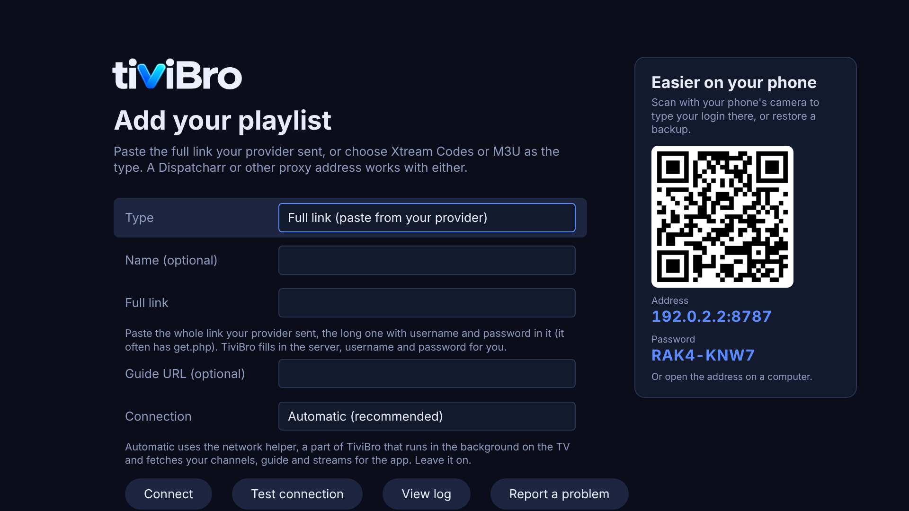</a>
  <a href="https://tivibro.app/view/#tv-first-run-remote">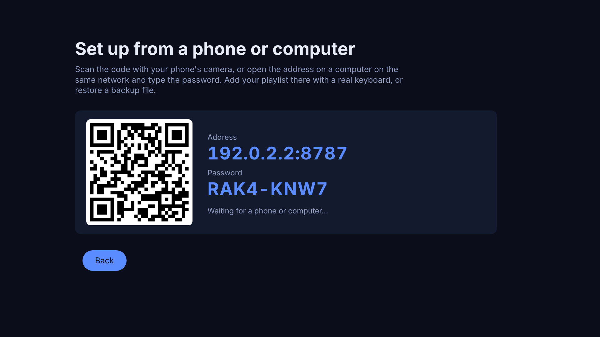</a>
</p>

<p align="center"><a href="media/firstrun.mp4">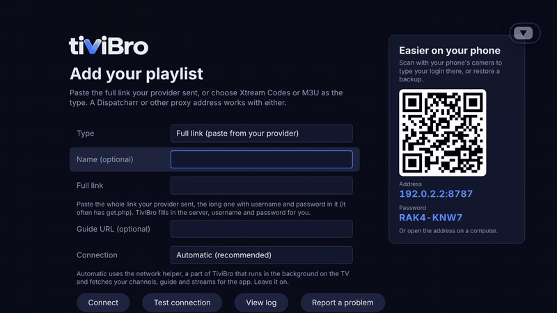</a></p>
<p align="center"><sub><a href="media/firstrun.mp4">Watch the MP4</a></sub></p>

Once your channels load, the [set-up tour](#the-set-up-tour) starts.

Restoring a backup onto a fresh TV, start to finish:

<p align="center"><a href="media/restore.mp4">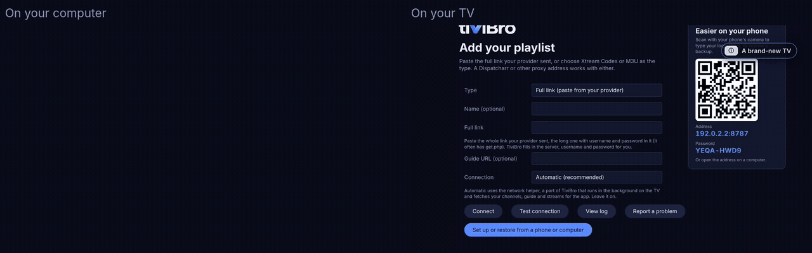</a></p>
<p align="center"><sub><a href="media/restore.mp4">Watch the MP4</a></sub></p>

### The set-up tour

Right after a new playlist connects, TiviBro shows what it has and walks you through making it yours, one screen at a time with the remote.  It only asks about what your playlist actually has, so a list with no local stations never shows the city step.  Nothing changes until the last screen, and a restore point is saved first, so the web editor can put everything back.

<p align="center">
  <a href="https://tivibro.app/view/#tv-tour-welcome">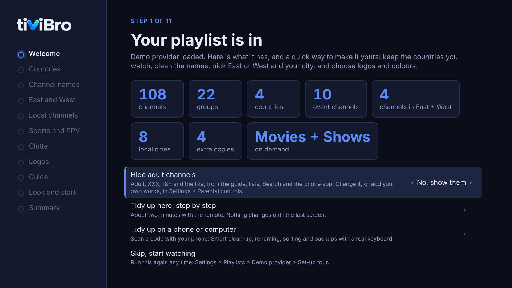</a>
  <a href="https://tivibro.app/view/#tv-tour-phone">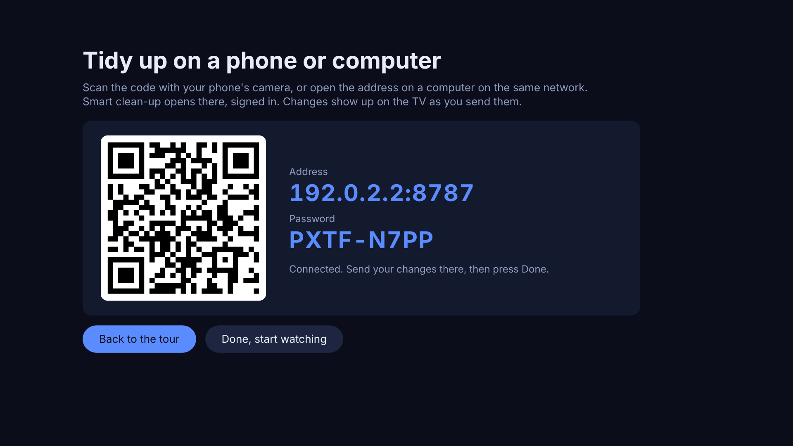</a>
</p>

The first screen counts your channels, groups, countries, event channels, East and West copies, local cities, extra copies and whether there are movies and shows.  Then:

- **Tidy up here, step by step** goes through the screens below.  The chip in the top corner keeps a running count ("Keeps 3,632 of 9,808 channels").
- **Tidy up on a phone or computer** shows a QR code.  Scan it with your phone's camera and the web editor opens on [Smart clean-up](#smart-clean-up), already signed in.  The address and password are there too, for a computer.
- **Skip, start watching** changes nothing.

| Screen | What you pick |
|---|---|
| **Countries** | Each country and region in the list, biggest first, with how many channels it has.  The TV's own country is ticked; **Keep every country** and **Keep only** the biggest are one press.  Groups with no country (sports, events, 24/7) are kept unless you say otherwise. |
| **Channel names** | Name clean-up on or off, group names too, and every rule, with your own channels shown before and after. |
| **East or West?** | Keep East feeds, West feeds or both, and whether to hide groups named West (or East).  Examples from your list. |
| **Your local channels** | Every city your provider's local groups carry, A to Z, with the networks in each.  **OK** ticks a city; ◀ ▶ jump between letters.  The other cities' stations are hidden in every local group.  **Put them together in "Local channels"** (on) makes one group with your stations, by city and network, and **Then hide the network groups** (on) puts ABC Locals, CBS Locals and the rest out of the way so each station shows up once. |
| **Sports and pay-per-view** | [Event channels](#event-channels-pay-per-view-and-sports-passes): reading events from names, short names, Events by time, the time zone for names without one, and **Hide channels with nothing on**.  The next events are listed. |
| **Clear the clutter** | Divider groups, empty groups, the same channel more than once (keep Full HD, the default, or the best, HD, SD or every copy; the copies you hide are still backups: TiviBro switches to one by itself if yours stops working, and they stay under hold OK > Other versions), groups with words like PPV or Adult, and whether groups the provider adds later show up. |
| **Channel logos** | The [logo library](#channel-logos), its style, and which logo wins when the playlist and the guide both have one, with logos it found for your channels. |
| **Make it yours** | Accent colour, background, text size, start screen, turning on the last channel at launch, the preview in the list, and what happens when a channel stops working.  Colours change as you pick them. |
| **All set** | How many channels and groups you keep and hide, **Your choices** (one line per screen, like "Detroit in Local channels, network groups hidden": **OK** on one goes back to that screen, and **Skip to the summary** comes back), **Apply and start watching**, and a few things worth knowing. |

**Hidden, not gone.**  Everything the tour hides stays one press away in **Settings > Channels and groups**, and Apply saves a restore point first.  Good to know about what hiding does:

- **Extra copies** you hide are still backups: if the copy you keep stops working, TiviBro switches to one of them by itself.  See [Other versions of a channel](#other-versions-of-a-channel).
- **The other East or West feed** is not a backup, because it runs hours apart.
- **Network groups** hidden after **Put them together in "Local channels"** don't take your stations with them: they stay in Local channels.
- **Hidden groups and channels** leave the guide, All channels, Search and the watchlist (unless **All channels includes hidden groups** is on).
- **Channels with nothing on** come back by themselves when an event is named.

<p align="center">
  <a href="https://tivibro.app/view/#tv-tour-countries">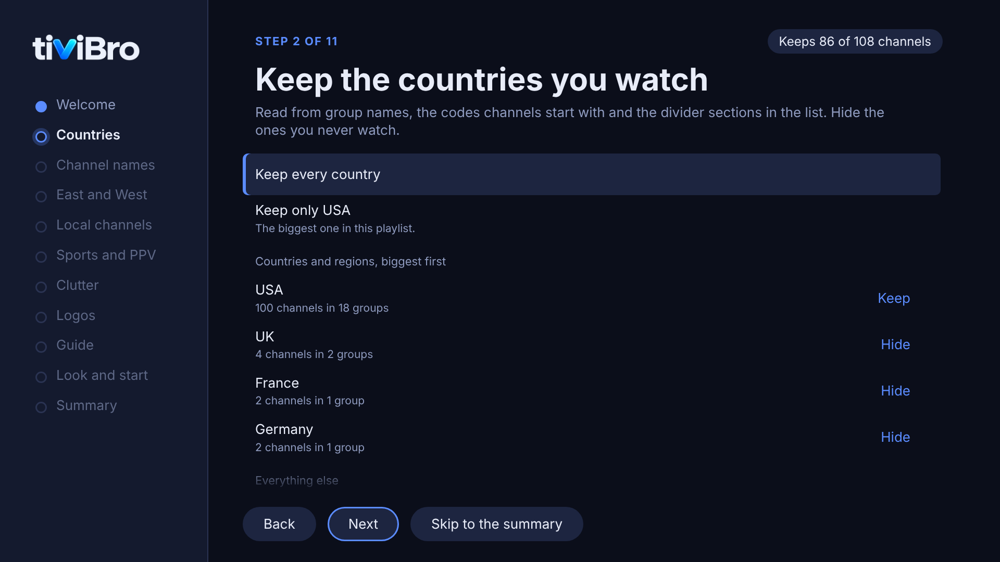</a>
  <a href="https://tivibro.app/view/#tv-tour-names">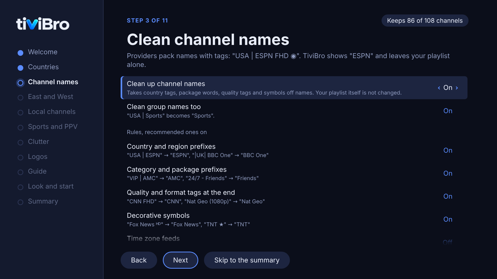</a>
  <a href="https://tivibro.app/view/#tv-tour-feeds">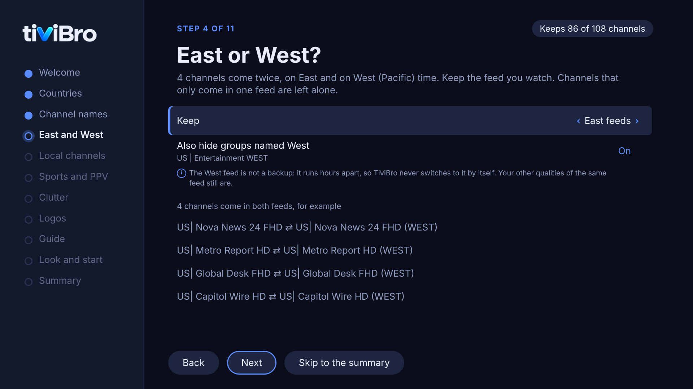</a>
</p>
<p align="center">
  <a href="https://tivibro.app/view/#tv-tour-locals">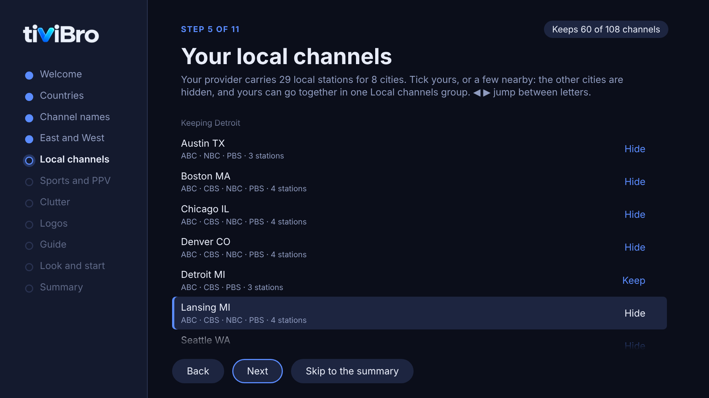</a>
  <a href="https://tivibro.app/view/#tv-tour-events">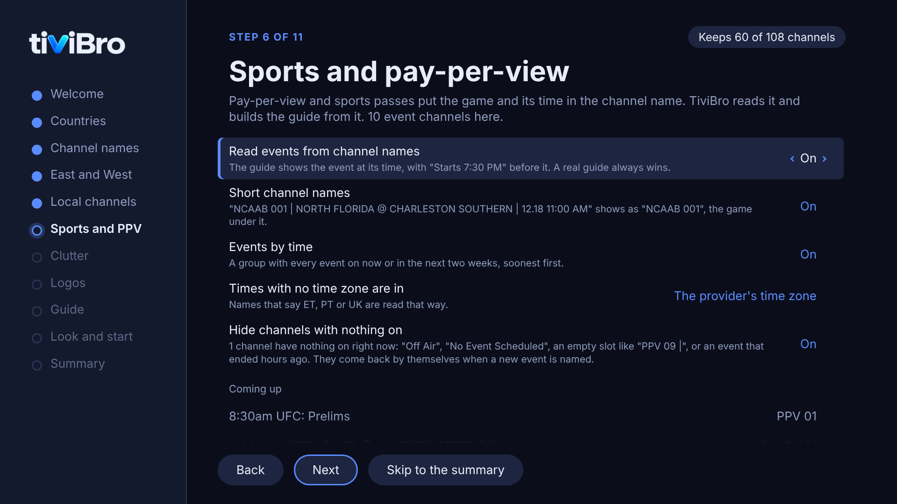</a>
  <a href="https://tivibro.app/view/#tv-tour-clutter">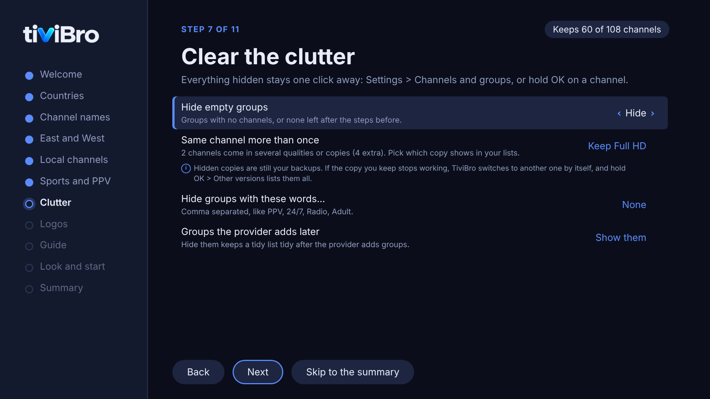</a>
</p>
<p align="center">
  <a href="https://tivibro.app/view/#tv-tour-logos">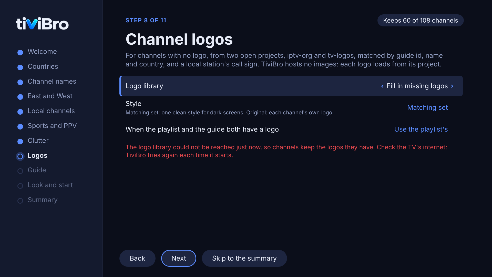</a>
  <a href="https://tivibro.app/view/#tv-tour-look">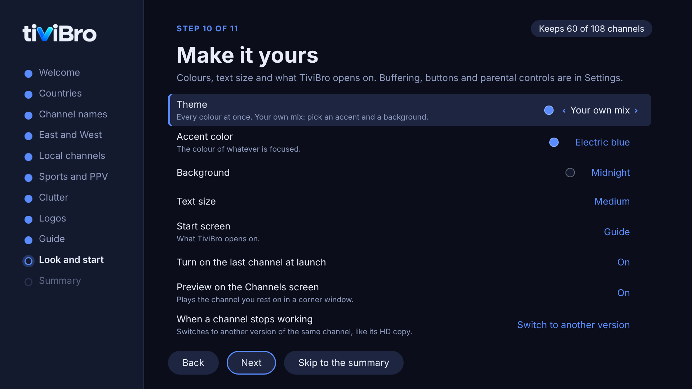</a>
  <a href="https://tivibro.app/view/#tv-tour-done">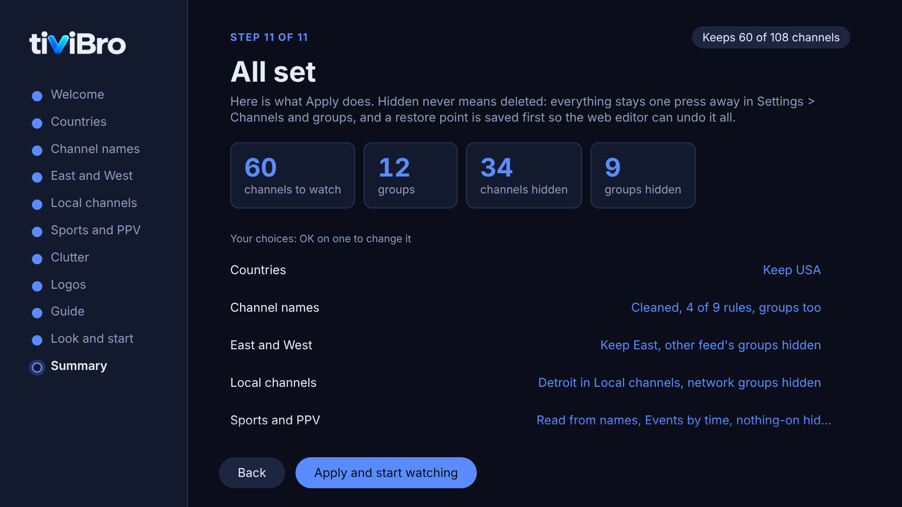</a>
</p>

Everything the tour hides stays one press away: Settings > Channels and groups, or hold **OK** on a channel.  Run it again any time from **Settings > Playlists > your playlist > Set-up tour**.  It works on the same engine as the web editor's Smart clean-up, so both always agree.

### Channel logos

Providers often leave logos out, or send some that no longer load.  The **logo library** fills them in from two open projects:

- **[iptv-org](https://github.com/iptv-org/database)**: each channel's own logo, for about 28,000 channels in 230 countries.
- **[tv-logos](https://github.com/tv-logo/tv-logos)**: one matching style made for dark screens, for about 7,700 channels.

TiviBro hosts no logo images.  It downloads a small list of where the logos are, only for the countries in your playlist, and each logo loads from its own project, the way your provider's logos do.  The list is kept on the TV for a week.

Channels are matched by their guide id ("CNN.us"), then by their cleaned name in their own country, then by a local station's call sign ("WXYZ") or, for a local station with no logo of its own, its network.  Event channels are left alone, since their names are games.  A provider logo that fails to load is replaced by the library's.

Turn it on in the set-up tour or in **Settings > Appearance and start screen > Logo library**:

- **Off**: only the playlist's and the guide's logos.
- **Fill in missing logos**: the library's logo for channels that have none.
- **Use for every channel it knows**: the library's logo everywhere it has one, so the whole list matches.

**Logo library style** picks **Matching set** (tv-logos) or **Original logos** (iptv-org); each falls back to the other.  On a real 9,800-channel playlist it found logos for about 3,600 channels.

### The remote

TiviBro works with the standard LG remote and the Magic Remote.  With the Magic Remote you can also point, click and scroll on every screen.  A legend at the bottom of each screen always tells you what the buttons do right there.

| Button | In the guide | Watching fullscreen |
|---|---|---|
| **OK** | First OK previews in the window, second goes fullscreen | Quick menu |
| **Hold OK** | Programme and channel options | Channel guide over the video |
| **Red** | Programme and channel options | Options for the channel |
| **Info** | Programme and channel options | Programme details |
| **Hold Info** | | Buffer info: how many seconds are banked and, when the player reports it, the stream's speed.  No Info button (most Magic Remotes): **OK**, then **Stream info** |
| **▲ ▼** | Move between channels | Channel up and down |
| **◀ ▶** | Move through time (◀ on "now" opens the groups) | ◀ rewind or last channel, ▶ info |
| **CH + / CH −** | Page up and down | Channel up and down |
| **⏪ ⏩** | Jump through time, into the past on catch-up channels | Skip in catch-up and movies |
| **▶ Play** / **❙❙ Pause** | Watch the previewed channel fullscreen | Play only plays and Pause only pauses; a single Play/Pause button switches between them.  Live TV can be paused too. |
| **Green** | Channels screen | Back to the TV guide |
| **Yellow** | Groups | Last channel |
| **Blue** | Settings | Audio track |
| **Back** | Back to now, then the groups | Back to the guide |
| **0 to 9** | Jump to a channel number (at once when no longer number starts with what you typed, otherwise after a short pause) | Jump to a channel number, the same way |

A few things work the way you would guess from other TV apps:

- Channel lists wrap around: **▲** on the first channel goes to the last, and **▼** on the last goes back to the first.  In the guide and in the group lists, **▼** on the last row goes back to the first, and **▲** on the first row stays where it is.  Holding an arrow stops at the end instead of flying past it.
- **▲** at the top of a list never opens the menu by surprise.  **◀** or **Back** does.
- **Leaving TiviBro:** press **Back** until the groups show on the home screen; it says **Press Back again to exit**, and one more **Back** closes the app.  The first screen works the same way.
- In a confirmation ("Delete this playlist?"), **Cancel** is selected first, so a stray **OK** never deletes anything.
- With the Magic Remote, clicking outside a pop-up closes it, clicking the progress bar in a movie or catch-up jumps there, and on Settings rows you can click the **‹ ›** arrows to change a value.

Buttons can be remapped under **Settings > Remote and buttons**, including keys TiviBro does not know yet (**Learn a button**).  **Button tester** shows what the TV sends for each key.  Every button, its default and the actions you can give it are listed in [Settings: Remote and buttons](#settings-remote-and-buttons).

<p align="center">
  <a href="https://tivibro.app/view/#tv-set-remote-player">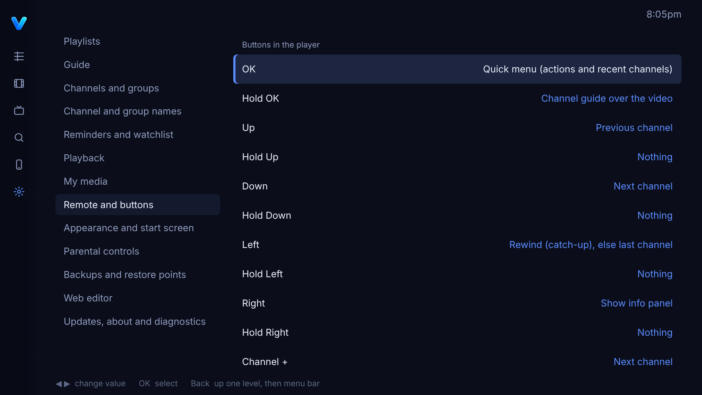</a>
  <a href="https://tivibro.app/view/#tv-set-quick-menu">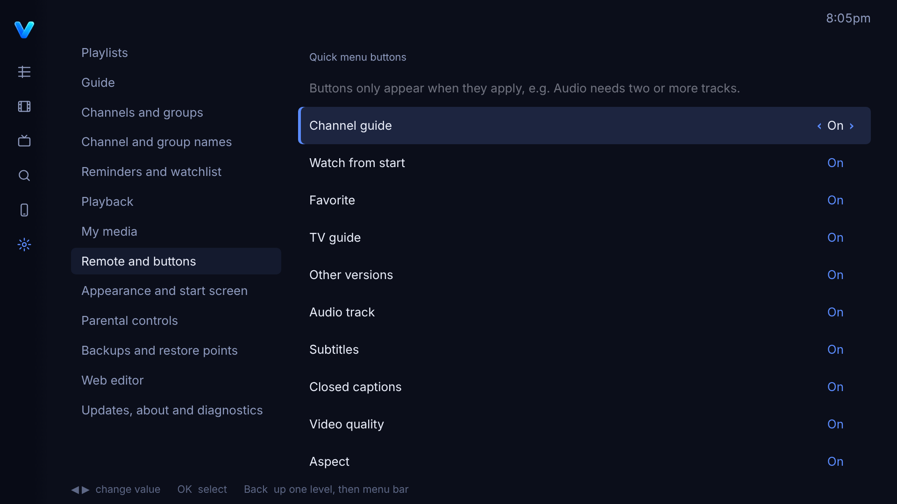</a>
</p>

### The guide

The guide is the home screen.  The channel you are on plays in the window at the top left, with the programme details beside it.

- **OK** on a channel previews it in the window.  **OK again** (or **▶ Play**) goes fullscreen.  If you prefer one press, set **Settings > Appearance and start screen > OK on a channel in the Guide** to *Fullscreen right away*.
- **▶** moves forward in time; **◀** moves back, and on "now" it opens the groups.
- Programmes you can replay carry a **↺** catch-up mark.
- **OK** on a future programme sets a reminder; on a past catch-up programme it replays it.
- **Hold OK** opens: Watch fullscreen, Play in the window, Earlier programmes, Remind me, Jump to now, and Channel options (favorite, copy to group, hide, rename).
- **No guide for this channel** (in **Hold OK** on a channel with no guide) is for a channel that will never have one: a radio stream, a camera, an event slot.  It stops saying "No guide information" and guide matching and public fill-in leave it out.  **Look for a guide again**, in the same place, undoes it, and **Settings > Guide > Channels with no guide wanted** lists them all.

<p align="center"><a href="media/guide.mp4">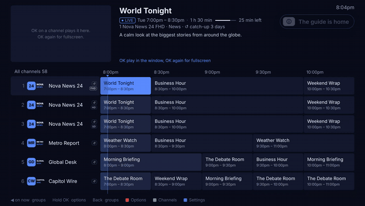</a></p>
<p align="center"><sub><a href="media/guide.mp4">Watch the MP4</a></sub></p>

<details>
<summary><b>More guide screenshots</b></summary>
<p align="center">
  <a href="https://tivibro.app/view/#tv-guide">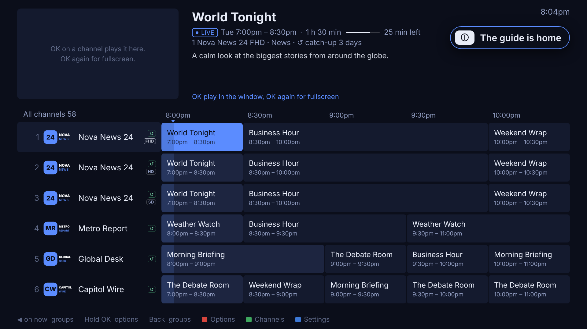</a>
  <a href="https://tivibro.app/view/#tv-guide-preview">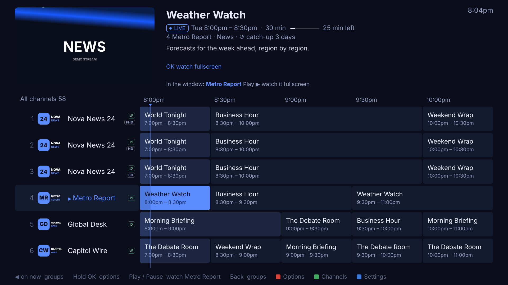</a>
</p>
</details>

Where the guide comes from (your provider, your own sources, public fill-in, and how channels are matched) is explained at the top of [Settings: Guide](#settings-guide).  How it looks is under [Settings: Appearance and start screen](#settings-appearance-and-start-screen): two-line programmes, dimming past programmes, how "now" is marked, logos only or names too, and catch-up marks.  Where your playlist has the same channel more than once, a small quality tag (**FHD**, **HD**, **SD**, **4K**) tells the copies apart.

**Not playing lately.**  A channel whose last two tries both failed, while the playlist's other channels play, gets a small amber tag: **not playing** in the guide's channel column, **not playing lately** on the Channels screen and in the phone app.  It's usually the provider: the channel may be off air or moved.  The tag goes the moment the channel plays again, and after three days on its own.

### Groups and the menu

Your groups sit right beside the guide: **Favorites** and your own groups first, then **All channels**, then your provider's groups.  Moving through the list updates the guide behind it.  **OK** or **▶** opens a group; **Hold OK** gives group options (rename, hide, sort, block).

**Recently added** lists channels that are new in your playlist since it last loaded, newest first, and they carry a **NEW** tag in the lists for a week (change it, or turn it off, under **Settings > Channels and groups > Recently added channels**).

Long lists: **CH + / −** moves a page at a time everywhere, and holding **▲** or **▼** speeds up the longer you hold it, so the end of a 5,000 channel group is a few seconds away.

**◀** or **Back** from the groups opens the menu: **Guide, Channels, Movies, Shows, My media, Search, Edit on phone, Settings**.  Movies and Shows appear only when your provider has them, and **My media** once you add a source.  **Edit on phone** isn't a screen: it turns on the [web editor](#turning-on-the-web-editor) and shows its QR code over whatever you're watching.

<p align="center"><a href="media/groups.mp4">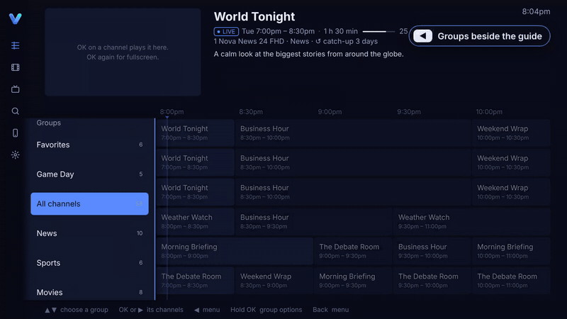</a></p>
<p align="center"><sub><a href="media/groups.mp4">Watch the MP4</a></sub></p>

<details>
<summary><b>Screenshots</b></summary>
<p align="center">
  <a href="https://tivibro.app/view/#tv-groups">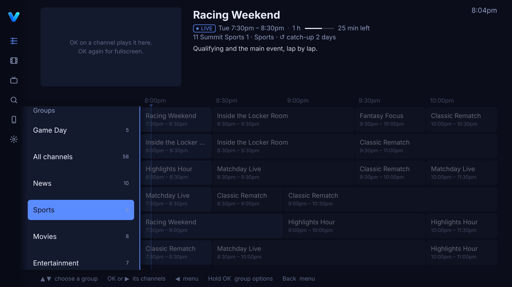</a>
  <a href="https://tivibro.app/view/#tv-menu">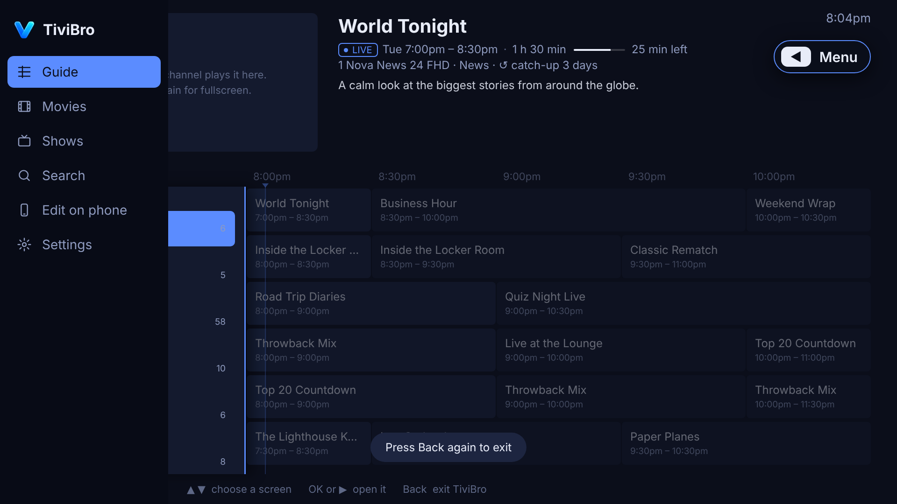</a>
</p>
</details>

The **Channels** screen (in the side menu when **Channels screen in the menu** is on, or **Green** in the guide) is the same list in TiviMate's classic layout: groups on the left, channels in the middle, the preview and details on the right.  Resting on a channel plays it in the preview (**Preview in channel list**); **OK** goes fullscreen.  Pick which screen opens first with **Start screen**.

<p align="center">
  <a href="https://tivibro.app/view/#tv-channels">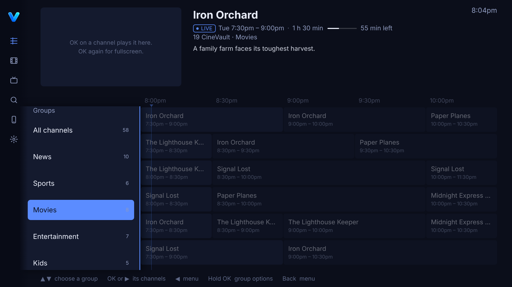</a>
</p>

### Watching fullscreen

- **▲ ▼** or **CH + / CH −** change channel.  An info bar shows the channel, what's on now and next, and how far into the programme you are.
- **The screensaver waits.**  While a channel, a movie or episode, My media or catch-up plays, TiviBro asks the TV to hold off its screensaver (a homebrew one such as Aerial too).  When nothing plays, playback is paused, or you are in another app, the screensaver comes on as usual.  There is nothing to set.
- **▶** shows the full programme info.  **Yellow** jumps back to the last channel.  **Green** goes back to the TV guide.
- **Hold OK** (or **OK > Channel guide**) lays the channel guide over the video: the group's channels with what's on now.  **OK** on another channel switches to it and keeps the channel guide open so you can keep browsing; **OK** on the channel that's already playing closes it.  **◀ ▶** change group.
- **OK** opens the **quick menu**: Channel guide, From start (catch-up channels), Favorite, TV guide, Other versions (when the channel has them), Captions, Aspect, Sleep timer, Stream info and Reconnect.
- **Closed captions**: **Captions** in the quick menu turns them on or off for every channel, like a TV's CC button (also **Settings > Playback > Closed captions**, with a caption size).  They show in fullscreen when the channel sends them, which most US channels do.  Not with the TV player (Settings > Playback > Player engine); **Stream info** says whether this channel has captions.  Pick which buttons appear under **Settings > Remote and buttons > Quick menu buttons**.
- **Red** opens options for the channel: favorite, copy to group, other versions, watch from start, catch-up, rename, assign guide, hide, aspect and sleep timer.  **Hold OK** opens the channel guide over the video.
- **Stream info** (quick menu) shows the channel, how much is buffered, the player in use, the picture's resolution, the bitrate and catch-up, updating while it's open, with the buffer gauge at the top right.  Any button can open it: **Stream info and buffer** under **Settings > Remote and buttons**.  **Sleep timer** stops playback after 15 minutes to 2 hours.  **Aspect** sets the shape of the picture for this channel (or this movie or episode), or for all of them:
  - *Original*: the picture's own shape.  *Fill*: stretched to fill the screen.  *Zoom*: fills the screen, edges cropped.
  - *4:3*: shown 4:3 with bars at the sides.  *16:9*: for a 16:9 picture squashed into 4:3, which some channels send.
  - *21:9*: a 2.35:1 film with black bars above and below fills the screen; the sides are cropped.
  - *4:3 to 16:9*: a 4:3 picture, or a 4:3 picture with black bars at the sides, stretched out to fill a 16:9 screen.
  - Each channel, movie and episode remembers its own choice; **Use this aspect for everything** makes it the default.  The shapes past Zoom need the picture to be scaled by TiviBro; with the TV player (Stream info says which player is in use) some TVs keep the picture as it was, and the menu says so.

<p align="center"><a href="media/zap.mp4">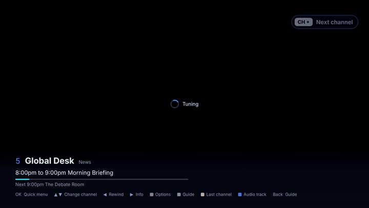</a></p>
<p align="center"><sub><a href="media/zap.mp4">Watch the MP4</a></sub></p>

<details>
<summary><b>Screenshots</b></summary>
<p align="center">
  <a href="https://tivibro.app/view/#tv-fullscreen">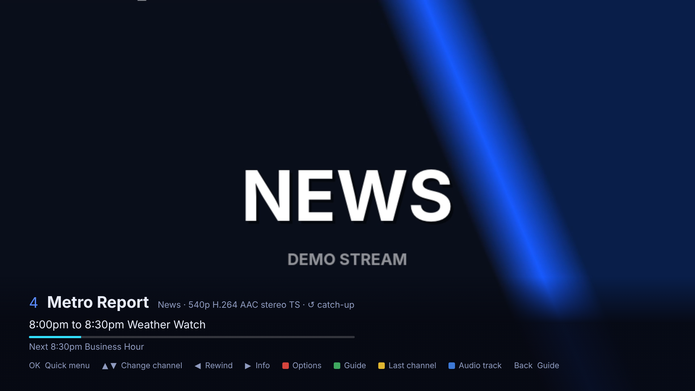</a>
  <a href="https://tivibro.app/view/#tv-quick-menu">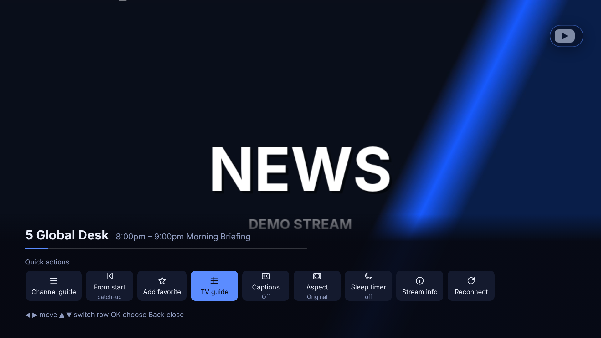</a>
  <a href="https://tivibro.app/view/#tv-info">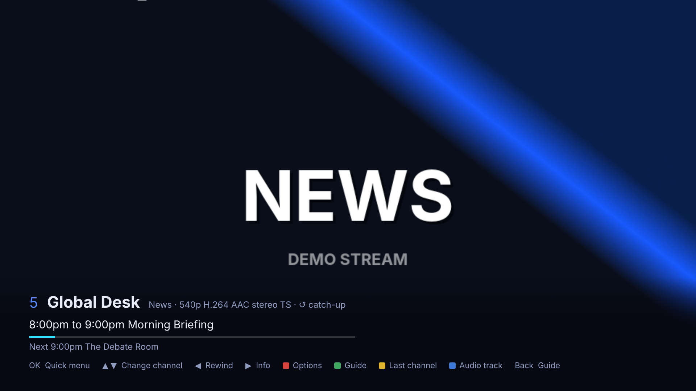</a>
  <a href="https://tivibro.app/view/#tv-mini-guide">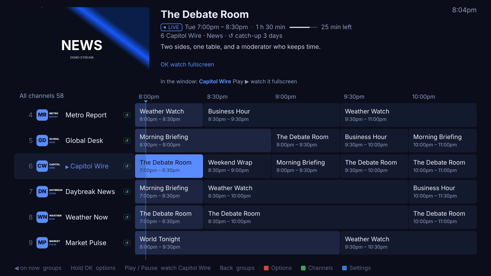</a>
</p>
</details>

The options menu, stream info, sleep timer and aspect:

<p align="center"><a href="media/options.mp4">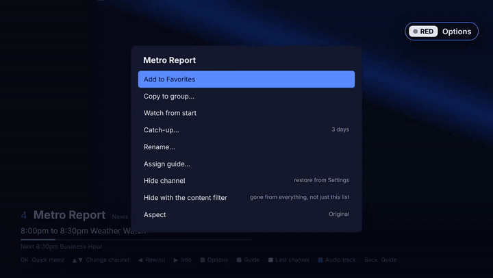</a></p>
<p align="center"><sub><a href="media/options.mp4">Watch the MP4</a></sub></p>

<details>
<summary><b>Screenshots</b></summary>
<p align="center">
  <a href="https://tivibro.app/view/#tv-options">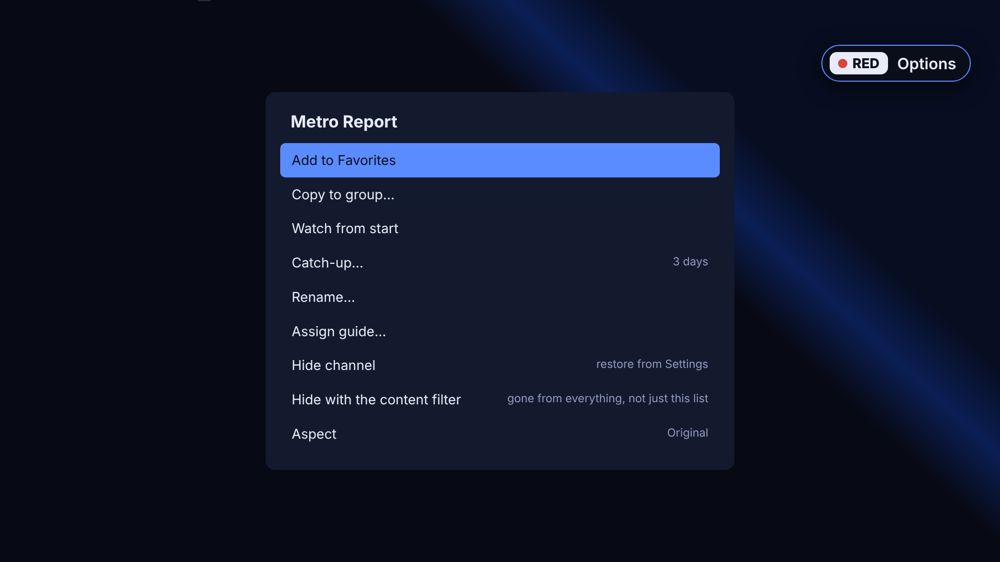</a>
  <a href="https://tivibro.app/view/#tv-stream-info">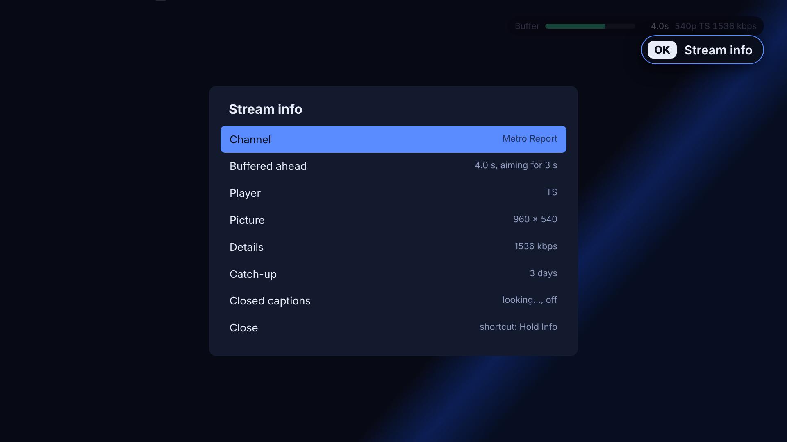</a>
  <a href="https://tivibro.app/view/#tv-sleep">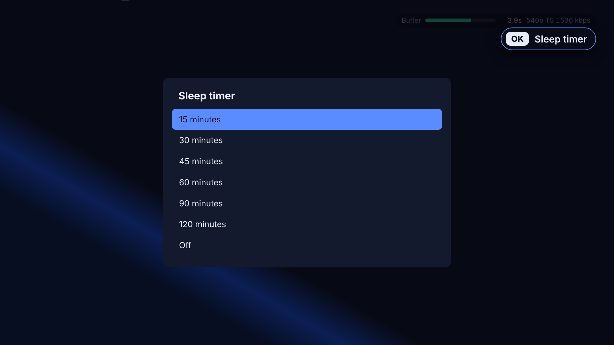</a>
  <a href="https://tivibro.app/view/#tv-aspect">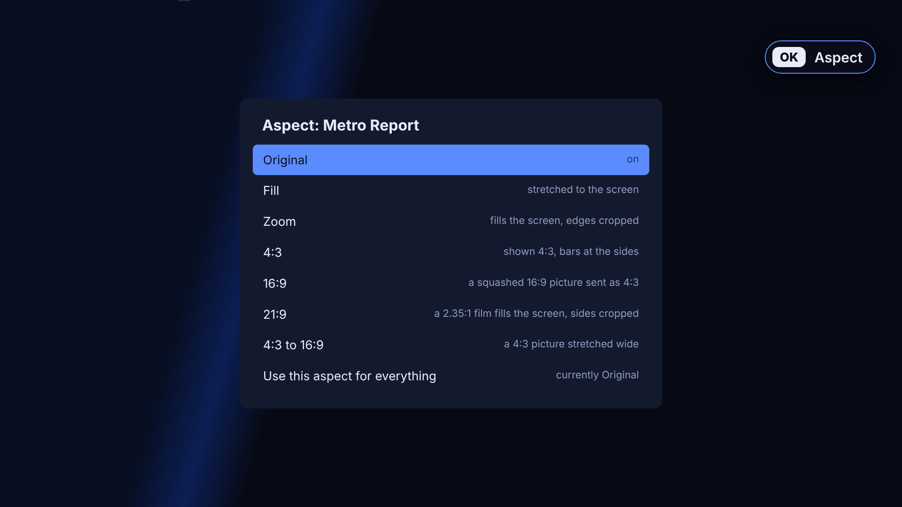</a>
</p>
</details>

**Smooth playback.**  TiviBro picks a player per stream (MPEG-TS, the TV's own player, or HLS) and falls back automatically if one struggles.  It watches for frozen pictures and reconnects on its own, with a short wait that grows between tries.  On a channel that keeps running dry it holds a bigger cushion before playing again (shown as *Buffering NN%*), and lets it shrink back once the stream settles.  It also rides out providers that jump their timestamps, briefly refuse connections, or send corrupted data.  If a provider is slow or your Wi-Fi is weak, try **Settings > Playback > Buffer profile**, or switch the **Stream format** between MPEG-TS and HLS.

It tries hard never to just stop:

- **Wi-Fi drops:** it waits for the network ("No network.  Waiting for it to come back") without using up its retries, and reconnects the moment the TV is back online.
- **A channel keeps failing:** it tries the TV's own player and the provider's HLS version of the channel, then keeps retrying with a message on screen (every 6 seconds for the first few minutes, then every 15, for up to 20 minutes), so a channel that comes back after a provider hiccup recovers by itself.
- **A channel stops working for good:** if your playlist has the same channel more than once (in another quality, another group, or a copy you hid), TiviBro switches to the next version and tells you, steadiest quality first: Full HD, HD, unmarked, 4K, then SD.  If every version fails, the provider itself is probably down, so it goes back to the channel you chose and keeps retrying.  Set this under **Settings > Playback > When a channel stops working**: switch by itself, ask you, or just keep retrying.  More in [Other versions of a channel](#other-versions-of-a-channel).
- **A channel never starts:** after a couple of quick retries it says plainly whether the provider is refusing it or the TV can't decode it.  **OK** tries again.
- **Paused live TV:** a short pause carries on where you left off.  After a long pause TiviBro lets the connection go (the provider would drop it anyway) and **Play** brings you back to live.
- **Movies and catch-up** pick up from the same spot after a dropped connection, and when you leave TiviBro (Home button, another input) and come back.

**HDR, Dolby Vision and sound formats.**  TiviBro reads what each stream is before the picture starts: from the HLS playlist, from the MPEG-TS stream, or for movies from your provider's details.  The info panel shows it, for example *4K  HEVC  Dolby Vision 8  E-AC-3 5.1*, and movie details show it before you press play.

- **Dolby Vision** plays through the TV's own player, which switches the screen into Dolby Vision itself.
- **HDR10 and HLG** stay on TiviBro's built-in player by default, for its steadier buffering.  If HDR pictures look grey or washed out, set **Settings > Playback > HDR and Dolby Vision** to *TV player for all HDR*.
- **HEVC, AV1, AAC, Dolby Digital (AC-3) and Dolby Digital Plus (E-AC-3, Atmos)** play on webOS 6 and later TVs.  Anything the built-in player can't decode moves to the TV's player automatically.
- **DTS, Dolby TrueHD and FLAC surround:** some sound the TV can't play at all.  TiviBro converts it for you, see [Sound the TV can't play](#sound-the-tv-cant-play).
- **Settings > Updates, about and diagnostics > What this TV can play** lists every format and which player handles it on your TV.

### Sound the TV can't play

LG TVs from 2020, 2021 and 2022 (webOS 5, 6 and 22, including the C1 and C2) can't play **DTS** sound at all.  No LG TV plays **Dolby TrueHD**, and **FLAC** with more than two channels doesn't play either.  Many movie files have one of those as their only sound, so they play with no sound.

TiviBro checks the sound before a movie, episode or My media file starts:

- **Another audio track the TV can play**, in the same language (or your **Audio language**): TiviBro plays that one.  Nothing to convert.
- **Only sound the TV can't play:** the network helper converts it to **Dolby Digital (AC-3)** while you watch, and TiviBro says so once ("Converting DTS audio for this TV").  The picture isn't touched, only the sound.  5.1 stays 5.1; 7.1 becomes 5.1.  It works with a soundbar or receiver too, since every one of them takes Dolby Digital.
- **Seeking** in a converted movie takes a moment longer than usual: the conversion starts again from the new spot.  The time, the progress bar, where you left off and subtitles all keep the movie's own time.
- **Audio track** in the quick menu lists the movie's own tracks.  Picking another one the TV can't play converts that one instead.

The conversion needs the **audio converter**, a small program (about 2 MB) the network helper downloads once from TiviBro's releases on GitHub, checks and keeps on the TV's storage.  The first movie that needs it asks: *Get* downloads it and the movie starts with sound; *Not now* plays the movie as it is, with no sound, and says why.  You can get it or remove it any time in **Settings > Playback**.  It is turned off or on with **Settings > Playback > Convert audio the TV can't play**.

Live channels with sound the TV can't play are converted the same way, when the stream says what its sound is.

### Other versions of a channel

Many playlists carry the same channel several times: in Full HD, HD and SD, in two groups, or as a backup copy.  TiviBro recognises them by name and treats them as versions of one channel.

- Lists and the guide show a quality tag (**FHD**, **HD**, **SD**, **4K**) beside each copy.
- **Other versions…** (**Hold OK** on a channel, or the **Red** options while watching) lists the other copies with their quality and group, hidden copies included.  The quick menu has an **Other versions** button too.  **OK** switches to one.
- **When a channel stops working,** TiviBro switches to the next version by itself and says so ("Nova News 24 isn't working.  Switched to Nova News 24 (HD)"), steadiest quality first: Full HD, HD, unmarked, 4K, then SD.  This only happens once the player has run out of retries, so a short hiccup never moves you.  If every version fails, the provider itself is probably down: TiviBro goes back to the channel you chose and keeps retrying until it returns.
- **Hidden copies count.**  Hiding the extra copies (in the set-up tour, Smart clean-up or by hand) only takes them out of your lists: they are still used as backups and listed under Other versions.  Only a copy you **block** with the parental PIN is never switched to.
- **East and West feeds are not versions of each other.**  They run hours apart, so TiviBro never switches from one to the other by itself.
- **Settings > Playback > When a channel stops working** chooses between switching by itself, asking you first, or just retrying.

<p align="center"><a href="media/versions.mp4">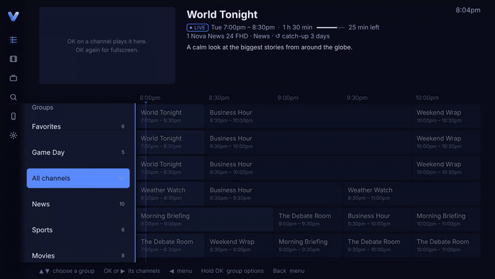</a></p>
<p align="center"><sub><a href="media/versions.mp4">Watch the MP4</a></sub></p>

<p align="center">
  <a href="https://tivibro.app/view/#tv-versions">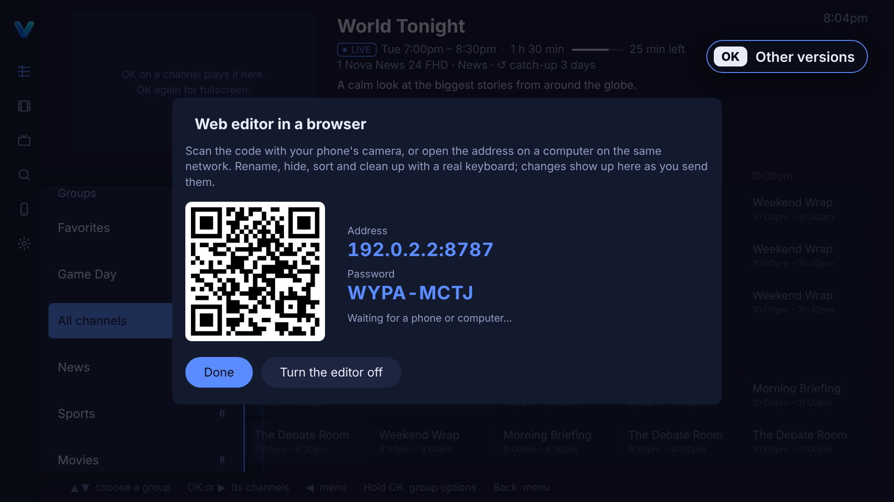</a>
  <a href="https://tivibro.app/view/#tv-quick-versions">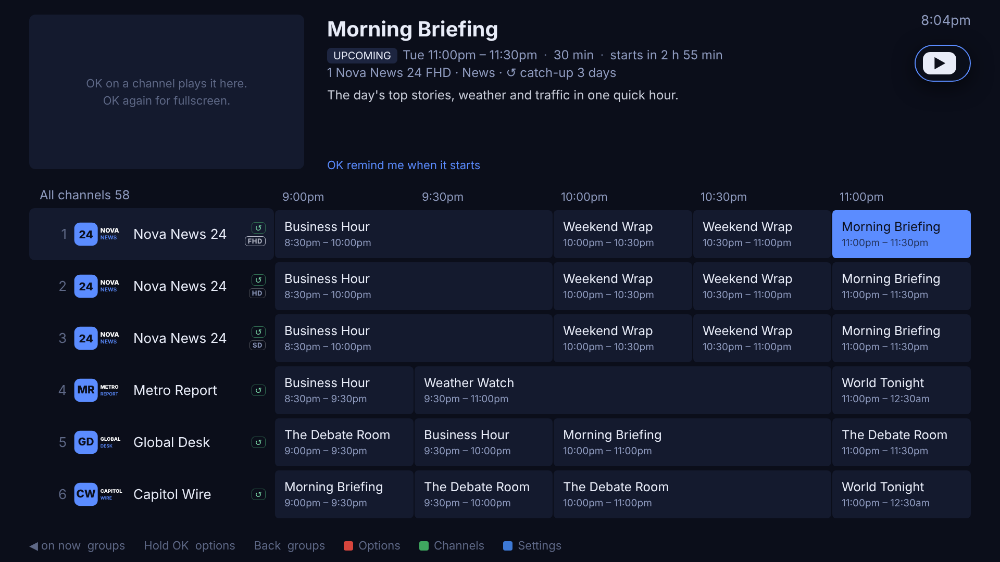</a>
  <a href="https://tivibro.app/view/#tv-failover">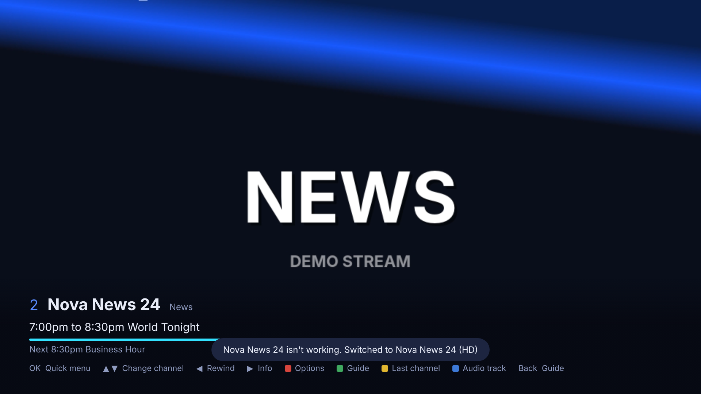</a>
</p>

### Event channels: pay-per-view and sports passes

Pay-per-view, league passes (NFL, NBA, NHL, MLB), college sports and one-off match channels often have no guide at all.  The provider writes the whole listing into the channel name instead: "NCAAB 001 | NORTH FLORIDA @ CHARLESTON SOUTHERN (M) | 12.18 11:00 AM | ESPN+".  That is long, gets cut off, and is hard to read in a list.

TiviBro reads those names:

- **Short channel names.**  The list shows the channel's own tag, "NCAAB 001", "PPV 03", "BigTen 01" or "ESPN+ 20", with the event on the line under it.
- **The event in the guide, at its time.**  Before it starts the guide says **Starts 7:30 PM: Kings vs Pelicans** (or **Starts Sat 9:00 PM** later in the week); during it, the matchup; for a few hours after, **Ended:**.  The info panel shows the details (league, sport, network) and the full original name.  A real guide for the channel always wins.
- **Events by time,** a group at the top of the list with every event channel that is on now or starts in the next two weeks, soonest first: what's on next, across all your passes, in one place.  **Hold OK** on it to turn it off.
- **Times are converted to your TV's time.**  Names that say ET, EDT, PT, CT, MT, UK, GMT, BST or CET are read in that zone ("2:00AM UK/9:00PM ET" uses the ET one), with daylight saving.  Names without a zone are read in the provider's time zone, or the one you pick in **Settings > Channels and groups > Event channels**.

It understands the usual ways providers write these: "Oct 29 7:30 PM", "Sat 15th Aug 8:00PM", "Saturday, 31 October 2026 12:30", "12.18 11:00 AM", "14/08", "2026-02-08 10:40", a time on its own for today, and a time between two teams ("Stoke City 15:00 Swansea City").  On a real provider it read 1,250 event channels this way.  Your own channel names (**Rename**) always win.

<p align="center">
  <a href="https://tivibro.app/view/#tv-events-list">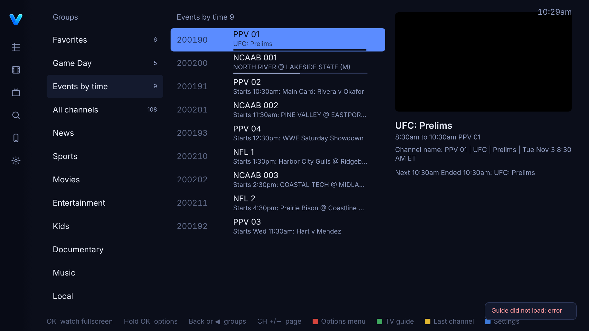</a>
  <a href="https://tivibro.app/view/#tv-events-guide">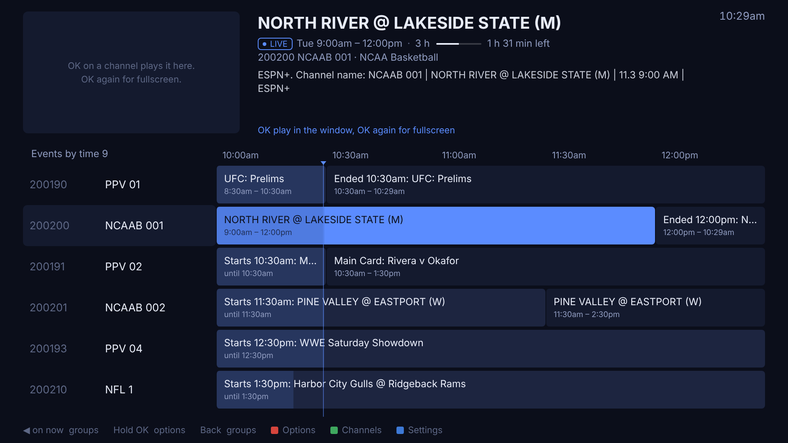</a>
</p>

### My teams

Many providers have a group for each league's teams ("NFL TEAMS", "NHL TEAMS": "NHL | DETROIT RED WINGS") next to their league passes.  **My teams** gathers the games of the teams you follow into one group near the top of the guide:

1. **Games on now**, on every channel showing them: event channels ("USA NHL 02: WPG VS CAR"), league passes, sports networks and guide programmes ("NFL Football: Lions at Vikings").  A game's channels are listed together, so when one feed doesn't work the next is right there.
2. **Their next games**, starting within 6 hours (or 3, 12 or 24), soonest first, at the bottom.

Only games: the other team's own channel is left out (unless you follow both), channels in your own groups count even when their provider group is hidden, and a team's own channel is there while it shows a game, not when its guide says "Future events not found yet" or the next game is tomorrow night.  A show about one team (a pregame show, a team magazine) isn't a game.  Games a local station lists as "NFL Football", with the teams only in the description, count.

Between games the group stays, empty, and says when the next one is: "No games on now or in the next 6 hours.  Next: Detroit Red Wings at Florida Panthers, Tomorrow 7:00pm on NHL | DETROIT RED WINGS."

For now it covers the main North American leagues only: NFL, NBA, NHL, MLB, WNBA and MLS.  College, junior and minor league teams, and other countries' leagues, aren't in it yet.

Choose your teams in **Settings > Channels and groups > My teams**.  It lists the leagues in your playlist (NFL, NBA, NHL, MLB, WNBA, MLS); open one and switch on your teams.  Teams with their own channel say so.  Or **hold OK** on a team's channel and choose **Follow the Detroit Red Wings** (in the phone app: press and hold the channel).  Your teams are kept in the settings, so they stay when you switch playlists.

**Remind me before their games** (off at first) sets reminders for their games the way the [watchlist](#watchlist) does.  Unfollowing a team takes its reminders with it.

TiviBro knows the teams by their full names ("Detroit Red Wings"), by short names when the league is clear ("Red Wings" on an NHL channel, or "Heat at Magic"), by city when the league is named ("NHL: Winnipeg vs Carolina"), and by abbreviations in event channel names ("WPG VS CAR" in an NHL group).  So "Magic Mike" on a movie channel is never a game, and junior and minor teams with the same names ("Parkland Rangers U15", "Providence Bruins") are left out.  **Hold OK** on the group for **Choose teams…** or **Turn off My teams**.

<p align="center">
  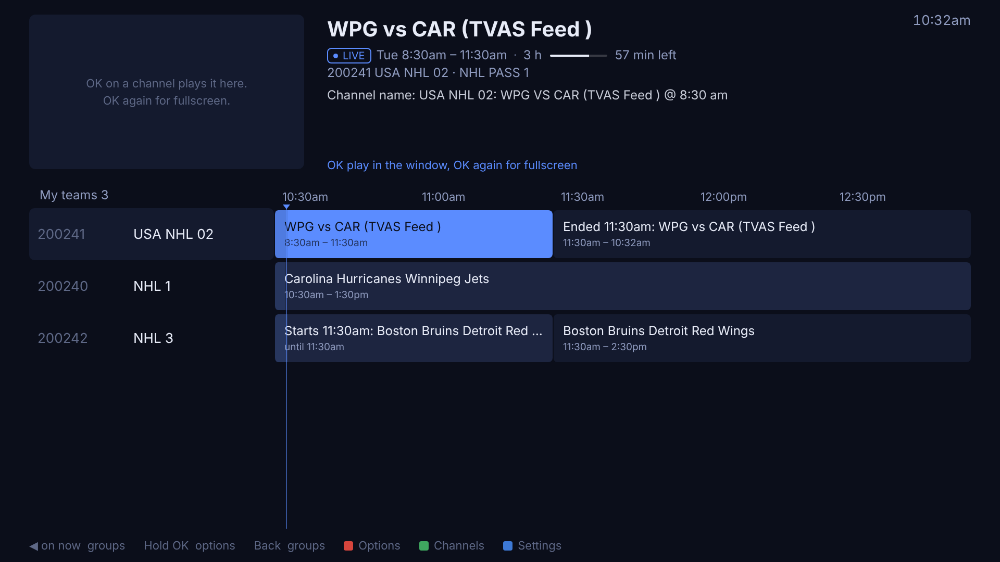
  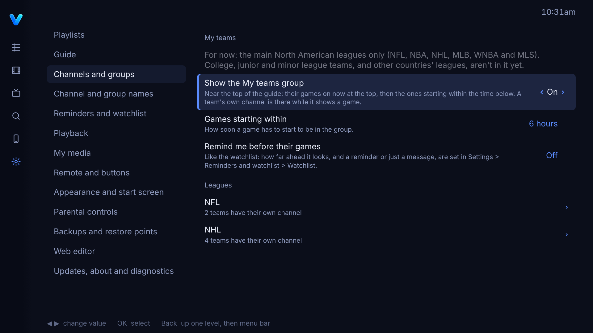
</p>

### Catch-up

Channels marked **↺** keep recent programmes on your provider's servers.

1. In the guide, press **⏪** (or **◀** past "now") to go back in time.
2. **OK** on a past programme replays it from the start.  **Hold OK** for more choices, including **Earlier programmes…** for a list by day.
3. While replaying: **◀ ▶** skip 30 seconds (keep pressing and each press jumps further), **▲ ▼** skip 5 minutes, **⏪ ⏩** jump further, **❙❙** pauses, and **Yellow** or **Back** returns to live.

From live TV, **From start** in the quick menu restarts the current programme.  Step sizes are under **Settings > Playback > Catch-up, movies and shows**.

<p align="center"><a href="media/catchup.mp4">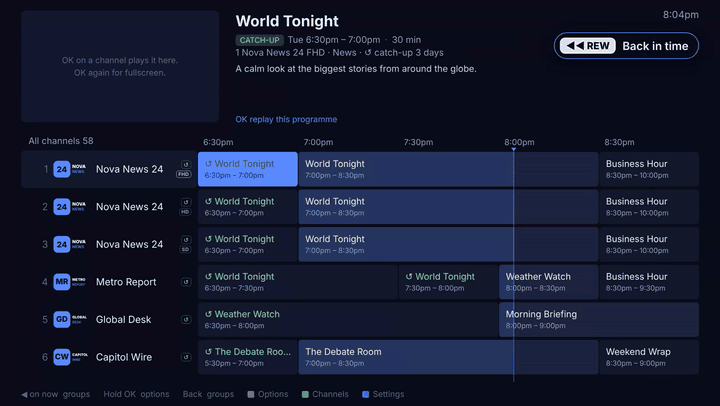</a></p>
<p align="center"><sub><a href="media/catchup.mp4">Watch the MP4</a></sub></p>

<details>
<summary><b>Screenshots</b></summary>
<p align="center">
  <a href="https://tivibro.app/view/#tv-catchup-guide">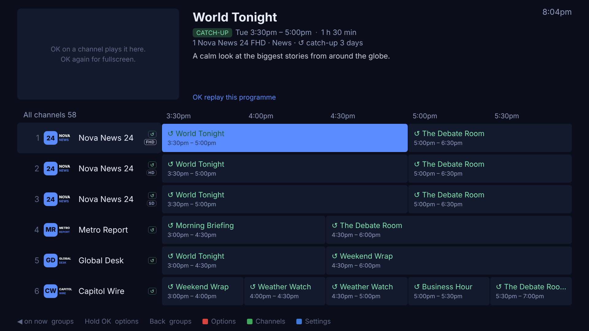</a>
  <a href="https://tivibro.app/view/#tv-hold-menu">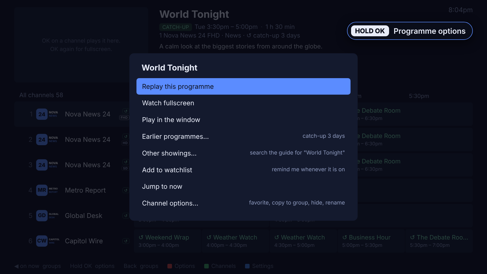</a>
  <a href="https://tivibro.app/view/#tv-catchup-play">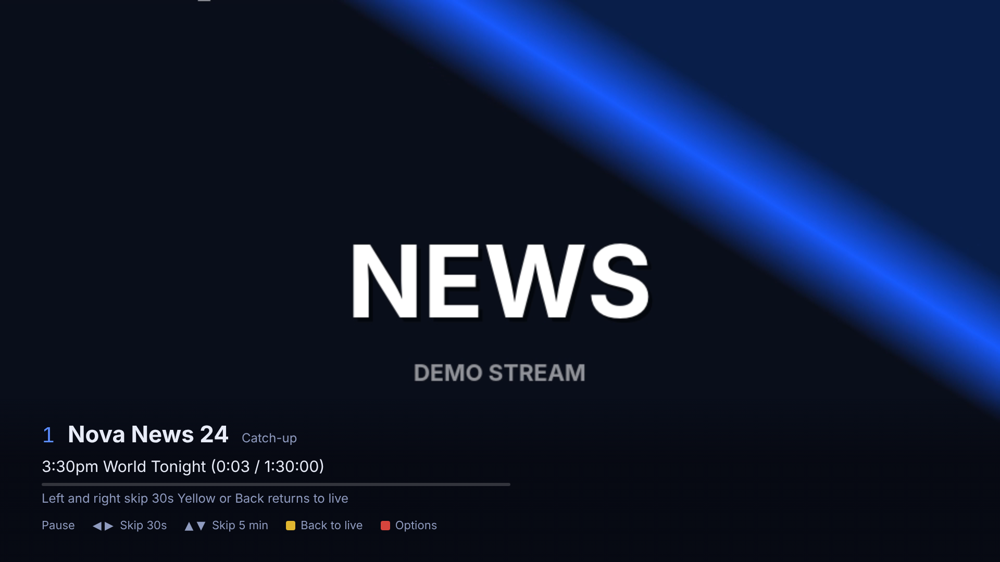</a>
</p>
</details>

### Movies and shows

If your provider offers video on demand, **Movies** and **Shows** appear in the menu.  With an Xtream Codes login they come from the provider's movie and series lists.  With an M3U link they come from the list itself: its films (links to `/movie/` or to a video file) go to **Movies**, and its episodes (links to `/series/`, or named like "Show S01 E02") are gathered into shows in **Shows**, by season, instead of filling the channel list.  The list's groups become the categories.  The network helper keeps them on the TV, so a list with hundreds of thousands of titles still fits.

- Categories on the left (**Continue watching**, **My list**, **All movies**, then your provider's), titles in the middle, details and poster on the right.
- **OK** plays a movie or opens a show's seasons and episodes.  **Hold OK** adds a title to **My list**.
- **Info** or **Hold OK** opens a title's options.  **CH + / CH −** page through long category lists.
- **Languages.**  Many providers put a language code in front of every title ("EN - ", "SE-4K - ", "[SE]") or on the category ("\|TR\| DIZI").  TiviBro takes it off the name and adds a **Languages** row at the top of the categories: **OK** on it picks which languages show.  By default that's your TV's language plus titles with no code; a library in one language shows everything and has no Languages row.  A 4K tag becomes a 4K label.
- **Hide a category:** **Hold OK** or **Red** on it.  Its titles leave **All movies** (or **All shows**) and Search too.  The same menu brings hidden categories back.
- **Adult categories** (named Adults, XXX, 18+ and the like) are listed last and stay out of **All** and Search.  With a PIN set for blocked channels, they ask for it.
- Running times read **1 h 25 min**, ratings **★ 7.6**.  On a TV, big libraries are downloaded and slimmed by the network helper, so even 160,000 movies stay light on memory.
- While watching, **◀ ▶** skip 30 seconds.  Keep pressing and each press jumps further (twice, four, then eight times as far); the info panel shows where you'll land and when the movie will end, and playback jumps there once you stop pressing.  **Back** cancels a jump you haven't landed yet.  **▲ ▼** skip 10 minutes.
- TiviBro remembers where you stopped and offers to resume.  The next episode can start by itself (**Play next episode automatically**).
- A movie or episode you watched to the end gets a **✓** in the list, and one you stopped part-way shows how far you got.  A show you started shows the episode you're on ("S1 E5") and how far you got in it, and opens on that episode.  **Hold OK** marks a title as watched or unwatched by hand.

<p align="center"><a href="media/vod.mp4">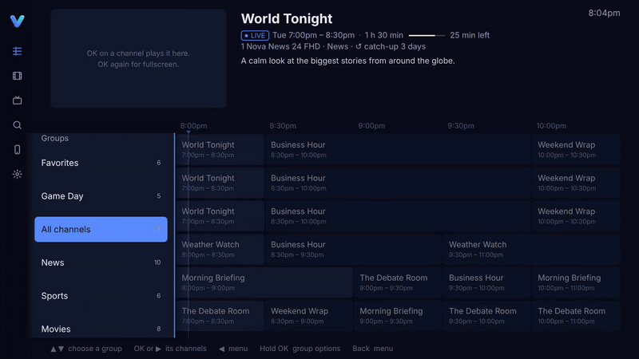</a></p>
<p align="center"><sub><a href="media/vod.mp4">Watch the MP4</a></sub></p>

<details>
<summary><b>Screenshots</b></summary>
<p align="center">
  <a href="https://tivibro.app/view/#tv-movies">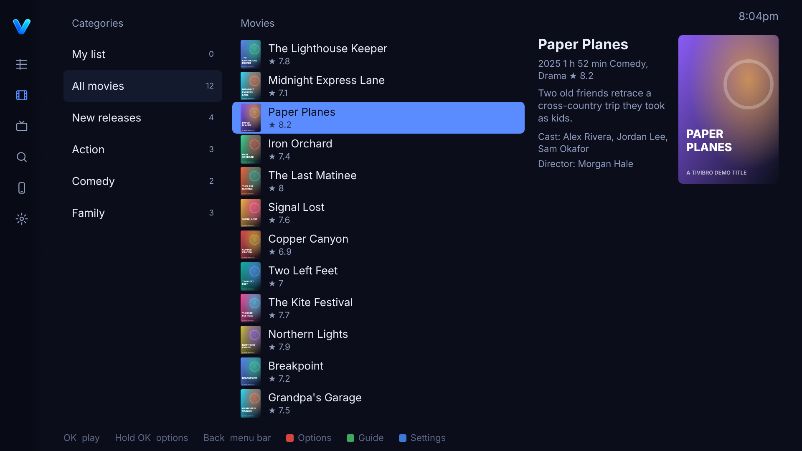</a>
  <a href="https://tivibro.app/view/#tv-episodes">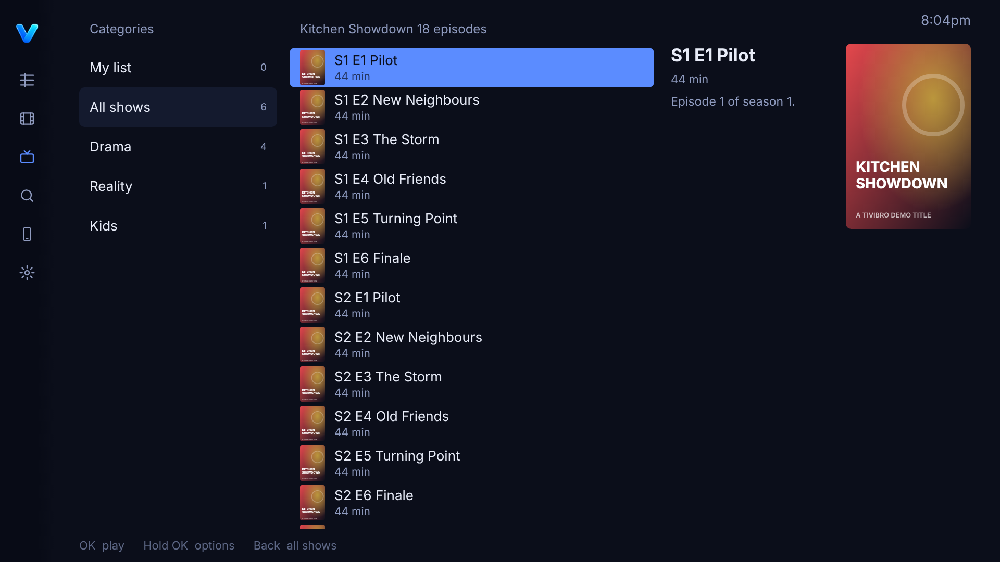</a>
</p>
</details>

### Movies on now

With your own free TMDB token saved (Settings > Guide > Movies in the guide, or Settings > My media), TiviBro finds the movies in your guide:

- **In the guide:** a movie's details show its poster, and a line with the year, runtime, genres and TMDB rating.  When the guide says little about it, TMDB's plot is shown instead.  Movies in the grid say **Movie** next to their time.
- **The Movies on now group,** near the top of the guide: the movies on now, most time left first, then the ones starting within the hour.  With none, it says so.
- **In the phone app:** an **On now** tab with the same posters and genre shelves; tap one for its backdrop, title logo, plot and channels (watch on the TV, or a reminder for one starting later).  Movies in the phone's guide and schedules show their poster.
- **The Movies on now screen,** in the side menu while a token is saved: big posters of the movies on now and starting in the next three hours, the one you're on large at the top over its backdrop, with its title logo (or its title when TMDB has no logo), its channel, time left, year, genres, rating and plot.  A movie on several channels is there once.  Under **On now** and **Starting soon** come the same movies by genre (**Action**, **Comedy**, **Family**…): a shelf for each genre with two or more of them, the biggest first, up to ten.  **OK** watches it fullscreen (Back lands in the guide on that channel); for one starting later, **OK** asks whether to set a reminder or watch the channel now (the cursor starts on **Cancel**, so a stray press sets nothing).  **Hold OK** or **Red** lists every channel showing it, a reminder on any of them, or the guide.

Which programmes are movies: the guide's own **Movie** category, a year in the title ("Bridesmaids (2011)") or "Movie:", anything 75 minutes or longer on a movie channel (HBO, Cinemax, Starz, TCM, a "Movies" group…), and other programmes 80 minutes to 4 hours long that aren't news, sport or a show.  TMDB has the last word: a movie of exactly that title (and year), and for the last kind also well known and not a TV series of the same name.  Only the programme titles (and years) go to TMDB, with your token.  Answers are kept on the TV for 30 days, so after the first day only a few titles an hour are looked up.  Turn it off with **Movie details from TMDB**, or just the group with **Show Movies on now** (Settings > Channels and groups).

<p align="center">
  <a href="https://tivibro.app/view/#tv-onnow">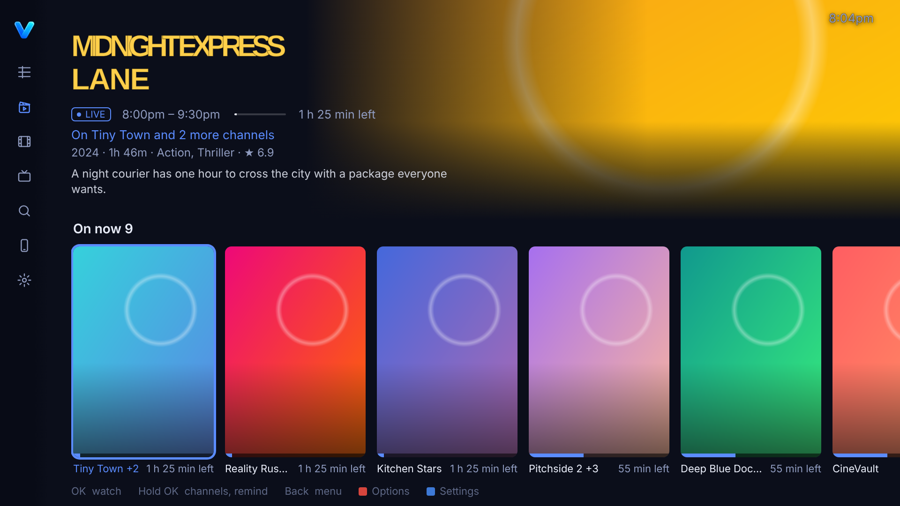</a>
  <a href="https://tivibro.app/view/#tv-onnow-genre"></a>
</p>

### My media

**My media** gives your own movies a full-width poster view.  It joins the menu once you add a source in **Settings > My media > Add media**.  It has **Continue watching**, **Favorites** and **All movies** shelves.  The movie you choose shows its title and description above the shelves.  There are no automatic trailers or previews.

<p align="center">
  <a href="https://tivibro.app/view/#tv-my-media"></a>
  <a href="https://tivibro.app/view/#tv-my-media-all"></a>
</p>

**In the phone app**, a **My media** tab shows the same shelves (Continue watching, Favorites, All movies) as a poster grid with search.  Tap a movie for its details, then **Resume on TV** or **Play on TV**: the TV opens My media and plays it.  **Settings > My media** in the phone app adds sources too: **Add media** looks for servers on your network (the TV looks, you tap one) or takes a WebDAV address and login typed on the phone.  Tap a source to rescan it, change its **Content**, fetch its movie details or remove it, and tap the TMDB token row to paste a token.  A scan that takes longer carries on on the TV.

<p align="center">
  
  
</p>

Press **Green** on My media to rescan all saved sources for new or removed movies.  Press **Yellow** to fetch details and artwork for new movies or outdated language matches.  Yellow leaves up-to-date matches alone.  Wait for a rescan to finish before fetching details.

Use **Left** and **Right** to move between movies, and **Up** and **Down** to move between shelves.  **OK** plays or resumes the selected movie.  **Hold OK** or **Red** opens movie options: add or remove a favorite, start over, mark as watched, find or correct movie details, or see file information.  Favorites and your place in a movie stay with My media across playlists and restarts.

**Back** opens the standard main menu directly.  **Left** from the first movie does the same.  There is no separate source menu on the movie screen; all sources appear together and source management stays in Settings.

**Add media and preferences are in Settings > My media**, not in the movie shelves.  **Blue** from My media opens those settings directly.  Choose **Add media > Browse my network (DLNA / UPnP)** to find a home server, or **Add a WebDAV server** and enter its WebDAV address and login.  The phone app's **Settings > My media** does the same, with the typing on the phone.  Turn on media sharing on a home server first.  A playlist must already be set up.

**Movies and TV shows.**  A new source finds both.  A source added before alpha 61 stays movies only until you open it in **Settings > My media** and set **Content** to **Movies and TV shows** (or **TV shows only**), then rescan.

Shows open into seasons and episodes.  **Red (Options)** has **TV shows** and, when something needs a look, **Needs review**.  **Favorites** shows your favourite movies and shows; they stay in the **Movies** and **TV shows** lists too, unless you turn off **Favorites also in lists** in **Settings > My media**.

Name folders and files like this, and the rest takes care of itself:

```
Movies/
  Frozen (2013)/
    Frozen.2013.1080p.BluRay.x264.mkv
TV/
  Harbour/
    Season 1/
      Harbour.S01E01.mkv
      Episode 02.mkv
```

- **Movies:** a folder named "Title (Year)" gives the title and year, whatever the file is called.  Without one, the file name is used: dots and underscores become spaces, and it is cut at the quality words (1080p, BluRay, x265).
- **Episodes:** S01E02, 1x02, or "Episode 2" inside a "Season 1" folder give the season and episode.  Shows numbered by air date or by one running number get their own order.
- **Extras:** folders named Extras, Featurettes, Behind the Scenes, Deleted Scenes, Interviews, Trailers and the like aren't opened.  Files with trailer, teaser or featurette in the name are skipped, and so are videos under 100 MB.
- **Needs review:** a file TiviBro isn't sure about waits here.  Fix one file, or a whole folder (you see what changes before it's saved).  The web editor can do the same, with undo.
- **Deleted files:** a file you delete from the server leaves My media at the next complete rescan.  If it comes back within 30 days, it keeps its details, favorite and watched state.  A scan that couldn't read every folder, or found nothing, changes nothing.

**Show details.**  With a TMDB token saved, shows get their poster and details on their own, then season details and episode names, summaries and pictures for the seasons you have.  Only exact matches are picked automatically; **Find show details** on a show picks one yourself.  **Yellow** fetches details again.  TMDB gets show titles or IDs, season numbers and your language, with your token, and never a source's login or links.

**Episodes.**  Playback remembers where you stopped, and **Auto next episode** offers the next one.  For a file that holds several episodes, TiviBro uses its chapters, or you can set where each episode starts.

**Big libraries.**  A scan works in parts and carries on where it stopped, and the source's options have **Pause scan** and **Restart scan**.  A scan that fails or finds nothing keeps what you had.

A WebDAV source is a WebDAV folder, not a normal website or HTTP directory.  Services such as premiumize use a customer ID and API key as the login.  TiviBro supports both signed file links and servers that serve files directly with HTTP Basic authentication.  For a file that needs a login, the helper streams it to the player and handles seeking and subtitle reads.  Your login is sent only to the server you added.

For easier typing, open **Settings > My media > Edit on a computer** and connect to the web editor.  Its **My media** page lets you add WebDAV logins, rescan or remove sources, and change the shared metadata language.  Saved logins are never sent back to the editor.

In **Settings > My media**, choose a saved source for **Rescan**, **Fetch movie details**, or **Remove**.  Removing a source leaves your files alone.  A failed, incomplete or empty scan keeps the previous library.

**Movie details:** **Fetch movie details** looks up a source's movies on TMDB.  Create your own API key or API Read Access Token at [TMDB API settings](https://www.themoviedb.org/settings/api), then save it under **Settings > My media > Add TMDB API token**.  You can paste it in the web editor instead of typing with the remote.  The token is checked before saving, kept only on this TV, never sent back to the editor, and excluded from backups and problem reports.  Public builds contain no token.  Fetching details sends movie titles/years or saved movie IDs to TMDB.  Only an exact, unambiguous title/year match is saved automatically; use **Find movie details** or **Change movie details** in a movie's options to search and choose a match.  **Remove movie details** clears it.  Posters and backdrops load from image.tmdb.org.  Existing matches, including manually corrected matches, are refreshed by ID rather than searched again.  Details and poster addresses survive rescans and restarts.  With a token saved, movies without details or a poster are looked up on their own after each scan and when TiviBro starts; one TMDB can't match is left alone for a week (a manual fetch still tries).  **Test TMDB token** (in Settings and the web editor) asks TMDB whether the saved token still works.

**Subtitles for movies and shows:** the subtitle menu (**Red** > **Subtitles** while playing) has **Find subtitles…**, which looks on [OpenSubtitles.com](https://www.opensubtitles.com) for what's playing, in your **Subtitle languages** (several at once, Latin American Spanish and Brazilian Portuguese included).  The search is filled in from the title and year, or the show, season and episode; change the title when the subtitle sites know it by another name.  Pick one from the list (the most downloaded first, with its frame rate and whether it's for the deaf and hard of hearing) and it's on.
- It needs your own free API key: sign up at opensubtitles.com, then **Profile > API consumers > New consumer**, and paste the key in **Settings > Playback > Add your OpenSubtitles API key** (typing it from the phone app is easiest).  Without an account OpenSubtitles allows 5 downloads a day; **Sign in** with a free account for 20.  The key and login stay on the TV, out of backups.
- **Timing** moves any subtitle a little earlier or later (0.1 s or 1 s at a time).  **Timing > Frame rate…** fixes a subtitle made for a copy at another frame rate, which drifts further out of time as the film goes on: pick *Subtitle for 23.976 fps, video at 25 fps* and so on (23.976, 24 and 25 fps), and every line's time is scaled to match.  A subtitle that is in time, then early or late for a while, then in time again was made for another cut of the film: try another download.
- TiviBro draws subtitle lines itself, exactly the ones whose time is now, so a line can't stay stuck on screen after Timing, Line up or a seek moved it.
- **Line up with another track…** fixes a subtitle that drifts or starts at the wrong time by matching it to one that's already in time (a built-in one, or another download, in any language).  It finds the shift and a frame-rate difference (23.976, 24 or 25 fps) and says how much it moved.

Movies use the usual seek bar and subtitle menu.  Embedded SRT, ASS/SSA and WebVTT text subtitles in MKV files can appear when the file has a usable subtitle index, including larger indexes in movies with many languages.  Text subtitles in MP4 files appear too.  ASS/SSA and WebVTT show as plain text, without their custom fonts, positioning or animation.  Image subtitles such as VobSub or PGS and separate subtitle files from your server are not included yet.  **Find subtitles** can add a subtitle from OpenSubtitles even when the file has no supported embedded tracks.  **Back** hides the player controls first, then returns to the same movie.  Series, folder picking, Search and phone app browsing are not included yet.

Playback contacts servers you add and their playback servers.  Fetching details also contacts api.themoviedb.org with titles/years or saved movie IDs and the preferred language, never your source logins or playback links.  Previously saved Cinemeta posters may still load from images.metahub.space until those movies are refreshed.  Cloud playback links are resolved each time you play and are never saved.  After a long pause with an expired link, return to the shelves and resume.  The library uses the helper's persistent storage, so app restarts and updates keep it even when browser storage is full.  Source logins are outside playlist backups and problem reports; add the sources again after restoring on another TV.  Up to eight sources can be saved.

### Search

**Search** in the menu finds channels and programmes in the guide (now, later today, the coming days and on catch-up) as you type, and also your Movies and Shows.  Below the box, **Everything**, **On now**, **Coming up**, **Replays**, **Channels** and **Movies & Shows** narrow the results (**◀ ▶** on that row).  Each programme shows once, even when several copies of the channel carry it, with **Today**, **Tomorrow** or the day and its time.  **OK** watches, replays, opens a show's episodes, or sets a reminder (**OK** again cancels it); **Hold OK** gives channel options.  **Yellow** adds what you typed to your [watchlist](#watchlist).

Programmes that have what you typed only in their **description** come after the rest, a moment later, with the words around it: **lions** finds the local station whose "NFL Football" is "Minnesota Vikings at Detroit Lions".

Movies and shows are searchable without opening **Movies** or **Shows** first: Search reads the lists the TV keeps (or loads them once).  Results are ranked by how closely the title matches (the whole title, then the start, then a word), then by what you can watch: on now, a movie or show, a channel, coming up, a replay.  So **batman** lists the Batman films before the 24/7 Batman channels, and **CNN** still finds the channel first.  Titles in languages you hid, and adult titles, don't show.  **OK** on a movie opens it in **Movies** and plays it, so **Back** lands on it there; on a show it opens its episodes.

<p align="center"><a href="media/search.mp4"></a></p>
<p align="center"><sub><a href="media/search.mp4">Watch the MP4</a></sub></p>

<p align="center">
  <a href="https://tivibro.app/view/#tv-search"></a>
</p>

### Favorites, hiding and your own groups

**Hold OK** on any channel (in the guide, the channel list or fullscreen with **Red**):

- **Add to Favorites** puts it in Favorites.
- **Select multiple…** (in the channel list) lets you copy, favorite or hide several channels at once.
- **Copy to group** adds it to one of your own groups (make one under **Settings > Channels and groups > New group…**).
- **Hide channel** removes it from the lists.  Hidden items come back from **Settings > Channels and groups**, or show them dimmed with **Show hidden items in lists**.
- **Show or hide channels…** puts a tick on every row of the group, right in the guide or the channel list, hidden channels too (dimmed, unticked).  **OK** ticks or unticks, **CH +/−** turns a page, **Red** has **Show all**, **Hide all**, **Hide channels with no guide information** and **Leave without saving**.  Nothing changes until **Back**, which saves.  It's also in a group's options, and in the guide's **Hold OK** menu.  A hidden channel is hidden in every group.  In the phone app: press and hold a channel, then **Show or hide channels…**.
- **Rename…** and **Assign guide…** fix a name or a missing guide for that one channel.
- **Other versions…** lists the same channel in its other qualities and copies, hidden ones included, to switch to one directly.
- **Move…** (in the channel list and the guide) changes the channel's place in its group, yours or the provider's: **▲ ▼** carry it, **CH + / −** a page at a time, **OK** puts it down.  A provider group you reorder keeps your order after playlist refreshes, and channels the provider adds later go to the end.  **Hold OK** on the group > **Back to the provider's channel order** undoes it.

**Manage groups** in Settings shows every group in one list to switch on or off, like TiviMate.  For hundreds of groups the [web editor](#channels-and-groups) is much faster.  Sorting, the Recent and Favorites groups, and getting hidden items back are in [Settings: Channels and groups](#settings-channels-and-groups).

<p align="center"><a href="media/channels.mp4"></a></p>
<p align="center"><sub><a href="media/channels.mp4">Watch the MP4</a></sub></p>

<p align="center">
  <a href="https://tivibro.app/view/#tv-channel-options"></a>
  <a href="https://tivibro.app/view/#tv-copy-to-group"></a>
  <a href="https://tivibro.app/view/#tv-set-manage-groups"></a>
</p>

### Reminders

**OK** (or **Hold OK > Remind me**) on a future programme in the guide or in search.  When it starts, TiviBro asks **Watch** or **Dismiss**, or switches by itself if you set **When a reminder starts** that way.  You can be reminded a few minutes early.

Reminders work with TiviBro closed too, as long as the TV is on: the TV shows its own alert over whatever you're watching, another app or an HDMI input included, and **Watch** opens TiviBro on the channel.  If it started a while ago and the channel has catch-up, TiviBro offers **Watch from the start**.  A reminder that came due while you were away is never lost: TiviBro asks when you come back, and one that already ended is offered from catch-up.  (Some TVs show a toast instead of an alert; select it to watch.)

Reminders are for someone using the TV.  When the screensaver, the Gallery or art screen, or Always Ready is showing, the alert waits and comes up once you're back (while the programme is still on); otherwise TiviBro asks the next time you open it.  Telling whether the screen is in use needs two permissions the TV only gives TiviBro on a rooted TV (installed with the Homebrew Channel or install.sh, which add them); elsewhere reminders show whatever is on screen.  With TiviBro closed, a rooted TV shows the alert with **Watch** and **Dismiss**; other TVs show a notification you can select to watch.  Inside TiviBro, a reminder waits if nobody has pressed a button for 10 minutes and nothing is playing.  Timing and behaviour are under [Settings: Reminders and watchlist](#settings-reminders-and-watchlist).

**Coming up.**  **Settings > Reminders and watchlist** lists every reminder still to come, soonest first, with its channel and the watchlist word or team that set it.  **OK** on one (**Cancel**) cancels it, after asking, and **Cancel all reminders** cancels every one.  The phone app's **Reminders** screen (a shortcut on the TV's card, and the bell on the Guide tab) and the web editor's [Reminders and watchlist](#reminders-and-watchlist) page show the same list, with the same Cancel and Cancel all.

### Watchlist

The watchlist looks for shows, teams and names in the guide for you: "Yankees", "Bluey", "Premier League", "Gordon Ramsay".  When one is coming up in the next 24 hours (or 6, 12 or 48), TiviBro sets a reminder, and says so.  Matching is by whole words in programme titles, so "Cars" never finds "Oscars".  A reminder you cancel doesn't come back, and a busy word keeps at most five reminders waiting at a time.

Add to it three ways: **Yellow** in Search (adds what you typed), **Hold OK > Add to watchlist** on a programme in the guide, or **Settings > Reminders and watchlist > Watchlist > Add a show, team or name…**.  That page lists your words, everything coming up (**OK** sets or cancels each reminder), and removes a word with the reminders it set.  The [web editor's](#reminders-and-watchlist) Reminders and watchlist page has the watchlist too, with a real keyboard.

The watchlist needs the guide to know what's on: with an XMLTV guide it sees every channel; with only the provider's per-channel guide, it sees the channels you've looked at.

<p align="center"><a href="media/reminders.mp4"></a></p>
<p align="center"><sub><a href="media/reminders.mp4">Watch the MP4</a></sub></p>

<p align="center">
  <a href="https://tivibro.app/view/#tv-reminder-set"></a>
  <a href="https://tivibro.app/view/#tv-reminder"></a>
</p>

### Settings

**Blue** in the guide, or **Settings** in the menu.  On a row with a choice, the focused row shows **‹ ›**: **◀ ▶** change it.  Colour rows show a swatch of the colour.  Every option is explained, with its default, in [Every setting](#every-setting).  The sections:

| Section | What's in it |
|---|---|
| [**Playlists**](#settings-playlists) | Add and switch playlists, connection and User-Agent, channel list reloads, subscription expiry and connections, the set-up tour, and each playlist's own guide, names and event channels |
| [**Guide**](#settings-guide) | How your guide is built, provider guide mode and offset, your own guide sources, reloads, public fill-in, guide coverage, assigning a guide, channels with no guide wanted, movie details from TMDB |
| [**Channels and groups**](#settings-channels-and-groups) | Manage groups, sort orders, your groups first, Recent and Favorites, My teams, Movies on now, event channels, recently added, your own groups, hidden groups and channels |
| [**Channel and group names**](#settings-channel-and-group-names) | Name clean-up rules, hiding channels with nothing on, your prefixes and suffixes, group prefixes and suffixes, previews |
| [**Reminders and watchlist**](#settings-reminders-and-watchlist) | When reminders come up and what they do, the watchlist, and every reminder coming up, with Cancel and Cancel all |
| [**Playback**](#settings-playback) | Buffer profile, player engine, MPEG-TS or HLS, network helper, HDR and Dolby Vision, aspect, catch-up skip steps, info panel when switching, audio, converting sound the TV can't play, subtitles and captions, next episode |
| [**My media**](#settings-my-media) | Add media sources, rescan, fetch details, the TMDB token, sort orders, metadata language, each source |
| [**Remote and buttons**](#settings-remote-and-buttons) | Remap buttons in the player and lists, quick menu buttons, learn a button, button tester |
| [**Appearance and start screen**](#settings-appearance-and-start-screen) | Start screen, OK in the guide, guide layout, catch-up marks, theme (Black and white, Tokyo Night, Dracula, Nord, Gruvbox, Catppuccin, Solarized, One Dark, Rosé Pine, Everforest, Kanagawa, Monokai, or your own mix), accent color (twelve presets or your own from a hue and brightness), background (Midnight, Black OLED, Slate, Ocean, Forest, Plum, Mocha, High contrast, Classic), focus style, text size, panel transparency, logos, clock, channel numbers |
| [**Parental controls**](#settings-parental-controls) | Content filter, PIN, what it protects, blocked groups and channels |
| [**Backups and restore points**](#settings-backups-and-restore-points) | Where backups live (the phone app, or a locked file), the last backup, and the restore points on this TV |
| [**Phone app and web editor**](#settings-phone-app-and-web-editor) | Pairing the TiviBro app, paired phones, and the web editor's switch, address, password and port |
| [**Updates, about and diagnostics**](#settings-updates-about-and-diagnostics) | Your version, check for updates, install an update (rooted TVs), what's new, automatic checks, test versions, report a problem, connection and speed tests, logs, what this TV can play, status |

<p align="center"><a href="media/settings.mp4"></a></p>
<p align="center"><sub><a href="media/settings.mp4">Watch the MP4</a></sub></p>

<details>
<summary><b>Screenshots</b></summary>
<p align="center">
  <a href="https://tivibro.app/view/#tv-settings"></a>
  <a href="https://tivibro.app/view/#tv-settings-look"></a>
</p>
</details>

### Updates

**Settings > Updates, about and diagnostics** shows your version and checks GitHub for a newer one.  TiviBro also checks by itself once a day and shows a short note when there is an update; nothing is installed without you.

- **Install** (rooted TVs with the Homebrew Channel): downloads the new version, checks its fingerprint, installs it, and restarts TiviBro with all your settings.
- **What's new** lists the changes in that version.
- **Include test versions** also offers alpha and beta builds.  It is on when you are running one.
- On TVs that aren't rooted, the page tells you the new version is out; install it from a computer as before.

<p align="center">
  <a href="https://tivibro.app/view/#tv-set-updates"></a>
</p>

### Parental controls

**Content filter**, at the top of **Settings > Parental controls**, takes channels out of TiviBro altogether, no PIN needed: they never show in the guide, any list, Search, the phone app or the web editor.

- **Hide adult channels** catches channels and groups named Adult, XXX, 18+, Porn, Erotic and the like, in several languages, and channels the provider marks as adult.  "Adult Swim" stays.  A new TV asks on the set-up tour's first screen, with **Yes** picked.
- **Add a word or call sign…** hides every channel and group with that whole word in its name: a city's affiliates by call sign, shopping channels, a sports league you never watch.
- While watching or in the guide, a channel's or group's options have **Hide with the content filter** (asked first).
- Each word, channel and group is listed there with **Remove**, and **Left out of this playlist** says how many channels and groups the filter takes out.  Nothing is deleted: remove an entry and the channels come back.

Set a PIN under **Settings > Parental controls**, then **Hold OK** on any channel or group and choose **Block channel** (or block a whole group from its options).  Decide whether the PIN guards blocked channels, Settings, or both, and whether it stays unlocked until TiviBro restarts.  **Lock now** locks it again straight away.  Blocked channels show **Locked** instead of their programme, and blocking the channel that's playing stops it.  All options: [Settings: Parental controls](#settings-parental-controls).

<p align="center"><a href="media/parental.mp4"></a></p>
<p align="center"><sub><a href="media/parental.mp4">Watch the MP4</a></sub></p>

<p align="center">
  <a href="https://tivibro.app/view/#tv-settings-parental"></a>
  <a href="https://tivibro.app/view/#tv-pin"></a>
</p>

---

## Every setting

Every option in **Settings**, section by section, in the order the TV lists them, with its choices and what it does.  The default is in **bold**.  Changes take effect straight away; nothing needs a restart.  The phone app's **Settings** tab has the same sections in the same order.

On a row with a choice, **◀ ▶** change it (with the Magic Remote, click the **‹ ›** arrows).  **OK** opens a row that leads to a page (marked **›**) or runs an action.  **Back** goes up a page, then to the section list, then to the menu.

### Settings: Playlists

Your playlists and how often their channel lists reload.  **OK** on a playlist opens its page.  The guide, names and channels of the playlist in use have their own sections: [Guide](#settings-guide), [Channel and group names](#settings-channel-and-group-names) and [Channels and groups](#settings-channels-and-groups).

<p align="center">
  <a href="https://tivibro.app/view/#tv-set-playlists"></a>
  <a href="https://tivibro.app/view/#tv-set-playlist"></a>
  <a href="https://tivibro.app/view/#tv-set-playlist-2"></a>
</p>

| Setting | Choices | What it does |
|---|---|---|
| *(each playlist)* | | Its name and type, and for the one in use, how many channels it has.  **OK** opens its page (below). |
| **Add playlist…** | | Opens the setup screen for another Xtream Codes or M3U playlist.  Each playlist keeps its own groups, favorites, hidden items, guide and name rules.  From the phone app it's easier: share your provider's link to it. |

Each playlist in the list starts with when its subscription ends ("Expires 19 Nov", "Expires in 3 days" in the last two weeks, "Expired 2 Oct"), when the provider reports it.

On a playlist's page:

| Setting | Choices | What it does |
|---|---|---|
| **Use this playlist** | | Switches the TV to this playlist (shown when it isn't the one in use). |
| **Name** | | The name shown in Settings and the web editor. |
| **Connection** | | Server, username and password (or the M3U address).  Opens the setup screen, which tests the login before saving. |
| **User-Agent** | **Default** or your own | Only if your provider asks for a specific one (TiviMate's "User-Agent" setting).  The network helper sends it for this playlist. |
| **Reload channel list** | Every app start · Every 6 hours · **Every 12 hours** · Every day · Every 2 days · Every week · Only when I ask | How often the channel list is fetched again.  Your groups, renames and hidden items are always kept. |
| **Reload channels now** | | Fetches the channel list right away.  While it reloads this row is **Stop reloading**, which stops it and keeps the channels from the last load. |
| **Last reloaded**, **Subscription expires**, **Connections allowed** | (information) | From your provider, when it reports them. |
| **Guide ›** | | This playlist's guide: the same rows as **Guide for** your playlist in [Settings: Guide](#settings-guide). |
| **Set-up tour** *(playlist in use, on the TV)* | | Runs the [set-up tour](#the-set-up-tour) again: countries, names, East or West, your city, event channels, clutter, logos and look.  Shows when you last applied it. |
| **Channel and group names ›** | | This playlist's name rules: the same page as [Settings: Channel and group names](#settings-channel-and-group-names). |
| **Event channels ›** | | This playlist's [event channels](#event-channels-pay-per-view-and-sports-passes) (see [Settings: Channels and groups](#settings-channels-and-groups)). |
| **Delete this playlist** | | Removes the playlist with its groups, favorites, hidden items and cached data.  Shown when you have more than one. |

### Settings: Guide

Where the programme guide comes from, for the playlist in use, and the movies in it.  Each playlist's page under [Playlists](#settings-playlists) has the same guide rows for that playlist.

**How your guide is built.**  The page starts with the order TiviBro builds your guide in:

1. **Your provider's guide.**
2. **Your own guide sources**, the first one first.  They win over the provider's.
3. **Public fill-in**, only for channels nothing else covers: epg.pw, iptv-epg.org, and Pluto TV's own guide from i.mjh.nz for Pluto channels.
4. **Matching:** each channel is linked to a guide channel by its guide id, then its name.  A wrong one: **Hold OK > Assign guide**.

A channel that will never have a guide (a radio stream, a camera, an event slot): **Hold OK > No guide for this channel**.  It drops out of matching and public fill-in, and stops saying "No guide information".  The web editor's Guide page does many at once (**Ignore**).

With public guides on, if the provider guide fails, the guide status says it is checking public guides.  Once they supply current matching listings, it says **Provider guide unavailable; using public guides.**  If they supply none, it says so instead.  If the guide TiviBro already had is still there, it says it is **using the saved guide**.  The original error stays in the guide's details.

<p align="center">
  <a href="https://tivibro.app/view/#tv-set-guide"></a>
  <a href="https://tivibro.app/view/#tv-set-guide-2"></a>
</p>

| Setting | Choices | What it does |
|---|---|---|
| **Provider guide** | Xtream: **Per channel** · Full XMLTV file · Off.  M3U: **From playlist** · Off | *Per channel* asks for each channel's programmes as you browse: light and fast.  *Full XMLTV file* downloads the provider's whole guide: days ahead, guide search and manual matching, but often 20 to 200 MB.  *Off* uses only your own guide sources. |
| **Provider guide time offset** | −12:00 to +12:00 in half hours, **0:00** | Use it when every programme from the provider guide is too early or too late. |
| **Guide sources ›** | | Extra XMLTV guides (`.xml` or `.xml.gz`), checked before the provider guide.  **OK** on one to edit its address, give it its own time offset, move it up or down (the first one wins when two cover a channel) or remove it.  **Add guide source…** adds one.  The [web editor](#the-programme-guide) has a list of free guides by region. |
| **Reload guide** | Same choices as the channel list, **Every 12 hours** | How often the guide is downloaded again. |
| **Keep past days** | 1 · **2** · 3 · 5 · 7 days | How far back the guide keeps programmes, for catch-up browsing.  More days use more TV memory. |
| **Match guide by channel name** | **On** · Off | Links channels that have no guide id to a guide channel with the same name. |
| **Public guide fill-in ›** | **On** · Off | For channels with no guide from your sources or your provider: free guides from epg.pw and iptv-epg.org, matched by guide id, a local station's call sign or the name, and Pluto TV's own guide (i.mjh.nz) for Pluto channels, matched by their Pluto id.  Inside: **Fill in from public guides**, **Countries** (**Automatic**: the countries of the channels that need a guide, or up to eight you choose), how many channels each guide filled in and when it last looked, **Look again now**, and **About these guides**.  TiviBro hosts nothing and sends no logins.  See [Public guide fill-in](#the-programme-guide). |
| **Reload guide now** | | Downloads the guide right away. |
| **Guide last loaded**, each source, **Channels with guide data** | (information) | When the guide loaded, how many channels and programmes each source gave, and how many of your channels have a guide. |
| **Assign guide to channels without one** | | Lists channels with no guide (leaving out the ones with no guide wanted); pick one and search the guide for the right channel.  Also on any channel: **Hold OK > Assign guide…**. |
| **Channels with no guide wanted ›** | | Shows once you have some: every channel you marked **No guide for this channel** on the TV, or **Ignore** in the web editor.  They are left out of guide matching and public fill-in, and don't say "No guide information".  **OK** on one (**Look again**) looks for a guide for it again. |
| **Movie details from TMDB** | **On** · Off | Under **Movies in the guide**.  With a TMDB token: posters and details for movies in the guide, the **Movie** tag, the [Movies on now](#movies-on-now) group and the Movies on now screen.  Only programme titles go to TMDB. |
| **Add TMDB API token** | Not set | Your own free TMDB API key or Read Access Token, the same one as in [Settings: My media](#settings-my-media).  Once saved the row reads **TMDB API token saved** (select it to replace it), with **Test TMDB token** and **Remove TMDB token** under it. |

### Settings: Channels and groups

Which groups show, in what order, the special groups (Recent, Favorites, My teams, Movies on now, Events by time, Recently added), your own groups, and getting hidden things back.

<p align="center">
  <a href="https://tivibro.app/view/#tv-set-groups"></a>
  <a href="https://tivibro.app/view/#tv-set-groups-2"></a>
  <a href="https://tivibro.app/view/#tv-set-manage-groups"></a>
</p>

| Setting | Choices | What it does |
|---|---|---|
| **Manage groups ›** | | Every group in one list, like TiviMate: **OK**, **◀** or **▶** switches a group on or off.  **Groups shown**, **Show all groups** and **Hide all groups** at the top (hide all, then switch on just the ones you watch).  For hundreds of groups the [web editor](#channels-and-groups) is faster. |
| **Show hidden items in lists** | On · **Off** | Hidden groups and channels appear dimmed, so you can unhide them from their own options. |
| **Channel order** | **Playlist order** · Channel number · Name · Most watched | For provider groups and All channels.  Your own groups keep the order you set. |
| **Group order** | **Playlist order** · Name | Groups you moved by hand stay where you put them. |
| **Your groups first** | **On** · Off | Favorites and your own groups above the provider's groups. |
| **Show All channels** | **On** · Off | The All channels group. |
| **Show Recent channels** | **On** · Off | A group with the channels you watched lately. |
| **Recent channels kept** | 10 · **20** · 30 · 50 | How many channels Recent remembers. |
| **Show Favorites group** | **On** · Off | The Favorites group. |
| **My teams ›** | | The teams you follow, for the [My teams](#my-teams) group: **Show the My teams group** (**On**), **Games starting within** (3 · **6** · 12 · 24 hours), **Remind me before their games** (**Off**), and a page for each league in your playlist to pick teams. |
| **Show Movies on now** | **On** · Off | The [Movies on now](#movies-on-now) group.  Needs a TMDB token (Settings > Guide > Add TMDB API token). |
| **Event channels ›** | **On** · Off | Pay-per-view and league pass channels whose names carry the game and its time, read into the guide (below). |
| **Show Events by time** | **On** · Off | With event channels on: the group of events on now or starting in the next two weeks.  The same switch as **Events by time** in Event channels; brings the group back after **Turn off Events by time** in its menu. |
| **Recently added channels** | Off · 3 days · **7 days** · 14 days | A **Recently added** group with the channels that are new in your playlist since it last loaded, newest first, and a **NEW** tag in the lists. |
| **Groups your provider adds later** | **Show them** · Hide them | *Hide them* keeps a tidy list tidy after **Hide all groups**: new provider groups arrive hidden. |
| **All channels includes hidden groups** | On · **Off** | Channels from groups you hid still appear in All channels. |
| **Reset watch time** | | Clears the statistics behind *Most watched*. |
| **New group…** | | Under **Your groups**.  Creates one of your own groups.  Then **Hold OK** on any channel and choose **Copy to group…**. |
| *(each of your groups)* | | **OK** for Rename, Move up, Move down, Empty this group and Delete group (Favorites can't be renamed or deleted). |
| **Hidden groups**, **Hidden channels** | | Everything you hid, with **Restore** on each and **Restore all groups** / **Restore all channels**. |
| **Clear all edits for this playlist** | | Under **Reset**.  Removes your groups, renames, guide assignments and hidden items for this playlist.  It asks first.  The web editor's **Backups and restore points > Start over** does the same, can be undone, and waits for **Send to TV**. |

**Event channels.**  For pay-per-view, league passes and one-off games whose name carries the matchup, date and time (see [Event channels](#event-channels-pay-per-view-and-sports-passes)).  The same page is on each playlist's page under [Playlists](#settings-playlists).

<p align="center"><a href="https://tivibro.app/view/#tv-set-events"></a></p>

| Setting | Default | What it does |
|---|---|---|
| **Read events from channel names** | **On** | Shows the event from the name in the guide at its time, with "Starts 7:30 PM" before it and "Ended" after.  A real guide for the channel always wins. |
| **Short channel names** | **On** | "NCAAB 001 \| NORTH FLORIDA @ CHARLESTON SOUTHERN (M) \| 12.18 11:00 AM" shows as "NCAAB 001", with the game on the line under it. |
| **Events by time** | **On** | A group with every event channel that is on now or starts in the next two weeks, soonest first. |
| **Times with no time zone are in** | **The provider's time zone** | For names without ET, PT, UK and so on.  US Eastern, Central, Mountain or Pacific, UK, Central Europe, UTC, or this TV's time.  Times always show in the TV's own time. |
| *(list)* | | How many event channels the playlist has, and the next few events. |

### Settings: Channel and group names

Rules that strip clutter from every channel and group name at once, for the playlist in use (each playlist has its own rules, also on its page under **Playlists**).  Your provider's names are never changed: switch a rule off and the original comes back.  Names you set by hand stay.

<p align="center"><a href="https://tivibro.app/view/#tv-set-names"></a></p>

| Setting | Default | What it does |
|---|---|---|
| **Clean up channel names** | **On** | The master switch.  Off shows the original names. |
| **Hide channels with nothing on** | Off | Event channels the provider names "Off Air", "Offline" or "No Event Scheduled" between events, empty slots ("PPV 09 \|", "EPL 02:", " :ESPN+ 291") and events that ended hours ago (the provider never renamed them) stay out of the lists while they say so, and come back by themselves when an event is named on them.  Favorites keep theirs.  Works even with name clean-up off. |
| **Clean group names too** | **On** | The rules below also tidy group names: "USA \| Sports" becomes "Sports".  Your group prefixes and suffixes apply either way. |
| **Enable recommended defaults** / **Turn all default rules off** | | Set every built-in rule at once.  Your own lists are kept. |
| **Country and region prefixes** | **On** | "USA \| ESPN" → "ESPN", "\|UK\| BBC One" → "BBC One", "CA: TSN 1" → "TSN 1", "UK◈ Sky Store" → "Sky Store".  About 250 country, region and language codes (CAR, ARG, CO, CA-FR, AFG, PK and so on), with any separator: \| : - • » ◈ ▶. |
| **Category and package prefixes** | **On** | "VIP \| AMC" → "AMC", "24/7 - Friends" → "Friends", "SPORTS: TNT" → "TNT", "DEP \| TUDN 01" → "TUDN 01".  Also Spanish ones (Deportes, Cine, Noticias, Infantil, Novelas) and package words like Gold or Max. |
| **Quality and format tags at the end** | **On** | "CNN FHD" → "CNN", "Nat Geo (1080p)" → "Nat Geo", "AMC \| RAW" → "AMC". |
| **Decorative symbols** | **On** | "Fox News ᴴᴰ" → "Fox News", "TNT ★" → "TNT", "⚽ EPL 1" → "EPL 1", "⫘⫘⫘ UK ⫘⫘⫘" → "UK", "Event 2026™: Final" → "Event 2026: Final", "EL NUEVE SD \*" → "EL NUEVE".  Emoji, sport symbols, circled letters, arrows and shapes. |
| **Time zone feeds** | Off | "HBO (East)" → "HBO", "Starz West" → "Starz".  Off by default because East and West feeds would end up with the same name. |
| **Any short bracketed tag at the ends** | Off | "[EN] Sky News" → "Sky News", "AMC (Backup)" → "AMC".  Off by default because it can remove useful text like "(Sports)". |
| **Free streaming service prefixes** | Off | "Pluto US \| CNN Headlines" → "CNN Headlines", "TUBI \| ION" → "ION", "Samsung TV Plus: Bob Ross" → "Bob Ross".  Pluto, Tubi, Plex, Samsung TV Plus, Roku, Xumo, Stirr, Distro, Local Now, LG Channels and more.  Off by default because a Pluto or Tubi copy then looks like the real channel. |
| **Country codes and names at the end** | Off | "CANAL 4 PAN" → "CANAL 4", "BEIN SPORTS 5 (USA)" → "BEIN SPORTS 5", "TN (Argentina)" → "TN".  Off by default because channels from different countries can end up with the same name. |
| **Status notes at the end** | Off | "FloHockey 39 - Off Air" → "FloHockey 39", "PPV 07 \| OFFLINE" → "PPV 07".  Off by default because the note tells you nothing is on; **Hide channels with nothing on** hides those channels instead. |
| **Your prefixes** / **Your suffixes** | empty | Your own text to remove from the start or end of channel names, any capitalisation.  Spaces count (shown as ·), so " HD" won't touch "WHD".  **Add a prefix…** (or suffix), **Paste a comma separated list…** in TiviMate's format, for example `US: , UK: , NOW \| `, and **Clear**. |
| **Preview** | | Names from your channels before and after, the ones that change first. |
| **Group prefixes** / **Group suffixes** | empty | The same, for group names only: words only groups carry, like `USA ` at the start or ` Channels` at the end.  Removed after the rules above (when **Clean group names too** is on), and even when it's off.  Same paste format. |
| **Group preview** | | Your group names before and after, the ones that change first. |

### Settings: Reminders and watchlist

How reminders behave, the [watchlist](#watchlist), and every reminder waiting to come up.

<p align="center"><a href="https://tivibro.app/view/#tv-set-reminders"></a></p>

| Setting | Choices | What it does |
|---|---|---|
| **Remind me before start** | At start · 1 min · **2 min** · 5 min · 10 min | How early a reminder comes up. |
| **When a reminder starts** | **Ask me** · Switch to the channel | *Ask me* shows **Watch** or **Dismiss**; *Switch* changes channel by itself. |
| **Reminder question stays for** | 10 s · **20 s** · 30 s · 1 min | How long the reminder waits for an answer. |
| **Watchlist ›** | | Shows, teams and names to look for in the guide; see [Watchlist](#watchlist).  Inside: **Add a show, team or name…**, **Look ahead** (6 hours · 12 hours · **24 hours** · 2 days), **When something is found** (**Set a reminder** · Just tell me), your words (**OK** to show one in Search or remove it with its reminders), and what's coming up for them (**OK** sets or cancels each reminder). |
| **Coming up** | | Every reminder still to come, soonest first, with its day, time and channel, **on now** when it has started, and the watchlist word or team that set it.  **OK** on one (**Cancel**) asks, then cancels it.  With none: how to set one. |
| **Cancel all reminders** | | With two or more: cancels every reminder, after asking.  Your watchlist stays and sets new ones as programmes come up. |

The phone app's **Reminders** screen and the web editor's **Reminders and watchlist** page list the same reminders, with the same **Cancel** and **Cancel all**.

### Settings: Playback

How channels start, how much video TiviBro holds, which player it uses, what it does when a stream struggles, and audio and subtitles.

<p align="center">
  <a href="https://tivibro.app/view/#tv-set-playback"></a>
  <a href="https://tivibro.app/view/#tv-set-playback-2"></a>
</p>

| Setting | Choices | What it does |
|---|---|---|
| **Buffer profile** | Fast zapping · **Balanced** · Smooth · Rock solid · Custom | How much video is held before a channel starts and while it plays.  More buffer rides out a shaky provider or Wi-Fi; less starts channels sooner.  The profiles: *Fast zapping* starts at 0.5 s and reads 10 s ahead; *Balanced* 2 s and 30 s; *Smooth* 4 s and 45 s; *Rock solid* 8 s and 60 s.  Bigger profiles also wait longer before treating a frozen picture as stuck, and retry more times.  Previews in the guide window always start quickly; the full profile applies in fullscreen. |
| **Profile details** | (information) | What the chosen profile does: how much it buffers before starting, how far it reads ahead, and the level it refills to after running dry. |
| **Start-up buffer** *(Custom only)* | 0.5 s to 15 s, **3 s** | Seconds of video buffered before a channel starts playing. |
| **Read-ahead** *(Custom only)* | 10 s to 120 s, **30 s** | How far ahead the player downloads while playing. |
| **Keep behind playhead** *(Custom only)* | 2 s to 30 s, **8 s** | Video kept behind what you are watching.  Lower saves TV memory on long sessions. |
| **Freeze detection** *(Custom only)* | 3 s to 20 s, **6 s** | How long a frozen picture is tolerated before the player recovers it. |
| **Reconnect attempts** *(Custom only)* | 3 to 50, **8** | Tries before the player gives up on a channel.  The count starts again after 30 seconds of clean playback. |
| **Player engine** | **Automatic** · Built-in demuxer · TV player | Under **Player**.  *Automatic* uses TiviBro's built-in player (fine buffer control, steady on sloppy streams) and moves to the TV's own player when a server blocks it or the stream needs it.  *TV player* uses the least CPU but ignores the buffer settings.  Every choice decodes in the TV's hardware. |
| **Stream format** *(Xtream playlists)* | **MPEG-TS** · HLS | MPEG-TS usually switches channels faster.  HLS copes better with a weak connection and some providers prefer it. |
| **Connection** | **Automatic (recommended)** · Direct | *Automatic* sends provider requests through the [network helper](#what-is-the-network-helper), which webOS needs for most providers (it adds the headers the TV insists on, unzips guides, and works around sloppy servers).  *Direct* only works with servers that allow app requests. |
| **Network helper** | (information) | Whether the helper is running.  **Settings > Updates, about and diagnostics** shows its status and its log. |
| **Buffer meter** | **When low** · Always · Off | A small gauge in fullscreen showing how many seconds of video are banked, written inside its bar, then the picture and the player in use, then the speed.  Each part keeps its width, so the bar stays still while the numbers change. |
| **Buffer info on demand** | 5 seconds · **10 seconds** · 30 seconds · Until pressed again | How long the gauge stays when you hold **Info** in fullscreen (the INFO button on LG's standard remote, or I on a keyboard), whatever the Buffer meter is set to.  Press again to hide it.  **Stream info** in the quick menu (**OK** in fullscreen) shows it too, along with the stream's details, and works on every remote.  Most Magic Remotes have no Info button: TiviBro notices and the hint here changes to match, and you can give any button **Show buffer info** or **Stream info and buffer** under **Settings > Remote and buttons > In the player**. |
| **Preview on the Channels screen** | **On** · Off | Plays the channel you rest on in the Channels screen.  Turn it off on very slow TVs for the snappiest list. |
| **When a channel stops working** | **Switch to another version** · Ask me · Keep retrying | When a channel has run out of retries and your playlist has it more than once (another quality, another group, or a copy you hid), TiviBro switches to the next version, steadiest first: Full HD, HD, unmarked, 4K, then SD.  *Ask me* asks before switching.  See [Other versions of a channel](#other-versions-of-a-channel). |
| **Turn on last channel at launch** | **On** · Off | Starts the channel you watched last when TiviBro opens. |
| **HDR and Dolby Vision** | **Automatic** · TV player for all HDR · Built-in player | *Automatic* plays Dolby Vision through the TV player (which switches the screen into Dolby Vision itself) and keeps HDR10 and HLG on the built-in player for steadier buffering.  Pick *TV player for all HDR* if HDR pictures look grey or washed out. |
| **Aspect** | **Original** · Fill · Zoom · 4:3 · 16:9 · 21:9 · 4:3 to 16:9 | The shape of the picture for every channel and video.  *Fill* stretches it to the screen, *Zoom* fills the screen and crops the edges, *16:9* fixes a picture squashed into 4:3, *21:9* fills the screen with a letterboxed 2.35:1 film, *4:3 to 16:9* stretches a 4:3 picture wide.  A channel, movie or episode can have its own from the quick menu (**Aspect**). |
| **Skip step** | 10 s · 15 s · **30 s** · 1 min · 2 min | Under **Catch-up, movies and shows**.  How far **◀ ▶** jump while watching catch-up or a movie.  Pressing again quickly jumps further each time. |
| **Rewind / fast forward step** | 30 s · 1 min · **2 min** · 5 min · 10 min | How far **⏪ ⏩** jump while watching catch-up or a movie. |
| **◀ on a live channel with catch-up** | **Rewind** · Last channel | On a catch-up channel, **◀** rewinds into the current programme.  Without catch-up, **◀** always goes to the last channel. |
| **Info panel when switching channels** | **On** · Off | Under **Switching channels**.  Off shows just the channel number and name when you change channel. |
| **Show stream details in the info panel** | **On** · Off | Adds the resolution, codecs and which player is in use. |
| **Keep the picture while reconnecting** | **On** · Off | When a channel drops for a moment, the last picture stays on screen with a small notice in the corner instead of a black screen and "Tuning".  Some streams the TV player draws itself can't be held; those go black as before.  A channel that drops three times in three minutes on MPEG-TS also tries the provider's HLS version of it straight away, and keeps using it while TiviBro is open. |
| **Black screen while switching** | On · **Off** | Hides the last picture until the next channel starts, instead of leaving it frozen. |
| **Audio language** | **The stream's own choice** · English · Spanish · French · German · and more | Under **Audio and subtitles**.  When a channel or movie has more than one audio track, tries this language, then the fallback language if you set one, else keeps the stream's own track.  This also applies to My media.  Language tags must be present in the file or stream.  Audio description tracks are skipped unless nothing else is in that language.  A track you pick from the quick menu wins until you change channel. |
| **Fallback audio language** | **Off** · English · and more | Try this language when the preferred audio language is missing.  Off keeps the stream's own track.  For Dutch then English, set Audio language to Dutch and the fallback to English. |
| **Prefer surround sound** | On · **Off** | Picks the 5.1 or Dolby track in that language when there is one.  Your TV or soundbar needs to support it. |
| **Convert audio the TV can't play** | **Automatic** · Off | DTS on LG TVs from 2020 to 2022, Dolby TrueHD on every LG TV, and FLAC surround don't play.  *Automatic* plays another audio track the TV can play if the movie has one, or has the network helper turn the sound into Dolby Digital while you watch.  *Off* plays those movies as they are, often without sound.  See [Sound the TV can't play](#sound-the-tv-cant-play). |
| **Audio converter** | (information) | Whether the audio converter is on the TV, its size and where it is kept, or how far its download has got. |
| **Get the converter now** / **Remove the converter** | | Downloads the audio converter (about 2 MB) from TiviBro's releases on GitHub, checks its fingerprint and keeps it on the TV's storage, so the first movie that needs it doesn't wait.  Once it is there, **Remove the converter** deletes it again; TiviBro then asks before getting it next time. |
| **Subtitles automatically** | **Off** · Any language · English only · Spanish only · … | Turns subtitles on when a stream has them; with a language, only subtitles in that language.  You can still switch them from the quick menu. |
| **Closed captions** | On · **Off** | Captions on live TV in fullscreen, when the channel sends them (most US channels do).  The same switch as **Captions** in the quick menu.  Not with the TV player. |
| **Caption size** | Small · **Medium** · Large | |
| **Subtitle languages** | English and others, several at once | Under **Subtitles from OpenSubtitles**.  The languages **Find subtitles** looks for, your first one listed first. |
| **Add your OpenSubtitles API key** | | Your free key from opensubtitles.com (Profile > API consumers).  Kept on this TV, out of backups.  Once saved the row reads **OpenSubtitles API key saved**; an empty key removes it. |
| **Sign in (optional)** | | Shows once a key is saved.  Your OpenSubtitles account: 20 downloads a day instead of 5.  Kept on this TV only.  In the phone app the username and then the password are asked on the phone. |
| **Play next episode automatically** | **On** · Off | When an episode ends, the next one starts. |

**Subtitles in MKV and MP4 movies and episodes.**  Open **Subtitles** from the player menu to choose a language or **Off**.  The menu is available as soon as playback starts and shows **Finding subtitles…** while tracks are discovered.  The automatic subtitle language setting above also applies.  Supported embedded SRT, ASS/SSA and WebVTT tracks appear with their language names, and your selection survives seeking and reconnects.  Only the selected subtitle track is shown, even if another track becomes active while subtitles load.  ASS/SSA and WebVTT show as plain text.  My media uses the file's known type even when its signed playback link has no extension.  Files without supported tracks show an unavailable message; bitmap subtitles are not supported.  Some MKV files do not index their subtitle tracks and cannot expose them here.  **Find subtitles** offers another way to add them.

**MP4 subtitles** work for the usual text kind (called tx3g or mov_text), shown as plain text without their colours or positions.  Not included: MP4 files made for streaming in pieces (fragmented MP4), image subtitles, and closed captions inside MP4.  TiviBro makes extra requests on the same link as the movie: a few when the movie starts, to find the subtitles, and then, while a subtitle is on, small reads of the lines a little ahead of where you are as the movie plays (how often depends on the file).  Some providers refuse those reads: one that allows only one connection at a time, or one whose links stop taking new requests after a while.  The movie keeps playing either way.  TiviBro waits a little, asks the movie's link for a new connection and carries on; if the provider keeps refusing, it stops asking for this movie and **Subtitles** shows **Subtitles unavailable**.

### Settings: My media

Your own movie and TV show sources and their preferences.  The [My media](#my-media) screen keeps the shelves full-width; source setup stays here.  The phone app's **Settings > My media** does all of this too, with the typing on the phone.

<p align="center"><a href="https://tivibro.app/view/#tv-set-my-media"></a></p>

| Settings > My media | Default | What it does |
|---|---|---|
| **Add media** | | Find a DLNA / UPnP server, or enter the WebDAV address of your media folder and its login.  Subfolders are scanned too.  One folder per movie, named like **Frozen (2013)**, matches best.  In the phone app the server list and the WebDAV form are on the phone. |
| **Edit on a computer** *(on the TV)* | | Shows a code for a computer or phone browser: the web editor's My media page, for typing server logins and fixing TV show episodes. |
| **Rescan media sources** | | Same as Green on My media: scan every saved source for movies and episodes. |
| **Fetch media details** | | Same as Yellow: look up details for movies, shows and the episodes you have, and refresh outdated language details. |
| **Add TMDB API token** | Not set | Under **Preferences**.  Your own TMDB API key or Read Access Token, the same one as under [Settings: Guide](#settings-guide).  Enter it on the TV, paste it in the phone app or the web editor.  Once saved the row reads **TMDB API token saved** (select it to replace it), with **Test TMDB token** and **Remove TMDB token** (saved movie details stay). |
| **Sort movies by** | **Name (A–Z)** | Name, release date (newest first), or date added (newest first).  Movies and Favorites follow this choice; Continue watching stays ordered by recent playback.  Rescans preserve the date first added. |
| **Sort TV shows by** | **Name (A–Z)** | Name, first aired (newest first), or date added (newest first).  TV shows and favorite shows follow it, on the TV and in the phone app; Continue watching stays ordered by recent playback. |
| **Favorites also in lists** | **On** | On: a favorite movie or show is in **Favorites** and also in **Movies** or **TV shows**.  Off: it is only in **Favorites**. |
| **Metadata language** | **English** | Shared by the TV app and web editor.  Changing it refreshes saved movie and show matches in the selected language.  Only missing translated fields fall back to English, identified beside the details.  If a request fails, the previous details remain. |
| *(each source)* | | Under **Media sources**, with how many movies and episode files it has.  **Content** (Movies only, Movies and TV shows, TV shows only), rescan, pause or restart a scan, fetch details, or remove the source. |

### Settings: Remote and buttons

Remap any button, choose the quick menu's buttons, and teach TiviBro keys it doesn't know.

<p align="center">
  <a href="https://tivibro.app/view/#tv-set-remote"></a>
  <a href="https://tivibro.app/view/#tv-set-remote-player"></a>
  <a href="https://tivibro.app/view/#tv-set-quick-menu"></a>
</p>

| Setting | What it does |
|---|---|
| **In the player ›** | What each button does while watching live TV fullscreen.  Every button has a press and a **Hold** action.  **OK** opens a list of actions to pick from. |
| **In the guide ›** | The same for the guide: the colour buttons, **Play / Pause**, **Info**, **Stop** and **Hold OK**.  Give any of them **Watch fullscreen** if your remote has no Play button.  Arrows, **OK**, **Back**, **CH + / −** and ⏪ ⏩ stay fixed there. |
| **On the Channels screen ›** | The same for the Channels screen.  Arrows, **OK**, **Back** and **CH + / −** stay fixed there. |
| **Quick menu buttons ›** | Switch each quick menu button on or off: Channel guide, Watch from start, Favorite, TV guide, Other versions, Audio track, Subtitles, Closed captions, Video quality, Aspect, Sleep timer, Stream info, Reconnect.  All are on by default; a button only appears when it applies (Audio needs two or more tracks, for example). |
| **Learn a button** *(on the TV)* | Under **Extra buttons**.  For keys TiviBro doesn't know yet (some LG remotes have extras).  Press this, then the button; it then appears in the button pages to assign.  Some buttons belong to the TV itself (Home, Live TV, the TV's own Guide, Input, Settings): webOS acts on them before TiviBro hears them, so they leave TiviBro and can't be learned. |
| **Button tester** *(on the TV)* | Shows the key code the TV sends for the next button you press, and what it does in TiviBro. |
| **Restore default buttons** | Puts every button back the way it came, after asking.  Each button page also has **Restore defaults for this screen**. |

The buttons and their defaults:

| Button | In the player | In the guide | On the Channels screen |
|---|---|---|---|
| **OK** | Quick menu | (fixed: watch) | (fixed) |
| **Hold OK** | Channel guide over the video | Options menu | Options menu |
| **▲ ▼** | Previous / next channel | (fixed) | (fixed) |
| **◀** | Rewind (catch-up), else last channel | (fixed) | (fixed) |
| **▶** | Show info panel | (fixed) | (fixed) |
| **CH + / CH −** | Next / previous channel | (fixed) | (fixed) |
| **Red** | Options menu | Options menu | Options menu |
| **Green** | TV guide | Channels screen | TV guide |
| **Yellow** | Last channel | Groups | Last channel |
| **Blue** | Audio track | Settings | Settings |
| **Play / Pause** | Play / pause | Watch fullscreen | Nothing |
| **Stop** | Leave fullscreen | Stop the window | Nothing |
| **⏪ Rewind** | Rewind (catch-up), else last channel | (fixed: earlier) | Nothing |
| **⏩ Fast forward** | Nothing | (fixed: later) | Nothing |
| **Info** | Show info panel | Options menu | Options menu |
| **Back** | (fixed: leaves fullscreen) | (fixed) | (fixed) |

Actions you can give a button in the player: nothing, quick menu, channel guide over the video, info panel, options menu, next, previous or last channel, rewind, watch from start, play/pause, TV guide, search, Settings, leave fullscreen, add or remove favorite, open Favorites, open Recent channels, change the aspect, audio track, closed captions on or off, sleep timer and reconnect.  In the guide: nothing, watch fullscreen (the channel in the window, else the highlighted one), options menu, groups, jump to now, last channel, stop the window, Channels screen, search, Settings, the web editor, favorite, open Favorites or Recent channels, Movies and Shows.  On the Channels screen: nothing, options menu, last channel, TV guide, search, Settings, favorite, open Favorites, open Recent channels, Movies, Shows and play/pause.  Catch-up and movie playback keep fixed seek buttons so they always behave the same.

### Settings: Appearance and start screen

Which screen TiviBro opens on, how the guide looks, colours, sizes and what's on screen.  Every change shows straight away.

<p align="center">
  <a href="https://tivibro.app/view/#tv-set-look"></a>
  <a href="https://tivibro.app/view/#tv-set-look-2"></a>
  <a href="https://tivibro.app/view/#tv-settings-look"></a>
</p>

| Setting | Choices | What it does |
|---|---|---|
| **Start screen** | **Guide** · Channels screen | What TiviBro opens on, and where **Back** from other screens leads. |
| **Channels screen in the menu** | On · **Off** | The plain channel list (without the guide) in the side menu.  Off, **Green** in the guide still opens it.  Always there while TiviBro starts on it. |
| **OK on a channel in the Guide** | **Preview first, then fullscreen** · Fullscreen right away | Under **The guide**.  Like TiviMate: the first **OK** plays the channel in the window, the second goes fullscreen.  Or go straight to fullscreen. |
| **Guide row size** | **Normal** · Bigger · Biggest | A little taller rows with bigger channel names and titles (Biggest wraps long names to two lines).  For smaller TVs or reading from across the room; one channel fewer fits at once. |
| **Two-line programmes** | **On** · Off | Each programme's time under its title in the grid. |
| **Dim past programmes** | **On** · Off | Programmes that already ended look dimmer. |
| **Mark what's on now** | **Tint what has aired** · Colour and tint · Off | How the guide shows programmes airing right now: the part already aired tinted in your accent colour, a coloured cell with that tint, or nothing.  The time of day is a thin line in the accent colour with a marker in the time bar. |
| **Channel names in the guide** | **On** · Off | Off shows logos only, leaving more room for programmes. |
| **Two-line channel names** | On · **Off** | Long channel names wrap instead of being cut off. |
| **Mark catch-up channels** | **On** · Off | Shows **↺** on channels and programmes you can replay. |
| **Theme** | **Your own mix** · Black and white · Tokyo Night · Dracula · Nord · Gruvbox · Catppuccin Mocha · Solarized Dark · One Dark · Rosé Pine · Everforest · Kanagawa · Monokai | Under **Colours and text**.  Every colour at once, from the popular editor and desktop themes.  *Black and white* is true black with white focus.  With a theme on, the accent and background below give way to it (**Background and accent**: From the theme); *Your own mix* brings them back. |
| **Accent color** | **Electric blue** · Cyan · Violet · Lavender · Pink · Mint · Teal · Lime · Amber · Ember · Red · White · Custom | The colour of whatever is focused, and of progress bars.  A swatch shows it beside the name. |
| **Custom hue** *(Custom only)* | 0° to 350°, **210°** | Around the colour wheel: red, yellow, green, cyan, blue, magenta. |
| **Custom brightness** *(Custom only)* | Deep · Rich · **Normal** · Light · Pastel | How light the custom accent is. |
| **Background** | **Midnight** · Black (OLED) · Slate · Ocean · Forest · Plum · Mocha · High contrast · Classic (1.0) | The whole palette behind everything.  *Black* is true black for OLED TVs; *High contrast* is the easiest to read. |
| **Focus style** | **Filled** · Filled with outline | The outline adds a white ring to whatever is selected, easier to spot from across the room. |
| **Text size** | Small · **Medium** · Large | In the guide and channel lists. |
| **Panels over video** | Solid · **Normal** · See-through | How see-through the info panel, quick menu and channel guide are in fullscreen. |
| **Channel logos** | **From the playlist** · From the guide | Which logo to use when both have one. |
| **Logo library** | **Off** · Fill in missing logos · Use for every channel it knows | Logos from iptv-org and tv-logos for channels with none, or for every channel.  See [Channel logos](#channel-logos).  The set-up tour offers *Fill in missing logos*. |
| **Logo library style** *(library on)* | **Matching set** · Original logos | One style for dark screens (tv-logos), or each channel's own logo (iptv-org).  Each falls back to the other. |
| **Logo library status** *(library on)* | | How many names it has, and for which countries. |
| **Numbers** | **TV font** · Even width · Fixed width, slashed zero | Even width gives every digit the same width, so channel numbers and times line up and the buffer info stays steady.  Fixed width also crosses the zero. |
| **Show clock** | **On** · Off | The clock in the top right corner. |
| **Show the date with the clock** | On · **Off** | Adds the date beside the time. |
| **Show channel numbers** | **On** · Off | Numbers beside channel names in lists and the guide. |
| **Info panel stays for** | 3 s · **5 s** · 8 s · 12 s | How long the info panel stays up in fullscreen. |
| **Press Back twice to exit** | **On** · Off | Back to the groups on the home screen (or the first screen) shows **Press Back again to exit**; a second **Back** asks **Do you want to exit?** (the TV's own question on webOS 6 and later, TiviBro's on older TVs) and you choose to exit or stay.  Off: Back on the menu bar asks at once. |

### Settings: Parental controls

A content filter that needs no PIN, and a 4-digit PIN for blocked channels and groups, and optionally for Settings.  See [Parental controls](#parental-controls) for blocking.

<p align="center">
  <a href="https://tivibro.app/view/#tv-set-parental"></a>
  <a href="https://tivibro.app/view/#tv-settings-parental"></a>
</p>

| Setting | Choices | What it does |
|---|---|---|
| **Hide adult channels** | On · Off | Under **Content filter**.  Channels and groups with adult words in their names, in several languages, and those the provider marks adult, are left out of everything.  No PIN needed.  On for a new TV (the set-up tour asks). |
| **Add a word or call sign…** | | Every channel and group with that whole word in its name.  Each word, and each channel or group hidden with the filter, is listed with **Remove**. |
| **Left out of this playlist** | (information) | How many channels and groups the filter takes out. |
| **Set a PIN** / **Change PIN** | | Under **PIN**.  Choose a 4-digit PIN (typed twice).  Changing it asks for the current one first.  Type with the number keys, or pick each digit with **▲ ▼**. |
| **PIN required for** | **Blocked channels** · Settings · Both | What the PIN guards. |
| **Stay unlocked until the app restarts** | **On** · Off | On: after the PIN once, it isn't asked again until TiviBro restarts.  Off: asked every time. |
| **Lock now** | | Locks again straight away. |
| **Blocked in this playlist** | | Every blocked group and channel.  **OK** unblocks one. |
| **Remove PIN** | | Turns parental controls off (asks for the PIN). |

Five wrong PINs in a row lock the PIN for 30 seconds.

### Settings: Backups and restore points

Two kinds of safety net, on one page.

<p align="center"><a href="https://tivibro.app/view/#tv-set-backups"></a></p>

- **A backup** holds everything: playlists with their logins, groups, favorites, names, guide matches and settings.  It lives off the TV: in the TiviBro phone app, or as a locked file from the web editor (or the phone app).
- **A restore point** lives on this TV and puts back your channel edits for this playlist: groups, hidden items, names and guide matches.  Your playlists and logins stay as they are.

| Setting | What it does |
|---|---|
| **In the TiviBro phone app** | Under **Backups**.  **Backups > Back up now** in the app, or every week by itself; restore puts one back on this TV or a new one.  Pressed in the phone app, it opens the app's [Backups and restore points](#settings-phone-app-and-web-editor) screen. |
| **As a file, from the web editor** | Shows the web editor's code; there, **Backups and restore points > Download a locked backup**, with a passphrase you choose.  In the phone app it opens that page in Edit channels, which hands over to the app's own Backups and restore points screen. |
| **Last backup** | (information) When the last backup was made, or none yet. |
| **Save a restore point now** | Under **Restore points on this TV**.  Asks for a name ("Before hiding sports").  TiviBro also saves one by itself before big changes: Smart clean-up, the set-up tour, and changes sent from the web editor. |
| *(each restore point)* | Newest first, with its date and **saved by itself** for the automatic ones.  **OK** for **Restore it** (your current edits are saved as a restore point first, then it asks) or **Delete it**. |

See also [Backups and restore points](#backups-and-restore-points) in the web editor.

### Settings: Phone app and web editor

Two different ways to use a phone with TiviBro, on one page.  Each works without the other: the phone app doesn't need the web editor switched on.

- **The TiviBro phone app** (Android) is a remote with the guide, On now, Movies, Shows, My media, reminders, backups and all of these settings.  Pair it once with **Pair the TiviBro app…**: that QR code is scanned inside the app, not with the phone's camera.
- **The web editor** works in any browser, for bigger jobs: groups, channels, names, Smart clean-up, guide matching, reminders and backups.  **Open it in a phone's browser (QR code)** is for the phone's camera.  The phone app opens the editor by itself (**Edit channels**), so the switch below is only needed for a browser.

In release builds, where the phone app isn't offered yet, this page is called **Web editor** and has only the web editor's rows.

**The TiviBro phone app**

The TiviBro app for Android is a remote and a second screen for this TV.  Pair a phone once and it stays paired.

- **The home screen** has a card for each TV with a grid of shortcuts: **Remote**, **Guide**, **On now**, **Movies and Shows**, **My media**, **Reminders**, **Edit channels**, **Backups** and **Settings**.  Only the ones this TV can use show: On now needs a TMDB token on the TV, Movies and Shows a provider that has them, My media a media source.  While the TV is off the card offers **Turn on**, **Edit channels anyway** and **Backups**.  The card's **⋮** menu has **Turn on**, **Open TiviBro on the TV**, the Quick Settings tile and **Forget this TV**.
- **Remote**: arrows round OK (hold OK for options), Back, channel and volume buttons, play and pause, the colour buttons and Info.
- **Type on your phone**: whenever the TV shows a box to type in (setting up a playlist, Search, renaming a group), the same boxes show at the top of the app.  Type with the phone's keyboard and the TV fills in as you go.  Passwords travel encrypted and are never shown on the phone.
- **Channels**: every channel as TiviBro shows it, by group, with what is on now.  Tap one to play it on the TV, and the star to add or remove it from your Favorites.  **Press and hold** a channel for its options: Favorites, your own groups (in or out, or a new group with it), **Rename…** and **Hide on the TV**.
- **Guide**: pick a time (Now, or any hour in the next day and a half) and a group: each channel shows what is on then and what comes after.  Tap a channel for its schedule, day by day, with descriptions: **Watch on TV**, or the bell to set a reminder.  The ▶ on each row plays it on the TV straight away, and **press and hold** gives the same options as in Channels.  The bell at the top opens **Reminders**.  Reminders are the TV's own, so they pop up on the TV even while TiviBro is closed.
- **Reminders**: every reminder waiting on the TV, soonest first: the time (or **Live** once it has started), the channel's logo, the programme, and the watchlist word or team that set it.  **✕** cancels one; **Cancel all** (it asks first) cancels every one, and your watchlist stays.
- **Movies** and **Shows**: the TV's own lists (its languages, hidden categories and PIN) as posters.  Search, pick a category, and open a title: **Resume on TV**, **From the start**, or a show's season and episode.
- **Settings**: every page of TiviBro's Settings on the TV, in the same 13 sections, changed on the TV at once.  When a button asks something (a box to type in, a menu to pick from, an "are you sure"), the question appears on the phone instead of the TV, and your answer goes back to the TV; a username then a password come one after the other.  Rows marked **On the TV** (**Learn a button**, **Button tester**, **Set-up tour**, **Pair the TiviBro app…**, the QR codes) happen on the TV's screen, so look there.  **Settings > My media** adds and manages sources on the phone itself: **Add media** (the TV looks for servers on your network, or type a WebDAV address and login), each source's rescan, content, details and remove, and the TMDB token.  **View app log**, and **TiviBro log** at the bottom of the section list, open the log on the phone.  When the TV's Settings are locked with a PIN, the phone asks for it.
- **Edit channels**: the [web editor](#turning-on-the-web-editor) full screen, already signed in.  Its My media and Backups and restore points pages hand over to the app's own screens.
- **Backups and restore points** (the **Backups** shortcut, also from Settings and the web editor): one screen with three parts.
  - **Saved on this phone**: **Back up now**, and **Back up every week** (while TiviBro is open on the TV and the phone is on your Wi-Fi).  Backups stay on the phone, encrypted.  Put one back on this TV or another paired TV.  The newest 8 automatic backups are kept; named, copied and edited ones stay until you delete them.
  - **Backup file**: **Save a file** makes a backup file on the phone's storage, locked with a passphrase you pick; **Restore a file** opens one.  The web editor's Backups and restore points page restores the same files on any TV.
  - **Restore points on the TV**: the ones the TV keeps, with **Make a restore point**, going back to one (a restore point of how things are now is made first, and TiviBro restarts on the TV), and deleting one.
- **Working on backups without the TV** (each backup's **⋮** menu).  Every one of these makes a new backup and leaves the one you started from alone:
  - **Edit channels on the phone** opens the web editor on the phone with that backup: groups, names, hiding, Smart clean-up and guide matches, with draft history.  **Save** keeps your changes; leaving asks whether to **Keep** them as a new backup.  It uses the channel list the phone kept the last time you opened **Edit channels** with that TV, so open it with the TV once first: there's no setting for it, and after a few seconds the phone says "channel list saved".  It keeps one per playlist you open there (very big lists too), and each backup in the list says which of its playlists you can edit on the phone.  Adding playlists, guide sources and My media still need the TV.
  - **Change settings**: start screen, text size, guide row size, clock, channel numbers, closed captions, hiding adult channels and more.
  - **Name it**, **Duplicate**, **Add playlists from another backup** (the playlists, with their edits, that this one doesn't have) and **Save a copy as a file**.
  - **Delete** asks twice.
  - Then **Restore** the new backup on the TV when you're ready.
- **Add a playlist from a link**: in your provider's email or message, choose **Share**, then **TiviBro**.  The app says what it found (the password stays hidden), you pick the TV, and the TV checks the login and loads the channels.

The app, the web editor and the TV share one colour scheme.  The app also turns the TV on (Wake-on-LAN) and has a Quick Settings tile that opens TiviBro on the TV.

To get it: [download the newest APK](https://tivibro.app/apk/) on your phone and open it to install (Android asks to allow installs from your browser the first time, and Google Play Protect checks each update).  Then choose **Pair the TiviBro app…** (it turns on **Phone app connection** if it's off) and scan the code with the app.

| Setting | Choices | What it does |
|---|---|---|
| **Phone app connection** | On · **Off** | Lets paired phones reach this TV on your network, also while TiviBro is closed or another app is on screen.  If webOS stops it, it comes back within 5 minutes, and after an install with the install script it's back right away.  Off: phones can't find or reach it (it asks first while phones are paired). |
| **Pair the TiviBro app…** *(on the TV)* | | Turns the connection on if needed and shows a QR code and a 12-character code for the app, for 10 minutes or until a phone pairs.  Five wrong codes end that code. |
| **Paired phones** | | Each phone, when it was added and last seen.  Select one to remove it; it can't connect again until you pair it again. |
| **This TV's name** | | How phones show this TV. |
| **Address** | (information) | This TV's network address and the port the app uses (47810). |

To turn the TV on from the phone, switch on **Turn on via Wi-Fi** in the TV's own settings (General, Devices, External devices, or Connection, depending on the model).

**The web editor**

<p align="center">
  <a href="https://tivibro.app/view/#tv-set-editor"></a>
  <a href="https://tivibro.app/view/#tv-set-editor-on"></a>
</p>

| Setting | Choices | What it does |
|---|---|---|
| **Open it in a phone's browser (QR code)** *(on the TV)* | | Turns the editor on and shows the code for your phone's camera, the same as **Edit on phone** in the side menu.  It doesn't pair the TiviBro app. |
| **Web editor for browsers** | On · **Off** | Starts the editor.  It switches off whenever TiviBro closes.  The phone app works either way. |
| **Open this address**, **Password** | (information) | Shown while it runs: the address to open on a device on the same network, and the password to type. |
| **Browsers connected** | (information) | How many browsers are using the editor now. |
| **New password** | | Makes a new password and logs out every browser. |
| **Port** | **8787** · 8080 · 8000 · 9090 · 18787 · 28787 · 38787 · 48787 · 58787 · 61787 · Random high port | Change it if another device on your network already uses this port, or if your network blocks it: the high ones often get through where the common ones don't.  A random port is picked once and kept, so a saved address keeps working. |
| **New random port** | | Only with a random port: picks a different one.  Saved addresses and bookmarks stop working. |

### Settings: Updates, about and diagnostics

Your version, new versions from GitHub, and finding out what's wrong.  See [Updates](#updates).

<p align="center"><a href="https://tivibro.app/view/#tv-set-updates"></a></p>

| Setting | Choices | What it does |
|---|---|---|
| **TiviBro**, **Status** | (information) | The version you have (test versions are marked), and whether a newer one is out. |
| **Check for updates** | | Looks for a newer release now. |
| **Install … now** | | On a rooted TV with the Homebrew Channel: downloads the new version, checks its fingerprint, installs it and restarts TiviBro with all your settings.  Other TVs get a note to install it from a computer. |
| **Released**, **What's new** | | When the new version came out and its size, and the changes in it. |
| **Check automatically** | **On** · Off | Under **Options**.  When TiviBro starts and every 6 hours while it is open.  A new version is announced once, and **Updates, about and diagnostics** is marked "update ready" until you install it.  Nothing is installed without asking you. |
| **Count this TV in the install numbers** | **On** · Off | Once a day, and when a new version first starts (as an install or an update), TiviBro says which version it is and which webOS the TV has.  Nothing else: no address is kept, no ID, nothing about your channels. |
| **Include test versions** | On · Off (**On** when you are running one) | Also offers alpha and beta builds: new features first, and some rough edges. |
| **Installing on this TV** | (information) | Whether this TV can install updates by itself. |
| **About** | (information) | The TMDB notice, who made TiviBro, and the playback libraries. |

**Diagnostics**, further down the same page:

**On the phone:** the phone app's **Settings** tab has **TiviBro log** at the bottom of the section list (and **View app log** opens it too): the same log as Report a problem (the app's, this and earlier sessions, and the network helper's), with provider, guide and server names taken out.  **Problems only** shows the warnings and errors, and **Share** sends it to a message, an email or a GitHub issue.

<p align="center">
  <a href="https://tivibro.app/view/#tv-set-diag"></a>
  <a href="https://tivibro.app/view/#tv-set-diag-test"></a>
  <a href="https://tivibro.app/view/#tv-set-caps"></a>
  <a href="https://tivibro.app/view/#tv-set-diag-log"></a>
</p>

| Setting | Choices | What it does |
|---|---|---|
| **Report a problem** | | Shows a QR code.  Scan it and your phone opens the web editor's **Report a problem** page (in the phone app it opens that page there): say what happened, read everything the TV adds (version, TV model, a few settings, the app and network helper logs, with logins and server names taken out), save the log file, and **Open the GitHub form** opens a bug report filled in for you.  Drag the log file into it and send.  You need a free GitHub account, or use **Send report** for a public issue without one. |
| **Your problem reports** | | Shows once you have sent a report.  Each report this TV sent (from the TV or the web editor), with its status: open, a reply from the developer, fixed in which version, or closed.  OK on one shows the developer's newest reply, **Update to** the version with the fix, **Still happening** and a code to read it all on your phone.  **Check now** asks for news straight away; TiviBro also asks every few hours and tells you when there is a reply. |
| **Run connection test** | | Checks, step by step: the network helper, your login, the channel categories and list, a real stream, each guide source and the public guides.  Each step says what worked or what failed and why. |
| **Speed test** | | Your internet speed (a download from Cloudflare's speed test service) and your provider's (part of a movie, or a live channel when there are no movies), and what that's enough for: 4K needs about 25 Mbps, Full HD 8 to 10, HD about 5.  It says whether your internet or the provider is the slow part.  Playback stops while it runs, since many providers allow one stream at a time. |
| **View app log** | | What TiviBro did this session.  **▲ ▼** scroll, **CH + / −** page.  In the phone app it opens the log on the phone. |
| **View app log with earlier sessions** | | Includes the sessions before, useful after a crash or restart. |
| **View network helper log** | | Every request the helper made: status, time, size, and the network error if any. |
| **Detailed logging** | On · **Off** | Also logs every request and buffer event.  Turn it on while chasing a problem.  It stays on until you turn it off. |
| **Clear log** | | Empties the log. |
| **What this TV can play ›** | | Every video, HDR and sound format, and which player handles it on this TV.  It combines the TV's own answers with what LG TVs are known to do (Dolby Vision and DTS aren't always reported correctly).  **Converted sound** says which formats the audio converter turns into Dolby Digital on this TV, and **Audio converter** whether it is there. |
| **Playing now** | (information) | The current stream's format and player. |
| **Status** | (information) | The network helper, where TiviBro stores things, the network setting, the audio converter, your TiviBro version, the browser engine, how many channels are loaded, and the command for debugging from a computer. |
| **Storage** | (information) | Where TiviBro keeps playlists, guides and movie and show lists on the TV, and how much room is left there.  It picks the TV's storage that survives updates and has the most room (app storage on recent LG TVs, not the smaller user data), and keeps it readable by TiviBro only. |

Logs always mask usernames and passwords.

---

## From your computer: the web editor

Cleaning up hundreds of groups with a TV remote is painful.  The web editor does it from any browser on your network, while TiviBro stays open on the TV.

<p align="center"><a href="media/live-edit.mp4"></a></p>
<p align="center"><sub><a href="media/live-edit.mp4">Watch the MP4</a></sub></p>

### Turning on the web editor

1. On the TV, open **Edit on phone** in the side menu (◀ from the groups).  It turns the editor on and shows a QR code, the address and the password.  The same panel is under hold OK on any group (**Edit on a phone or computer…**), in **Settings > Phone app and web editor**, and on any remote button you like (Settings > Remote and buttons).  (On a brand-new TV: the first screen already shows the code.)
2. On a phone, scan the code with the camera: the editor opens signed in.  On a computer, open the address, like `http://192.168.1.20:8787`, and type the password.  Dashes and capitals don't matter, and neither do look-alikes: 5 or S, 0 or O, 8 or B all work.  New passwords leave out characters that are easy to misread.
3. **Done** closes the panel and leaves the editor running; **Turn the editor off** stops it.

The editor switches off every time TiviBro closes.  On a brand-new TV with no playlist it starts by itself, for the QR code on the first screen.  After five wrong passwords it locks for a minute.

The pages follow the TV's Settings: **Overview**, **Playlists**, **Guide**, **Channels and groups**, **Channel and group names**, **Reminders and watchlist**, **Smart clean-up**, **My media**, **Backups and restore points**, **Report a problem** and **Help**.

**On a phone.**  The [set-up tour](#the-set-up-tour)'s QR code opens the editor signed in; any phone browser works with the address and password too.  On a phone the page name sits in the top bar (tap it for the list of pages), **Channels and groups** shows the groups first and a group's channels on their own screen (**‹ Groups** goes back), **⋯** on a group moves it (up, down, to the top or bottom, or to a position), and **⋯** on a channel has Rename, Copy or move, the same moves and Take out.

**Inside the TiviBro phone app** (**Edit channels**), the editor is the same, except that **My media** and **Backups and restore points** hand over to the app's own screens: a short card with **Open My media settings** or **Open Backups and restore points**.  Your unsent changes from the editor stay on the Backups and restore points page.

<p align="center">
  <a href="https://tivibro.app/view/#editor-phone-tools"></a>
  <a href="https://tivibro.app/view/#editor-phone-channels"></a>
  <a href="https://tivibro.app/view/#editor-phone-channel-menu"></a>
  <a href="https://tivibro.app/view/#editor-phone-pages"></a>
</p>

<p align="center">
  <a href="https://tivibro.app/view/#tv-set-editor-on"></a>
</p>

<p align="center">
  <a href="https://tivibro.app/view/#editor-overview"></a>
  <a href="https://tivibro.app/view/#editor-steps"></a>
</p>

The **Overview** shows how many channels and groups are on the TV, guide coverage, **Smart suggestions**, and **Clean up your guide in five steps**: hide the groups you never watch, clean up channel and group names, make favorites and your own groups, get a guide for every channel, and download a backup.

- Each step has **Open**, and **Skip** for one you want to leave as it is (**Undo skip** brings it back).  Skips are kept on the TV, so another phone or computer sees them too.
- **Hide steps** folds the card to one line, and **Show steps** opens it again.  Once every step is done or skipped the card folds by itself and says **Guide set up ✓**.

**Tips you can hide.**  Every tip and info box on a page, and each smart suggestion, has a **✕** that hides it in this browser.  A tip comes back by itself when its text changes, and **Show hidden tips** (in **Help**, and under Smart suggestions) brings them all back.  **Help** in the editor explains every page.

### Drafts and Send to TV

Every change is a **draft** until you press **Send to TV** (or <kbd>Ctrl</kbd>+<kbd>S</kbd>).  A bar at the bottom counts what hasn't reached the TV, and turns green when the TV confirms.

- **Review** lists every change in plain words before sending.  **Send automatically** sends as you go.
- <kbd>Ctrl</kbd>+<kbd>Z</kbd> undoes, <kbd>Ctrl</kbd>+<kbd>Shift</kbd>+<kbd>Z</kbd> redoes, even after sending.
- **Restore points** live on the TV.  It makes one before applying each batch (keeps the last 15), and you can make named ones before big changes.  Restoring one is itself undoable.
- **Your changes in this editor**, on the [Backups and restore points](#backups-and-restore-points) page, lists what hasn't reached the TV yet, this session's changes (each with **Go back to before this**), your draft history, and **Start over**.

<p align="center">
  <a href="https://tivibro.app/view/#editor-history"></a>
</p>

**You can't lose unsent work.**  An hour of clean-up shouldn't vanish because of a stray click, a refresh or a closed tab, so the editor saves your drafts twice:

- **In this browser,** the moment you make a change.
- **On the TV,** a few seconds later (at least every 30 seconds while you keep working).  The bar at the bottom says when: *Draft saved on the TV at 8:41*.  If the TV can't be reached it says so, and the browser copy still holds your work.

Reload the page, close the tab, or open the editor on another computer or your phone, and it asks whether to pick up your unsent changes, whichever copy is newer.  **Keep working on them** brings everything back; **Throw them away** clears them, but a copy stays in the draft history.

<p align="center">
  <a href="https://tivibro.app/view/#editor-recover"></a>
  <a href="https://tivibro.app/view/#editor-drafts"></a>
</p>

**Draft history** (on **Backups and restore points**, under **Your changes in this editor**) keeps versions of your unsent work on the TV:

- one every few minutes, or every 20 changes, while you work;
- one just before you send, and one before you discard;
- and any you name with **Save a version** (for example *Before hiding the sports groups*).

**Open** goes back to a version and keeps working from there; it's an ordinary step, so **Undo** returns to where you were.  Versions that reached the TV are marked *sent to the TV*.  Each version holds only your edits (which groups and channels are hidden, renames, your groups and so on), not the channel list, so it's small: a few KB for a typical clean-up, about 200 KB for 12,000 changes on a 15,000-channel playlist.  The TV keeps up to 8 MB of draft history per playlist (40 automatic versions and 25 others), drops the oldest automatic ones first, and deletes a playlist's drafts with the playlist.

### Channels and groups

- The switch beside a group shows or hides it on the TV.  Drag **⠿** to reorder, or use **⋯ > Move to the top, Move up one, Move down one, Move to the bottom** or **Move to position…** (on a phone or tablet, ⋯ is the way).  Your groups move among your groups and always come first; provider groups move among provider groups.
- **✎** renames a group.  Renamed and edited groups are tagged so you can see what you changed.  To clean many group names at once, use [Channel and group names](#channel-and-group-names).
- Tick channels, then **Copy or move to group**.  Any group works as the destination, yours or the provider's.  Copy keeps the channel where it was; Move takes it out.
- **Order** sorts the open group on the TV: provider order, A to Z, Z to A, channel number, or **Your order**, for your groups and the provider's.  In Your order, drag **⠿** to move a channel, or use **⋯ > Move to the top, Move up one, Move down one, Move to the bottom** or **Move to position…** (on a phone, ⋯ is the only way).  Channels the provider adds to a group later go to the end.
- **👁** hides a channel everywhere; **★** adds it to Favorites.  Both work on many ticked channels at once.
- Your changes survive playlist refreshes.

<p align="center">
  <a href="https://tivibro.app/view/#editor-groups"></a>
  <a href="https://tivibro.app/view/#editor-copy-move"></a>
</p>

### Smart clean-up

The same engine as the TV's [set-up tour](#the-set-up-tour), with more room: pick per channel, see every group, undo any step.  The tour's QR code opens this page signed in.

Every step shows what is in effect now, and re-reads it after each change, undo or redo, so coming back is updating your setup, not starting over.  Steps that hide things list what they hid, with a way to show it again.  It works as a checklist.  Each step says **✓ Done** (nothing left for it to do), **To do**, or **Skipped**, and the line at the top counts them.  **Skip** leaves a step as it is, and **Undo skip** brings it back.  Skips are saved on the TV, so another phone or computer sees them too.  The number on **Smart clean-up** in the menu is the steps still to do.

- **Adult groups** finds groups named Adult, XXX, 18+ and similar (not Adult Swim) and hides them in one press.  On the TV, Settings > Parental controls can also lock any group behind a PIN.
- **Keep only your countries** (with **Tick all** and **Untick all**, for keeping one or two out of many) works out each group's country and keeps the ones you tick.  It reads codes at the start of group names ("US \| News", "[UK] Sports"), country words ("Canada Sports", "France Cinema", "Latino / Mexico"), the code most of a group's channels start with ("ARG \| ..."), and the divider group a group sits under ("⫘⫘⫘ CAN ⫘⫘⫘" then "TSN +").  Groups with no country, like sports and event groups, stay unless you tick **Also hide groups with no country**.
- **Same channel, more than once** finds a channel in several qualities and keeps one (Full HD first is a good balance).  It opens on **To check**: only the channels where two copies have the same quality, so TiviBro couldn't tell which to keep.  **All** shows every set, one line each, with a button per copy, marked **Keep** on the one that stays and **Hide** on the rest (hidden copies stay backups): click a copy to keep that one instead, or **Keep all** to leave a set as it is.  Channels with different numbers in their names are never treated as copies, so "US (Peacock 002)" and "US (Peacock 014)" stay separate.  Type in **Find a channel** to narrow the list; **Hide extra copies** then works on just the channels found, or on all of them when the search is empty.
- **Hide by keyword** hides groups or channels with words like PPV or 24/7, with a preview.
- **Empty groups** hides groups with nothing left to watch.
- **East and West feeds** finds channels that come in both time zones ("HBO (EAST)" and "HBO (WEST)", "A&E" and "A&E (WEST)") and keeps the feed you pick, **Keep East** or **Keep West**.  The other copies are hidden in one step, and **Also hide groups named West** (or East) hides groups like "USA WEST" too.  Channels that only come in one feed are left alone.
- **Local channels: pick your city** reads the city out of every station in your local groups ("ABC Locals", "CBS Locals" and so on: ABC, CBS, NBC, FOX, CW, PBS, Telemundo, Univision, CBC, CTV, Global and more).  It starts with a search box: type your city (**Find your city: Chicago, Boston, Denver…**), tick it (or a few nearby, like Detroit and Lansing), and **Keep only these cities** hides every other city's stations in all the local groups at once.  Stations with no city in their name (national feeds such as Galavision or UniMás) are never put in your local group; **Leave stations with no city shown** keeps them visible where they are.  A city in brackets counts ("CW \| EAST (PHILLY)" is Philadelphia).  Coming back later, your earlier pick is ticked, so you are updating it, not starting over.  **Also put them together in one group called** ("Local channels", or a name of your own) copies the stations you keep into one group, by city and network, and **Then hide the network groups** hides ABC Locals, CBS Locals and the rest, so each station shows up once.  Running it again adds to the same group.
- **Divider groups** hides groups like "⫘⫘⫘ UK ⫘⫘⫘" or "===== SPORTS =====" that only split the provider's list into sections.
- **Channels with nothing on** is the same switch as **Hide channels with nothing on** on the TV: event channels named "Off Air", "Offline" or "No Event Scheduled", empty slots, and events that ended hours ago stay out of the lists while they say so.
- **Groups of old events**: event groups where every event ended days ago (the provider stopped updating them).  Hide them in one go; they stay hidden until you show them again.

Everything here only hides, never deletes, and each action is one undo step.  Taking a word off many group names at once (**Shorter group names**) is now on [Channel and group names](#channel-and-group-names).

<p align="center">
  <a href="https://tivibro.app/view/#editor-smart-cleanup"></a>
  <a href="https://tivibro.app/view/#editor-feeds-local"></a>
</p>

### Channel and group names

Rules strip clutter from every channel and group name at once: country prefixes like `US |`, quality tags like `FHD`, brackets and more.  Your provider's names are untouched, so switching a rule off brings the original back.  Names you set by hand stay.  The same rules are on the TV under **Settings > Channel and group names** ([details](#settings-channel-and-group-names)).

- **Channel names**: **Clean up channel names** (the master switch, group names included), **Clean group names with these rules too**, the rules (**Recommended defaults**, **Turn all rules off**), your own prefixes and suffixes for channel names, and a preview (**Only names that change**).
- **Group names**: your own prefixes and suffixes for groups (**Remove at the start of group names**, **Remove at the end of group names**).  They touch group names only and apply after the rules above.  Same format as the channel lists: comma separated, like TiviMate, spaces count, upper and lower case don't matter.  The group preview shows the result.
- **Shorter group names** (moved here from Smart clean-up) spots a word most of your groups start with ("USA News", "USA Sports", "USA Kids") and takes it off all of them at once, with **Put it back** to undo.  Your provider's list is not changed, and any group can be renamed back.

<p align="center">
  <a href="https://tivibro.app/view/#editor-names"></a>
  <a href="https://tivibro.app/view/#tv-set-names"></a>
</p>

### The programme guide

The editor's **Guide** page starts with **How the TV builds your guide**, the same order as on the TV:

1. **Your provider's guide**, loaded with your playlist and again on the reload schedule you set in Playlists.
2. **Your own guide sources**, which come first when both cover a channel.
3. **Public fill-in**, for channels that still have nothing once 1 and 2 have loaded: epg.pw, iptv-epg.org, and Pluto TV's own guide for Pluto channels.  At most twice a day.
4. **Matching**: most channels find their guide by themselves; step 4 lists the rest, to match or ignore.

The **Jump to** links under it go to each step, and to **Reminders and watchlist**.

**Where it comes from.**  For Xtream providers:

- **Per channel** (recommended for most): the TV asks for each channel's next shows as you browse.  Fast and light.
- **Full XMLTV file**: the TV downloads your provider's whole guide.  Days ahead and manual matching, but files are often 20 to 200 MB.  Live progress (speed, percent, time left) shows in the editor and in the corner of the TV.
- **Off**: only your own sources.

M3U playlists can use the guide address inside the playlist.

**Extra sources.**  Add any `.xml` or `.xml.gz` guide.  Zipped guides work on every TV: the network helper unzips them as they download, and it also unzips provider guides that arrive gzipped.  **Recommended free guides** lists community guides by region (epgshare01, iptv-epg.org, i.mjh.nz for Pluto, Samsung TV Plus, Plex and Roku, and more), each with a one-click **Test**.  The first source in the list wins when two cover the same channel, and **Offset** fixes a guide that is an hour off.

**Public guide fill-in.**  Step 3 on the Guide page (on by default).  After your sources and your provider's guide have loaded, the TV lists the channels that still have nothing and looks them up in two free, community-run guides: **epg.pw** (20 countries, lighter files, tried first) and **iptv-epg.org** (70 countries, bigger and more complete).  Channels match by guide id, a US local station's call sign or the name, and only in their own country's guide when TiviBro can tell the country.  Pluto TV channels (guide ids like "US_5ca5…") are also looked up in Pluto's own guide from i.mjh.nz, by id, when there are three or more of them with nothing.  What it finds never replaces a guide you already have.  The card shows how many channels were filled in from each, lets you turn it off, and lets you pick up to eight countries instead of **Automatic** (the countries of the channels that need a guide, up to four).  The TV fetches the files itself, at most twice a day, in the background once your own guide is on screen; iptv-epg.org needs the network helper (Settings > Playback > Connection: Automatic).  Programmes from a public guide say "public guide" on the TV, and a wrong match is fixed like any other: Smart match or **Hold OK > Assign guide**.

**Matching channels to the guide** (step 4).  The tabs sort your channels: **Needs a guide**, **Guide is empty**, **Provider only**, **Matched by you**, **Matched on its own**, **Waiting for the TV**, **All** and **Ignored**.  **Smart match** fixes channels showing "No guide information".  It ignores clutter, understands country codes, East and West feeds, numbered channels and US call signs, then shows its best guess with a confidence score.  You approve or decline each one, and nothing changes until you press **Apply**.

**Ignore.**  Radio stations, cameras and 24/7 loops never have a guide.  **Ignore** on a row, or tick several and press **Ignore for the guide**, and they move to the **Ignored** tab: they leave every other tab, the counts and Smart match, public fill-in skips them, and the TV stops saying "No guide information" for them.  **Look for a guide again**, in the Ignored tab, undoes it.  On the TV it's **Hold OK > No guide for this channel** (and **Look for a guide again**), and **Settings > Guide > Channels with no guide wanted** lists them.

<p align="center">
  <a href="https://tivibro.app/view/#editor-guide"></a>
  <a href="https://tivibro.app/view/#editor-guide-ignored"></a>
  <a href="https://tivibro.app/view/#editor-guide-progress"></a>
  <a href="https://tivibro.app/view/#editor-smart-match"></a>
</p>

### Reminders and watchlist

- **Reminders** lists every reminder waiting on the TV, soonest first, with what set it: you (OK on a future programme in the TV's guide, or in the phone app), your watchlist or your teams.  **Cancel** drops one, **Cancel all** drops every one (it asks first), and **Refresh** asks the TV again.  These take effect on the TV at once; they are not drafts.
- **Watchlist**: type a show, team or name and **Add**; **✕** removes one.  The TV looks for them in the guide and sets reminders (see [Watchlist](#watchlist)).

The same reminders are under **Settings > Reminders and watchlist** on the TV and on the phone app's **Reminders** screen.

<p align="center"><a href="https://tivibro.app/view/#editor-reminders"></a></p>

### Playlists

Add Xtream Codes or M3U playlists (or paste the provider's **Full link** and let TiviBro fill in the login), switch which one the TV uses, set reload schedules and the User-Agent, or change a login.  The TV tests every new login before saving.  **Logins never reach the editor**: it only ever sees server names.  Each playlist keeps its own groups, names and guide setup.

<p align="center">
  <a href="https://tivibro.app/view/#editor-playlists"></a>
</p>

### My media in the editor

The same sources as **Settings > My media** on the TV and in the phone app: a change in one place shows in the others.  Add a WebDAV server (address and login, checked by the TV before it's saved), rescan or remove a source, set the sort orders and metadata language, and paste, test or remove your TMDB token.  A home media server (DLNA / UPnP) is added from the phone app or the TV, which can look for it on your network.

**Fix TV show episodes** is for episode files that landed in the wrong show or the wrong season (not for movies: on the TV, hold OK on a movie in My media and choose **Find movie details** or **Change movie details**).  Load the files (**Needs review** shows the ones TiviBro wasn't sure about), tick the episodes to move, type the right show title and season number, then **Preview the changes**.  Episode numbers stay as they are.  Check the list and press **Save**; **Undo** puts them back.

Inside the phone app this page hands over to the app's own My media settings.

### Backups and restore points

One page for both safety nets, and for your unsent changes (**Your changes in this editor**, see [Drafts and Send to TV](#drafts-and-send-to-tv)).

**Backup file.**  A backup is one file with everything: settings, every playlist **with its login**, each playlist's groups, favorites, names and guide matches, and its restore points.  Channel lists and guides aren't in it; they reload from your provider.

**Always locked.**  You choose a passphrase (or press **Suggest one**).  The TV makes the backup and locks it with AES-256-GCM before it leaves the TV, so the file on your computer is useless without the passphrase.  Nobody can recover a forgotten passphrase, so keep it in a password manager.  The phone app's **Save a file** makes the same kind of file.

**Restoring, even on a brand-new TV:**

1. Install TiviBro and open it.  Choose **Set up or restore from a computer**.  (On a TV already set up: **Settings > Phone app and web editor**.)
2. Open the address shown on the TV and type the password.
3. **Restore a backup**, drop the file, type the passphrase and press **Unlock**.  The editor lists the playlists inside so you know it's the right file.
4. **Restore to the TV.**  TiviBro restarts with everything back, and the editor reconnects by itself.

**Restore points on the TV.**  Snapshots of this playlist's groups, channels, names and guide matches.  The TV makes one by itself before it takes changes from this editor; **Create restore point** makes your own before a big clean-up.  Restoring one makes another first, so a restore can be undone too.  The TV's **Settings > Backups and restore points** and the phone app's Backups and restore points screen list the same restore points.

Inside the phone app, the backup file and restore point parts hand over to the app's own Backups and restore points screen; your unsent changes stay here.

<p align="center"><a href="https://tivibro.app/view/#tv-restored"></a></p>

<p align="center"><a href="https://tivibro.app/view/#editor-backup"></a></p>

---

## Troubleshooting

**Settings > Updates, about and diagnostics > Run connection test** is the best first step when something doesn't work: it checks each part in turn and says what failed.

<p align="center">
  <a href="https://tivibro.app/view/#tv-set-diag-test"></a>
</p>

<a name="what-is-the-network-helper"></a>**What is the network helper?**  The **network helper** is a part of TiviBro that runs in the background on the TV.  It talks to your provider for the app: it fetches the channel list, the guide and the streams, sends the User-Agent your provider wants, unzips guides, and copes with servers that don't follow the rules.  webOS won't let an app talk to most IPTV servers directly, so TiviBro needs it.  It starts with TiviBro, runs only on the TV, and contacts your own provider, media sources you add and their playback servers (and, if you turn them on, the logo projects).

You'll see it in three places: **Connection** on the first screen and in **Settings > Playback** (leave it on **Automatic**), **Network helper** in Settings > Playback and in the diagnostics status (it should say *running*), and the connection test.  If it says *not running*, restart TiviBro; if that doesn't help, **Settings > Updates, about and diagnostics > View network helper log** shows why.

| Problem | Try this |
|---|---|
| A channel won't start or keeps buffering | **OK** on the error message, or **Reconnect** in the quick menu.  Then try **Stream format** HLS instead of MPEG-TS, or a bigger **Buffer profile**. |
| Every channel fails | **Settings > Updates, about and diagnostics > Run connection test**.  It checks the [network helper](#what-is-the-network-helper), your login, the channel list, a stream and the guide, step by step. |
| "No guide information" | Check that **Public guide fill-in** is on (Settings > Guide), and that its countries include the channel's.  Then use **Smart match** in the web editor, or **Hold OK > Assign guide** on the TV.  Or add an extra guide source for your region.  A channel that will never have a guide: **Hold OK > No guide for this channel** (or **Ignore** in the web editor). |
| Guide times are off by an hour | **Provider guide time offset** in Settings, or **Offset** on an extra source in the editor. |
| TiviBro closes after reloading a very big playlist (100,000 channels or more) | A very big list is a lot for a TV to hold, and a reload is the hardest moment.  Set **Settings > Playlists > the playlist > Reload channel list** to **Only when I ask** and reload when you're not watching, or ask your provider for a smaller list.  TiviBro reloads one list at a time, lets the network helper save it, looks for at most 30,000 channels in the public guides and sends the phone app at most 30,000.  If TiviBro closes twice in a row while loading a playlist, it sets that playlist to **Only when I ask** itself and says so; when nothing of that list is kept yet, the next start asks whether to try it again, change the connection or use another playlist instead of loading it a third time. |
| An M3U list's films and series aren't in Movies and Shows | They come in when the network helper reads the list, so **Reload channels now** once after updating.  Films need a link to `/movie/` or to a video file (`.mp4`, `.mkv` and the like), and episodes a link to `/series/` or a name like "Show S01 E02".  If TiviBro says a list is too big for this TV, ask your provider for a smaller one. |
| A playlist takes forever to load | **Back** on the loading screen offers to stop: change the connection, use another playlist or add one.  During a reload, **Settings > Playlists > the playlist > Stop reloading** stops it and keeps the channels you had. |
| Most channels won't play, with errors like 404 or 522 | When five or more channels fail with errors from the provider and next to none play, TiviBro says so (once a day).  The login can work and the account be active while the list itself is out of date, or its channels only work from another country (with a VPN).  **Reload the channel list**, or ask your provider. |
| The guide seems stuck loading | Big XMLTV files take minutes on a TV; watch the progress bar.  If it stays at 0, **Test** the address. |
| The web editor says it can't reach the TV | TiviBro was closed or the TV went to sleep.  Open TiviBro; the editor reconnects and your drafts are safe. |
| Changes don't show on the TV | Check the bar at the bottom of the editor.  If it still counts changes, press **Send to TV**. |
| Wrong editor password | It's on the TV under **Settings > Phone app and web editor**.  After five wrong tries, wait a minute. |
| HDR looks grey or washed out | **Settings > Playback > HDR and Dolby Vision > TV player for all HDR**. |
| A movie plays with no sound | It may only have DTS, Dolby TrueHD or FLAC surround sound, which the TV can't play.  Check that **Settings > Playback > Convert audio the TV can't play** is *Automatic* and that **Audio converter** says *Ready* (**Get the converter now** if not).  See [Sound the TV can't play](#sound-the-tv-cant-play). |
| Dolby Vision shows odd green or purple colours | Make sure **HDR and Dolby Vision** isn't set to *Built-in player*. |
| A remote button does nothing | **Settings > Remote and buttons > Button tester**, then **Learn a button**. |
| Something crashed, or TiviBro closed by itself | The next time it starts, TiviBro asks whether to report it and says what it was doing (loading which guide, playing which channel, how much memory it used).  **Send a report now** sends it from the TV straight away; **Report with my phone** shows the code for your phone so you can add what you were doing.  The report carries the log of the session that closed.  The TV turning off or restarting, and updates, don't count as a crash.  Test builds also have **Report a problem** at the bottom of the menu, and it is always in **Settings > Updates, about and diagnostics**.  **View app log with earlier sessions** shows the log on the TV.  Logs mask usernames and passwords.  When the developer answers your report, TiviBro shows the reply; if it still happens, **Still happening** sends a fresh log to the same report. |
