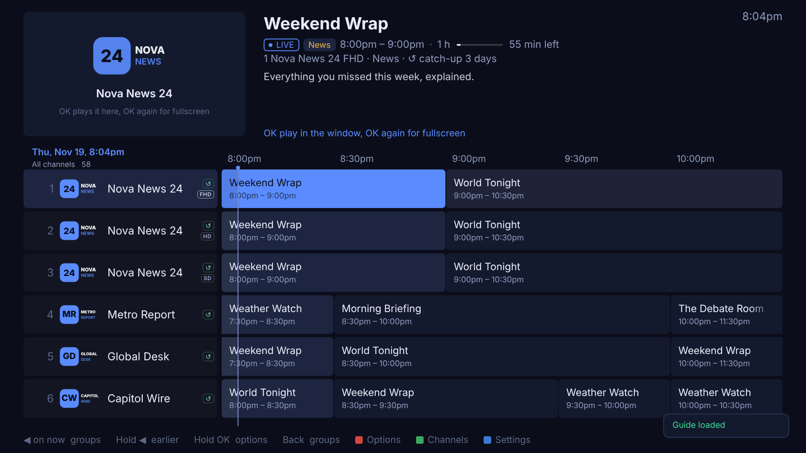
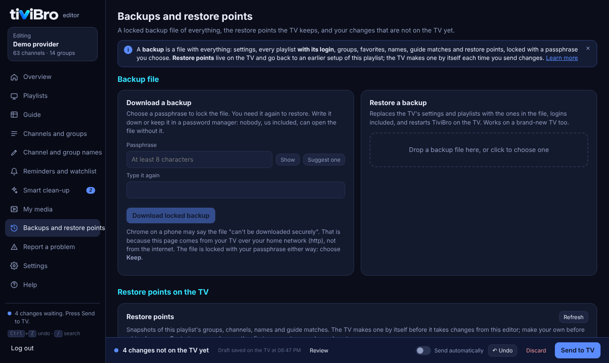

<!-- Generated from docs/USER-GUIDE.md by scripts/wiki/build.js.  Edit the guide, not this page. -->

*Web editor: the web editor*

One page for both safety nets, and for your unsent changes (**Your changes in this editor**, see [Drafts and Send to TV](Drafts-and-Send-to-TV)).

**Backup file.**  A backup is one file with everything: settings, every playlist **with its login**, each playlist's groups, favorites, names and guide matches, and its restore points.  Channel lists and guides aren't in it; they reload from your provider.

**Always locked.**  You choose a passphrase (or press **Suggest one**).  The TV makes the backup and locks it with AES-256-GCM before it leaves the TV, so the file on your computer is useless without the passphrase.  Nobody can recover a forgotten passphrase, so keep it in a password manager.  The phone app's **Save a file** makes the same kind of file.

**Restoring, even on a brand-new TV:**

1. Install TiviBro and open it.  Choose **Set up or restore from a computer**.  (On a TV already set up: **Settings > Playlists and accounts > Phone app and web editor**.)
2. Open the address shown on the TV and type the password.
3. **Restore a backup**, drop the file, type the passphrase and press **Unlock**.  The editor lists the playlists inside so you know it's the right file.
4. **Restore to the TV.**  TiviBro restarts with everything back, and the editor reconnects by itself.

**Restore points on the TV.**  Snapshots of this playlist's groups, channels, names and guide matches.  The TV makes one by itself before it takes changes from this editor; **Create restore point** makes your own before a big clean-up.  Restoring one makes another first, so a restore can be undone too.  The TV's **Settings > System > Backups and restore points** and the phone app's Backups and restore points screen list the same restore points.

Inside the phone app, the backup file and restore point parts hand over to the app's own Backups and restore points screen; your unsent changes stay here.

---

← [My media in the editor](My-media-in-the-editor)  ·  [Home](Home)  ·  [Troubleshooting](Troubleshooting) →
