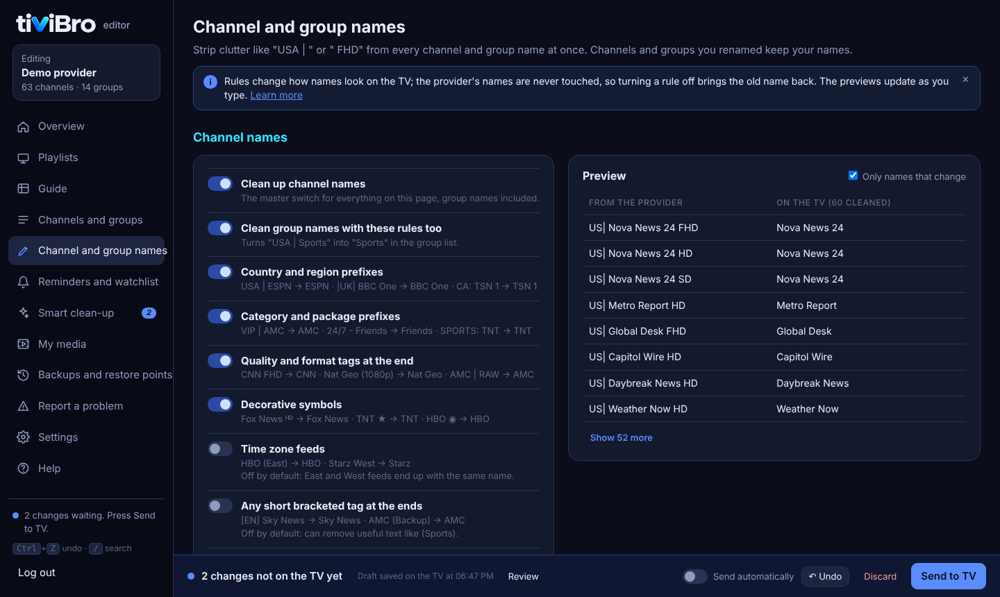
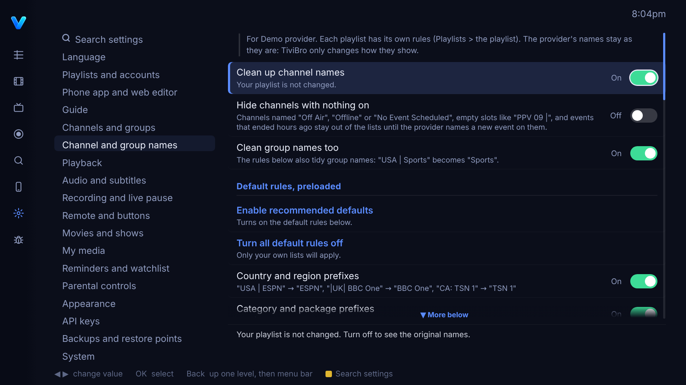

<!-- Generated from docs/USER-GUIDE.md by scripts/wiki/build.js.  Edit the guide, not this page. -->

*Web editor: the web editor*

Rules strip clutter from every channel and group name at once: country prefixes like `US |`, quality tags like `FHD`, brackets and more.  Your provider's names are untouched, so switching a rule off brings the original back.  Names you set by hand stay.  The same rules are on the TV under **Settings > Channels and groups > Channel and group names** ([details](Settings-Channels-and-groups#settings-channel-and-group-names)).

- **Channel names**: **Clean up channel names** (the master switch, group names included), **Clean group names with these rules too**, the rules (**Recommended defaults**, **Turn all rules off**), your own prefixes and suffixes for channel names, and a preview (**Only names that change**).
- **Group names**: your own prefixes and suffixes for groups (**Remove at the start of group names**, **Remove at the end of group names**).  They touch group names only and apply after the rules above.  Same format as the channel lists: comma separated, like TiviMate, spaces count, upper and lower case don't matter.  The group preview shows the result.
- **Shorter group names** (moved here from Smart clean-up) spots a word most of your groups start with ("USA News", "USA Sports", "USA Kids") and takes it off all of them at once, with **Put it back** to undo.  Your provider's list is not changed, and any group can be renamed back.

  
  

---

← [Smart clean-up](Smart-clean-up)  ·  [Home](Home)  ·  [The programme guide](The-programme-guide) →
