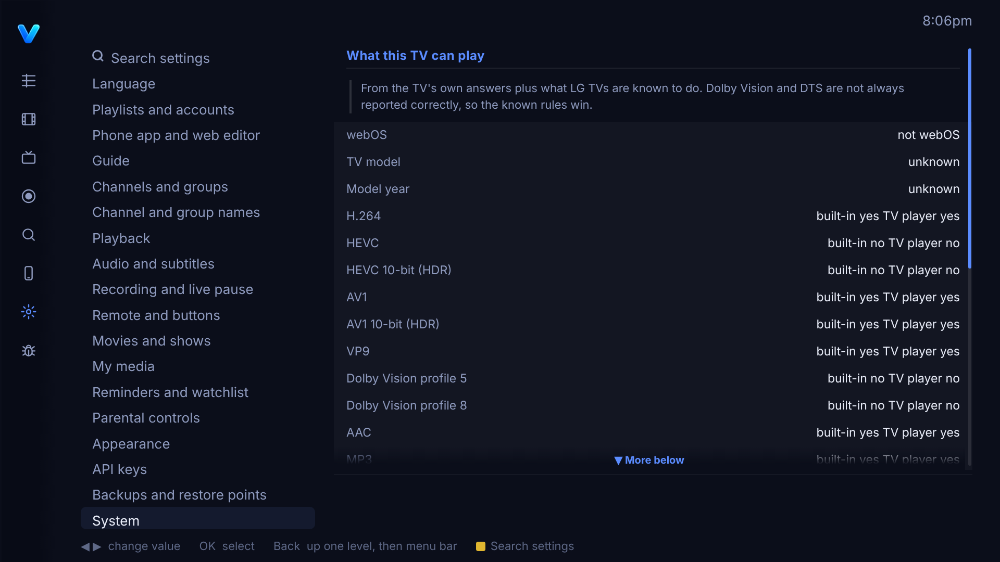

**Does TiviBro come with channels?**
No.  TiviBro is a player.  You need your own subscription: an Xtream Codes login or an M3U playlist address.

**Is it really free?**
Yes.  No accounts, no ads, no tracking, MIT licensed.  The only thing TiviBro sends about itself is an anonymous daily count of TVs by version, which you can switch off ([details](Privacy-and-security#install-numbers)).

**Which TVs work?**
LG TVs from webOS 4 (2018) to webOS 26.  webOS 25 is the main target and is tested in the webOS 25 Simulator; older versions share the same code with fallbacks.  See [webOS compatibility](https://github.com/ohmybahgosh/TiviBro/blob/main/docs/COMPATIBILITY.md).

**Is it a TiviMate port?**
No.  It is built from scratch for webOS, with the TiviMate way of working in mind: guide first, preview then fullscreen, quick menu, groups beside the guide.  See [TiviMate parity](https://github.com/ohmybahgosh/TiviBro/blob/main/docs/TIVIMATE-PARITY.md) for a feature-by-feature list.

**Does it play 4K, HDR and Dolby Vision?**
Yes, as far as your TV and provider do.  Dolby Vision goes through the TV's own player, which switches the screen into Dolby Vision; HDR10 and HLG play in TiviBro's built-in player unless you choose otherwise under **Settings > Playback > HDR and Dolby Vision**.  **Settings > System > What this TV can play** lists what your TV handles.  See [Watching fullscreen](Watching-fullscreen).

**Why is there no sound on some movies?**
LG TVs from 2020, 2021 and 2022 (the C1 and C2 among them) can't decode DTS.  TiviBro warns you in the movie details; pick another audio track under **Options** if the movie has one.

**What does each setting do?**
Every option, with its choices and default, is in the [Every setting](Settings-Playback-and-buffering) pages, one per section of Settings.

**A channel I watch keeps dying.  Can TiviBro use the HD copy instead?**
Yes, by itself.  When your playlist has the same channel more than once, TiviBro switches to another version once the player gives up.  See [Other versions of a channel](Other-versions-of-a-channel).

**Can I use more than one playlist?**
Yes.  **Settings > Playlists and accounts > Add playlist…**.  Each playlist keeps its own groups, favorites, hidden items, names and guide setup.

**Does it work with Dispatcharr or other proxies?**
Yes.  Use the proxy's address as the server (Xtream) or playlist address (M3U).

**What is the "network helper", and why does TiviBro need it?**
It's a part of TiviBro that runs in the background on the TV and talks to your provider for the app: the channel list, the guide and the streams.  webOS won't let an app talk to most IPTV servers directly, so the helper does it on the TV itself, and sends a custom User-Agent when your provider asks for one.  Leave **Connection** on **Automatic**.  It only contacts your own provider (and the logo projects, if you turn them on); nothing else leaves your TV.  If Settings says it's *not running*, restart TiviBro.  More: [What is the network helper?](Troubleshooting#what-is-the-network-helper)

**My provider has a guide, but some channels say "No guide information".**
See [The programme guide](The-programme-guide).  Smart match in the web editor usually fixes most of them in one go.

**Can my backup be read by someone else?**
Not without your passphrase.  See [Backup and restore](Backup-and-restore) and [Privacy and security](Privacy-and-security).

**Can I watch two channels at once?**
Yes, with Multiview: in fullscreen, quick menu > **Multiview**, or hold OK on a channel > **Watch in Multiview**.  webOS lets an app play only one video at a time, so the channel you hear plays as normal video and the network helper on the TV makes the second one itself, as live video beside it at up to 30 frames a second.  It works on any webOS TV, rooted or not, and each box uses one of your provider's connections.  See [Multiview: two channels side by side](Multiview-two-channels-side-by-side).

**Can TiviBro record, or pause live TV?**
Yes, for free.  Record from the guide to a USB drive on a rooted TV, or to a Windows share or WebDAV folder on your PC or NAS from any TV.  Pause and rewind any live channel, not only catch-up ones.  See [Recording, live pause and rewind](Recording-live-pause-and-rewind).

**Does it skip intros and credits?**
Yes, for free (Plex keeps it for Plex Pass): Skip intro, Skip recap and Skip credits, as a button or automatically.  See [Settings: Playback](Settings-Playback).

**Do I need a TMDB token for posters and details?**
No.  Without one, movies and shows get their details from TheTVDB through TiviBro's own service.  With your own free TMDB token you can choose TMDB instead, for movies and shows on their own.  See [No TMDB token? TheTVDB](No-TMDB-token-TheTVDB).

**Which languages is it in?**
🇺🇸 English, 🇩🇪 German, 🇪🇸 🇲🇽 Spanish, 🇫🇷 French, 🇮🇹 Italian, 🇳🇱 Dutch, 🇵🇱 Polish, 🇧🇷 🇵🇹 Portuguese, 🇷🇺 Russian and 🇹🇷 Turkish, on the TV, the phone app and the web editor.  See [Language](Language).

**Something else?**
Try [Troubleshooting](Troubleshooting), or open an [issue](https://github.com/ohmybahgosh/TiviBro/issues) with a copy of **Settings > System > View app log** (it hides usernames and passwords).
