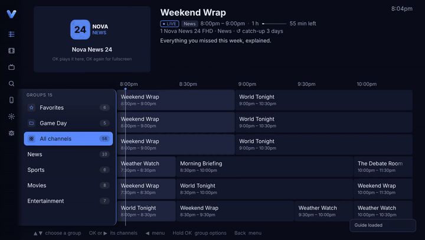
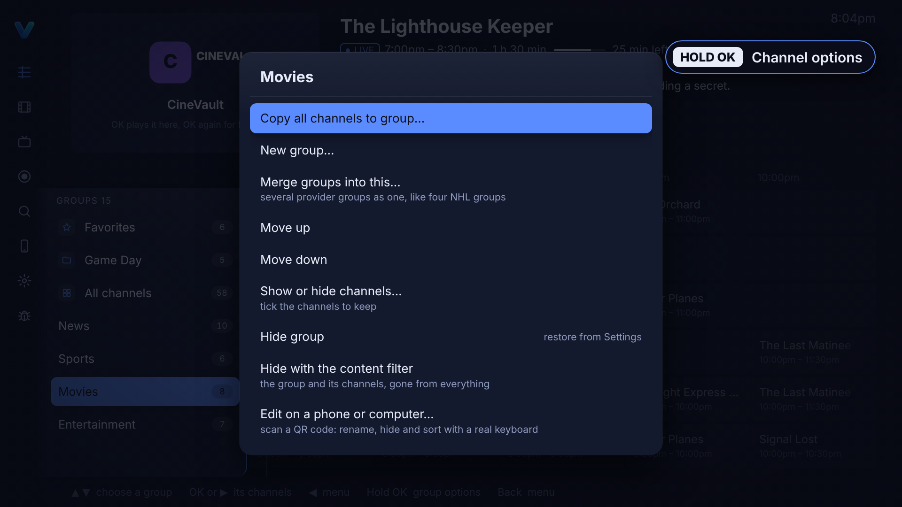
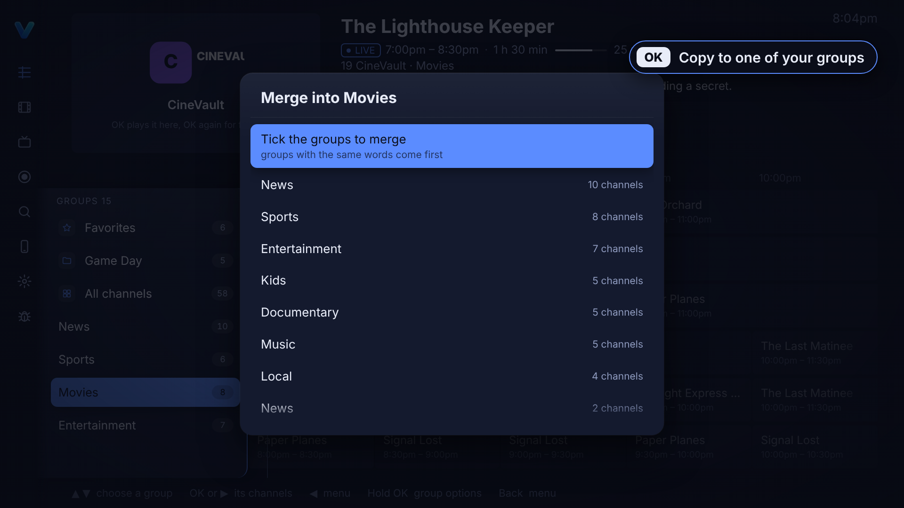
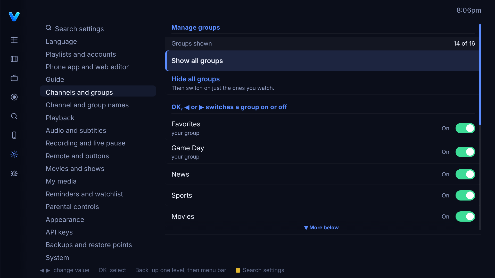

<!-- Generated from docs/USER-GUIDE.md by scripts/wiki/build.js.  Edit the guide, not this page. -->

*On the TV*

**Hold OK** on any channel (in the guide, the channel list or fullscreen with **Red**):

- **Add to Favorites** puts it in Favorites.
- **Select multiple…** (in the channel list) lets you copy, favorite or hide several channels at once.
- **Copy to group** adds it to one of your own groups (make one under **Settings > Channels and groups > New group…**).
- **Hide channel** removes it from the lists.  Hidden items come back from **Settings > Channels and groups**, or show them dimmed with **Show hidden items in lists**.
- **Show or hide channels…** puts a tick on every row of the group, right in the guide or the channel list, hidden channels too (dimmed, unticked).  **OK** ticks or unticks, **CH +/−** turns a page, **Red** has **Show all**, **Hide all**, **Hide channels with no guide information** and **Leave without saving**.  Nothing changes until **Back**, which saves.  It's also in a group's options, and in the guide's **Hold OK** menu.  A hidden channel is hidden in every group.  In the phone app: press and hold a channel, then **Show or hide channels…**.
- **Rename…** and **Assign guide…** fix a name or a missing guide for that one channel.
- **Other versions…** lists the same channel in its other qualities and copies, hidden ones included, to switch to one directly.
- **Move…** (in the channel list and the guide) changes the channel's place in its group, yours or the provider's: **▲ ▼** carry it, **CH + / −** a page at a time, **OK** puts it down.  A provider group you reorder keeps your order after playlist refreshes, and channels the provider adds later go to the end.  **Hold OK** on the group > **Back to the provider's channel order** undoes it.

**Manage groups** in Settings shows every group in one list to switch on or off, like TiviMate.  For hundreds of groups the [web editor](Channels-and-groups) is much faster.  Sorting, the Recent and Favorites groups, and getting hidden items back are in [Settings: Channels and groups](Settings-Channels-and-groups).

<a href="https://github.com/ohmybahgosh/TiviBro/raw/main/docs/media/channels.mp4">Watch the MP4</a>

  
  
  

---

← [Search](Search)  ·  [Home](Home)  ·  [Reminders](Reminders) →
