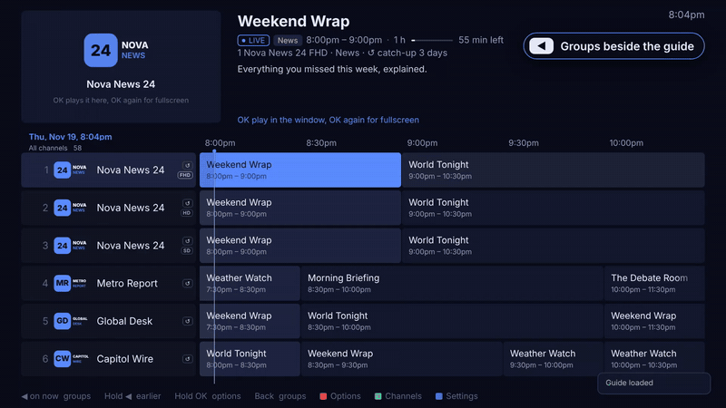
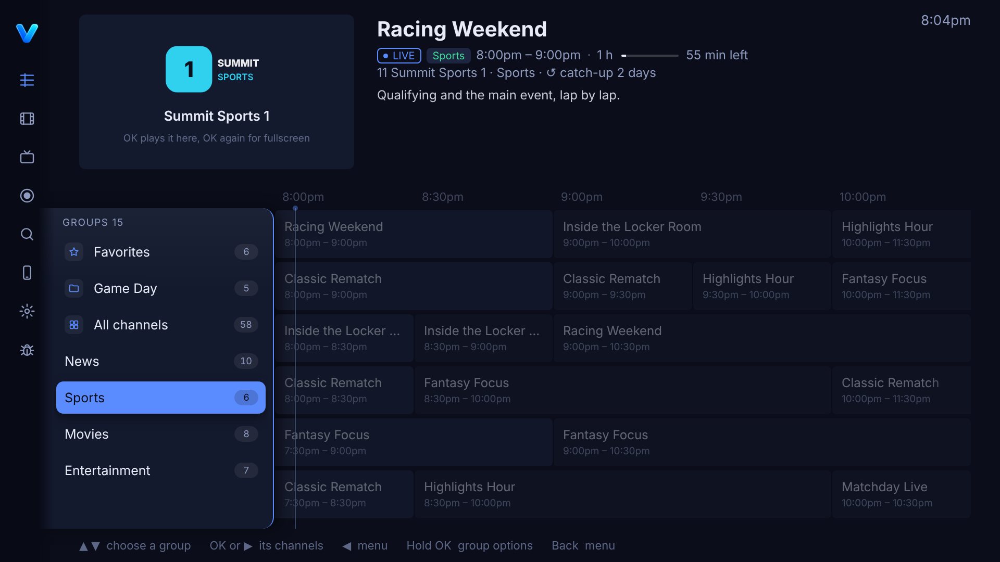
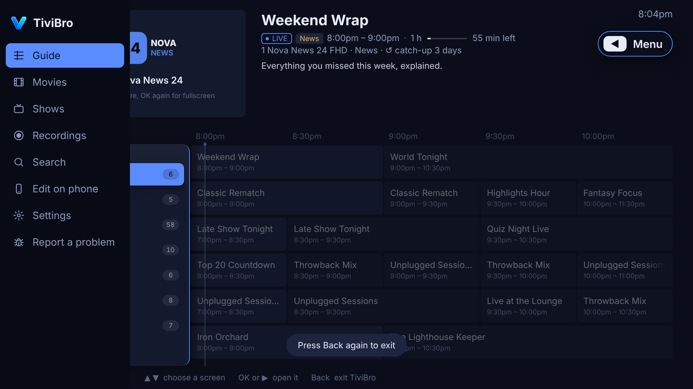
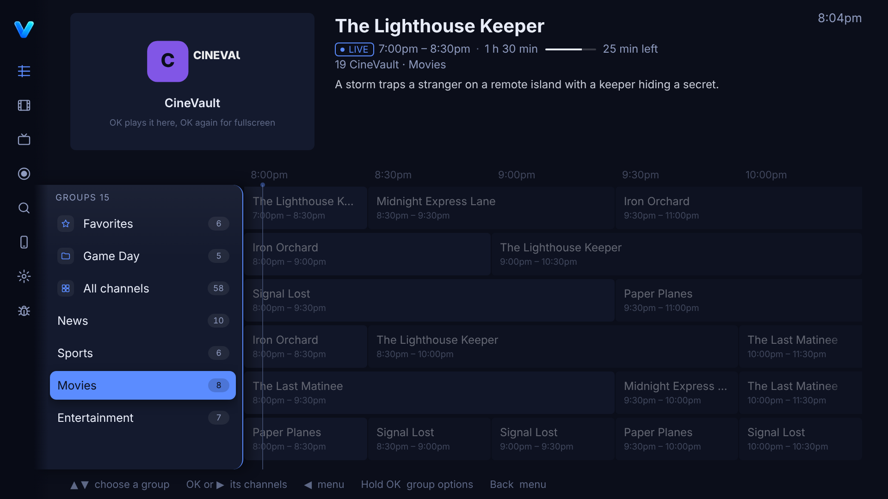

<!-- Generated from docs/USER-GUIDE.md by scripts/wiki/build.js.  Edit the guide, not this page. -->

*On the TV*

Your groups sit right beside the guide: **Favorites** and your own groups first, then **All channels**, then your provider's groups.  Moving through the list updates the guide behind it.  **OK** or **▶** opens a group, on the channel playing when it's in it, else at the top, at what's on now; **Hold OK** gives group options (rename, hide, sort, block).

**Merge groups.**  Providers often split one thing over several groups (four NHL groups).  **Hold OK** on a provider group > **Merge groups into this…** lists the other groups, the ones with a word in common first: tick them with **OK** and choose **Merge**.  Their channels show in that group, after its own, and new channels the provider adds to them come along.  **Split back into N groups** undoes it.  In the web editor (on the phone too), it's **⋯ > Merge groups into this…** on a group.  **Settings > Channels and groups > Merge groups** does several at once, on the TV or in the phone app: tick the groups, then choose **Into a new group…** (you name it), **Into one of them…** or **Into another group…**.  Groups merged now are listed there with **Split**.

**Sort a group.**  **Hold OK** on a group > **Sort channels…** picks that group's own order: **Next event first**, the provider's order, A to Z, Z to A or channel number.  Next event first suits sports and PPV groups (merged ones too): channels whose names carry an event on now come first, then the ones starting soonest, and the ones with nothing on last.  It updates every few minutes as events start and end.

**Rename groups.**  **Settings > Channels and groups > Rename groups** lists every group: OK on one to type a name of your own (the phone app's keyboard is easiest).  A renamed group says what the provider calls it, and an empty name goes back to that.

**My teams** sits near the top while a game is on or coming up.  Between games it moves down under your groups and **All channels**, still there to open (it says when the next game is).  In it, a channel that carries your team's game later, like a regional sports network, says **Next game 9:00pm: …** up to the game, the way team channels do.

**Recently added** lists channels that are new in your playlist since it last loaded, newest first, and they carry a **NEW** tag in the lists for a week (change it, or turn it off, under **Settings > Channels and groups > Recently added channels**).

Long lists: **CH + / −** moves a page at a time everywhere, and holding **▲** or **▼** speeds up the longer you hold it, so the end of a 5,000 channel group is a few seconds away.

**◀** or **Back** from the groups opens the menu: **Guide, Channels, Movies, Shows, My media, Search, Edit on phone, Settings**.  Movies and Shows appear only when your provider has them, and **My media** once you add a source.  **Edit on phone** isn't a screen: it turns on the [web editor](Turning-on-the-web-editor) and shows its QR code over whatever you're watching.

<a href="https://github.com/ohmybahgosh/TiviBro/raw/main/docs/media/groups.mp4">Watch the MP4</a>

<b>Screenshots</b>

  
  

The **Channels** screen (in the side menu when **Channels screen in the menu** is on, or **Green** in the guide) is the same list in TiviMate's classic layout: groups on the left, channels in the middle, the preview and details on the right.  Resting on a channel plays it in the preview (**Preview in channel list**); **OK** goes fullscreen.  Pick which screen opens first with **Start screen**.

  

---

← [The guide](The-guide)  ·  [Home](Home)  ·  [Watching fullscreen](Watching-fullscreen) →
