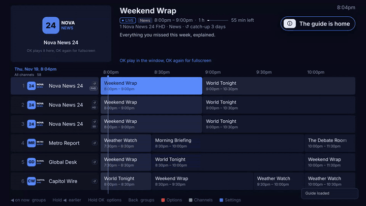
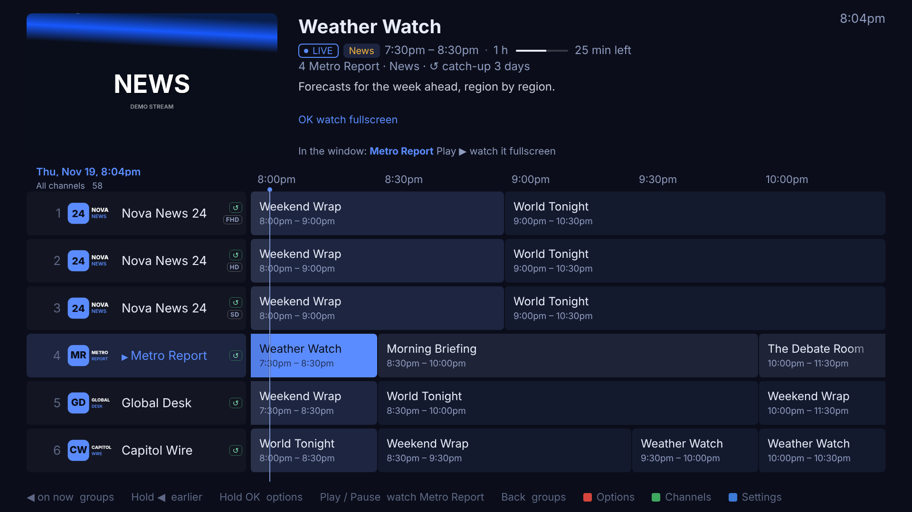
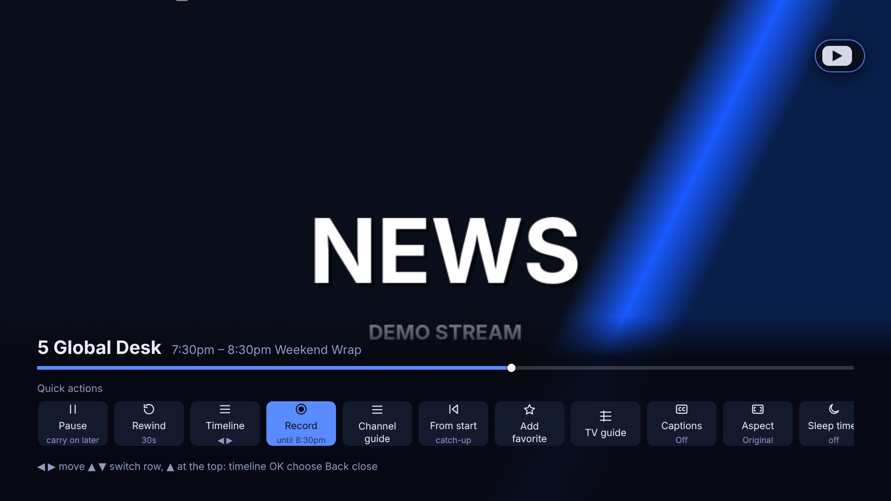
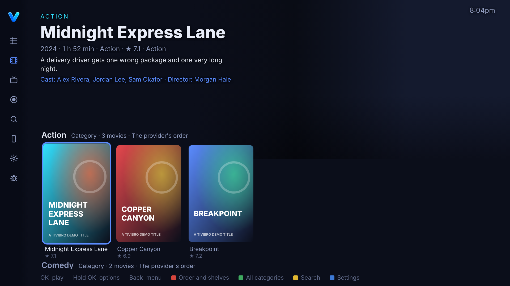
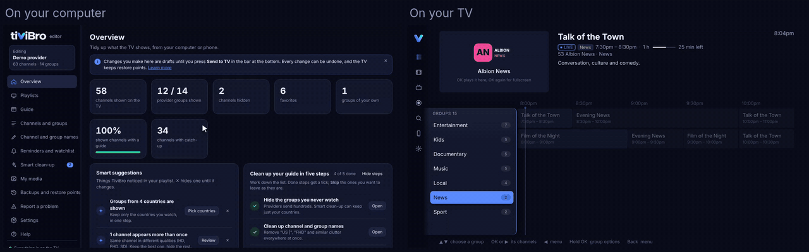

<b>The ultimate IPTV player for LG webOS.</b> A free, guide-first IPTV player for LG webOS, built to feel like TiviMate and go further. <a href="https://tivibro.app">tivibro.app</a>

> **📱 Help get TiviBro for Android into the Play Store.**  The free phone app (remote and TV guide for TiviBro on your TV) is in closed testing on Google Play.  To publish it for everyone, Google needs **12 testers opted in for 14 days in a row**.
>
> **You don't have to use it.**  Even if you never open the app, joining and **leaving it installed for 14 days** counts.  Please sign up, and **ask friends and family with an Android phone to do the same**.  Every tester gets us closer to the store.
>
> **How to join (about 2 minutes):**
> 1. **Join the tester group.**  With the Google account your phone uses, open [TiviBro Android testers](https://groups.google.com/g/tivibro-testers) and choose **Join group**.  Nobody sees your address and the group sends no mail.
> 2. **Opt in on Google Play.**  Open [the TiviBro test page](https://play.google.com/apps/testing/app.tivibro.phone) and choose **Become a tester**, signed in with that same account.  It can take a few minutes after joining the group before this works.
> 3. **Install it** from that page, or search the Play Store on your phone once you've opted in.
> 4. **Leave it installed** for at least 14 days.  That's it.
>
> Step by step: [tivibro.app/android-test](https://tivibro.app/android-test/) · Questions: [discussion #130](https://github.com/ohmybahgosh/TiviBro/discussions/130).  Already using the APK?  Uninstall it first (Google Play only installs and updates its own copy), then pair your TV again.  The APK on GitHub stays either way.

Welcome to the TiviBro wiki.  It explains every screen and every setting on the TV, with screenshots, every page of the web editor, and how to get help when something is off.

> TiviBro does not provide any channels, streams or playlists.  You bring your own legal subscription (Xtream Codes, M3U with XMLTV, or a Stalker portal).

> TiviBro is in alpha testing on real LG TVs (webOS 4 to 26), with beta next.  Expect some rough edges, and keep a backup before updating.

In 🇺🇸 English, 🇩🇪 German, 🇪🇸 🇲🇽 Spanish, 🇫🇷 French, 🇮🇹 Italian, 🇳🇱 Dutch, 🇵🇱 Polish, 🇧🇷 🇵🇹 Portuguese, 🇷🇺 Russian and 🇹🇷 Turkish ([Language](Language)).

## Start here

| | |
|---|---|
| 🚀 **New to TiviBro?** | [Installing](Installing), then [First start](First-start) and [The set-up tour](The-set-up-tour) |
| 🎮 **Which button does what?** | [The remote](The-remote) |
| 📺 **Watching TV** | [The guide](The-guide) · [Watching fullscreen](Watching-fullscreen) · [Catch-up](Catch-up) · [Multiview](Multiview-two-channels-side-by-side) |
| ⏺️ **Record, pause and rewind** | [Recording, live pause and rewind](Recording-live-pause-and-rewind) · [Settings: Recording and live pause](Settings-Recording-and-live-pause) |
| 🏈 **Sports** | [Sports](Sports) · [My teams](My-teams) · [Event channels](Event-channels-pay-per-view-and-sports-passes) |
| 🎬 **Movies and shows** | [Movies and shows](Movies-and-shows) · [Movies on now](Movies-on-now) · [No TMDB token? TheTVDB](No-TMDB-token-TheTVDB) · [Search](Search) |
| 📂 **Your own movies and shows** | [My media](My-media) · [Settings: My media](Settings-My-media) |
| 🍿 **Plex** | [Plex](Plex) · [Settings: Plex](Settings-Plex) |
| 🖼️ **Channels without logos?** | [Channel logos](Channel-logos) |
| 🧹 **Too many groups?** | [Turning on the web editor](Turning-on-the-web-editor) · [Smart clean-up](Smart-clean-up) · [Channels and groups](Channels-and-groups) · [Channel and group names](Channel-and-group-names) |
| 🗓️ **Missing guide data?** | [The programme guide](The-programme-guide) |
| 💾 **New TV or reinstall?** | [Backups and restore points](Backups-and-restore-points) |
| ⚙️ **What does this setting do?** | [Settings](Settings), one page per section of Settings |
| 🔁 **A channel keeps dying** | [Other versions of a channel](Other-versions-of-a-channel) |
| ⏰ **Reminders and PINs** | [Reminders](Reminders) · [Watchlist](Watchlist) · [Parental controls](Parental-controls) |
| 🛠️ **Something's wrong** | [Troubleshooting](Troubleshooting) · [FAQ](FAQ) |

## Free here, paid elsewhere

| Feature | In TiviBro | Elsewhere |
|---|---|---|
| ⏺️ **DVR: record from the guide** | ✅ Free, to a USB drive or to a PC or NAS share on any TV | TiviMate Premium, Plex Pass |
| ⏸️ **Pause and rewind live TV** | ✅ Free, on every channel | TiviMate: catch-up channels only, Premium |
| ⏭️ **Skip intro, recap and credits** | ✅ Free, as a button or automatic | Plex Pass |
| 🗣️ **Dialogue boost and night mode** | ✅ Free, on channels, movies and shows | Plex Pass |
| 📺📺 **Multiview** | ✅ Free, two channels at once | TiviMate Premium |
| 📚 **Multiple playlists, catch-up, favorites and your own groups** | ✅ Free | TiviMate Premium |
| ⏰ **Reminders, parental controls, backups** | ✅ Free | TiviMate Premium |
| 🎬 **Movie and show details, Up next, Trakt** | ✅ Free, no token needed | Usually a media server |

As listed on TiviMate's and Plex's own sites, November 2026.

## What no other IPTV player does

TiviMate set the bar for IPTV on a TV, and TiviBro follows its layout on purpose.  These are the things we haven't found in TiviMate or any other IPTV player, on any platform:

| | |
|---|---|
| 📱 **Set up from your phone, from the very first screen** | A QR code waits beside the login form.  Scan it and TiviBro's editor opens on your phone, signed in: type your login with a real keyboard or restore a backup, and the TV moves on by itself. |
| 🧭 **A set-up tour built from your own playlist** | Right after you connect, TiviBro counts what your list has and asks only about that: the countries in it, East or West, the cities its local groups carry, its event channels, its duplicates. |
| 🖼️ **Fills in missing logos, without hosting a single one** | A small index points at Worldwide TV Logos', tv-logos' and iptv-org's own logos, matched by guide id, cleaned name, country and local call sign. |
| 🏟️ **Reads sports and PPV listings from channel names** | When a provider writes the event into the name instead of the guide, TiviBro turns it into a short channel name and a guide entry at the real time in your time zone. |
| 🏈 **Your teams' live scores while you watch** | A Sports screen tied to your channels, a page per game, and your teams' scores in the corner while you watch something else. |
| 🖥️ **A full editor on your phone or computer** | Clean up 10,000 channels with a keyboard instead of a remote, then **Send to TV**.  Unsent work is autosaved on the TV within seconds. |
| 🔁 **Switches to a working copy by itself** | Same channel in FHD, HD and SD?  When one dies, TiviBro moves to the next version on its own and tells you. |
| 🙈 **Hides channels with nothing on** | Event channels that say "Off Air" or "No Event Scheduled" stay out of the way, and come back by themselves when an event is named. |
| 📺 **Made for LG TVs** | Runs on the TV itself, webOS 4 to 26.  No Android box or Fire Stick needed. |

| | TiviBro | TiviMate |
|---|---|---|
| Runs on LG webOS TVs | ✅ | ❌ Android TV and Fire TV |
| Price | Free, every feature | Free version, Premium paid |
| Catch-up, multiple playlists, backups | ✅ Free | Premium |
| Recording | ✅ Free, to a USB drive (rooted TVs) or a PC or NAS share (any TV) | Premium |
| Pause and rewind any live channel | ✅ With a timeline and a rewind buffer | Catch-up channels only |
| Two channels at once (Multiview) | ✅ Free | Premium |
| Open source | ✅ MIT | ❌ |
| Sports and PPV events read from channel names | ✅ | ❌ |
| Edit your playlist from a computer, with autosaved drafts | ✅ | ❌ On the TV only |
| Switches to another version of a dead channel by itself | ✅ | ❌ |
| Set up by scanning a QR code with your phone | ✅ From the first screen | ❌ Type it with the remote |
| Fills in missing channel logos | ✅ Three open logo projects | ❌ |

TiviMate column from its own site and public guides, November 2026.  TiviMate is a great app; this is what TiviBro adds.

## What it looks like

  
  
  

The web editor on a computer, and the TV following along.

## For developers

[Developing](Developing) · [Recording the demo media](Recording-the-demo-media) · [Releasing](Releasing) · [Source code](https://github.com/ohmybahgosh/TiviBro)

Every picture in this wiki comes from a made-up demo provider.  Click any picture to open it full size.
