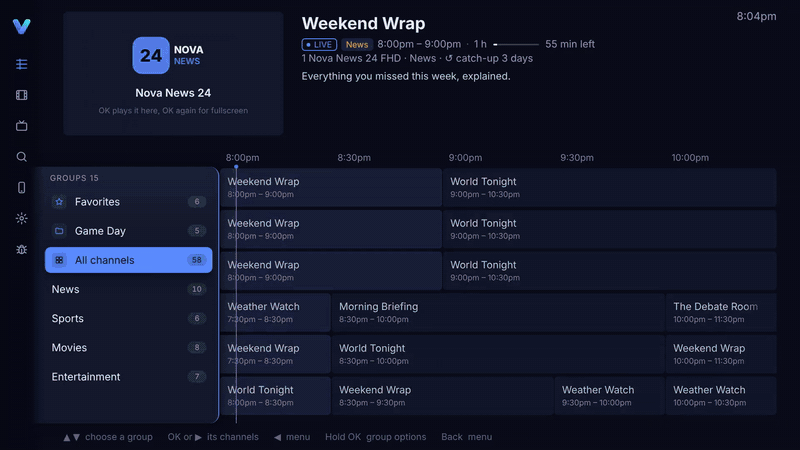
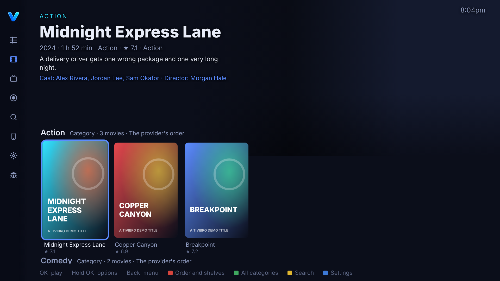
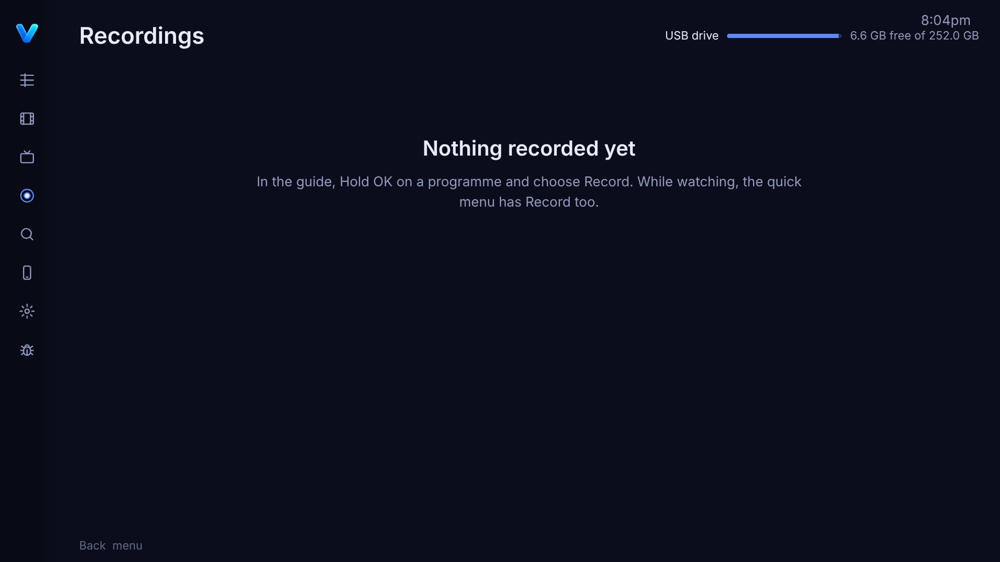

<!-- Generated from docs/USER-GUIDE.md by scripts/wiki/build.js.  Edit the guide, not this page. -->

*On the TV*

If your provider offers video on demand, **Movies** and **Shows** appear in the menu.  With an Xtream Codes login they come from the provider's movie and series lists.  With an M3U link they come from the list itself: its films (links to `/movie/` or to a video file) go to **Movies**, and its episodes (links to `/series/`, or named like "Show S01 E02") are gathered into shows in **Shows**, by season, instead of filling the channel list.  The list's groups become the categories.  The network helper keeps them on the TV, so a list with hundreds of thousands of titles still fits.

- Categories on the left (**Continue watching**, **My list**, **All movies**, then your provider's), titles in the middle, details and poster on the right.
- **OK** plays a movie or opens a show's seasons and episodes.  **Hold OK** adds a title to **My list**.
- **A show's page.**  A show opens full screen: its backdrop, details and summary at the top, its seasons as tabs (each with how many episodes it has), and the season's episodes as cards with their picture, length, air date, progress and a ✓ when watched.  It opens on the episode you're up to.  **◀ ▶** move along the cards, **Up** goes to the season tabs (**◀ ▶** there change season), **Down** comes back, **OK** plays, **Hold OK** has the episode's options and **Back** closes the show.  The focused episode's summary is under the cards, unless **Hide spoilers** is on and you haven't started it.
- **Info** or **Hold OK** opens a title's options, with **Watch the trailer** when there is one (the provider's, else TMDB's with your token).  **New titles missing?**  Settings > Movies and shows > **Reload movies and shows now**, or Red on the home.  **CH + / CH −** page through long category lists.
- **Languages.**  Many providers put a language code in front of every title ("EN - ", "SE-4K - ", "[SE]") or on the category ("\|TR\| DIZI").  TiviBro takes it off the name and adds a **Languages** row at the top of the categories: **OK** on it picks which languages show.  By default that's your TV's language plus titles with no code; a library in one language shows everything and has no Languages row.  A 4K tag becomes a 4K label.
- **Hide a category:** **Hold OK** or **Red** on it.  Its titles leave **All movies** (or **All shows**) and Search too.  The same menu brings hidden categories back.
- **Adult categories** (named Adults, XXX, 18+ and the like) are listed last and stay out of **All** and Search.  With a PIN set for blocked channels, they ask for it.
- Running times read **1 h 25 min**, ratings **★ 7.6**.  On a TV, big libraries are downloaded and slimmed by the network helper, so even 160,000 movies stay light on memory.
- While watching, **◀ ▶** skip 30 seconds.  Keep pressing and each press jumps further (twice, four, then eight times as far); the info panel shows where you'll land and when the movie will end, and playback jumps there once you stop pressing.  **Back** cancels a jump you haven't landed yet.  **▲ ▼** bring up the bar without moving (people press Down by habit), and **▼** with the bar up opens the chapters when the file has them.  **CH+ CH−** skip 10 minutes, or go to the next or previous chapter.  A picture of the movie at that time shows over the bar (**Seek previews**: Settings > Playback, or Red in the player), made on the TV from the movie playing.  A file with chapters shows them as marks on the bar: **CH+ CH−** go from one to the next, and **Red > Chapters** lists them with a picture of each.
- TiviBro remembers where you stopped and offers to resume.
- **Next episode at the credits:** when a file marks its credits, a **Next episode** button comes up as they start; **OK** plays the next one straight away.
- **Up next**, full screen: when an episode plays to its end, the next one fills the screen (its picture, the show's logo art from TMDB with your token, or its title, the season and episode, its title and summary) and **Play** counts down in a ring.  **OK** starts it at once, **Back** returns to the episodes.  The countdown is 10 seconds unless you choose another (**Up next countdown**); with **Play the next one automatically** off the card waits for OK.  With **Hide spoilers** on, an episode you haven't seen shows the show's picture and no summary.  The next movie of a collection you play comes the same way.
- A movie or episode you watched to the end gets a **✓** in the list, and one you stopped part-way shows how far you got.  A show you started shows the episode you're on ("S1 E5") and how far you got in it, and opens on that episode.  **Hold OK** marks a title as watched or not watched by hand, as Plex does: a movie or an episode, a whole season (Hold OK on the season on a show's page), or a whole show (Hold OK on the show).  With Trakt connected, the same goes to your Trakt history.

<a href="https://github.com/ohmybahgosh/TiviBro/raw/main/docs/media/vod.mp4">Watch the MP4</a>

<b>Screenshots</b>

  
  

---

← [Recording, live pause and rewind](Recording-live-pause-and-rewind)  ·  [Home](Home)  ·  [Movies on now](Movies-on-now) →
