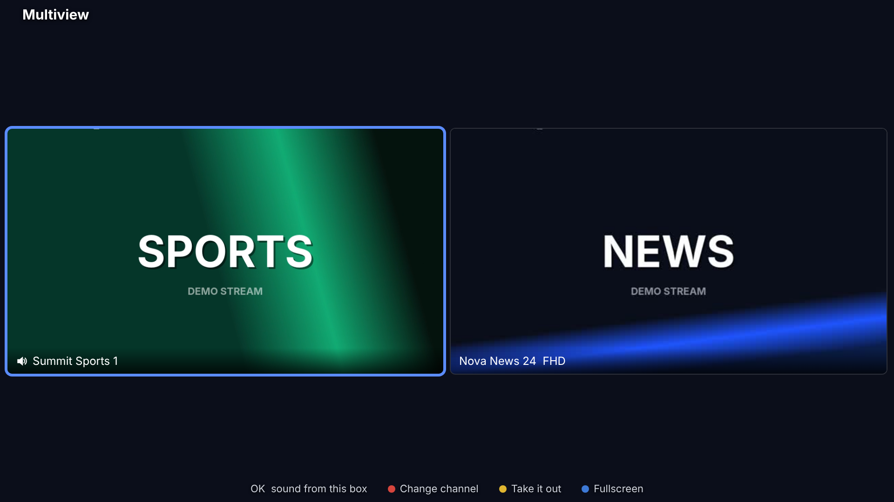

<!-- Generated from docs/USER-GUIDE.md by scripts/wiki/build.js.  Edit the guide, not this page. -->

*On the TV*

Watch two channels at once, like two games.  In fullscreen, open the quick menu and choose **Multiview**, or hold OK on a channel and choose **Watch in Multiview**.

- The box with the sound icon is the channel you hear.  It plays as normal video, as smooth as fullscreen.
- The other box is live video without sound, up to 30 frames a second, made by the network helper on the TV.
- **◀ ▶** move between the boxes.  **OK** on the other box gives it the sound.  OK on an empty box picks a channel for it: your groups first (Favorites, Recent and the rest, as in the guide), then that group's channels with what's on now.  **Search by name** is at the top of the list.
- **Red** changes the box's channel, and **Yellow** takes it out.
- **Blue**, **Play**, **Back**, or OK on the box with sound go fullscreen on that channel.  Multiview in the quick menu brings the same two channels back.

Good to know:

- Each box uses one of your provider's connections, as watching a channel does.  A login that allows one connection can't show a second channel.  Settings > Playlists and accounts shows how many yours allows.
- webOS lets an app play one video at a time, so only the box with sound is real video.  The other is made on the TV's processor, a little behind (about a third of a second).
- It needs the network helper and the converter TiviBro uses for sound the TV can't play (it comes with TiviBro).  It works on any webOS TV, rooted or not; newer TVs (a 2022 C2 and later) make the smoothest pictures.

---

← [Watching fullscreen](Watching-fullscreen)  ·  [Home](Home)  ·  [DASH channels and protected channels](DASH-channels-and-protected-channels) →
