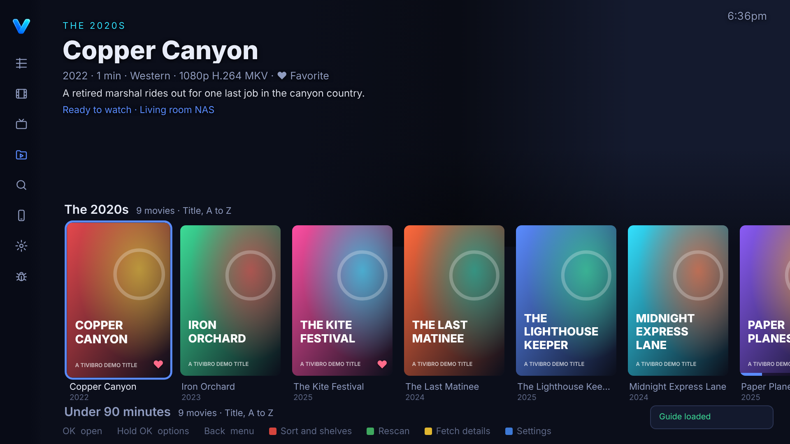
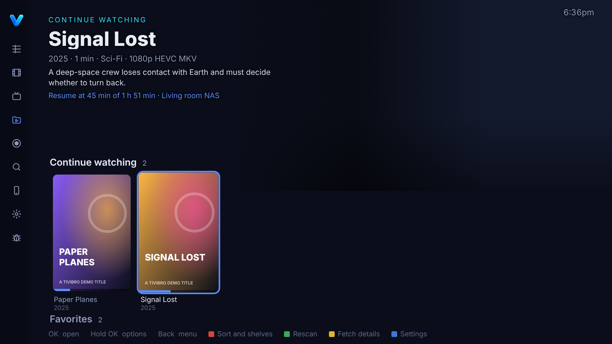
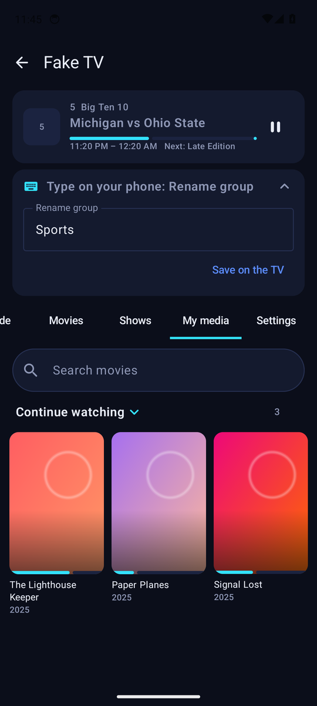
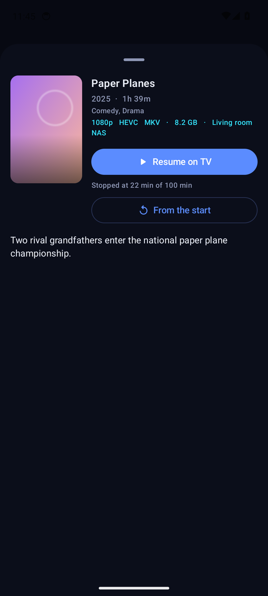

<!-- Generated from docs/USER-GUIDE.md by scripts/wiki/build.js.  Edit the guide, not this page. -->

*On the TV*

**My media** gives your own movies a full-width poster view.  It joins the menu once you add a source in **Settings > My media > Add media**.  It has **Continue watching**, **Favorites** and **All movies** shelves.  The movie you choose shows its title and description above the shelves.  There are no automatic trailers or previews.

<p align="center">
  <a href="https://tivibro.app/view/#tv-my-media"></a>
  <a href="https://tivibro.app/view/#tv-my-media-all"></a>
</p>

**In the phone app**, a **My media** tab shows the same shelves (Continue watching, Favorites, All movies) as a poster grid with search.  Tap a movie for its details, then **Resume on TV** or **Play on TV**: the TV opens My media and plays it.  **Settings > My media** in the phone app adds sources too: **Add media** looks for servers on your network (the TV looks, you tap one), finds **Windows and network shares** (or takes a server's name or address) and their login, takes a WebDAV address and login typed on the phone, signs in to **Dropbox** and lets you pick the folder, or takes a **Google Drive** service account key and lets you pick the drive and folder.  Tap a source to rescan it, change its **Content**, fetch its movie details, change a share's or WebDAV folder's **login**, or remove it, and tap the TMDB token row to paste a token.  A scan that takes longer carries on on the TV.

<p align="center">
  
  
</p>

Press **Green** on My media to rescan all saved sources for new or removed movies.  **Red > Fetch missing details** (or Yellow on a shelf's name) fetches details and artwork for new movies or outdated language matches, leaving up-to-date matches alone.  **Yellow on a movie** marks it watched or not watched in one press, and so does Yellow on an episode on a show's page (on a season: the whole season), in My media and in your provider's Movies and shows.  Wait for a rescan to finish before fetching details.

Use **Left** and **Right** to move between movies, and **Up** and **Down** to move between shelves.  **OK** plays or resumes the selected movie.  **Hold OK** or **Red** opens movie options: add or remove a favorite, start over, mark as watched, find or correct movie details, or see file information.  Favorites and your place in a movie stay with My media across playlists and restarts.

**Back** opens the standard main menu directly.  **Left** from the first movie does the same.  There is no separate source menu on the movie screen; all sources appear together and source management stays in Settings.

**Add media and preferences are in Settings > My media**, not in the movie shelves.  **Blue** from My media opens those settings directly.  Choose **Add media > Browse my network (DLNA / UPnP)** to find a home server, **Add a Windows or network share (SMB)** for a shared folder (see [Windows and network shares](My-media#windows-and-network-shares)), or **Add a WebDAV server** and enter its WebDAV address and login.  Dropbox is added from the phone app, and Google Drive from the web editor or the phone app (see below).  The phone app's **Settings > My media** does the same, with the typing on the phone.  Turn on media sharing on a home server first.  A playlist must already be set up.

#### Windows and network shares

A shared folder on a Windows PC, a Mac, a NAS (Synology, QNAP, Unraid, TrueNAS) or a router with a USB drive plays straight from the share, with seeking and the subtitle files beside each movie.  **Add media > Add a Windows or network share (SMB)**:

1. The TV looks for shares on your network for a few seconds and lists what answers, by name.  A server that isn't listed can still be typed: its name (like **NAS** or **DESKTOP-PC**), its IP address, or a whole path like `\\NAS\Movies`.  A Windows PC shows up when its file sharing and network discovery are on.
2. Sign in: the user name and password of an account on that computer (on Windows, the PC's user name or your Microsoft account email).  Leave the user name empty for a guest; Windows 11 doesn't allow guests.  A server you already have a library on offers **Sign in as** with the login saved there, so a second folder needs no typing.
3. Pick the share, then the folder: **Add** scans it and its subfolders.

SMB 2 and 3 are used, signed and encrypted where the server asks, so Windows 11 shares work.  SMB1-only servers aren't supported.  The login stays on the TV, like a WebDAV password: never in backups, logs or the web editor.  If the server's address changes (a router gives it a new one), TiviBro finds it again by its name.  When its password changes, use **Change login** on the library's page.  New movies and episodes are noticed by themselves, down to a show's season folders.

**Movies and TV shows.**  A new source finds both.  A source added before alpha 61 stays movies only until you open it in **Settings > My media** and set **Content** to **Movies and TV shows** (or **TV shows only**), then rescan.

OK on a movie opens its own page: its details, and Resume or Play, From the start, **Play the collection** (its movies one after another), Trailer (played inside TiviBro: Back returns to the page, Yellow opens the YouTube app), Favorite and More options, and **N copies** when you have the movie more than once (each copy with what it is, where and how big; the best one for this TV marked, and the one OK plays), with the rest of its collection underneath.  The **Movies** and **TV shows** tabs open on **Library**: **All movies**, **Collections** and **All shows** open a grid of posters to scroll down through, with the letters down the right side to jump to (▶ from the end of a row), CH+ and CH− a page at a time, and **Red** to sort, to filter (not watched, in progress, watched, added this week or month, 4K, HDR, Dolby Vision, more than one copy, rating, genre, year, decade, director, actor, library; several at once, **Clear filters** to start over) and to change the poster size (Small, Medium, Large, Extra large; also **Settings > My media > Library poster size**).  All shows says how many seasons you have of each show.  **Categories**, next to them, has a coloured tile for each genre and decade; OK opens its titles in the grid.  A show's poster has the number of its episodes you haven't watched in its corner (✓ once you've seen them all), and a movie you've watched has a ✓ (**Settings > My media > Watched marks on posters**).  What came in since your last visit has a small dot by its name and its own shelf, **New since your last visit**; the dot goes once you open it (**Mark what's new**).  Recently added says when each came.  My media opens on the tab, and the grid, you were last on (**Open where you left off**).  **Search** matches titles first, then actors, genres, directors, networks and collections, as you type; episode names once you press Search.  A long shelf ends with **See all**, the same grid.  OK on a show opens its own page: its seasons as posters, then the season's episodes as cards with their picture, title, air date and summary (OK plays, **Hold OK** has the options, **Back** goes back a step).  The **TV shows** tab has **Recently added episodes** (shows with a new episode file; a whole season that came at once says so, and opens on it), **Recently aired** (an episode you have aired in the last 30 days), **Start watching** (shows you haven't begun) and **Rediscover** (shows you started and haven't watched for over 45 days).  **Red (Options)** has **TV shows** and, when something needs a look, **Needs review**.  **Favorites** shows your favourite movies and shows; they stay in the **Movies** and **TV shows** lists too, unless you turn off **Favorites also in lists** in **Settings > My media**.

Name folders and files like this, and the rest takes care of itself:

```
Movies/
  Frozen (2013)/
    Frozen.2013.1080p.BluRay.x264.mkv
TV/
  Harbour/
    Season 1/
      Harbour.S01E01.mkv
      Episode 02.mkv
```

- **Movies:** a folder named "Title (Year)" gives the title and year, whatever the file is called.  Without one, the file name is used: dots and underscores become spaces, and it is cut at the quality words (1080p, BluRay, x265).
- **Episodes:** S01E02, 1x02, or "Episode 2" inside a "Season 1" folder give the season and episode.  Shows numbered by air date or by one running number get their own order.
- **Extras:** folders named Extras, Featurettes, Behind the Scenes, Deleted Scenes, Interviews, Trailers and the like aren't opened.  Files with trailer, teaser or featurette in the name are skipped, and so are videos under 100 MB.
- **Needs review:** a file TiviBro isn't sure about waits here.  Fix one file, or a whole folder (you see what changes before it's saved).  The web editor can do the same, with undo.
- **Deleted files:** a file you delete from the server leaves My media at the next complete rescan.  If it comes back within 30 days, it keeps its details, favorite and watched state.  A scan that couldn't read every folder, or found nothing, changes nothing.

**Show details.**  With a TMDB token saved, shows get their poster and details on their own, then season details and episode names, summaries and pictures for the seasons you have.  Only exact matches are picked automatically; **Find show details** on a show picks one yourself.  **Yellow** fetches details again.  TMDB gets show titles or IDs, season numbers and your language, with your token, and never a source's login or links.

**Episodes.**  Playback remembers where you stopped, and **Auto next episode** offers the next one.  For a file that holds several episodes, TiviBro uses its chapters, or you can set where each episode starts.

**Big libraries.**  A scan works in parts and carries on where it stopped, and the source's options have **Pause scan** and **Restart scan**.  A scan that fails or finds nothing keeps what you had.

A WebDAV source is a WebDAV folder, not a normal website or HTTP directory.  Services such as premiumize use a customer ID and API key as the login.  TiviBro supports both signed file links and servers that serve files directly with HTTP Basic authentication.  For a file that needs a login, the helper streams it to the player and handles seeking and subtitle reads.  Your login is sent only to the server you added.

**Google Drive.**  Shared drives and Drive folders work as libraries.  Google doesn't let TVs sign in to read Drive folders, so TiviBro uses a **service account**: a free robot account in Google Cloud that only sees what you share with it.  Set it up once (about 5 minutes):

1. Open [Google Cloud](https://console.cloud.google.com/projectcreate) and create a project (any name, no billing needed).
2. Turn on the [Google Drive API](https://console.cloud.google.com/apis/library/drive.googleapis.com) for it.
3. In [Service accounts](https://console.cloud.google.com/iam-admin/serviceaccounts), create one (no roles needed), open it, then **Keys > Add key > Create new key > JSON**.  A .json file downloads.  Keep it private: it is the account's password.
4. In Google Drive, share your shared drive (**Manage members**) or folder (**Share**) with the service account's email (it ends in iam.gserviceaccount.com), as a **Viewer**.

Then in the web editor's **My media** page, **Add Google Drive**: choose the .json file, pick the shared drive or folder, open folders until you're in the one with your movies or shows, and **Add this folder**.  The phone app does the same: **Settings > My media > Add media > Google Drive**.  Add each folder you want as its own library (for example one for movies, one for TV shows), or the whole drive as one.  After the first one, the key on the TV is used again: on the TV, **Settings > My media > Add a library > Google Drive** lists your shared drives and folders to pick with the remote, the web editor has **Use the key on the TV**, and the phone app offers it before asking for the file.  The same key works on any number of TVs, and anyone the folder is shared with can make their own.

TiviBro only reads: it never changes or deletes anything.  The key stays on the TV like a password: never sent back to the web editor or the phone, and not in backups or problem reports.  Movies play through the TV, so seeking works.  New files show up on their own (a shared drive's list of changes, or a folder's top level).  Google limits how often one file can be downloaded in a day; a file played by many people may refuse for a while, and TiviBro says so.

**Dropbox.**  Sign in with the TiviBro phone app: **Settings > My media > Add media > Dropbox**.  Sign in to Dropbox in the browser that opens, come back to the app, choose the folder your movies and shows are in (or the whole Dropbox) and tap **Use this folder**.  The TV keeps only the sign-in, never your Dropbox password, and it stays on the TV: not in backups, problem reports or the web editor.  Movies play straight from Dropbox.  Removing the source signs the TV out of Dropbox.  If Dropbox stops accepting the sign-in (you changed your password or removed TiviBro from your Dropbox apps), remove the source and add it again from the phone app.

For easier typing, open **Settings > My media > Edit on a computer** and connect to the web editor.  Its **My media** page lets you add WebDAV logins, rescan or remove sources, and change the shared metadata language.  Saved logins are never sent back to the editor.

In **Settings > My media**, choose a saved source for **Rescan**, **Fetch movie details**, or **Remove**.  Removing a source leaves your files alone.  A failed, incomplete or empty scan keeps the previous library.

**Movie details:** **Fetch movie details** looks up a source's movies on TMDB.  Create your own API key or API Read Access Token at [TMDB API settings](https://www.themoviedb.org/settings/api), then save it under **Settings > API keys > Add TMDB API token**.  You can paste it in the web editor instead of typing with the remote.  The token is checked before saving, kept only on this TV, never sent back to the editor, and excluded from backups and problem reports.  Public builds contain no token.  Fetching details sends movie titles/years or saved movie IDs to TMDB.  Only an exact, unambiguous title/year match is saved automatically; use **Find movie details** or **Change movie details** in a movie's options to search and choose a match.  **Remove movie details** clears it.  Posters and backdrops load from image.tmdb.org.  Existing matches, including manually corrected matches, are refreshed by ID rather than searched again.  Details and poster addresses survive rescans and restarts.  With a token saved, movies without details or a poster are looked up on their own after each scan and when TiviBro starts; one TMDB can't match is left alone for a week (a manual fetch still tries).  **Test TMDB token** (in Settings and the web editor) asks TMDB whether the saved token still works.

**Subtitles remembered:** turn subtitles on or off while watching a movie or episode, and it plays the same way next time, in the same language.  **Size and style** in the subtitle menu changes the size, colour and background right there.

**Subtitles for movies and shows:** the subtitle menu (**Red** > **Subtitles** while playing) has **Find subtitles…**, which looks on [OpenSubtitles.com](https://www.opensubtitles.com) for what's playing, in your **Subtitle languages** (several at once, Latin American Spanish and Brazilian Portuguese included).  The search is filled in from the title and year, or the show, season and episode; change the title when the subtitle sites know it by another name.  The results are under a heading per language, each looked up on its own so one language never crowds out another, best match first: the right year (or season and episode), then the release closest to what is playing, then the most downloaded.  Each shows its downloads, frame rate and whether it's for the deaf and hard of hearing.  Pick one and it's on.
- It needs your own free OpenSubtitles key.  **Settings > API keys > Set up OpenSubtitles (step by step)** (or **Find subtitles** before it's set up) walks you through it, and from the phone app's Settings the steps come to your phone:
  1. Make a free account at opensubtitles.com (the .com site) and confirm the email.
  2. Signed in, open opensubtitles.com/consumers (your profile, **API consumers**) and press **New consumer**.  Name it TiviBro, keep **Allow anonymous downloads** ticked (and tick **Under dev** if you like: it allows 100 downloads a day), and press **Save**.
  3. Paste the **API key** it shows.  TiviBro checks it with OpenSubtitles straight away.
  4. Optionally sign in with your account: 5 downloads a day without (100 with Under dev), 20 signed in.
  The key and login stay on the TV, out of backups.
- **Timing** moves any subtitle a little earlier or later (0.1 s or 1 s at a time).  **Timing > Frame rate…** fixes a subtitle made for a copy at another frame rate, which drifts further out of time as the film goes on: pick *Subtitle for 23.976 fps, video at 25 fps* and so on (23.976, 24 and 25 fps), and every line's time is scaled to match.  A subtitle that is in time, then early or late for a while, then in time again was made for another cut of the film: try another download.
- TiviBro draws subtitle lines itself, exactly the ones whose time is now, so a line can't stay stuck on screen after Timing, Line up or a seek moved it.
- **How subtitles look:** **Settings > Audio and subtitles > Subtitle colour** (white, yellow, gold, light blue or light green), **Subtitle size** (small to extra large) and **Subtitle background** (an outline, a see-through box or a black box behind each line).  They apply to every subtitle, from a download, the file or the stream; closed captions keep the channel's own colours.
- **Downloads are kept for a while:** play the same movie or episode again within a week and its downloaded subtitles come back on, with the timing you set, without another download.  **Settings > Audio and subtitles > Keep downloaded subtitles** sets how long (Off, 1 day, 3 days or a week).
- **Line up with another track…** fixes a subtitle that drifts or starts at the wrong time by matching it to one that's already in time (a built-in one, or another download, in any language).  It finds the shift and a frame-rate difference (23.976, 24 or 25 fps) and says how much it moved.

Movies use the usual seek bar and subtitle menu.  Embedded SRT, ASS/SSA and WebVTT text subtitles in MKV files can appear when the file has a usable subtitle index, including larger indexes in movies with many languages.  Text subtitles in MP4 files appear too.  ASS/SSA and WebVTT show as plain text, without their custom fonts, positioning or animation.  This works for movies and episodes from Dropbox and Google Drive too.  Image subtitles such as VobSub or PGS are not included yet.  **Subtitle files beside a video** (Dropbox, WebDAV and Google Drive) come in as tracks too, as Plex reads them: "Movie.srt", "Movie.en.srt" or "Episode.eng.forced.srt" next to the file, a **Subs** or **Subtitles** folder beside it (with the video's own folder in it, as release groups do), or any subtitle file in a folder with only that video.  Each is named for its language (and Forced or SDH), and one comes on as embedded ones do.  A **DLNA** media server's own subtitles (Jellyfin, Emby, Plex, Serviio, minidlna) come in the same way; a library scanned before this needs **Rescan** once.  **Find subtitles** can add a subtitle from OpenSubtitles even when the file has no supported embedded tracks.  **Back** hides the player controls first, then returns to the same movie.  Series, folder picking, Search and phone app browsing are not included yet.

Playback contacts servers you add and their playback servers.  Fetching details also contacts api.themoviedb.org with titles/years or saved movie IDs and the preferred language, never your source logins or playback links.  Previously saved Cinemeta posters may still load from images.metahub.space until those movies are refreshed.  Cloud playback links are resolved each time you play and are never saved.  After a long pause with an expired link, return to the shelves and resume.  The library uses the helper's persistent storage, so app restarts and updates keep it even when browser storage is full.  Source logins are outside playlist backups and problem reports; add the sources again after restoring on another TV.  Up to eight sources can be saved.

---

← [TV series from TMDB](TV-series-from-TMDB)  ·  [Home](Home)  ·  [Search](Search) →
