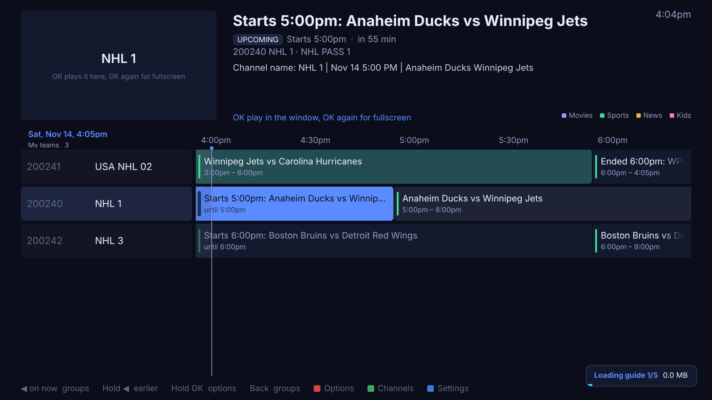
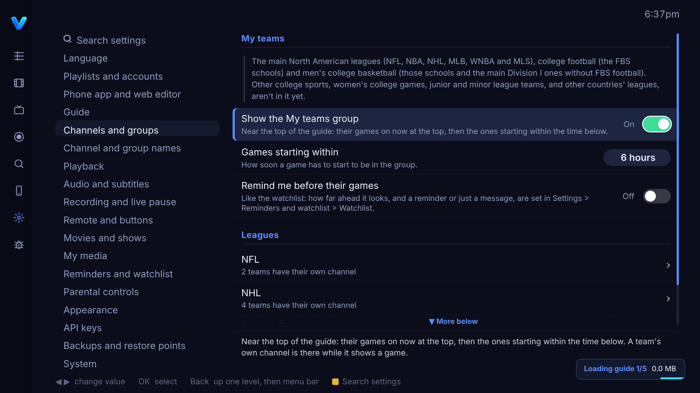

<!-- Generated from docs/USER-GUIDE.md by scripts/wiki/build.js.  Edit the guide, not this page. -->

*On the TV*

Many providers have a group for each league's teams ("NFL TEAMS", "NHL TEAMS": "NHL | DETROIT RED WINGS") next to their league passes.  **My teams** gathers the games of the teams you follow into one group near the top of the guide:

1. **Games on now**, on every channel showing them: event channels ("USA NHL 02: WPG VS CAR"), league passes, sports networks and guide programmes ("NFL Football: Lions at Vikings").  A game's channels are listed together, so when one feed doesn't work the next is right there.
2. **Their next games**, starting within 6 hours (or 3, 12 or 24), soonest first, at the bottom.

Only games: the other team's own channel is left out (unless you follow both), channels in your own groups count even when their provider group is hidden, and a team's own channel is there while it shows a game, not when its guide says "Future events not found yet" or the next game is tomorrow night.  A show about one team (a pregame show, a team magazine) isn't a game.  Games a local station lists as "NFL Football", with the teams only in the description, count.

Between games the group stays, empty, and says when the next one is: "No games on now or in the next 6 hours.  Next: Detroit Red Wings at Florida Panthers, Tomorrow 7:00pm on NHL | DETROIT RED WINGS."

For now it covers the main North American leagues (NFL, NBA, NHL, MLB, WNBA and MLS), college football (the FBS schools, plus North Dakota State and Sacramento State) and men's college basketball (the same schools and the main Division I ones without FBS football: the Big East, the West Coast Conference, the Atlantic 10, the Missouri Valley, the Horizon League, the Ivy League and more).  Football and basketball are followed separately, so you can follow a school's football team, its basketball team or both.  A school counts by its full name ("Michigan Wolverines") anywhere, and by its name alone ("Alabama at LSU") where the listing says the sport.  A listing that names two schools but not the sport ("Purdue Boilermakers vs Michigan State Spartans") goes to the sport in season, and when both are, the school's other games that week decide: the same game listed elsewhere with its sport, then the fact that a school plays football once a week, usually on a Saturday.  Women's college games, other college sports, junior and minor league teams, and other countries' leagues, aren't in it yet.

A game on several channels keeps a row for each channel, and they all show it the same way: the two teams in full, the visitors first ("Michigan Wolverines at Oregon Ducks"), at the time most of those channels give.

Choose your teams in **Settings > Channels and groups > My teams**.  It lists the leagues in your playlist (NFL, NBA, NHL, MLB, WNBA, MLS, College Football, College Basketball); open one and switch on your teams.  Teams with their own channel say so.  Or **hold OK** on a team's channel and choose **Follow the Detroit Red Wings** (in the phone app: press and hold the channel).  Your teams are kept in the settings, so they stay when you switch playlists.

**Remind me before their games** (off at first) sets reminders for their games the way the [watchlist](Watchlist) does: one per game, at its earliest start in the guide, however many channels carry it.  Overtime blocks and replays later that night get none.  Unfollowing a team takes its reminders with it.

TiviBro knows the teams by their full names ("Detroit Red Wings"), by short names when the league is clear ("Red Wings" on an NHL channel, or "Heat at Magic"), by city when the league is named ("NHL: Winnipeg vs Carolina"), and by abbreviations in event channel names ("WPG VS CAR" in an NHL group).  So "Magic Mike" on a movie channel is never a game, and junior and minor teams with the same names ("Parkland Rangers U15", "Providence Bruins") are left out.  **Hold OK** on the group for **Choose teams…** or **Turn off My teams**.

  
  

---

← [Event channels: pay-per-view and sports passes](Event-channels-pay-per-view-and-sports-passes)  ·  [Home](Home)  ·  [Sports](Sports) →
