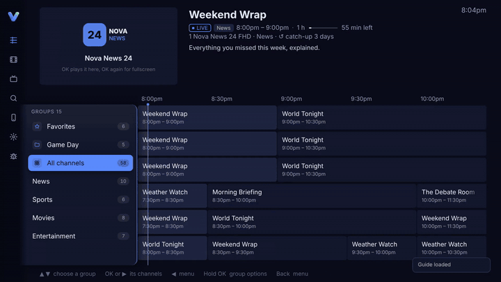
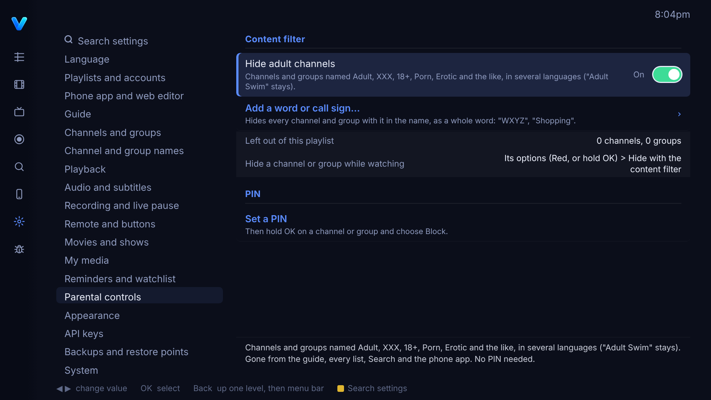
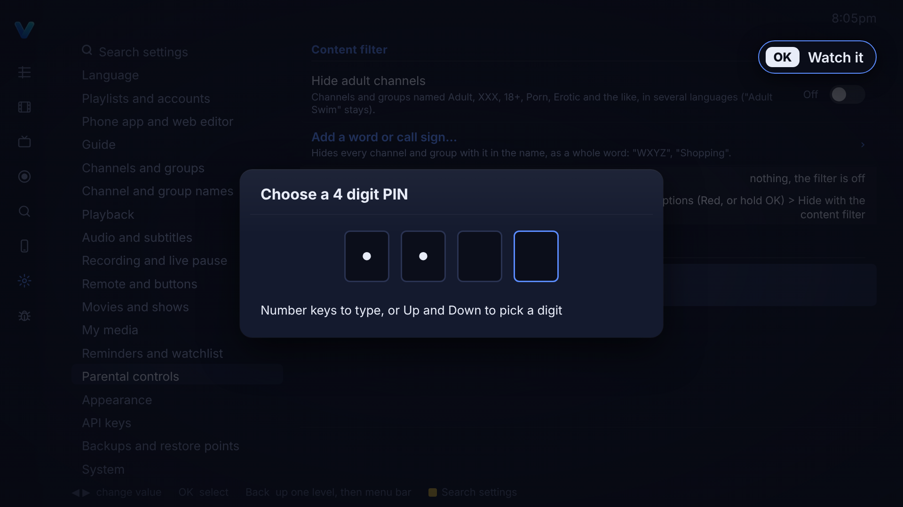

<!-- Generated from docs/USER-GUIDE.md by scripts/wiki/build.js.  Edit the guide, not this page. -->

*On the TV*

**Content filter**, at the top of **Settings > Parental controls**, takes channels out of TiviBro altogether, no PIN needed: they never show in the guide, any list, Search, the phone app or the web editor.

- **Hide adult channels** catches channels and groups named Adult, XXX, 18+, Porn, Erotic and the like, in several languages, and channels the provider marks as adult.  "Adult Swim" stays.  A new TV asks on the set-up tour's first screen, with **Yes** picked.
- **Add a word or call sign…** hides every channel and group with that whole word in its name: a city's affiliates by call sign, shopping channels, a sports league you never watch.
- While watching or in the guide, a channel's or group's options have **Hide with the content filter** (asked first).
- Each word, channel and group is listed there with **Remove**, and **Left out of this playlist** says how many channels and groups the filter takes out.  Nothing is deleted: remove an entry and the channels come back.

Set a PIN under **Settings > Parental controls**, then **Hold OK** on any channel or group and choose **Block channel** (or block a whole group from its options).  Decide whether the PIN guards blocked channels, Settings, or both, and whether it stays unlocked until TiviBro restarts.  **Lock now** locks it again straight away.  Blocked channels show **Locked** instead of their programme, and blocking the channel that's playing stops it.  All options: [Settings: Parental controls](Settings-Parental-controls).

<a href="https://github.com/ohmybahgosh/TiviBro/raw/main/docs/media/parental.mp4">Watch the MP4</a>

  
  

---

← [Updates](Updates)  ·  [Home](Home)  ·  [Settings: Language](Settings-Language) →
