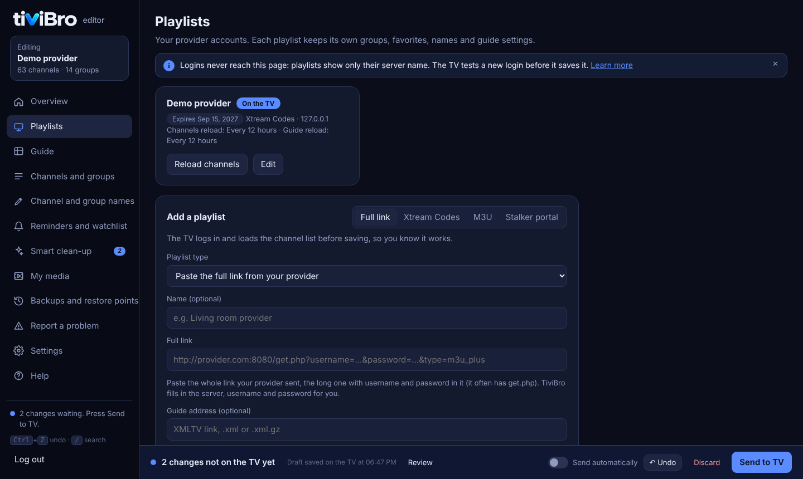

<!-- Generated from docs/USER-GUIDE.md by scripts/wiki/build.js.  Edit the guide, not this page. -->

*Web editor: the web editor*

Add Xtream Codes, M3U or Stalker portal playlists (or paste the provider's **Full link** and let TiviBro fill in the login), choose which one is first (every playlist that is on is used at once, see [Settings: Playlists](Settings-Playlists)), turn them on and off, set reload schedules and the User-Agent, or change a login.  The TV tests every new login before saving.  **Logins never reach the editor**: it only ever sees server names.  Each playlist keeps its own groups, names and guide setup.  The editor's channel pages show every playlist that is on; names, guide matching and Smart clean-up rules are the first playlist's.

  

---

← [Reminders and watchlist](Reminders-and-watchlist)  ·  [Home](Home)  ·  [My media in the editor](My-media-in-the-editor) →
