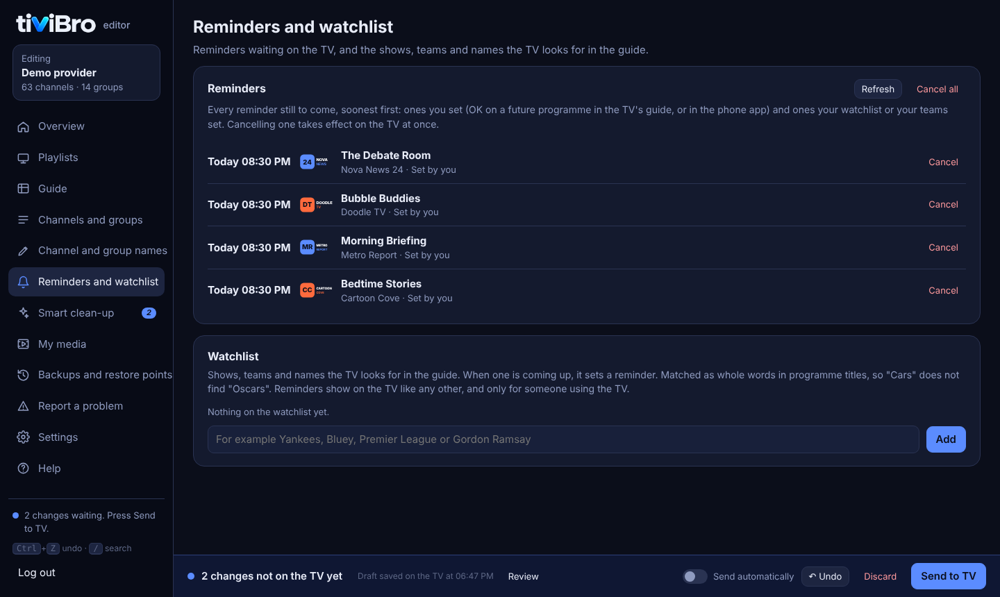

<!-- Generated from docs/USER-GUIDE.md by scripts/wiki/build.js.  Edit the guide, not this page. -->

*Web editor: the web editor*

- **Reminders** lists every reminder waiting on the TV, soonest first, with what set it: you (OK on a future programme in the TV's guide, or in the phone app), your watchlist or your teams.  **Cancel** drops one, **Cancel all** drops every one (it asks first), and **Refresh** asks the TV again.  These take effect on the TV at once; they are not drafts.
- **Watchlist**: type a show, team or name and **Add**; **✕** removes one.  The TV looks for them in the guide and sets reminders (see [Watchlist](Watchlist)).

The same reminders are under **Settings > Reminders and watchlist** on the TV and on the phone app's **Reminders** screen.

---

← [The programme guide](The-programme-guide)  ·  [Home](Home)  ·  [Playlists](Playlists) →
