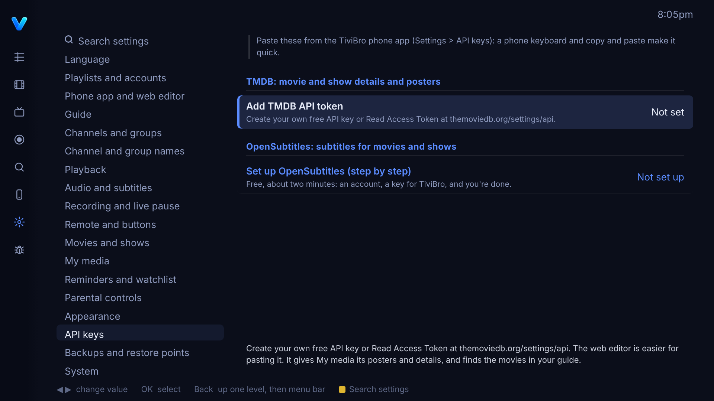

<!-- Generated from docs/USER-GUIDE.md by scripts/wiki/build.js.  Edit the guide, not this page. -->

*Every setting*

Every key you paste, in one place.  Typing them from the TiviBro phone app (Settings > API keys) is easiest: a phone keyboard and copy and paste.

| Setting | Choices | What it does |
|---|---|---|
| **Add TMDB API token** | | Your free key or Read Access Token from themoviedb.org/settings/api, for movie and show details and posters (My media, Movies on now).  Then **Test TMDB token** and **Remove TMDB token**. |
| **Set up OpenSubtitles (step by step)** | | The free key for Find subtitles, step by step (an account, the key and what to tick, paste it, checked straight away).  Once set up: **OpenSubtitles API key saved** to replace it, **Test OpenSubtitles key** (the key, and your sign-in if any), **Sign in** for more downloads, and **Remove OpenSubtitles key**. |
| **Connect Trakt** | | Under **Trakt: watch history and lists**.  The same as in [Settings: Trakt](Settings-My-media#settings-trakt); **Trakt history and lists** opens the rest of it in My media. |

The keys stay on this TV, out of backups.

---

← [Settings: Appearance](Settings-Appearance)  ·  [Home](Home)  ·  [Settings: Backups and restore points](Settings-Backups-and-restore-points) →
