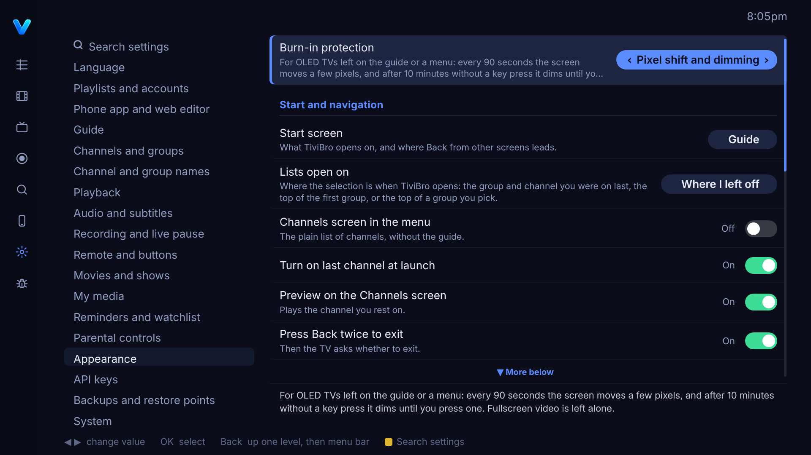
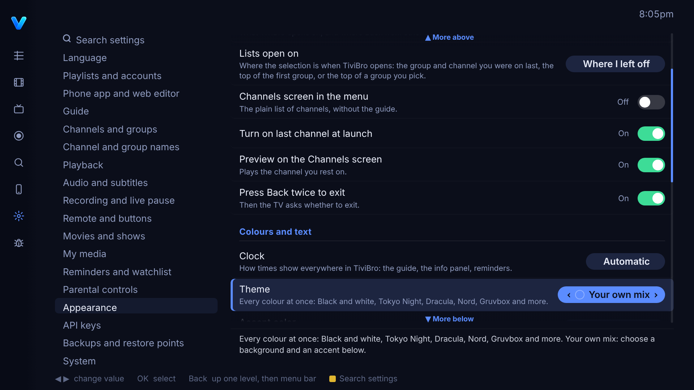
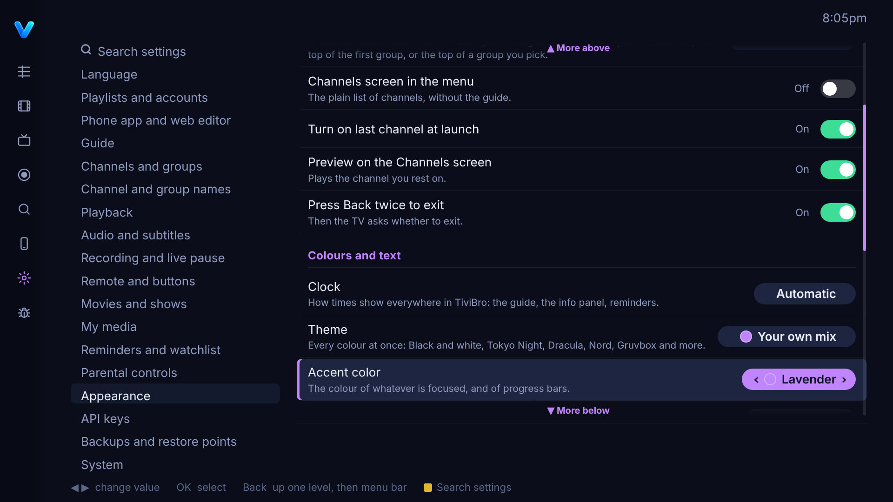

<!-- Generated from docs/USER-GUIDE.md by scripts/wiki/build.js.  Edit the guide, not this page. -->

*Every setting*

Which screen TiviBro opens on, where the lists start, colours, sizes and what's on screen.  Every change shows straight away.  How the guide looks is under [Guide](Settings-Guide); the order of movies and shows under [Movies and shows](Settings-Movies-and-shows).

  
  
  

| Setting | Choices | What it does |
|---|---|---|
| **Burn-in protection** | **Pixel shift and dimming** · Pixel shift only · Off | For OLED TVs left on the guide or a menu: every 90 seconds the screen moves a few pixels (4 at most), and after 10 minutes without a key press it dims until you press one (that key only wakes it).  Fullscreen video is left alone. |
| **Start screen** | **Guide** · Channels screen | Under **Start and navigation**.  What TiviBro opens on, and where **Back** from other screens leads. |
| **Lists open on** | **Where I left off** · The first group · A group I pick | Where the selection is when TiviBro opens.  Where I left off is the group and channel you were on last; the other two start at the top of that group (unless a channel is already playing).  With **A group I pick**, **Group to open on** chooses it: any group, Favorites and All channels too. |
| **Channels screen in the menu** | On · **Off** | The plain channel list (without the guide) in the side menu.  Off, **Green** in the guide still opens it.  Always there while TiviBro starts on it. |
| **Turn on last channel at launch** | **On** · Off | Starts the channel you watched last when TiviBro opens. |
| **Preview on the Channels screen** | **On** · Off | Plays the channel you rest on in the Channels screen.  Turn it off on very slow TVs for the snappiest list. |
| **Press Back twice to exit** | **On** · Off | Back to the groups on the home screen (or the first screen) shows **Press Back again to exit**; a second **Back** asks **Do you want to exit?** (the TV's own question on webOS 6 and later, TiviBro's on older TVs) and you choose to exit or stay.  Off: Back on the menu bar asks at once. |
| **Clock** | **Automatic** · 12 hours (7:30pm) · 24 hours (19:30) | How times show everywhere in TiviBro.  Automatic follows the TV's region: 12 hours in the US, 24 hours in most of Europe. |
| **Theme** | **Your own mix** · Black and white · Graphite · GitHub Dark · Ayu Dark · Tokyo Night · Dracula · Nord · Gruvbox · Catppuccin Mocha · Solarized Dark · One Dark · Rosé Pine · Everforest · Kanagawa · Monokai · Terminal | Under **Colours and text**.  Every colour at once, from the popular editor and desktop themes.  *Black and white* is true black with white focus.  *Graphite*, *GitHub Dark* and *Ayu Dark* are crisp near-black themes with bright text.  *Terminal* is green on black, with a monospace clock and a blinking cursor.  With a theme on, the accent and background below give way to it (**Background and accent**: From the theme); *Your own mix* brings them back. |
| **Accent color** | **Electric blue** · Cyan · Violet · Lavender · Pink · Mint · Teal · Lime · Amber · Ember · Red · White · Custom | The colour of whatever is focused, and of progress bars.  A swatch shows it beside the name. |
| **Custom hue** *(Custom only)* | 0° to 350°, **210° Azure** | Around the colour wheel, each with a plain name: 0° Red, 30° Orange, 60° Yellow, 120° Green, 180° Cyan, 240° Blue, 300° Magenta and the ones between. |
| **Custom brightness** *(Custom only)* | Deep · Rich · **Normal** · Light · Pastel | How light the custom accent is. |
| **Background** | **Midnight** · Black (OLED) · Slate · Ocean · Forest · Plum · Mocha · High contrast · Classic (1.0) | The whole palette behind everything.  *Black* is true black for OLED TVs; *High contrast* is the easiest to read. |
| **Focus style** | **Filled** · Filled with outline | The outline adds a white ring to whatever is selected, easier to spot from across the room. |
| **Text size** | Small · **Medium** · Large | In the guide and channel lists.  On a 32-inch or smaller TV it starts at Large. |
| **Panels over video** | Solid · **Normal** · See-through | How see-through the info panel, quick menu and channel guide are in fullscreen. |
| **Channel logos** | **From the playlist** · From the guide | Which logo to use when both have one. |
| **Logo library** | **Off** · Fill in missing logos · Use for every channel it knows | Logos from Worldwide TV Logos, tv-logos and iptv-org for channels with none, or for every channel.  See [Channel logos](Channel-logos).  The set-up tour offers *Fill in missing logos*. |
| **Logo library style** *(library on)* | **Cleaned up** · Cleaned up, in colour · Matching set · Original logos | Each channel's own logo, cleaned up and in white for dark screens (Worldwide TV Logos); the same logos in their own colours; one style for dark screens (tv-logos); or each channel's own logo as iptv-org has it.  Each falls back to the others.  The panel beside the row previews each style with your channels. |
| **Logo library status** *(library on)* | | How many names it has, and for which countries. |
| **Numbers** | **TV font** · Even width · Fixed width, slashed zero | Even width gives every digit the same width, so channel numbers and times line up and the buffer info stays steady.  Fixed width also crosses the zero. |
| **Show clock** | **On** · Off | The clock in the top right corner. |
| **Show the date with the clock** | On · **Off** | Adds the date beside the time. |
| **Show channel numbers** | **On** · Off | Numbers beside channel names in lists and the guide. |
| **Info panel stays for** | 3 s · **5 s** · 8 s · 12 s | How long the info panel stays up in fullscreen. |

---

← [Settings: Parental controls](Settings-Parental-controls)  ·  [Home](Home)  ·  [Settings: API keys](Settings-API-keys) →
