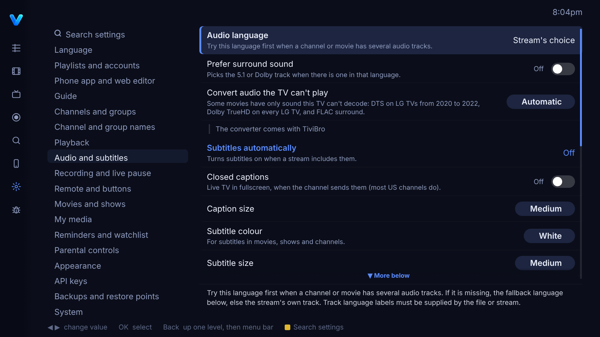

<!-- Generated from docs/USER-GUIDE.md by scripts/wiki/build.js.  Edit the guide, not this page. -->

*Every setting*

Which audio track plays, sound the TV can't play, subtitles and captions, and subtitles from OpenSubtitles.

| Setting | Choices | What it does |
|---|---|---|
| **Audio language** | **The stream's own choice** · English · Spanish · French · German · and more | When a channel or movie has more than one audio track, tries this language, then the fallback language if you set one, else keeps the stream's own track.  This also applies to My media.  Language tags must be present in the file or stream.  Audio description tracks are skipped unless nothing else is in that language.  A track you pick from the quick menu wins until you change channel.  **Original language**: each movie's own language (TMDB), never a dub or a commentary. |
| **Fallback audio language** | **Off** · English · and more | Try this language when the preferred audio language is missing.  Off keeps the stream's own track.  For Dutch then English, set Audio language to Dutch and the fallback to English. |
| **Prefer surround sound** | On · **Off** | Picks the 5.1 or Dolby track in that language when there is one.  Your TV or soundbar needs to support it. |
| **Convert audio the TV can't play** | **Automatic** · Off | DTS on LG TVs from 2020 to 2022, Dolby TrueHD on every LG TV, and FLAC surround don't play.  *Automatic* plays another audio track the TV can play if the movie has one, or has the network helper turn the sound into Dolby Digital while you watch.  *Off* plays those movies as they are, often without sound.  See [Sound the TV can't play](Sound-the-TV-cant-play). |
| **Audio converter** | (information) | Whether the audio converter is ready ("Built in, ready" when it came with TiviBro), its size and where it is kept, or how far its download has got. |
| **Get the converter now** / **Remove the converter** | | Only in a TiviBro built without the converter.  Downloads the audio converter (about 2 MB) from TiviBro's releases on GitHub, checks its fingerprint and keeps it on the TV's storage, so the first movie that needs it doesn't wait.  Once it is there, **Remove the converter** deletes it again; TiviBro then asks before getting it next time. |
| **Subtitles automatically** | **Off** · Any language · English only · Spanish only · … | Turns subtitles on when a stream has them; with a language, only subtitles in that language.  You can still switch them from the quick menu. |
| **Closed captions** | On · **Off** | Captions on live TV in fullscreen, when the channel sends them (most US channels do).  The same switch as **Captions** in the quick menu.  Not with the TV player. |
| **Caption size** | Small · **Medium** · Large | |
| **Subtitle colour** | **White** · Yellow · Gold · Light blue · Light green | For subtitles in movies, shows and channels.  Closed captions keep the channel's own colours. |
| **Subtitle size** | Small · **Medium** · Large · Extra large | |
| **Subtitle background** | **Outline** · See-through box · Black box | A box behind each line is easier to read over bright scenes. |
| **Subtitle languages** | English and others, several at once | Under **Subtitles from OpenSubtitles**.  The languages **Find subtitles** looks for, your first one listed first. |
| **Set up OpenSubtitles (step by step)** | | The free key from opensubtitles.com, step by step (see [Subtitles for movies and shows](Movies-and-shows)).  Kept on this TV, out of backups.  Once set up the row reads **OpenSubtitles API key saved**, to replace the key; an empty key removes it. |
| **Sign in (optional)** | | Shows once a key is saved.  Your OpenSubtitles account: 20 downloads a day instead of 5.  Kept on this TV only.  In the phone app the username and then the password are asked on the phone. |
| **Keep downloaded subtitles** | Off · 1 day · 3 days · **A week** | Under **Subtitles from OpenSubtitles**.  A movie or episode you come back to gets its subtitles and timing again, without another download.  Kept on this TV only. |
| **Forget audio sync for N channels and movies** | | Under **Audio sync**, once one is set.  Every channel, movie and episode plays its sound as sent again.  See [Audio sync](Audio-sync-sound-ahead-of-or-behind-the-picture). |

**Subtitles in MKV and MP4 movies and episodes.**  Open **Subtitles** from the player menu to choose a language or **Off**.  The menu has two parts: **Settings** at the top (**Find subtitles…**, **Timing** and **Line up with another track…**), then the subtitles the video has, under **In this movie** or **In this episode** with how many there are.  It opens on the subtitle that is on, so switching language is a press or two even in a movie with dozens of languages.  The menu is available as soon as playback starts and shows **Finding subtitles…** while tracks are discovered.  The automatic subtitle language setting above also applies.  Supported embedded SRT, ASS/SSA and WebVTT tracks appear with their language names, and your selection survives seeking and reconnects.  Only the selected subtitle track is shown, even if another track becomes active while subtitles load.  ASS/SSA and WebVTT show as plain text.  My media uses the file's known type even when its signed playback link has no extension.  Files without supported tracks show an unavailable message; bitmap subtitles are not supported.  Some MKV files do not index their subtitle tracks and cannot expose them here.  **Find subtitles** offers another way to add them.

**MP4 subtitles** work for the usual text kind (called tx3g or mov_text), shown as plain text without their colours or positions.  Not included: MP4 files made for streaming in pieces (fragmented MP4), image subtitles, and closed captions inside MP4.  TiviBro makes extra requests on the same link as the movie: a few when the movie starts, to find the subtitles, and then, while a subtitle is on, small reads of the lines a little ahead of where you are as the movie plays (how often depends on the file).  Some providers refuse those reads: one that allows only one connection at a time, or one whose links stop taking new requests after a while.  The movie keeps playing either way.  TiviBro waits a little, asks the movie's link for a new connection and carries on; if the provider keeps refusing, it stops asking for this movie and **Subtitles** shows **Subtitles unavailable**.

---

← [Settings: Playback](Settings-Playback)  ·  [Home](Home)  ·  [Settings: Recording and live pause](Settings-Recording-and-live-pause) →
