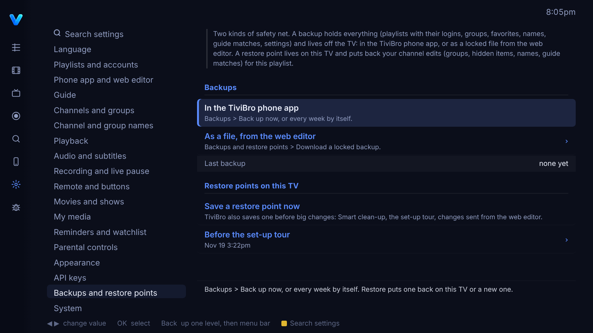

<!-- Generated from docs/USER-GUIDE.md by scripts/wiki/build.js.  Edit the guide, not this page. -->

*Every setting*

Two kinds of safety net, on one page.

- **A backup** holds everything: playlists with their logins, groups, favorites, names, guide matches and settings.  It lives off the TV: in the TiviBro phone app, or as a locked file from the web editor (or the phone app).
- **A restore point** lives on this TV and puts back your channel edits for this playlist: groups, hidden items, names and guide matches.  Your playlists and logins stay as they are.  With several playlists on, a point belongs to the first playlist and covers every playlist that was on when it was made (the web editor lists them); restoring it leaves the others as they are.

| Setting | What it does |
|---|---|
| **In the TiviBro phone app** | Under **Backups**.  **Backups > Back up now** in the app, or every week by itself; restore puts one back on this TV or a new one.  Pressed in the phone app, it opens the app's [Backups and restore points](Settings-Phone-app-and-web-editor) screen. |
| **As a file, from the web editor** | Shows the web editor's code; there, **Backups and restore points > Download a locked backup**, with a passphrase you choose.  In the phone app it opens that page in Edit channels, which hands over to the app's own Backups and restore points screen. |
| **Last backup** | (information) When the last backup was made, or none yet. |
| **Save a restore point now** | Under **Restore points on this TV**.  Asks for a name ("Before hiding sports").  TiviBro also saves one by itself before big changes: Smart clean-up, the set-up tour, and changes sent from the web editor. |
| *(each restore point)* | Newest first, with its date and **saved by itself** for the automatic ones.  **OK** for **Restore it** (your current edits are saved as a restore point first, then it asks) or **Delete it**. |

See also [Backups and restore points](Backups-and-restore-points) in the web editor.

---

← [Settings: Parental controls](Settings-Parental-controls)  ·  [Home](Home)  ·  [Settings: Phone app and web editor](Settings-Phone-app-and-web-editor) →
