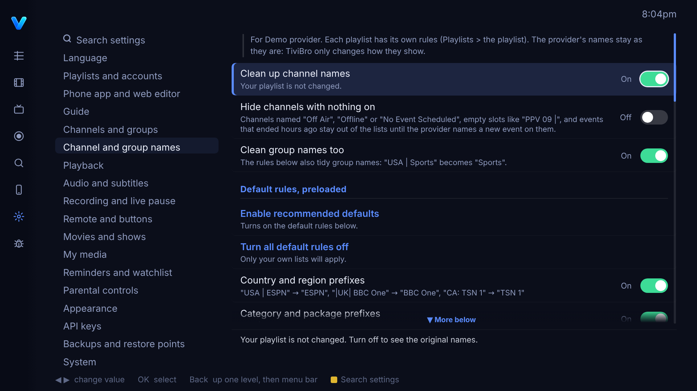

<!-- Generated from docs/USER-GUIDE.md by scripts/wiki/build.js.  Edit the guide, not this page. -->

*Every setting*

Rules that strip clutter from every channel and group name at once, for the playlist in use (each playlist has its own rules, also on its page under **Playlists**).  Your provider's names are never changed: switch a rule off and the original comes back.  Names you set by hand stay.

| Setting | Default | What it does |
|---|---|---|
| **Clean up channel names** | **On** | The master switch.  Off shows the original names. |
| **Hide channels with nothing on** | Off | Event channels the provider names "Off Air", "Offline" or "No Event Scheduled" between events, empty slots ("PPV 09 \|", "EPL 02:", " :ESPN+ 291") and events that ended hours ago (the provider never renamed them) stay out of the lists while they say so, and come back by themselves when an event is named on them.  Favorites keep theirs.  Works even with name clean-up off. |
| **Clean group names too** | **On** | The rules below also tidy group names: "USA \| Sports" becomes "Sports".  Your group prefixes and suffixes apply either way. |
| **Enable recommended defaults** / **Turn all default rules off** | | Set every built-in rule at once.  Your own lists are kept. |
| **Country and region prefixes** | **On** | "USA \| ESPN" → "ESPN", "\|UK\| BBC One" → "BBC One", "CA: TSN 1" → "TSN 1", "UK◈ Sky Store" → "Sky Store".  About 250 country, region and language codes (CAR, ARG, CO, CA-FR, AFG, PK and so on), with any separator: \| : - • » ◈ ▶. |
| **Category and package prefixes** | **On** | "VIP \| AMC" → "AMC", "24/7 - Friends" → "Friends", "SPORTS: TNT" → "TNT", "DEP \| TUDN 01" → "TUDN 01".  Also Spanish ones (Deportes, Cine, Noticias, Infantil, Novelas) and package words like Gold or Max. |
| **Quality and format tags at the end** | **On** | "CNN FHD" → "CNN", "Nat Geo (1080p)" → "Nat Geo", "AMC \| RAW" → "AMC". |
| **Decorative symbols** | **On** | "Fox News ᴴᴰ" → "Fox News", "TNT ★" → "TNT", "⚽ EPL 1" → "EPL 1", "⫘⫘⫘ UK ⫘⫘⫘" → "UK", "Event 2026™: Final" → "Event 2026: Final", "EL NUEVE SD \*" → "EL NUEVE".  Emoji, sport symbols, circled letters, arrows and shapes. |
| **Time zone feeds** | Off | "HBO (East)" → "HBO", "Starz West" → "Starz".  Off by default because East and West feeds would end up with the same name. |
| **Any short bracketed tag at the ends** | Off | "[EN] Sky News" → "Sky News", "AMC (Backup)" → "AMC".  Off by default because it can remove useful text like "(Sports)". |
| **Free streaming service prefixes** | Off | "Pluto US \| CNN Headlines" → "CNN Headlines", "TUBI \| ION" → "ION", "Samsung TV Plus: Bob Ross" → "Bob Ross".  Pluto, Tubi, Plex, Samsung TV Plus, Roku, Xumo, Stirr, Distro, Local Now, LG Channels and more.  Off by default because a Pluto or Tubi copy then looks like the real channel. |
| **Country codes and names at the end** | Off | "CANAL 4 PAN" → "CANAL 4", "BEIN SPORTS 5 (USA)" → "BEIN SPORTS 5", "TN (Argentina)" → "TN".  Off by default because channels from different countries can end up with the same name. |
| **Status notes at the end** | Off | "FloHockey 39 - Off Air" → "FloHockey 39", "PPV 07 \| OFFLINE" → "PPV 07".  Off by default because the note tells you nothing is on; **Hide channels with nothing on** hides those channels instead. |
| **Your prefixes** / **Your suffixes** | empty | Your own text to remove from the start or end of channel names, any capitalisation.  Spaces count (shown as ·), so " HD" won't touch "WHD".  **Add a prefix…** (or suffix), **Paste a comma separated list…** in TiviMate's format, for example `US: , UK: , NOW \| `, and **Clear**. |
| **Preview** | | Names from your channels before and after, the ones that change first. |
| **Group prefixes** / **Group suffixes** | empty | The same, for group names only: words only groups carry, like `USA ` at the start or ` Channels` at the end.  Removed after the rules above (when **Clean group names too** is on), and even when it's off.  Same paste format. |
| **Group preview** | | Your group names before and after, the ones that change first. |

---

← [Settings: Channels and groups](Settings-Channels-and-groups)  ·  [Home](Home)  ·  [Settings: Playback](Settings-Playback) →
