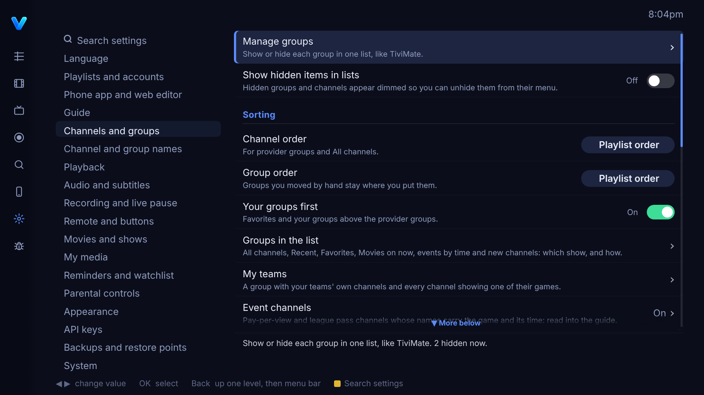
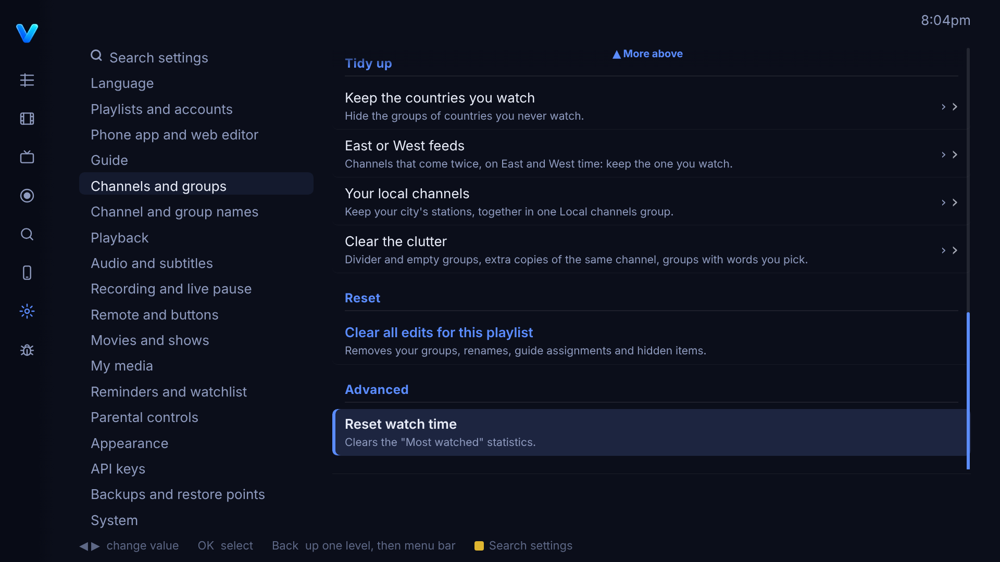
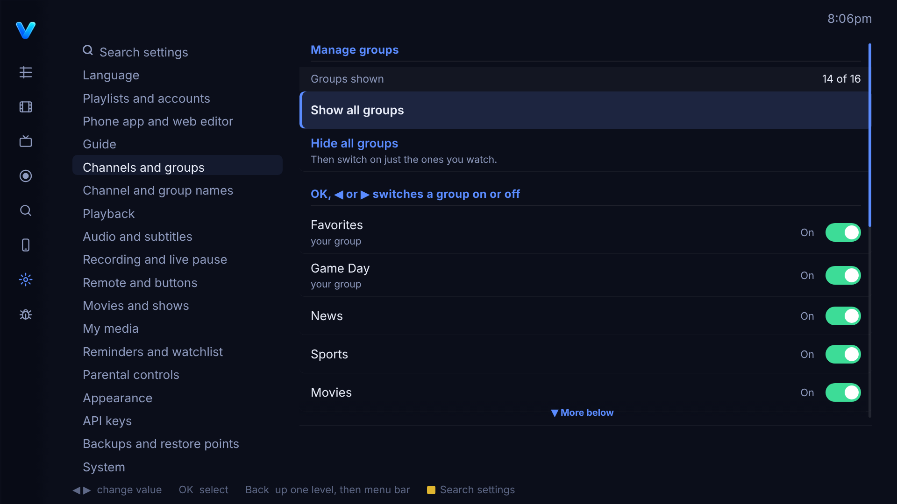
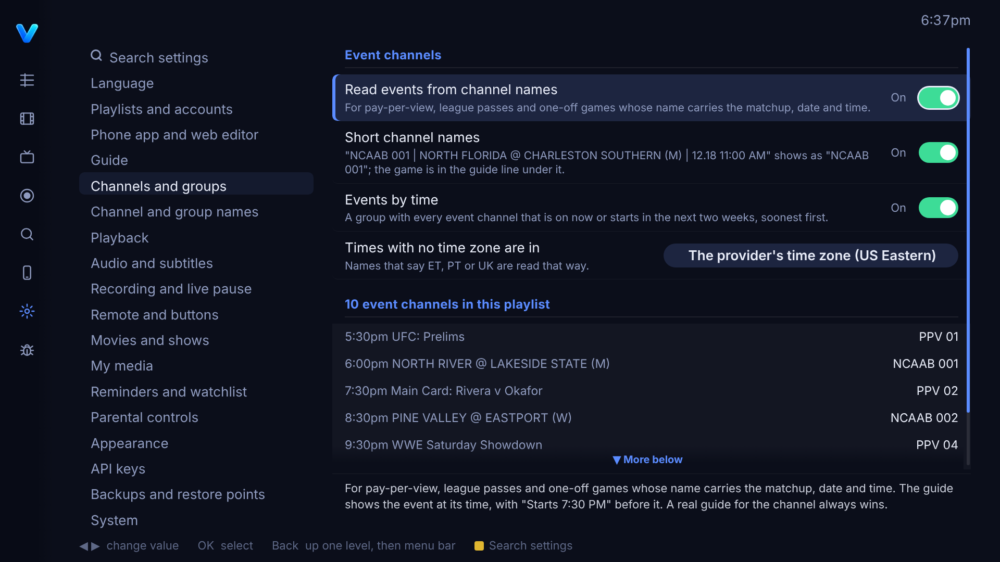
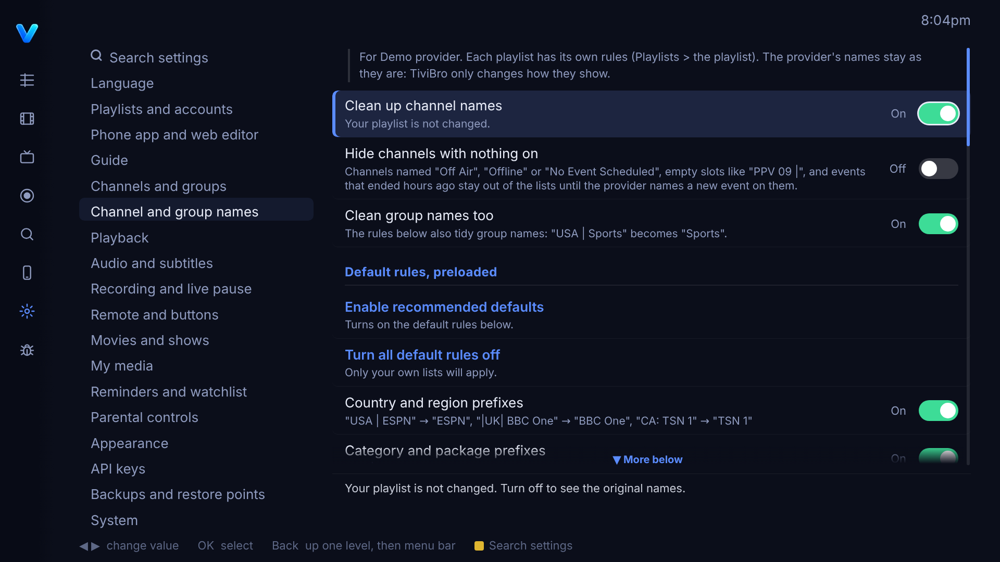

<!-- Generated from docs/USER-GUIDE.md by scripts/wiki/build.js.  Edit the guide, not this page. -->

*Every setting*

Which groups show, in what order, the special groups (Recent, Favorites, My teams, Movies on now, Events by time, Recently added), your own groups, and getting hidden things back.

  
  
  

| Setting | Choices | What it does |
|---|---|---|
| **Manage groups ›** | | Every group in one list, like TiviMate: **OK**, **◀** or **▶** switches a group on or off.  **Groups shown**, **Show all groups** and **Hide all groups** at the top (hide all, then switch on just the ones you watch).  For hundreds of groups the [web editor](Channels-and-groups) is faster. |
| **Show hidden items in lists** | On · **Off** | Hidden groups and channels appear dimmed, so you can unhide them from their own options. |
| **Channel order** | **Playlist order** · Channel number · Name · Most watched | For provider groups and All channels.  Your own groups keep the order you set. |
| **Group order** | **Playlist order** · Name | Groups you moved by hand stay where you put them. |
| **Your groups first** | **On** · Off | Favorites and your own groups above the provider's groups. |
| **Groups in the list ›** | | A page with the special groups: which show (All channels, Recent, Favorites, Movies on now, Events by time, Recently added) and how, and what happens to groups your provider adds later.  The rows marked *(Groups in the list)* below are on it. |
| **Show All channels** *(Groups in the list)* | **On** · Off | The All channels group. |
| **Show Recent channels** *(Groups in the list)* | **On** · Off | A group with the channels you watched lately. |
| **Recent channels kept** *(Groups in the list)* | 10 · **20** · 30 · 50 | How many channels Recent remembers. |
| **Show Favorites group** *(Groups in the list)* | **On** · Off | The Favorites group. |
| **My teams ›** | | The teams you follow, for the [My teams](My-teams) group: **Show the My teams group** (**On**), **Games starting within** (3 · **6** · 12 · 24 hours), **Remind me before their games** (**Off**), and a page for each league in your playlist to pick teams. |
| **Show Movies on now** *(Groups in the list)* | **On** · Off | The [Movies on now](Movies-on-now) group.  Needs a TMDB token (Settings > Playlists and accounts > API keys). |
| **Event channels ›** | **On** · Off | Pay-per-view and league pass channels whose names carry the game and its time, read into the guide (below). |
| **Show Events by time** *(Groups in the list)* | **On** · Off | With event channels on: the group of events on now or starting in the next two weeks.  The same switch as **Events by time** in Event channels; brings the group back after **Turn off Events by time** in its menu. |
| **Recently added channels** *(Groups in the list)* | Off · 3 days · **7 days** · 14 days | A **Recently added** group with the channels that are new in your playlist since it last loaded, newest first, and a **NEW** tag in the lists. |
| **Groups your provider adds later** *(Groups in the list)* | **Show them** · Hide them | *Hide them* keeps a tidy list tidy after **Hide all groups**: new provider groups arrive hidden. |
| **All channels includes hidden groups** *(Groups in the list)* | On · **Off** | Channels from groups you hid still appear in All channels. |
| **Reset watch time** | | Clears the statistics behind *Most watched*. |
| **New group…** | | Under **Your groups**.  Creates one of your own groups.  Then **Hold OK** on any channel and choose **Copy to group…**. |
| **Your groups ›** | | A page with each of your groups: **OK** for Rename, Move up, Move down, Empty this group and Delete group (Favorites can't be renamed or deleted). |
| **Hidden groups ›**, **Hidden channels ›** | | Pages with everything you hid, **Restore** on each and **Restore all groups** / **Restore all channels**.  Pages of their own, so a long list doesn't make this page (or the phone app's) hard to scroll past. |
| **Keep the countries you watch**, **East or West feeds**, **Your local channels**, **Clear the clutter** | | Under **Tidy up**: the set-up tour's clean-up steps, one at a time, whenever you like.  Each opens that step and its summary, and **Apply** hides only what that step says (after a restore point).  A step this playlist has nothing for says so.  In the phone app each is a page. |
| **Clear all edits for this playlist** | | Under **Reset**.  Removes your groups, renames, guide assignments and hidden items for this playlist.  It asks first.  The web editor's **Backups and restore points > Start over** does the same, can be undone, and waits for **Send to TV**. |

**Event channels.**  For pay-per-view, league passes and one-off games whose name carries the matchup, date and time (see [Event channels](Event-channels-pay-per-view-and-sports-passes)).  The same page is on each playlist's page under [Playlists](Settings-Playlists-and-accounts).

| Setting | Default | What it does |
|---|---|---|
| **Read events from channel names** | **On** | Shows the event from the name in the guide at its time, with "Starts 7:30 PM" before it and "Ended" after.  A real guide for the channel always wins. |
| **Short channel names** | **On** | "NCAAB 001 \| NORTH FLORIDA @ CHARLESTON SOUTHERN (M) \| 12.18 11:00 AM" shows as "NCAAB 001", with the game on the line under it. |
| **Events by time** | **On** | A group with every event channel that is on now or starts in the next two weeks, soonest first. |
| **Times with no time zone are in** | **The provider's time zone** | For names without ET, PT, UK and so on.  US Eastern, Central, Mountain or Pacific, UK, Central Europe, UTC, or this TV's time.  Times always show in the TV's own time. |
| *(list)* | | How many event channels the playlist has, and the next few events. |

#### Settings: Channel and group names

Rules that strip clutter from every channel and group name at once, for the playlist in use (each playlist has its own rules, also on its page under **Playlists**).  Your provider's names are never changed: switch a rule off and the original comes back.  Names you set by hand stay.

| Setting | Default | What it does |
|---|---|---|
| **Clean up channel names** | **On** | The master switch.  Off shows the original names. |
| **Hide channels with nothing on** | Off | Event channels the provider names "Off Air", "Offline" or "No Event Scheduled" between events, empty slots ("PPV 09 \|", "EPL 02:", " :ESPN+ 291") and events that ended hours ago (the provider never renamed them) stay out of the lists while they say so, and come back by themselves when an event is named on them.  Favorites keep theirs.  Works even with name clean-up off. |
| **Clean group names too** | **On** | The rules below also tidy group names: "USA \| Sports" becomes "Sports".  Your group prefixes and suffixes apply either way. |
| **Enable recommended defaults** / **Turn all default rules off** | | Set every built-in rule at once.  Your own lists are kept. |
| **Country and region prefixes** | **On** | "USA \| ESPN" → "ESPN", "\|UK\| BBC One" → "BBC One", "CA: TSN 1" → "TSN 1", "UK◈ Sky Store" → "Sky Store".  About 250 country, region and language codes (CAR, ARG, CO, CA-FR, AFG, PK and so on), with any separator: \| : - • » ◈ ▶. |
| **Category and package prefixes** | **On** | "VIP \| AMC" → "AMC", "24/7 - Friends" → "Friends", "SPORTS: TNT" → "TNT", "DEP \| TUDN 01" → "TUDN 01".  Also Spanish ones (Deportes, Cine, Noticias, Infantil, Novelas) and package words like Gold or Max. |
| **Quality and format tags at the end** | **On** | "CNN FHD" → "CNN", "Nat Geo (1080p)" → "Nat Geo", "AMC \| RAW" → "AMC". |
| **Decorative symbols** | **On** | "Fox News ᴴᴰ" → "Fox News", "TNT ★" → "TNT", "⚽ EPL 1" → "EPL 1", "⫘⫘⫘ UK ⫘⫘⫘" → "UK", "Event 2026™: Final" → "Event 2026: Final", "EL NUEVE SD \*" → "EL NUEVE".  Emoji, sport symbols, circled letters, arrows and shapes. |
| **Time zone feeds** | Off | "HBO (East)" → "HBO", "Starz West" → "Starz".  Off by default because East and West feeds would end up with the same name. |
| **Any short bracketed tag at the ends** | Off | "[EN] Sky News" → "Sky News", "AMC (Backup)" → "AMC".  Off by default because it can remove useful text like "(Sports)". |
| **Free streaming service prefixes** | Off | "Pluto US \| CNN Headlines" → "CNN Headlines", "TUBI \| ION" → "ION", "Samsung TV Plus: Bob Ross" → "Bob Ross".  Pluto, Tubi, Plex, Samsung TV Plus, Roku, Xumo, Stirr, Distro, Local Now, LG Channels and more.  Off by default because a Pluto or Tubi copy then looks like the real channel. |
| **Country codes and names at the end** | Off | "CANAL 4 PAN" → "CANAL 4", "BEIN SPORTS 5 (USA)" → "BEIN SPORTS 5", "TN (Argentina)" → "TN".  Off by default because channels from different countries can end up with the same name. |
| **Status notes at the end** | Off | "FloHockey 39 - Off Air" → "FloHockey 39", "PPV 07 \| OFFLINE" → "PPV 07".  Off by default because the note tells you nothing is on; **Hide channels with nothing on** hides those channels instead. |
| **Your prefixes** / **Your suffixes** | empty | Your own text to remove from the start or end of channel names, any capitalisation.  Spaces count (shown as ·), so " HD" won't touch "WHD".  **Add a prefix…** (or suffix), **Paste a comma separated list…** in TiviMate's format, for example `US: , UK: , NOW \| `, and **Clear**. |
| **Preview** | | Names from your channels before and after, the ones that change first. |
| **Group prefixes** / **Group suffixes** | empty | The same, for group names only: words only groups carry, like `USA ` at the start or ` Channels` at the end.  Removed after the rules above (when **Clean group names too** is on), and even when it's off.  Same paste format. |
| **Group preview** | | Your group names before and after, the ones that change first. |

---

← [Settings: Guide](Settings-Guide)  ·  [Home](Home)  ·  [Settings: Playback](Settings-Playback) →
