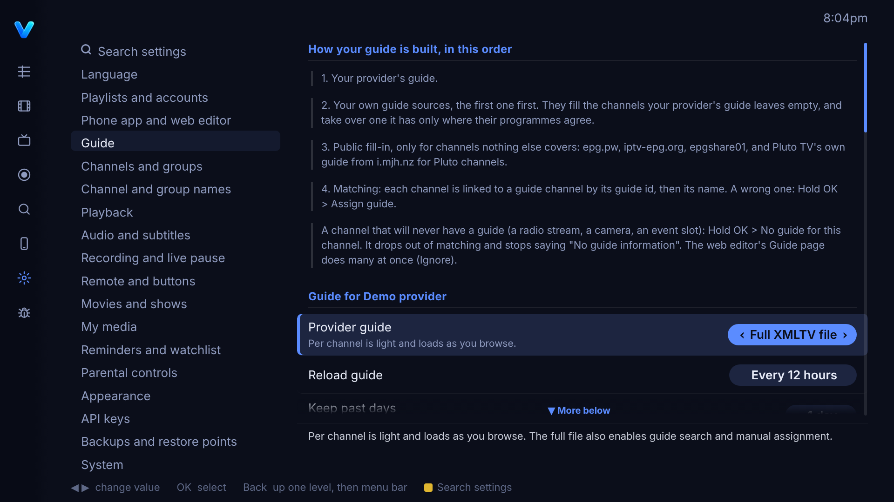
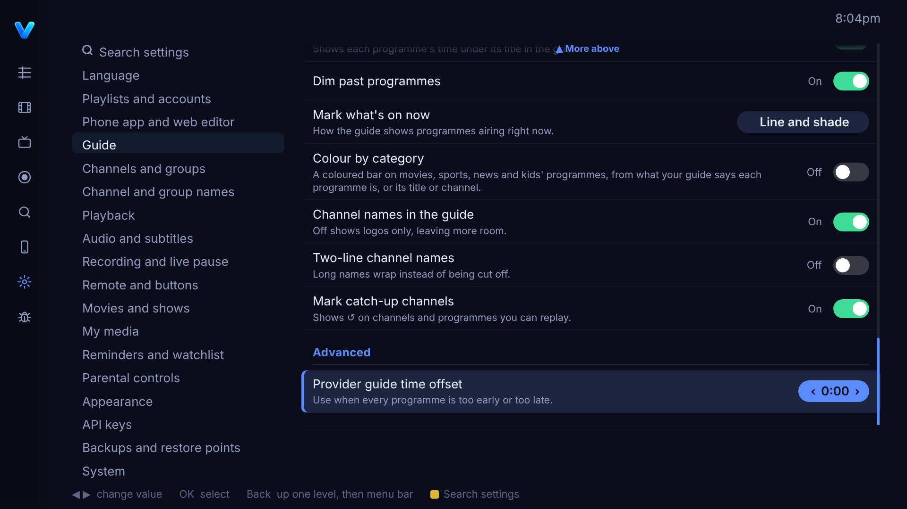

<!-- Generated from docs/USER-GUIDE.md by scripts/wiki/build.js.  Edit the guide, not this page. -->

*Every setting*

Where the programme guide comes from, for the playlist in use, and how it looks.  Each playlist's page under [Playlists](Settings-Playlists) has the same guide rows for that playlist.

**How your guide is built.**  The page starts with the order TiviBro builds your guide in:

1. **Your provider's guide.**
2. **Your own guide sources**, the first one first.  They fill the channels your provider's guide leaves empty, and take over one it has only where their programmes agree (similar titles at the same times), so a source with more days but the wrong schedule doesn't win.
3. **Public fill-in**, only for channels nothing else covers: epg.pw, iptv-epg.org, epgshare01, and Pluto TV's own guide from i.mjh.nz for Pluto channels.
4. **Matching:** each channel is linked to a guide channel by its guide id, then its name.  A wrong one: **Hold OK > Assign guide**.

A channel that will never have a guide (a radio stream, a camera, an event slot): **Hold OK > No guide for this channel**.  It drops out of matching and public fill-in, and stops saying "No guide information".  The web editor's Guide page does many at once (**Ignore**).

With public guides on, if the provider guide fails, the guide status says it is checking public guides.  Once they supply current matching listings, it says **Provider guide unavailable; using public guides.**  If they supply none, it says so instead.  If the guide TiviBro already had is still there, it says it is **using the saved guide**.  The original error stays in the guide's details.

  
  

| Setting | Choices | What it does |
|---|---|---|
| **Provider guide** | Xtream: **Per channel** · Full XMLTV file · Off.  M3U: **From playlist** · Off | *Per channel* asks for each channel's programmes as you browse: light and fast.  *Full XMLTV file* downloads the provider's whole guide: days ahead, guide search and manual matching, but often 20 to 200 MB.  *Off* uses only your own guide sources. |
| **Provider guide time offset** | −12:00 to +12:00 in half hours, **0:00** | Use it when every programme from the provider guide is too early or too late. |
| **Guide sources ›** | | Extra XMLTV guides (`.xml` or `.xml.gz`), used after the provider guide: they fill channels it doesn't have, and take over one it has only where their programmes agree with it (the same titles at the same times), so a guide with more days but the wrong schedule doesn't win.  **OK** on one to edit its address, give it its own time offset, move it up or down (the first one wins when two cover a channel) or remove it.  **Add guide source…** adds one.  The [web editor](The-programme-guide) has a list of free guides by region, and after a guide load each source there says how many of your channels it matched. |
| **Reload guide** | Same choices as the channel list, **Every 12 hours** | How often the guide is downloaded again.  When your provider adds channels with guide ids (or, with matching by name, names) the stored guide doesn't cover, it's also downloaded again right after the channel list, so they get their programmes without waiting. |
| **Keep past days** | 1 · **2** · 3 · 5 · 7 days | How far back the guide keeps programmes, for catch-up browsing.  More days use more TV memory. |
| **Match guide by channel name** | **On** · Off | Links channels that have no guide id to a guide channel with the same name. |
| **Public guide fill-in ›** | **On** · Off | For channels with no guide from your sources or your provider: free guides from epg.pw, iptv-epg.org and epgshare01, matched by guide id, a local station's call sign or the name, and Pluto TV's own guide (i.mjh.nz) for Pluto channels, matched by their Pluto id.  Inside: **Fill in from public guides**, **Countries** (**Automatic**: the countries of the channels that need a guide, or up to eight you choose), **Sports guides** (**On**: US sports networks and team channels from EPGTalk and epgshare01, which also stand in for a sports channel's own guide when theirs reaches further ahead; needs the helper), how many channels each guide filled in and when it last looked, **Look again now**, and **About these guides**.  TiviBro hosts nothing and sends no logins.  See [Public guide fill-in](The-programme-guide). |
| **Reload guide now** | | Downloads the guide right away. |
| **Guide last loaded**, each source, **Channels with guide data** | (information) | When the guide loaded, how many channels and programmes each source gave, and how many of your channels have a guide. |
| **Assign guide to channels without one** | | Lists channels with no guide (leaving out the ones with no guide wanted); pick one and search the guide for the right channel.  Also on any channel: **Hold OK > Assign guide…**. |
| **Channels with no guide wanted ›** | | Shows once you have some: every channel you marked **No guide for this channel** on the TV, or **Ignore** in the web editor.  They are left out of guide matching and public fill-in, and don't say "No guide information".  **OK** on one (**Look again**) looks for a guide for it again. |
| **OK on a channel in the Guide** | **Preview first, then fullscreen** · Fullscreen right away | Under **How it looks**.  Like TiviMate: the first **OK** plays the channel in the window, the second goes fullscreen.  Or go straight to fullscreen. |
| **Guide row size** | **Normal** · Bigger · Biggest | A little taller rows with bigger channel names and titles (Biggest wraps long names to two lines).  For smaller TVs or reading from across the room; one channel fewer fits at once. |
| **Two-line programmes** | **On** · Off | Each programme's time under its title in the grid. |
| **Dim past programmes** | **On** · Off | Programmes that already ended are an outline with quieter text, so past and still to come read differently at a glance. |
| **Mark what's on now** | **Line and shade** · Line, shade and progress bar · Coloured cell, shade and bar | How the guide shows programmes airing right now.  As TiviMate draws it: the time of day is a thin line in a light shade of the accent colour, over the programmes, from a dot on the time bar, and each programme on now is a touch lighter up to the line.  It can also have a bar along the bottom for the part already aired, ending at the line, and a coloured cell. |
| **Colour by category** | On · **Off** | A short coloured bar on movies, sports, news and kids' programmes, from what your guide says each programme is, or else from its title or what the channel plainly is (ESPN, CNN, Disney Junior), with what each colour means at the top right.  Anything else stays plain. |
| **Channel names in the guide** | **On** · Off | Off shows logos only, leaving more room for programmes. |
| **Two-line channel names** | On · **Off** | Long channel names wrap instead of being cut off. |
| **Mark catch-up channels** | **On** · Off | Shows **↺** on channels and programmes you can replay. |

---

← [Settings: Playlists](Settings-Playlists)  ·  [Home](Home)  ·  [Settings: Channels and groups](Settings-Channels-and-groups) →
