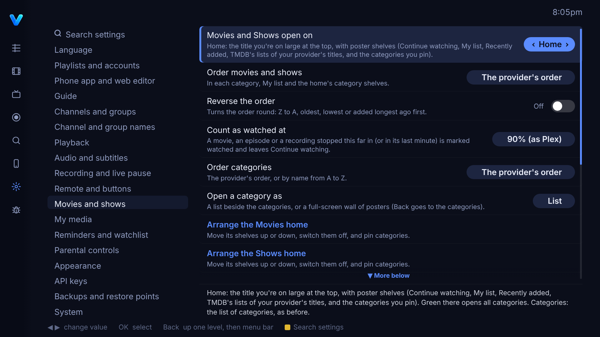

<!-- Generated from docs/USER-GUIDE.md by scripts/wiki/build.js.  Edit the guide, not this page. -->

*Every setting*

The Movies and Shows screens, and the details (TMDB or TheTVDB) for them and the guide.

| Setting | Choices | What it does |
|---|---|---|
| **Order movies and shows** | **The provider's order** · Recently added first · Name (A–Z) · Rating (highest first) | The order of titles in each Movies and Shows category and My list.  All movies and All shows stay newest first in the provider's order; Recently added is always newest first. |
| **Category under each poster** | On · **Off** | On shelves that mix categories (Recently added, Continue watching, My list, TMDB's lists), each poster says which category it's in, after its year and rating. |
| **Count as watched at** | 85% · **90% (as Plex)** · 95% · 98% | A movie, an episode (from your provider or My media) or a recording stopped this far in, or in its last minute, is marked watched and leaves Continue watching. |
| **Order categories** | **The provider's order** · Name (A–Z) | The order of the categories in the Movies and Shows lists.  Continue watching, My list and the newest titles stay at the top. |
| **Categories by language** | On · **Off** | A folder for each language when your provider's category names say the language ("HINDI MOVIES", "\|EN\| Action"): open one to see its categories, Back to leave it.  Nothing more is loaded, so it suits TVs with little memory too.  Not with categories ordered by name. |
| **Open a category as** | **List** · Posters, full screen | A list beside the categories, or the category's titles as a full-screen wall of posters, with the title you're on (its year, length, genre, rating and summary) at the top.  Back goes to the categories. |
| **Reload movies and shows now** | | Both lists again from your provider, for titles added since they last loaded, without reloading the channels.  Also **Red** on the Movies or Shows home. |
| **Play the next one automatically** | **On** · Off | When an episode ends, Up next shows the next one and starts it when its countdown ends; the same for the next movie of a collection you play.  Off: Up next waits for OK.  Also in My media. |
| **Up next countdown** *(Play the next one automatically on)* | 5 · **10** · 15 · 20 seconds | How long Up next counts down before the next one starts.  Also in My media. |
| **Hide spoilers** | On · **Off** | In the guide, new episodes and episodes or movies that haven't aired yet (not news or sport), and on the Shows screen, episodes you haven't started, keep only their title, season and episode, and when they air: no summary, episode title or picture from the episode. |
| **Movies: details from** | **TMDB, else TheTVDB** · TheTVDB · TMDB only | Under **Where details come from**.  Where movies get their posters, details, trailers and skip times: the guide (Movies on now), your provider's Movies and My media.  TMDB needs your token; TheTVDB needs nothing (TiviBro's own service, only titles leave the TV).  See [No TMDB token?](No-TMDB-token-TheTVDB) |
| **Shows: details from** | **TMDB, else TheTVDB** · TheTVDB · TMDB only | The same for shows: the guide, your provider's Shows, My media and Up next. |
| **Movie details in the guide** | **On** · Off | Under **Details in the guide**.  Posters and details for movies in the guide, the **Movie** tag, the [Movies on now](Movies-on-now) group and the Movies on now screen, from TMDB or TheTVDB as set under **Where details come from**.  Only programme titles leave the TV. |
| **Series details in the guide** | **On** · Off | Under **Details in the guide**.  A series' poster, network, genres and rating in the guide, each episode's own title and summary when the guide gives its season and episode, and what your provider leaves out on the Shows screen ([TV series in the guide](TV-series-in-the-guide)), from TMDB or TheTVDB as set under **Where details come from**.  Only a show's name and episode numbers leave the TV. |
| **TMDB API token ›** | | Under **Details in the guide**.  Opens [API keys](Settings-API-keys), where the token is added, tested or removed. |

---

← [Settings: Remote and buttons](Settings-Remote-and-buttons)  ·  [Home](Home)  ·  [Settings: My media](Settings-My-media) →
