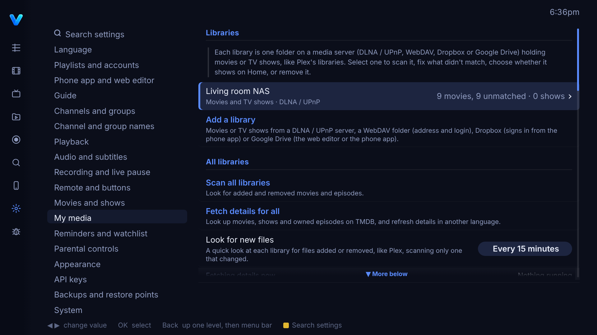

<!-- Generated from docs/USER-GUIDE.md by scripts/wiki/build.js.  Edit the guide, not this page. -->

*Every setting*

Your libraries, like Plex's: each one is a folder of movies or TV shows on a media server (DLNA / UPnP, WebDAV, Dropbox or Google Drive).  The [My media](My-media) screen keeps the shelves full-width; managing libraries stays here.  The phone app's **Settings > My media** does all of this too, with the typing on the phone.

| Settings > My media | Default | What it does |
|---|---|---|
| *(each library)* | | What it holds and where, with its counts: movies and how many are unmatched, shows and episode files, or **Scanning…**.  Opens the library's page (below). |
| **Add a library** | | Find a DLNA / UPnP server, or enter the WebDAV address of your media folder and its login.  **Dropbox** is signed in from the phone app, and **Google Drive** added from the web editor or the phone app.  Subfolders are scanned too.  One folder per movie, named like **Frozen (2013)**, matches best.  In the phone app the server list and the WebDAV form are on the phone. |
| **Scan all libraries** | | Same as Green on My media: scan every library for movies and episodes. |
| **Fetch details for all** | | Same as Yellow: look up details for movies, shows and the episodes you have, and refresh outdated language details. |
| **Edit on a computer** *(on the TV)* | | Shows a code for a computer or phone browser: the web editor's My media page, for typing server logins, fixing many matches at once and TV show episodes. |
| **Display and shelves ›** | | Sorting (**Sort movies by**, **Sort TV shows by**, reversed or not), **Arrange shelves** (one per tab with movies and shows), **Library poster size**, **Watched marks on posters**, **Mark what's new**, **Open where you left off**, **Play the next one automatically**, **Favorites also in lists** and **Metadata language**. |
| **Trakt ›** | | [Settings: Trakt](Settings-My-media#settings-trakt). |
| **TMDB API token ›** | | Opens [API keys](Settings-API-keys), the one place the token lives: add, test or remove it there. |

**A library's page:**

| Row | What it does |
|---|---|
| **Holds** | **Movies**, **TV shows**, or **Movies and TV shows** (each file sorted by its name).  Decides how files are read and which tab they go to. |
| **Name** | What My media and Settings call it. |
| **Show on Home** | On: its Recently added, Continue watching and favorites are on My media's Home.  Off: only on the Movies and TV shows tabs. |
| **Scan now**, **Restart scan** | Look for added or removed files; Restart starts over from the first folder.  While it scans: **Pause scan**. |
| **Fetch movie details** / **Fetch show details** | From TMDB, for this library. |
| **More for this library** | Its folder, Dropbox sign-in, pause or restart a scan.  In the phone app: the phone's own form. |
| **Unmatched movies ›** | The movies TMDB didn't recognise, each with **Fix match**: type the title, pick the right movie. |
| **Shows that need review** | Episodes TiviBro couldn't place and shows without a match, on the TV shows tab. |
| **Excluded files** | Trailers, extras and samples left out; include one back. |
| **Remove library** | Takes it off My media.  Your files stay where they are. |

#### Settings: Trakt

[Trakt](https://trakt.tv) keeps what you've watched in step across TiviBro, your phone and other apps, and its lists become shelves on My media that show only what you can watch.  Your Trakt sign-in stays on the TV, out of backups.

| Settings > My media > Trakt | Default | What it does |
|---|---|---|
| **Connect Trakt** | | Shows a code.  On your phone or computer, open **trakt.tv/activate**, sign in and enter it; the TV connects by itself.  In the phone app, select the link to open it.  No password is typed on the TV. |
| **Sync now**, **Disconnect Trakt** | | Once connected: sync at once (it also syncs every few hours), or sign this TV out. |
| **Mark as watched on Trakt** | **On** | A movie or episode you finish on My media goes on your Trakt history.  Kept and sent later when Trakt can't be reached. |
| **Bring my Trakt history in** | **On** | What you watched in other apps shows as watched here, so Next up and Not watched yet follow along. |
| *(each list)* | | Its page: **On My media**, **Holds** (movies, TV shows or both, and so its tab), its name, **Refresh now** and **Remove from My media**. |
| **Add a list by its link** | | Like Radarr and Sonarr: paste a trakt.tv/users/NAME/lists/LIST link, or type NAME/LIST.  The list must be public, or yours. |
| **Find a list** | | Search Trakt's public lists by name. |
| **Add a Trakt chart** | | Trending, popular, most anticipated, box office and most watched, for movies or shows. |
| **Add your watchlist or recommendations** | | Your Trakt watchlist, and the movies and shows Trakt recommends for you. |

Lists refresh every 6 hours.  TiviBro uses Trakt but is not endorsed or certified by Trakt.  Trakt's free accounts have limits on lists and items; TiviBro says so when Trakt answers that one is reached.

---

← [Settings: Movies and shows](Settings-Movies-and-shows)  ·  [Home](Home)  ·  [Settings: Reminders and watchlist](Settings-Reminders-and-watchlist) →
