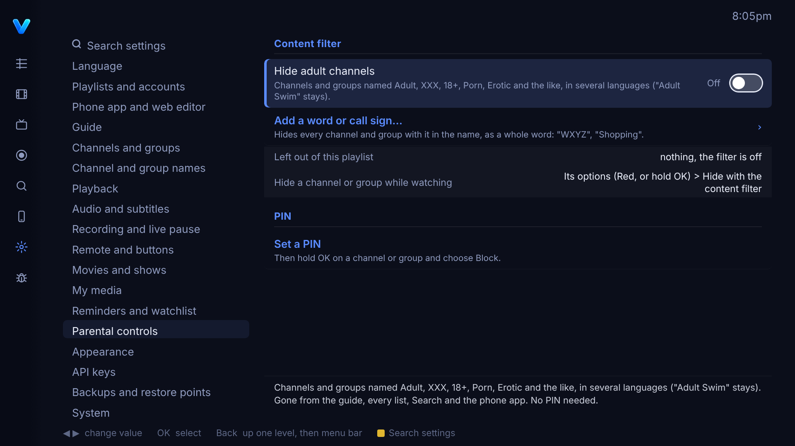
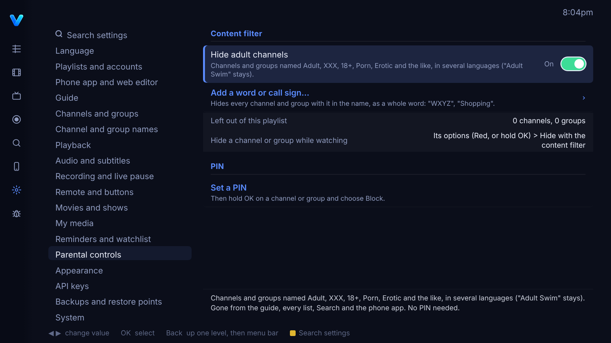

<!-- Generated from docs/USER-GUIDE.md by scripts/wiki/build.js.  Edit the guide, not this page. -->

*Every setting*

A content filter that needs no PIN, and a 4-digit PIN for blocked channels and groups, and optionally for Settings.  See [Parental controls](Parental-controls) for blocking.

  
  

| Setting | Choices | What it does |
|---|---|---|
| **Hide adult channels** | On · Off | Under **Content filter**.  Channels and groups with adult words in their names, in several languages, and those the provider marks adult, are left out of everything.  No PIN needed.  On for a new TV (the set-up tour asks). |
| **Add a word or call sign…** | | Every channel and group with that whole word in its name.  Each word, and each channel or group hidden with the filter, is listed with **Remove**. |
| **Left out of this playlist** | (information) | How many channels and groups the filter takes out. |
| **Set a PIN** / **Change PIN** | | Under **PIN**.  Choose a 4-digit PIN (typed twice).  Changing it asks for the current one first.  Type with the number keys, or pick each digit with **▲ ▼**. |
| **PIN required for** | **Blocked channels** · Settings · Both | What the PIN guards. |
| **Stay unlocked until the app restarts** | **On** · Off | On: after the PIN once, it isn't asked again until TiviBro restarts.  Off: asked every time. |
| **Lock now** | | Locks again straight away. |
| **Blocked in this playlist** | | Every blocked group and channel.  **OK** unblocks one.  More than three: a page of their own, **Blocked groups and channels ›**. |
| **Remove PIN** | | Turns parental controls off (asks for the PIN). |

Five wrong PINs in a row lock the PIN for 30 seconds.

---

← [Settings: Reminders and watchlist](Settings-Reminders-and-watchlist)  ·  [Home](Home)  ·  [Settings: Appearance](Settings-Appearance) →
