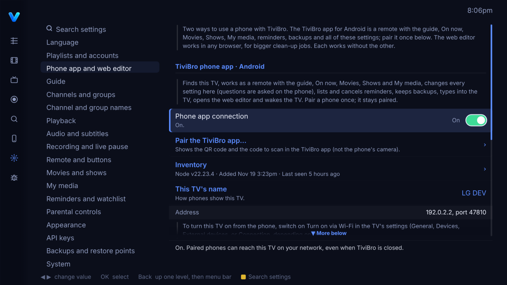

<!-- Generated from docs/USER-GUIDE.md by scripts/wiki/build.js.  Edit the guide, not this page. -->

*Every setting*

Its own section in Settings, right under Playlists and accounts.  The TiviBro phone app is a big part of TiviBro, so it isn't tucked inside another page.

Two different ways to use a phone with TiviBro, on one page.  Each works without the other: the phone app doesn't need the web editor switched on.

- **The TiviBro phone app** (Android) is a remote with the guide, On now, Sports, Movies, Shows, My media, reminders, backups and all of these settings.  Pair it once with **Pair the TiviBro app…**: that QR code is scanned inside the app, not with the phone's camera.
- **The web editor** works in any browser, for bigger jobs: groups, channels, names, Smart clean-up, guide matching, reminders and backups.  **Open it in a phone's browser (QR code)** is for the phone's camera.  The phone app opens the editor by itself (**Edit channels**), so the switch below is only needed for a browser.

In release builds, where the phone app isn't offered yet, this page is called **Web editor** and has only the web editor's rows.

**The TiviBro phone app**

The TiviBro app for Android is a remote and a second screen for this TV.  Pair a phone once and it stays paired.

- **The home screen** has a card for each TV with a grid of shortcuts: **Remote**, **Guide**, **On now**, **Movies and Shows**, **My media**, **Reminders**, **Recordings**, **Edit channels**, **Backups** and **Settings**.  Only the ones this TV can use show: On now needs movie details on the TV (TMDB or TheTVDB), Movies and Shows a provider that has them, My media a media source, Recordings a USB drive in the TV (the tile turns red while something records).  While the TV is off the card offers **Turn on**, **Edit channels anyway** and **Backups**.  The card's **⋮** menu has **Turn on**, **Open TiviBro on the TV**, the Quick Settings tile and **Forget this TV**.
- **Remote**: arrows round OK (hold OK for options), Back, channel and volume buttons, play and pause, the colour buttons and Info.
- **Type on your phone**: whenever the TV shows a box to type in (setting up a playlist, Search, renaming a group), the same boxes show at the top of the app.  Type with the phone's keyboard and the TV fills in as you go.  Passwords travel encrypted and are never shown on the phone.
- **Channels**: every channel as TiviBro shows it, by group, with what is on now.  Tap one to play it on the TV, and the star to add or remove it from your Favorites.  **Press and hold** a channel for its options: Favorites, your own groups (in or out, or a new group with it), **Rename…** and **Hide on the TV**.
- **Guide**: pick a time (Now, or any hour in the next day and a half) and a group: each channel shows what is on then and what comes after.  Tap a channel for its schedule, day by day, with descriptions: **Watch on TV**, or the bell to set a reminder.  The ▶ on each row plays it on the TV straight away, and **press and hold** gives the same options as in Channels.  The bell at the top opens **Reminders**.  Reminders are the TV's own, so they pop up on the TV even while TiviBro is closed.
- **Reminders**: every reminder waiting on the TV, soonest first: the time (or **Live** once it has started), the channel's logo, the programme, and the watchlist word or team that set it.  **✕** cancels one; **Cancel all** (it asks first) cancels every one, and your watchlist stays.
- **Reminders on the phone too**: a minute before a reminder starts, the phone shows a notification with **Watch on TV**, wherever you are.  **Watch on TV** turns the TV on when it can and plays the programme there; when that channel doesn't start, the next one showing it is tried.  The phone keeps its list in step with the TV about every 15 minutes while it is on the same network, even with TiviBro closed on the TV.  The switch **Also on this phone** at the top of Reminders turns it off.  Android 13 and later ask once whether TiviBro may show notifications.
- **Sports widget**: on the phone's home screen, add the **TiviBro Sports** widget and stretch it from a strip to the whole page.  It shows the games of the teams you follow in My teams: live ones first with their score, then the next ones and today's results, read straight from ESPN (so it works with the TV off and away from home).  It refreshes about every 15 minutes, every 2 minutes while a game is live, and with its arrow.  Tap a game to play it on the TV (turned on first when it can be), with its channels tried in turn.  It learns your teams from the TV the first time you open the app's Sports tab.
- **Remote widget**: add **TiviBro Remote** to the phone's home screen for the arrows round OK, Back, play and pause, Info, volume and mute, channel up and down and the colour buttons, without opening the app.  The power button turns the TV on and opens TiviBro when it's off, and turns it off when it's on.  Both widgets use the TV picked for the Quick Settings tile (or your only TV).
- **Recordings**: the USB drive in the TV and its room, then **Recording now**, **Scheduled**, **Recorded** and **Didn't record**, as on the TV's Recordings screen, with how much you've watched.  Tap one to **Watch on TV** (where you left off, or **Watch from the start**), **Stop recording**, **Cancel recording** or **Delete** (it asks first).  To record, tap a programme in the Guide and choose **Record** (one on now records from now to its end, a later one is scheduled), or press and hold a channel for **Record now**.
- **Movies** and **Shows**: the TV's own lists (its languages, hidden categories and PIN) as posters.  Search, pick a category, and open a title: **Resume on TV**, **From the start**, or a show's season and episode.
- **Settings**: every page of TiviBro's Settings on the TV, in the same 17 sections, changed on the TV at once.  When a button asks something (a box to type in, a menu to pick from, an "are you sure"), the question appears on the phone instead of the TV, and your answer goes back to the TV; a username then a password come one after the other.  Rows marked **On the TV** (**Learn a button**, **Button tester**, **Set-up tour**, **Pair the TiviBro app…**, the QR codes) happen on the TV's screen, so look there.  **Settings > My media** adds and manages sources on the phone itself: **Add media** (the TV looks for servers on your network, or type a WebDAV address and login), each source's rescan, content, details and remove, and the TMDB token.  **View app log**, and **TiviBro log** at the bottom of the section list, open the log on the phone.  When the TV's Settings are locked with a PIN, the phone asks for it.
- **Edit channels**: the [web editor](Turning-on-the-web-editor) full screen, already signed in.  Its My media and Backups and restore points pages hand over to the app's own screens.
- **Backups and restore points** (the **Backups** shortcut, also from Settings and the web editor): one screen with three parts.
  - **Saved on this phone**: **Back up now**, and **Back up every week** (while TiviBro is open on the TV and the phone is on your Wi-Fi).  Backups stay on the phone, encrypted.  Put one back on this TV or another paired TV.  The newest 8 automatic backups are kept; named, copied and edited ones stay until you delete them.
  - **Backup file**: **Save a file** makes a backup file on the phone's storage, locked with a passphrase you pick; **Restore a file** opens one.  The web editor's Backups and restore points page restores the same files on any TV.
  - **Restore points on the TV**: the ones the TV keeps, with **Make a restore point**, going back to one (a restore point of how things are now is made first, and TiviBro restarts on the TV), and deleting one.
- **Working on backups without the TV** (each backup's **⋮** menu).  Every one of these makes a new backup and leaves the one you started from alone:
  - **Edit channels on the phone** opens the web editor on the phone with that backup: groups, names, hiding, Smart clean-up and guide matches, with draft history.  **Save** keeps your changes; leaving asks whether to **Keep** them as a new backup.  It uses the channel list the phone kept the last time you opened **Edit channels** with that TV, so open it with the TV once first: there's no setting for it, and after a few seconds the phone says "channel list saved".  It keeps one per playlist you open there (very big lists too), and each backup in the list says which of its playlists you can edit on the phone.  Adding playlists, guide sources and My media still need the TV.
  - **Change settings**: start screen, text size, guide row size, clock, channel numbers, closed captions, hiding adult channels and more.
  - **Name it**, **Duplicate**, **Add playlists from another backup** (the playlists, with their edits, that this one doesn't have) and **Save a copy as a file**.
  - **Delete** asks twice.
  - Then **Restore** the new backup on the TV when you're ready.
- **Add a playlist from a link**: in your provider's email or message, choose **Share**, then **TiviBro**.  The app says what it found (the password stays hidden), you pick the TV, and the TV checks the login and loads the channels.  If it won't add, **What the TV tried** under the message shows the TV's log of each try, with logins masked.

The app, the web editor and the TV share one colour scheme.  The app also turns the TV on (Wake-on-LAN and Bluetooth) and has a Quick Settings tile that opens TiviBro on the TV.

To get it: [download the newest APK](https://tivibro.app/apk/) on your phone and open it to install (Android asks to allow installs from your browser the first time, and Google Play Protect checks each update).  After that the app updates itself: when a newer version is out, **Update now** on the home screen downloads it with a progress bar, checks it is the release GitHub describes and installs it (Android asks you to allow TiviBro to install apps the first time, and to confirm).  The **App update** tile on the first TV's card checks any time, and the first start of a new version shows what's new in it.  **Download** still opens the APK in the browser.  **From Google Play** (the test there): Play installs the updates, not the app.  When Play has a newer version, a card on the home screen says so and **Update on Google Play** opens TiviBro's Play Store page; the **App update** tile asks Play any time.  Then choose **Pair the TiviBro app…** (it turns on **Phone app connection** if it's off) and scan the code with the app.

| Setting | Choices | What it does |
|---|---|---|
| **Phone app connection** | On · **Off** | Lets paired phones reach this TV on your network, also while TiviBro is closed or another app is on screen.  If webOS stops it, it comes back within 5 minutes, and after an install with the install script it's back right away.  Off: phones can't find or reach it (it asks first while phones are paired). |
| **Pair the TiviBro app…** *(on the TV)* | | Turns the connection on if needed and shows a QR code and a 12-character code for the app, for 10 minutes or until a phone pairs.  Five wrong codes end that code. |
| **Paired phones** | | Each phone, when it was added and last seen.  Select one to remove it; it can't connect again until you pair it again. |
| **This TV's name** | | How phones show this TV. |
| **Address** | (information) | This TV's network address and the port the app uses (47810). |

To turn the TV on from the phone, switch on **Turn on via Wi-Fi** in the TV's own settings (General, Devices, External devices, or Connection, depending on the model).  The app learns the TV's Wi-Fi and wired addresses while the TV is on and wakes all of them, so it works whichever way the TV is connected.

**Turn on** also wakes the TV over Bluetooth, the way LG's ThinQ app does, at the same time as over the network.  This helps when the network alone doesn't wake it.  It needs the phone's Bluetooth on, **Turn on via Bluetooth** on the TV where the TV has it (next to **Turn on via Wi-Fi**), and on Android 12 and later the **Nearby devices** permission, which the app asks for the first time you press **Turn on**.  There is nothing else to set up: the app registers itself with the TV the next time it finds the TV on, and **Forget this TV** removes it again.  The Quick Settings tile uses Bluetooth too once it is allowed (it never asks).  If Bluetooth is off on the phone, the app says so and wakes the TV over the network only.  Reading the TV's Bluetooth address needs a permission the TV only gives TiviBro on a rooted TV (installed with the Homebrew Channel or install.sh); on other TVs **Turn on** uses the network only.

**The web editor**

  
  

| Setting | Choices | What it does |
|---|---|---|
| **Open it in a phone's browser (QR code)** *(on the TV)* | | Turns the editor on and shows the code for your phone's camera, the same as **Edit on phone** in the side menu.  It doesn't pair the TiviBro app. |
| **Web editor for browsers** | On · **Off** | Starts the editor.  It switches off whenever TiviBro closes.  The phone app works either way. |
| **Open this address**, **Password** | (information) | Shown while it runs: the address to open on a device on the same network, and the password to type. |
| **Browsers connected** | (information) | How many browsers are using the editor now. |
| **New password** | | Makes a new password and logs out every browser. |
| **Port** | **8787** · 8080 · 8000 · 9090 · 18787 · 28787 · 38787 · 48787 · 58787 · 61787 · Random high port | Change it if another device on your network already uses this port, or if your network blocks it: the high ones often get through where the common ones don't.  A random port is picked once and kept, so a saved address keeps working. |
| **New random port** | | Only with a random port: picks a different one.  Saved addresses and bookmarks stop working. |

---

← [Settings: Playlists and accounts](Settings-Playlists-and-accounts)  ·  [Home](Home)  ·  [Settings: Guide](Settings-Guide) →
