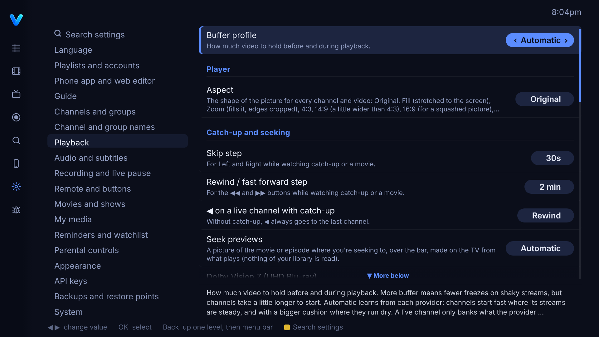

<!-- Generated from docs/USER-GUIDE.md by scripts/wiki/build.js.  Edit the guide, not this page. -->

*Every setting*

How channels start, how much video TiviBro holds, which player it uses, and what it does when a stream struggles.  The player engine, stream format, connection, HDR and the buffer's details are behind **Advanced** at the bottom of the page.  Sound and subtitles have their own page, [Audio and subtitles](Settings-Audio-and-subtitles).

  
  

| Setting | Choices | What it does |
|---|---|---|
| **Buffer profile** | **Automatic** · Fast zapping · Balanced · Smooth · Rock solid · Custom | How much video is held before a channel starts and while it plays.  More buffer rides out a shaky provider or Wi-Fi; less starts channels sooner.  *Automatic* learns from each provider as you watch: until it knows one it behaves like *Balanced*; a provider whose channels hardly ever run dry then starts channels at 0.8 s, and one whose channels often do gets 4 s to 6 s and a longer read-ahead.  **Profile details** shows what it has learned, and **Start learning again** forgets it.  On a TV with 1 GB of memory or less, and for a few days after TiviBro closed while a channel played, *memory-safe* playback holds about 24 MB of video ahead instead (shown under the profile and in Stream info): the full profile on most channels, less on a heavy 4K one, so a small TV isn't closed by webOS for running out of memory.  The fixed profiles: *Fast zapping* starts at 0.5 s and reads 10 s ahead; *Balanced* 2 s and 30 s; *Smooth* 4 s and 45 s; *Rock solid* 8 s and 60 s.  Bigger profiles also wait longer before treating a frozen picture as stuck, and retry more times.  Previews in the guide window always start quickly; the full profile applies in fullscreen. |
| **Profile details** | (information) | What the chosen profile does: how much it buffers before starting, the most it reads ahead, and the level it refills to after running dry.  A live channel only banks what the provider sends ahead of real time (often 10 to 40 seconds), whatever the profile allows: **Buffer info on demand** shows the most a channel has reached as *most 34s*. |
| **Start-up buffer** *(Custom only)* | 0.5 s to 15 s, **3 s** | Seconds of video buffered before a channel starts playing. |
| **Read-ahead** *(Custom only)* | 10 s to 120 s, **30 s** | The most the player downloads ahead while playing.  Movies can fill it; live channels usually stay lower, since the provider only sends a little ahead of real time. |
| **Keep behind playhead** *(Custom only)* | 2 s to 30 s, **8 s** | Video kept behind what you are watching.  Lower saves TV memory on long sessions. |
| **Freeze detection** *(Custom only)* | 3 s to 20 s, **6 s** | How long a frozen picture is tolerated before the player recovers it. |
| **Reconnect attempts** *(Custom only)* | 3 to 50, **8** | Tries before the player gives up on a channel.  The count starts again after 30 seconds of clean playback. |
| **Memory-safe playback** | **Automatic** · Always on · Off | Holds at most about 24 MB of video ahead (the full buffer profile on most channels, less on a heavy 4K one) so TiviBro doesn't close on TVs with 1 or 2 GB.  Automatic turns it on for TVs with 1 GB, and for three days after TiviBro closed while playing (a week if it happens again). |
| **Seek previews** | **Automatic** · On, 4K too · Off | A picture of the movie or episode where you're seeking to, over the bar, made on the TV from what's playing (nothing of your library is read).  Automatic: with Memory-safe playback on, only for movies up to 1080p and nothing made ahead.  Also Red in the player. |
| **Skip intro** | **Show a button** · Skip automatically · Off | An intro or recap marked in the file's chapters or by the online databases below.  Show a button: "Skip intro" or "Skip recap" while it plays, OK skips it, Back hides it.  Automatically: skipped by itself, once (seek back to watch it).  Nothing is guessed. |
| **Skip credits** | **Show a button** · Skip automatically · Off | End credits marked the same way.  Skipping them brings up Up next with its countdown (the next episode, or the next movie of a collection you play), jumps to a scene after the credits, or ends the movie.  Automatically: only in the last quarter of a movie or episode. |
| **Skip times from online databases** | **On** · Off | For a movie or episode whose file has no chapters: its intro, recap and credits from [TheIntroDB](https://theintrodb.org) and [IntroDB](https://introdb.app), two free community databases.  Only the title's TMDB or IMDb number, season and episode are sent (with your TMDB key only to find an IMDb number).  Works for My media and the provider's movies and shows when TiviBro knows the title's TMDB number. |
| **Buffer meter** | **When low** · Always · Off | A small gauge in fullscreen showing how many seconds of video are banked, written inside its bar, then the picture, the player in use and the most this channel has held (*most 34s*), then the speed.  Each part keeps its width, so the bar stays still while the numbers change. |
| **Buffer info on demand** | 5 seconds · **10 seconds** · 30 seconds · Until pressed again | How long the gauge stays when you hold **Info** in fullscreen (the INFO button on LG's standard remote, or I on a keyboard), whatever the Buffer meter is set to.  Press again to hide it.  **Stream info** in the quick menu (**OK** in fullscreen) shows it too, along with the stream's details, and works on every remote.  Most Magic Remotes have no Info button: TiviBro notices and the hint here changes to match, and you can give any button **Show buffer info** or **Stream info and buffer** under **Settings > Remote and buttons > In the player**. |
| **Player engine** | **Automatic** · Built-in demuxer · TV player | Under **Player**.  *Automatic* uses TiviBro's built-in player (fine buffer control, steady on sloppy streams) and moves to the TV's own player when a server blocks it or the stream needs it.  *TV player* uses the least CPU but ignores the buffer settings.  Every choice decodes in the TV's hardware. |
| **Stream format** *(Xtream playlists)* | **MPEG-TS** · HLS | MPEG-TS usually switches channels faster.  HLS copes better with a weak connection and some providers prefer it. |
| **Connection** | **Automatic (recommended)** · Direct | *Automatic* sends provider requests through the [network helper](Troubleshooting#what-is-the-network-helper), which webOS needs for most providers (it adds the headers the TV insists on, unzips guides, and works around sloppy servers).  *Direct* only works with servers that allow app requests. |
| **Network helper** | (information) | Whether the helper is running.  **Settings > System** shows its status and its log. |
| **HDR and Dolby Vision** | **Automatic** · TV player for all HDR · Built-in player | *Automatic* plays Dolby Vision through the TV player (which switches the screen into Dolby Vision itself) and keeps HDR10 and HLG on the built-in player for steadier buffering.  Pick *TV player for all HDR* if HDR pictures look grey or washed out. |
| **Aspect** | **Original** · Fill · Zoom · 4:3 · 16:9 · 21:9 · 4:3 to 16:9 | The shape of the picture for every channel and video.  *Fill* stretches it to the screen, *Zoom* fills the screen and crops the edges, *16:9* fixes a picture squashed into 4:3, *21:9* fills the screen with a letterboxed 2.35:1 film, *4:3 to 16:9* stretches a 4:3 picture wide.  A channel, movie or episode can have its own from the quick menu (**Aspect**). |
| **Skip step** | 10 s · 15 s · **30 s** · 1 min · 2 min | Under **Catch-up and seeking**.  How far **◀ ▶** jump while watching catch-up or a movie.  Pressing again quickly jumps further each time. |
| **Rewind / fast forward step** | 30 s · 1 min · **2 min** · 5 min · 10 min | How far **⏪ ⏩** jump while watching catch-up or a movie. |
| **◀ on a live channel with catch-up** | **Rewind** · Last channel | On a catch-up channel, **◀** rewinds into the current programme.  Without catch-up, **◀** always goes to the last channel.  A DASH channel that keeps the last minutes itself (most do) goes back inside them instead, at once: **◀ ▶** and **⏪ ⏩** move in it, and **Back**, **Stop**, yellow or **▶** past the end are live again; going back further than it keeps uses catch-up when the channel has it. |
| **Info panel when switching channels** | **On** · Off | Under **Switching channels**.  Off shows just the channel number and name when you change channel. |
| **Show stream details in the info panel** | **On** · Off | Adds the resolution, codecs and which player is in use. |
| **Keep the picture while reconnecting** | **On** · Off | When a channel drops for a moment, the last picture stays on screen with a small notice in the corner instead of a black screen and "Tuning".  Some streams the TV player draws itself can't be held; those go black as before.  A channel that drops three times in three minutes on MPEG-TS also tries the provider's HLS version of it straight away, and keeps using it while TiviBro is open. |
| **Black screen while switching** | On · **Off** | Hides the last picture until the next channel starts, instead of leaving it frozen. |
| **When a channel stops working** | **Switch to another version** · Ask me · Keep retrying | When a channel has run out of retries and your playlist has it more than once (another quality, another group, or a copy you hid), TiviBro switches to the next version, steadiest first: Full HD, HD, unmarked, 4K, then SD.  *Ask me* asks before switching.  See [Other versions of a channel](Other-versions-of-a-channel). |
| **Ask when a channel is slow to start** | **On** · Off | After 12 seconds without a picture (fullscreen), TiviBro says what it has seen (nothing from the provider yet, an error from the provider, or video the TV shows no picture for, and which players it tried) and asks: **Keep trying** (asks again a minute later), **Start over**, **Other versions of this channel** or **Stop**.  It closes by itself if the channel starts. |

---

← [Settings: Channel and group names](Settings-Channel-and-group-names)  ·  [Home](Home)  ·  [Settings: Audio and subtitles](Settings-Audio-and-subtitles) →
