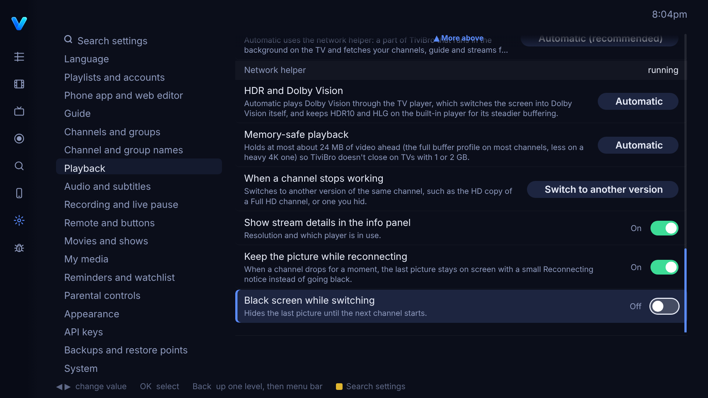
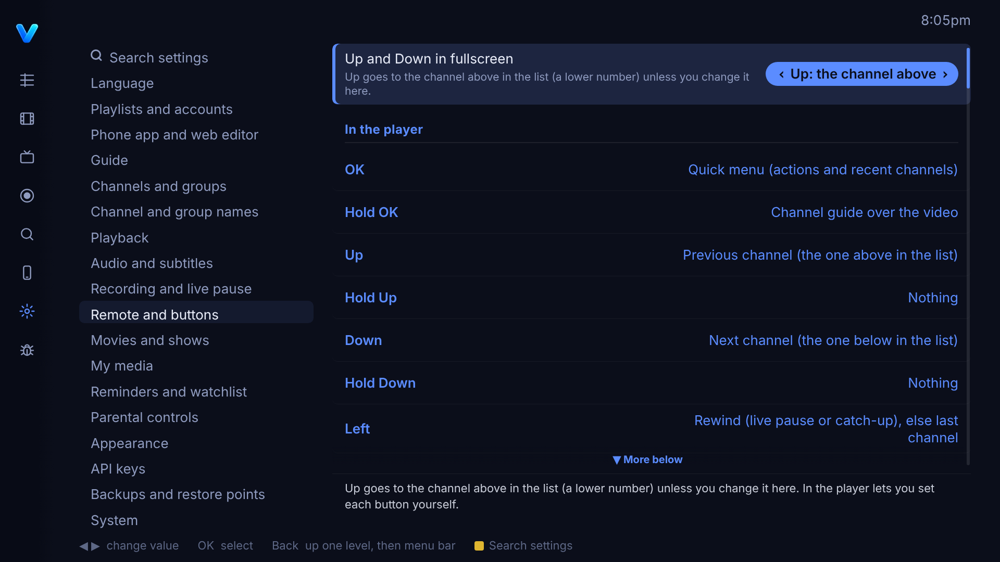
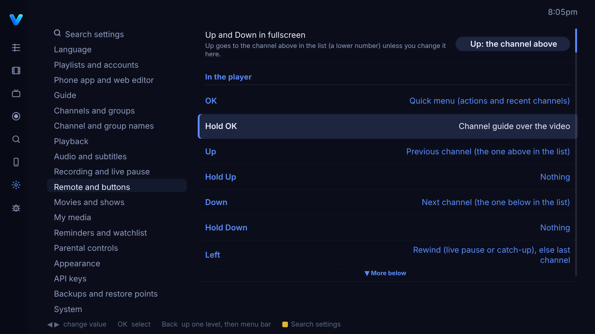
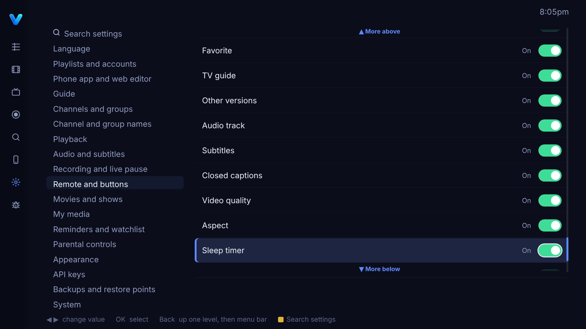

<!-- Generated from docs/USER-GUIDE.md by scripts/wiki/build.js.  Edit the guide, not this page. -->

*Every setting*

How channels start, how much video TiviBro holds, which player it uses, and what it does when a stream struggles.  The player engine, stream format, connection, HDR and the buffer's details are behind **Advanced** at the bottom of the page.  Sound and subtitles have their own page, [Audio and subtitles](Settings-Playback#settings-audio-and-subtitles).

  
  

| Setting | Choices | What it does |
|---|---|---|
| **Buffer profile** | **Automatic** · Fast zapping · Balanced · Smooth · Rock solid · Custom | How much video is held before a channel starts and while it plays.  More buffer rides out a shaky provider or Wi-Fi; less starts channels sooner.  *Automatic* learns from each provider as you watch: until it knows one it behaves like *Balanced*; a provider whose channels hardly ever run dry then starts channels at 0.8 s, and one whose channels often do gets 4 s to 6 s and a longer read-ahead.  **Profile details** shows what it has learned, and **Start learning again** forgets it.  On a TV with 1 GB of memory or less, and for a few days after TiviBro closed while a channel played, *memory-safe* playback holds about 24 MB of video ahead instead (shown under the profile and in Stream info): the full profile on most channels, less on a heavy 4K one, so a small TV isn't closed by webOS for running out of memory.  The fixed profiles: *Fast zapping* starts at 0.5 s and reads 10 s ahead; *Balanced* 2 s and 30 s; *Smooth* 4 s and 45 s; *Rock solid* 8 s and 60 s.  Bigger profiles also wait longer before treating a frozen picture as stuck, and retry more times.  Previews in the guide window always start quickly; the full profile applies in fullscreen. |
| **Profile details** | (information) | What the chosen profile does: how much it buffers before starting, the most it reads ahead, and the level it refills to after running dry.  A live channel only banks what the provider sends ahead of real time (often 10 to 40 seconds), whatever the profile allows: **Buffer info on demand** shows the most a channel has reached as *most 34s*. |
| **Start-up buffer** *(Custom only)* | 0.5 s to 15 s, **3 s** | Seconds of video buffered before a channel starts playing. |
| **Read-ahead** *(Custom only)* | 10 s to 120 s, **30 s** | The most the player downloads ahead while playing.  Movies can fill it; live channels usually stay lower, since the provider only sends a little ahead of real time. |
| **Keep behind playhead** *(Custom only)* | 2 s to 30 s, **8 s** | Video kept behind what you are watching.  Lower saves TV memory on long sessions. |
| **Freeze detection** *(Custom only)* | 3 s to 20 s, **6 s** | How long a frozen picture is tolerated before the player recovers it. |
| **Reconnect attempts** *(Custom only)* | 3 to 50, **8** | Tries before the player gives up on a channel.  The count starts again after 30 seconds of clean playback. |
| **Memory-safe playback** | **Automatic** · Always on · Off | Holds at most about 24 MB of video ahead (the full buffer profile on most channels, less on a heavy 4K one) so TiviBro doesn't close on TVs with 1 or 2 GB.  Automatic turns it on for TVs with 1 GB, and for three days after TiviBro closed while playing (a week if it happens again). |
| **Seek previews** | **Automatic** · On, 4K too · Off | A picture of the movie or episode where you're seeking to, over the bar, made on the TV from what's playing (nothing of your library is read).  Automatic: with Memory-safe playback on, only for movies up to 1080p and nothing made ahead.  Also Red in the player. |
| **Skip intro and Up next** | **On** · Off | From the file's chapters: "Skip intro" while a marked intro or recap plays, "Up next" when marked end credits start.  OK does it, Back hides it.  Nothing is guessed. |
| **Buffer meter** | **When low** · Always · Off | A small gauge in fullscreen showing how many seconds of video are banked, written inside its bar, then the picture, the player in use and the most this channel has held (*most 34s*), then the speed.  Each part keeps its width, so the bar stays still while the numbers change. |
| **Buffer info on demand** | 5 seconds · **10 seconds** · 30 seconds · Until pressed again | How long the gauge stays when you hold **Info** in fullscreen (the INFO button on LG's standard remote, or I on a keyboard), whatever the Buffer meter is set to.  Press again to hide it.  **Stream info** in the quick menu (**OK** in fullscreen) shows it too, along with the stream's details, and works on every remote.  Most Magic Remotes have no Info button: TiviBro notices and the hint here changes to match, and you can give any button **Show buffer info** or **Stream info and buffer** under **Settings > Playback > Remote and buttons > In the player**. |
| **Player engine** | **Automatic** · Built-in demuxer · TV player | Under **Player**.  *Automatic* uses TiviBro's built-in player (fine buffer control, steady on sloppy streams) and moves to the TV's own player when a server blocks it or the stream needs it.  *TV player* uses the least CPU but ignores the buffer settings.  Every choice decodes in the TV's hardware. |
| **Stream format** *(Xtream playlists)* | **MPEG-TS** · HLS | MPEG-TS usually switches channels faster.  HLS copes better with a weak connection and some providers prefer it. |
| **Connection** | **Automatic (recommended)** · Direct | *Automatic* sends provider requests through the [network helper](Troubleshooting#what-is-the-network-helper), which webOS needs for most providers (it adds the headers the TV insists on, unzips guides, and works around sloppy servers).  *Direct* only works with servers that allow app requests. |
| **Network helper** | (information) | Whether the helper is running.  **Settings > System** shows its status and its log. |
| **HDR and Dolby Vision** | **Automatic** · TV player for all HDR · Built-in player | *Automatic* plays Dolby Vision through the TV player (which switches the screen into Dolby Vision itself) and keeps HDR10 and HLG on the built-in player for steadier buffering.  Pick *TV player for all HDR* if HDR pictures look grey or washed out. |
| **Aspect** | **Original** · Fill · Zoom · 4:3 · 16:9 · 21:9 · 4:3 to 16:9 | The shape of the picture for every channel and video.  *Fill* stretches it to the screen, *Zoom* fills the screen and crops the edges, *16:9* fixes a picture squashed into 4:3, *21:9* fills the screen with a letterboxed 2.35:1 film, *4:3 to 16:9* stretches a 4:3 picture wide.  A channel, movie or episode can have its own from the quick menu (**Aspect**). |
| **Skip step** | 10 s · 15 s · **30 s** · 1 min · 2 min | Under **Catch-up and seeking**.  How far **◀ ▶** jump while watching catch-up or a movie.  Pressing again quickly jumps further each time. |
| **Rewind / fast forward step** | 30 s · 1 min · **2 min** · 5 min · 10 min | How far **⏪ ⏩** jump while watching catch-up or a movie. |
| **◀ on a live channel with catch-up** | **Rewind** · Last channel | On a catch-up channel, **◀** rewinds into the current programme.  Without catch-up, **◀** always goes to the last channel.  A DASH channel that keeps the last minutes itself (most do) goes back inside them instead, at once: **◀ ▶** and **⏪ ⏩** move in it, and **Back**, **Stop**, yellow or **▶** past the end are live again; going back further than it keeps uses catch-up when the channel has it. |
| **Info panel when switching channels** | **On** · Off | Under **Switching channels**.  Off shows just the channel number and name when you change channel. |
| **Show stream details in the info panel** | **On** · Off | Adds the resolution, codecs and which player is in use. |
| **Keep the picture while reconnecting** | **On** · Off | When a channel drops for a moment, the last picture stays on screen with a small notice in the corner instead of a black screen and "Tuning".  Some streams the TV player draws itself can't be held; those go black as before.  A channel that drops three times in three minutes on MPEG-TS also tries the provider's HLS version of it straight away, and keeps using it while TiviBro is open. |
| **Black screen while switching** | On · **Off** | Hides the last picture until the next channel starts, instead of leaving it frozen. |
| **When a channel stops working** | **Switch to another version** · Ask me · Keep retrying | When a channel has run out of retries and your playlist has it more than once (another quality, another group, or a copy you hid), TiviBro switches to the next version, steadiest first: Full HD, HD, unmarked, 4K, then SD.  *Ask me* asks before switching.  See [Other versions of a channel](Other-versions-of-a-channel). |
| **Ask when a channel is slow to start** | **On** · Off | After 12 seconds without a picture (fullscreen), TiviBro says what it has seen (nothing from the provider yet, an error from the provider, or video the TV shows no picture for, and which players it tried) and asks: **Keep trying** (asks again a minute later), **Start over**, **Other versions of this channel** or **Stop**.  It closes by itself if the channel starts. |

#### Settings: Audio and subtitles

Which audio track plays, sound the TV can't play, subtitles and captions, and subtitles from OpenSubtitles.

| Setting | Choices | What it does |
|---|---|---|
| **Audio language** | **The stream's own choice** · English · Spanish · French · German · and more | When a channel or movie has more than one audio track, tries this language, then the fallback language if you set one, else keeps the stream's own track.  This also applies to My media.  Language tags must be present in the file or stream.  Audio description tracks are skipped unless nothing else is in that language.  A track you pick from the quick menu wins until you change channel.  **Original language**: each movie's own language (TMDB), never a dub or a commentary. |
| **Fallback audio language** | **Off** · English · and more | Try this language when the preferred audio language is missing.  Off keeps the stream's own track.  For Dutch then English, set Audio language to Dutch and the fallback to English. |
| **Prefer surround sound** | On · **Off** | Picks the 5.1 or Dolby track in that language when there is one.  Your TV or soundbar needs to support it. |
| **Convert audio the TV can't play** | **Automatic** · Off | DTS on LG TVs from 2020 to 2022, Dolby TrueHD on every LG TV, and FLAC surround don't play.  *Automatic* plays another audio track the TV can play if the movie has one, or has the network helper turn the sound into Dolby Digital while you watch.  *Off* plays those movies as they are, often without sound.  See [Sound the TV can't play](Sound-the-TV-cant-play). |
| **Audio converter** | (information) | Whether the audio converter is ready ("Built in, ready" when it came with TiviBro), its size and where it is kept, or how far its download has got. |
| **Get the converter now** / **Remove the converter** | | Only in a TiviBro built without the converter.  Downloads the audio converter (about 2 MB) from TiviBro's releases on GitHub, checks its fingerprint and keeps it on the TV's storage, so the first movie that needs it doesn't wait.  Once it is there, **Remove the converter** deletes it again; TiviBro then asks before getting it next time. |
| **Subtitles automatically** | **Off** · Any language · English only · Spanish only · … | Turns subtitles on when a stream has them; with a language, only subtitles in that language.  You can still switch them from the quick menu. |
| **Closed captions** | On · **Off** | Captions on live TV in fullscreen, when the channel sends them (most US channels do).  The same switch as **Captions** in the quick menu.  Not with the TV player. |
| **Caption size** | Small · **Medium** · Large | |
| **Subtitle colour** | **White** · Yellow · Gold · Light blue · Light green | For subtitles in movies, shows and channels.  Closed captions keep the channel's own colours. |
| **Subtitle size** | Small · **Medium** · Large · Extra large | |
| **Subtitle background** | **Outline** · See-through box · Black box | A box behind each line is easier to read over bright scenes. |
| **Subtitle languages** | English and others, several at once | Under **Subtitles from OpenSubtitles**.  The languages **Find subtitles** looks for, your first one listed first. |
| **Set up OpenSubtitles (step by step)** | | The free key from opensubtitles.com, step by step (see [Subtitles for movies and shows](Movies-and-shows)).  Kept on this TV, out of backups.  Once set up the row reads **OpenSubtitles API key saved**, to replace the key; an empty key removes it. |
| **Sign in (optional)** | | Shows once a key is saved.  Your OpenSubtitles account: 20 downloads a day instead of 5.  Kept on this TV only.  In the phone app the username and then the password are asked on the phone. |
| **Keep downloaded subtitles** | Off · 1 day · 3 days · **A week** | Under **Subtitles from OpenSubtitles**.  A movie or episode you come back to gets its subtitles and timing again, without another download.  Kept on this TV only. |

**Subtitles in MKV and MP4 movies and episodes.**  Open **Subtitles** from the player menu to choose a language or **Off**.  The menu has two parts: **Settings** at the top (**Find subtitles…**, **Timing** and **Line up with another track…**), then the subtitles the video has, under **In this movie** or **In this episode** with how many there are.  It opens on the subtitle that is on, so switching language is a press or two even in a movie with dozens of languages.  The menu is available as soon as playback starts and shows **Finding subtitles…** while tracks are discovered.  The automatic subtitle language setting above also applies.  Supported embedded SRT, ASS/SSA and WebVTT tracks appear with their language names, and your selection survives seeking and reconnects.  Only the selected subtitle track is shown, even if another track becomes active while subtitles load.  ASS/SSA and WebVTT show as plain text.  My media uses the file's known type even when its signed playback link has no extension.  Files without supported tracks show an unavailable message; bitmap subtitles are not supported.  Some MKV files do not index their subtitle tracks and cannot expose them here.  **Find subtitles** offers another way to add them.

**MP4 subtitles** work for the usual text kind (called tx3g or mov_text), shown as plain text without their colours or positions.  Not included: MP4 files made for streaming in pieces (fragmented MP4), image subtitles, and closed captions inside MP4.  TiviBro makes extra requests on the same link as the movie: a few when the movie starts, to find the subtitles, and then, while a subtitle is on, small reads of the lines a little ahead of where you are as the movie plays (how often depends on the file).  Some providers refuse those reads: one that allows only one connection at a time, or one whose links stop taking new requests after a while.  The movie keeps playing either way.  TiviBro waits a little, asks the movie's link for a new connection and carries on; if the provider keeps refusing, it stops asking for this movie and **Subtitles** shows **Subtitles unavailable**.

#### Settings: Remote and buttons

Remap any button, choose the quick menu's buttons, and teach TiviBro keys it doesn't know.

  
  
  

| Setting | What it does |
|---|---|
| **Up and Down in fullscreen** | Which way Up and Down change channel in fullscreen: **Up: the channel above** (the default) or Up: the channel below.  The same as setting Up and Down under **In the player**. |
| **In the player ›** | What each button does while watching live TV fullscreen.  Every button has a press and a **Hold** action.  **OK** opens a list of actions to pick from. |
| **In the guide ›** | The same for the guide: the colour buttons, **Play / Pause**, **Info**, **Stop** and **Hold OK**.  Give any of them **Watch fullscreen** if your remote has no Play button.  Arrows, **OK**, **Back**, **CH + / −** and ⏪ ⏩ stay fixed there. |
| **On the Channels screen ›** | The same for the Channels screen.  Arrows, **OK**, **Back** and **CH + / −** stay fixed there. |
| **Quick menu buttons ›** | Switch each quick menu button on or off: Channel guide, Watch from start, Favorite, TV guide, Other versions, Audio track, Subtitles, Closed captions, Video quality, Aspect, Sleep timer, Stream info, Reconnect.  All are on by default; a button only appears when it applies (Audio needs two or more tracks, for example). |
| **Learn a button** *(on the TV)* | Under **Extra buttons**.  For keys TiviBro doesn't know yet (some LG remotes have extras).  Press this, then the button; it then appears in the button pages to assign.  Some buttons belong to the TV itself (Home, Live TV, the TV's own Guide, Input, Settings): webOS acts on them before TiviBro hears them, so they leave TiviBro and can't be learned. |
| **Button tester** *(on the TV)* | Shows the key code the TV sends for the next button you press, and what it does in TiviBro. |
| **Restore default buttons** | Puts every button back the way it came, after asking.  Each button page also has **Restore defaults for this screen**. |

The buttons and their defaults:

| Button | In the player | In the guide | On the Channels screen |
|---|---|---|---|
| **OK** | Quick menu | (fixed: watch) | (fixed) |
| **Hold OK** | Channel guide over the video | Options menu | Options menu |
| **▲ ▼** | Previous / next channel | (fixed) | (fixed) |
| **◀** | Rewind (catch-up), else last channel | (fixed) | (fixed) |
| **▶** | Show info panel | (fixed) | (fixed) |
| **CH + / CH −** | Next / previous channel | (fixed) | (fixed) |
| **Red** | Options menu | Options menu | Options menu |
| **Green** | TV guide | Channels screen | TV guide |
| **Yellow** | Last channel | Groups | Last channel |
| **Blue** | Audio track | Settings | Settings |
| **Play / Pause** | Play / pause | Watch fullscreen | Nothing |
| **Stop** | Leave fullscreen | Stop the window | Nothing |
| **⏪ Rewind** | Rewind (catch-up), else last channel | (fixed: a screen earlier) | Nothing |
| **⏩ Fast forward** | Nothing | (fixed: a screen later) | Nothing |
| **Info** | Show info panel | About this show (a series), else Options menu | Options menu |
| **Back** | (fixed: leaves fullscreen) | (fixed) | (fixed) |

Actions you can give a button in the player: nothing, quick menu, channel guide over the video, info panel, options menu, next, previous or last channel, rewind, watch from start, play/pause, TV guide, search, Settings, leave fullscreen, add or remove favorite, open Favorites, open Recent channels, change the aspect, audio track, closed captions on or off, sleep timer and reconnect.  In the guide: nothing, watch fullscreen (the channel in the window, else the highlighted one), options menu, about this show, groups, jump to now, jump to a day and time, last channel, stop the window, Channels screen, search, Settings, the web editor, favorite, open Favorites or Recent channels, Movies and Shows.  On the Channels screen: nothing, options menu, last channel, TV guide, search, Settings, favorite, open Favorites, open Recent channels, Movies, Shows and play/pause.  Catch-up and movie playback keep fixed seek buttons so they always behave the same.

---

← [Settings: Channels and groups](Settings-Channels-and-groups)  ·  [Home](Home)  ·  [Settings: Movies and shows](Settings-Movies-and-shows) →
