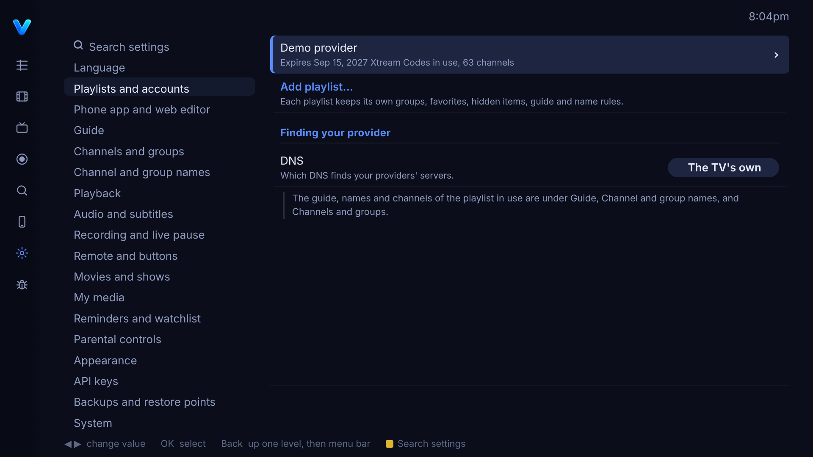
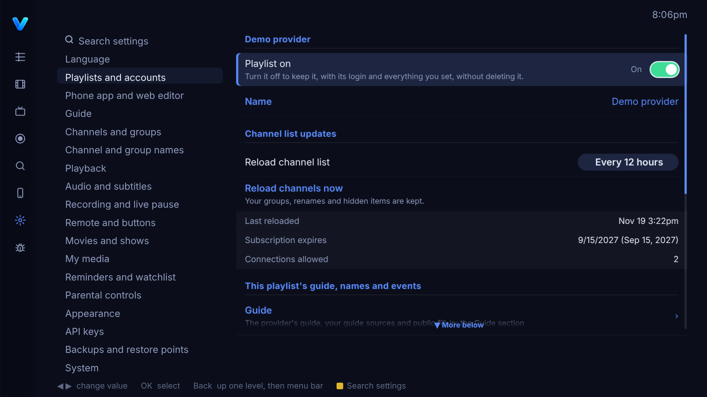
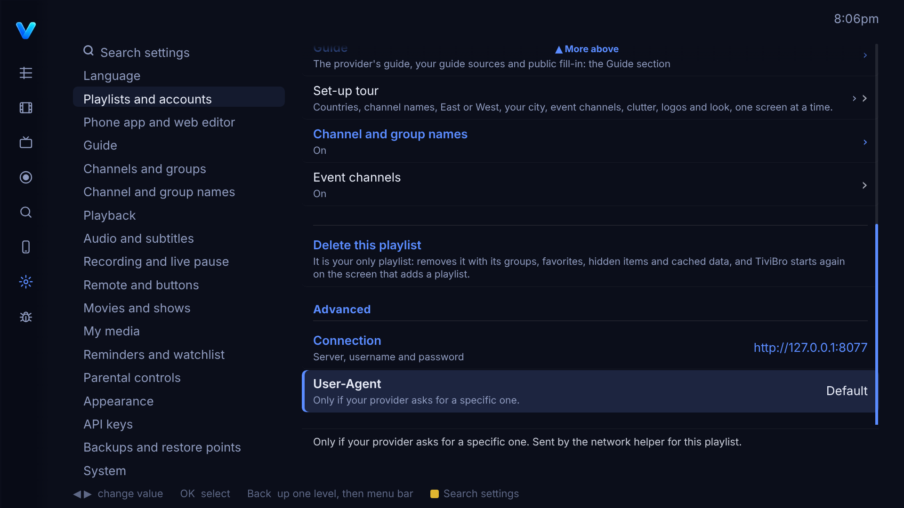
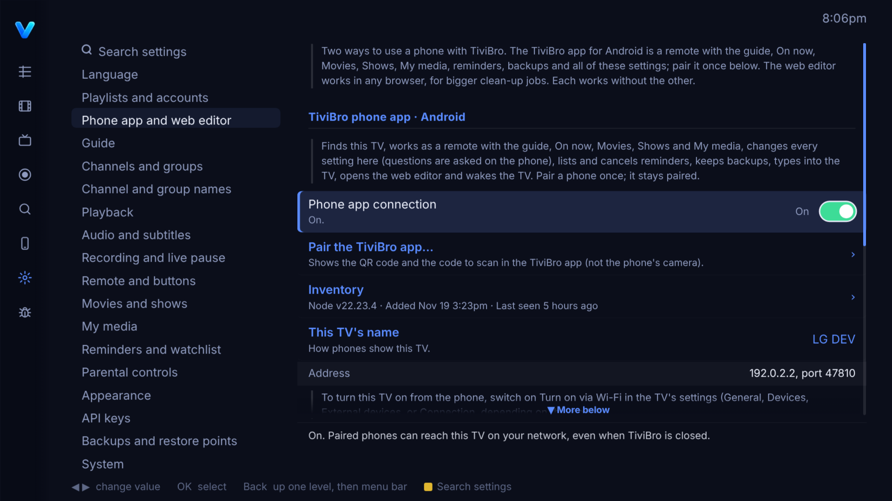

<!-- Generated from docs/USER-GUIDE.md by scripts/wiki/build.js.  Edit the guide, not this page. -->

*Every setting*

Your playlists and how often their channel lists reload.  **OK** on a playlist opens its page.  The guide, names and channels of the first playlist have their own sections: [Guide](Settings-Guide), [Channel and group names](Settings-Channels-and-groups#settings-channel-and-group-names) and [Channels and groups](Settings-Channels-and-groups).

**Several playlists at once.**  Every playlist that is on is used at the same time, like TiviMate.  In the group column of the Channels screen and the guide, each playlist gets its own section: a heading with the playlist's name, and its groups under it.  Favorites, All channels, Recent, My teams and your own groups stay at the top and can hold channels from any playlist.  **Up** and **Down** step over the headings.  With one playlist on, nothing changes.

- Each channel plays from its own playlist: its server, login, User-Agent and catch-up.  Each playlist's guide (its provider guide, its guide sources, its time offset) covers its own channels, even where two guides use the same guide ids, and public fill-in covers the channels nothing else does, for each playlist that has **Public guide fill-in** on.  Search, reminders, the watchlist, My teams, catch-up and Movies on now work across all of them.
- **Channel numbers** stay unique: the first playlist keeps its own numbers, and each other playlist's start at the next thousand after the highest number before it (after a first playlist that ends at 1523, the next one's channel 1 is 2001).  The number keys reach every channel.
- **Each playlist keeps its own settings** for channel and group names (including **Hide channels with nothing on**), event channels and the time zone their times are in, its guide, and its set-up tour (on its page under **Playlists**).  The content filter covers every playlist.
- **Movies and Shows** show every playlist's movies and shows together: Continue watching, My list and All at the top, then a heading per playlist with its categories.  Each title plays from its own playlist.  Languages apply to all of them; hiding a category is kept by its playlist.
- **Mixing playlists** (Settings > Playlists and accounts, with two or more on): each other playlist has a **Mix into the first playlist** part on its page, with a switch for each place its channels can show up besides its own section: **In All channels**, **In Favorites and your groups**, **In My teams**, **In Events by time**, **In Movies on now**, **In Recently added** and **In Search**.  All are on, as before these switches.  Off only leaves that playlist's channels out of that place: a channel of it already in one of your groups is kept there, out of sight, and is back when the switch is on again.  Its own groups, under its heading, always show.  The **Mixing playlists** row says "All mixed in", "Partly mixed in" or "Not mixed in", and lists each playlist with how many of its seven switches are on.
- The **first playlist** is the one at the top: its groups come first, and your Favorites, your own groups, Recent and reminders belong to it.  Hiding, renaming or moving a channel or group of another playlist is kept with that playlist, so it is still there when you turn the playlist off and on again, or make it the first.
- A playlist added from **Add playlist…** joins the others; the first playlist stays first.  Turn a playlist off (**Playlist on**) to take its section out without deleting anything.
- The other playlists open from the copy the TV keeps of their lists, and reload in the background, one at a time.  Together, the playlists that are on can have up to 250,000 channels (120,000 on a TV with 1 GB of memory, or after TiviBro closed while playing, when background loads also wait until nothing plays, and a big playlist leaves the lists while it reloads); a playlist that would go past that is left out, with a message.  Movies and Shows load other playlists' titles up to 200,000 of each kind in all (60,000 in that case).
- **Settings > Guide** shows the first playlist's guide, then a **Guide for** page for each other playlist that is on.
- If the first playlist can't load when TiviBro starts, the screen that says so offers **Try again**, **Change the connection**, or making another playlist that is on the first one.
- Turning a playlist off while one of its channels or movies plays stops it.  A reminder for another playlist's channel opens that channel.
- The web editor shows every playlist's channels, with each group's playlist next to its name; its **Channel and group names** page has a **Rules for the playlist** list to edit each playlist's rules.  Smart clean-up has a **Clean up** list: every playlist that is on, or just one; every change is kept by the playlist it belongs to.  Restore points list the playlists they cover (**For ...**): restoring one puts back those playlists' edits, leaves a playlist turned on since as it is, and skips one that is off now.  The phone app's channel list shows each group's playlist in front of its name, and its Movies and Shows each category's.

  
  
  

| Setting | Choices | What it does |
|---|---|---|
| *(each playlist)* | | Its name and type, whether it is the first playlist or on, and how many channels it has.  **OK** opens its page (below). |
| **Add playlist…** | | Opens the setup screen for another Xtream Codes, M3U or Stalker portal playlist, which is then used next to the ones you have.  Each playlist keeps its own hidden items, renames, guide and name rules.  From the phone app it's easier: share your provider's link to it. |
| **DNS** *(under Finding your provider)* | **The TV's own** · Cloudflare (1.1.1.1, 1.0.0.1) · Google (8.8.8.8) · Quad9 (9.9.9.9) · ControlD Unfiltered (76.76.2.0) · ControlD Uncensored (76.76.2.5) · Cloudflare, Google, ControlD Unfiltered or ControlD Uncensored over HTTPS · A DNS server I type | Which DNS the network helper uses to find your providers' servers.  The TV's own is right for most.  Try another when a provider's address isn't found, or your internet provider blocks it.  Over HTTPS also hides the names you look up from your internet provider; each is tried at its second address when the first is blocked (1.0.0.1 for Cloudflare).  If the one you pick doesn't answer, the TV's own is used.  Your network's own names (like a server at home) always use the TV's.  **A DNS server I type** adds a **DNS server** row for its address (like 192.168.1.1).  The first setup screen has the same choice, under **Connection**, for a provider that needs it before any playlist works. |

Each playlist in the list starts with when its subscription ends ("Expires 19 Nov", "Expires in 3 days" in the last two weeks, "Expired 2 Oct"), when the provider reports it.

On a playlist's page:

| Setting | Choices | What it does |
|---|---|---|
| **Make this the first playlist** | | With several playlists on: its groups come first, and the Favorites, your own groups, Recent and reminders shown are this playlist's.  With only one playlist on, this row is **Use this playlist**, which switches the TV to it. |
| **Playlist on** | **On** · Off | On: its channels are in the lists, in its own section.  Off keeps the playlist with its login, groups, favorites and names, and takes it out of the lists until you turn it on again (instead of deleting it).  Turning off the first playlist makes the next one that is on the first; the last one on stays on.  The web editor's Playlists page has **Turn off** and **Turn on** too. |
| **Name** | | The name shown in Settings and the web editor. |
| **Connection** | | Server, username and password (or the M3U address).  Opens the setup screen, which tests the login before saving. |
| **User-Agent** | **Default** or your own | Only if your provider asks for a specific one (TiviMate's "User-Agent" setting).  The network helper sends it for this playlist.  A channel whose line in an M3U playlist ends with `\|User-Agent=...` sends its own instead, and `\|Referer=...` and `\|Origin=...` go with it too (VLC's `#EXTVLCOPT:http-user-agent` and `http-referrer` lines as well). |
| **Reload channel list** | Every app start · Every 6 hours · **Every 12 hours** · Every day · Every 2 days · Every week · Only when I ask | How often the channel list is fetched again.  Your groups, renames and hidden items are always kept. |
| **Reload channels now** *(playlists that are on)* | | Fetches the channel list right away.  While it reloads this row is **Stop reloading**, which stops it and keeps the channels from the last load. |
| **Last reloaded**, **Subscription expires**, **Connections allowed** | (information) | From your provider, when it reports them. |
| **Guide ›** | | This playlist's guide: the same rows as **Guide for** your playlist in [Settings: Guide](Settings-Guide). |
| **Set-up tour** *(playlist in use, on the TV)* | | Runs the [set-up tour](The-set-up-tour) again: countries, names, East or West, your city, event channels, clutter, logos and look.  Shows when you last applied it. |
| **Channel and group names ›** | | This playlist's name rules: the same page as [Settings: Channel and group names](Settings-Channels-and-groups#settings-channel-and-group-names). |
| **Event channels ›** | | This playlist's [event channels](Event-channels-pay-per-view-and-sports-passes) (see [Settings: Channels and groups](Settings-Channels-and-groups)). |
| **Delete this playlist** | | Removes the playlist with its groups, favorites, hidden items and cached data.  **Playlist on** (off) keeps them instead.  Your only playlist can be deleted too (an expired one, say): TiviBro then starts again on the screen that adds a playlist. |

#### Settings: API keys

Every key you paste, in one place.  Typing them from the TiviBro phone app (Settings > Playlists and accounts > API keys) is easiest: a phone keyboard and copy and paste.

| Setting | Choices | What it does |
|---|---|---|
| **Add TMDB API token** | | Your free key or Read Access Token from themoviedb.org/settings/api, for movie and show details and posters (My media, Movies on now).  Then **Test TMDB token** and **Remove TMDB token**. |
| **Set up OpenSubtitles (step by step)** | | The free key for Find subtitles, step by step (an account, the key and what to tick, paste it, checked straight away).  Once set up: **OpenSubtitles API key saved** to replace it, **Test OpenSubtitles key** (the key, and your sign-in if any), **Sign in** for more downloads, and **Remove OpenSubtitles key**. |

The keys stay on this TV, out of backups.

#### Settings: Phone app and web editor

Two different ways to use a phone with TiviBro, on one page.  Each works without the other: the phone app doesn't need the web editor switched on.

- **The TiviBro phone app** (Android) is a remote with the guide, On now, Movies, Shows, My media, reminders, backups and all of these settings.  Pair it once with **Pair the TiviBro app…**: that QR code is scanned inside the app, not with the phone's camera.
- **The web editor** works in any browser, for bigger jobs: groups, channels, names, Smart clean-up, guide matching, reminders and backups.  **Open it in a phone's browser (QR code)** is for the phone's camera.  The phone app opens the editor by itself (**Edit channels**), so the switch below is only needed for a browser.

In release builds, where the phone app isn't offered yet, this page is called **Web editor** and has only the web editor's rows.

**The TiviBro phone app**

The TiviBro app for Android is a remote and a second screen for this TV.  Pair a phone once and it stays paired.

- **The home screen** has a card for each TV with a grid of shortcuts: **Remote**, **Guide**, **On now**, **Movies and Shows**, **My media**, **Reminders**, **Edit channels**, **Backups** and **Settings**.  Only the ones this TV can use show: On now needs a TMDB token on the TV, Movies and Shows a provider that has them, My media a media source.  While the TV is off the card offers **Turn on**, **Edit channels anyway** and **Backups**.  The card's **⋮** menu has **Turn on**, **Open TiviBro on the TV**, the Quick Settings tile and **Forget this TV**.
- **Remote**: arrows round OK (hold OK for options), Back, channel and volume buttons, play and pause, the colour buttons and Info.
- **Type on your phone**: whenever the TV shows a box to type in (setting up a playlist, Search, renaming a group), the same boxes show at the top of the app.  Type with the phone's keyboard and the TV fills in as you go.  Passwords travel encrypted and are never shown on the phone.
- **Channels**: every channel as TiviBro shows it, by group, with what is on now.  Tap one to play it on the TV, and the star to add or remove it from your Favorites.  **Press and hold** a channel for its options: Favorites, your own groups (in or out, or a new group with it), **Rename…** and **Hide on the TV**.
- **Guide**: pick a time (Now, or any hour in the next day and a half) and a group: each channel shows what is on then and what comes after.  Tap a channel for its schedule, day by day, with descriptions: **Watch on TV**, or the bell to set a reminder.  The ▶ on each row plays it on the TV straight away, and **press and hold** gives the same options as in Channels.  The bell at the top opens **Reminders**.  Reminders are the TV's own, so they pop up on the TV even while TiviBro is closed.
- **Reminders**: every reminder waiting on the TV, soonest first: the time (or **Live** once it has started), the channel's logo, the programme, and the watchlist word or team that set it.  **✕** cancels one; **Cancel all** (it asks first) cancels every one, and your watchlist stays.
- **Movies** and **Shows**: the TV's own lists (its languages, hidden categories and PIN) as posters.  Search, pick a category, and open a title: **Resume on TV**, **From the start**, or a show's season and episode.
- **Settings**: every page of TiviBro's Settings on the TV, in the same 17 sections, changed on the TV at once.  When a button asks something (a box to type in, a menu to pick from, an "are you sure"), the question appears on the phone instead of the TV, and your answer goes back to the TV; a username then a password come one after the other.  Rows marked **On the TV** (**Learn a button**, **Button tester**, **Set-up tour**, **Pair the TiviBro app…**, the QR codes) happen on the TV's screen, so look there.  **Settings > My media** adds and manages sources on the phone itself: **Add media** (the TV looks for servers on your network, or type a WebDAV address and login), each source's rescan, content, details and remove, and the TMDB token.  **View app log**, and **TiviBro log** at the bottom of the section list, open the log on the phone.  When the TV's Settings are locked with a PIN, the phone asks for it.
- **Edit channels**: the [web editor](Turning-on-the-web-editor) full screen, already signed in.  Its My media and Backups and restore points pages hand over to the app's own screens.
- **Backups and restore points** (the **Backups** shortcut, also from Settings and the web editor): one screen with three parts.
  - **Saved on this phone**: **Back up now**, and **Back up every week** (while TiviBro is open on the TV and the phone is on your Wi-Fi).  Backups stay on the phone, encrypted.  Put one back on this TV or another paired TV.  The newest 8 automatic backups are kept; named, copied and edited ones stay until you delete them.
  - **Backup file**: **Save a file** makes a backup file on the phone's storage, locked with a passphrase you pick; **Restore a file** opens one.  The web editor's Backups and restore points page restores the same files on any TV.
  - **Restore points on the TV**: the ones the TV keeps, with **Make a restore point**, going back to one (a restore point of how things are now is made first, and TiviBro restarts on the TV), and deleting one.
- **Working on backups without the TV** (each backup's **⋮** menu).  Every one of these makes a new backup and leaves the one you started from alone:
  - **Edit channels on the phone** opens the web editor on the phone with that backup: groups, names, hiding, Smart clean-up and guide matches, with draft history.  **Save** keeps your changes; leaving asks whether to **Keep** them as a new backup.  It uses the channel list the phone kept the last time you opened **Edit channels** with that TV, so open it with the TV once first: there's no setting for it, and after a few seconds the phone says "channel list saved".  It keeps one per playlist you open there (very big lists too), and each backup in the list says which of its playlists you can edit on the phone.  Adding playlists, guide sources and My media still need the TV.
  - **Change settings**: start screen, text size, guide row size, clock, channel numbers, closed captions, hiding adult channels and more.
  - **Name it**, **Duplicate**, **Add playlists from another backup** (the playlists, with their edits, that this one doesn't have) and **Save a copy as a file**.
  - **Delete** asks twice.
  - Then **Restore** the new backup on the TV when you're ready.
- **Add a playlist from a link**: in your provider's email or message, choose **Share**, then **TiviBro**.  The app says what it found (the password stays hidden), you pick the TV, and the TV checks the login and loads the channels.  If it won't add, **What the TV tried** under the message shows the TV's log of each try, with logins masked.

The app, the web editor and the TV share one colour scheme.  The app also turns the TV on (Wake-on-LAN and Bluetooth) and has a Quick Settings tile that opens TiviBro on the TV.

To get it: [download the newest APK](https://tivibro.app/apk/) on your phone and open it to install (Android asks to allow installs from your browser the first time, and Google Play Protect checks each update).  After that the app updates itself: when a newer version is out, **Update now** on the home screen downloads it with a progress bar, checks it is the release GitHub describes and installs it (Android asks you to allow TiviBro to install apps the first time, and to confirm).  The **App update** tile on the first TV's card checks any time, and the first start of a new version shows what's new in it.  **Download** still opens the APK in the browser.  Then choose **Pair the TiviBro app…** (it turns on **Phone app connection** if it's off) and scan the code with the app.

| Setting | Choices | What it does |
|---|---|---|
| **Phone app connection** | On · **Off** | Lets paired phones reach this TV on your network, also while TiviBro is closed or another app is on screen.  If webOS stops it, it comes back within 5 minutes, and after an install with the install script it's back right away.  Off: phones can't find or reach it (it asks first while phones are paired). |
| **Pair the TiviBro app…** *(on the TV)* | | Turns the connection on if needed and shows a QR code and a 12-character code for the app, for 10 minutes or until a phone pairs.  Five wrong codes end that code. |
| **Paired phones** | | Each phone, when it was added and last seen.  Select one to remove it; it can't connect again until you pair it again. |
| **This TV's name** | | How phones show this TV. |
| **Address** | (information) | This TV's network address and the port the app uses (47810). |

To turn the TV on from the phone, switch on **Turn on via Wi-Fi** in the TV's own settings (General, Devices, External devices, or Connection, depending on the model).  The app learns the TV's Wi-Fi and wired addresses while the TV is on and wakes all of them, so it works whichever way the TV is connected.

**Turn on** also wakes the TV over Bluetooth, the way LG's ThinQ app does, at the same time as over the network.  This helps when the network alone doesn't wake it.  It needs the phone's Bluetooth on, **Turn on via Bluetooth** on the TV where the TV has it (next to **Turn on via Wi-Fi**), and on Android 12 and later the **Nearby devices** permission, which the app asks for the first time you press **Turn on**.  There is nothing else to set up: the app registers itself with the TV the next time it finds the TV on, and **Forget this TV** removes it again.  The Quick Settings tile uses Bluetooth too once it is allowed (it never asks).  If Bluetooth is off on the phone, the app says so and wakes the TV over the network only.  Reading the TV's Bluetooth address needs a permission the TV only gives TiviBro on a rooted TV (installed with the Homebrew Channel or install.sh); on other TVs **Turn on** uses the network only.

**The web editor**

  
  

| Setting | Choices | What it does |
|---|---|---|
| **Open it in a phone's browser (QR code)** *(on the TV)* | | Turns the editor on and shows the code for your phone's camera, the same as **Edit on phone** in the side menu.  It doesn't pair the TiviBro app. |
| **Web editor for browsers** | On · **Off** | Starts the editor.  It switches off whenever TiviBro closes.  The phone app works either way. |
| **Open this address**, **Password** | (information) | Shown while it runs: the address to open on a device on the same network, and the password to type. |
| **Browsers connected** | (information) | How many browsers are using the editor now. |
| **New password** | | Makes a new password and logs out every browser. |
| **Port** | **8787** · 8080 · 8000 · 9090 · 18787 · 28787 · 38787 · 48787 · 58787 · 61787 · Random high port | Change it if another device on your network already uses this port, or if your network blocks it: the high ones often get through where the common ones don't.  A random port is picked once and kept, so a saved address keeps working. |
| **New random port** | | Only with a random port: picks a different one.  Saved addresses and bookmarks stop working. |

---

← [Settings: Language](Settings-Language)  ·  [Home](Home)  ·  [Settings: Guide](Settings-Guide) →
