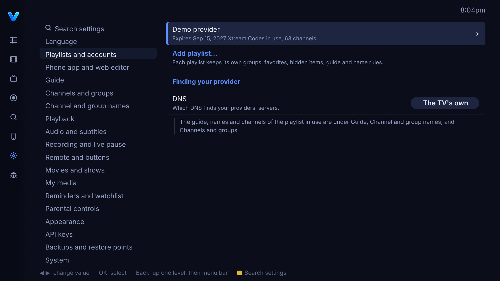
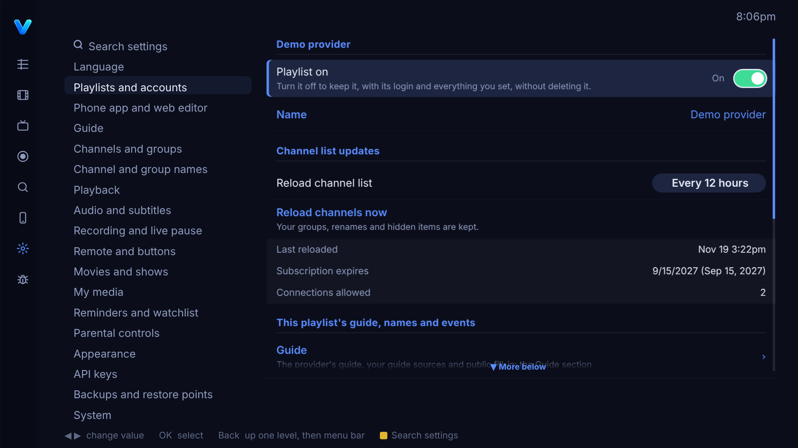
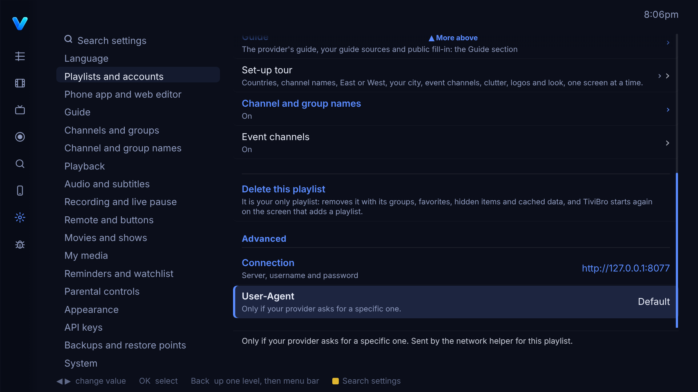

<!-- Generated from docs/USER-GUIDE.md by scripts/wiki/build.js.  Edit the guide, not this page. -->

*Every setting*

Your playlists and how often their channel lists reload.  **OK** on a playlist opens its page.  The guide, names and channels of the first playlist have their own sections: [Guide](Settings-Guide), [Channel and group names](Settings-Channel-and-group-names) and [Channels and groups](Settings-Channels-and-groups).

**Several playlists at once.**  Every playlist that is on is used at the same time, like TiviMate.  In the group column of the Channels screen and the guide, each playlist gets its own section: a heading with the playlist's name, and its groups under it.  Favorites, All channels, Recent, My teams and your own groups stay at the top and can hold channels from any playlist.  **Up** and **Down** step over the headings.  With one playlist on, nothing changes.

- Each channel plays from its own playlist: its server, login, User-Agent and catch-up.  Each playlist's guide (its provider guide, its guide sources, its time offset) covers its own channels, even where two guides use the same guide ids, and public fill-in covers the channels nothing else does, for each playlist that has **Public guide fill-in** on.  Search, reminders, the watchlist, My teams, catch-up and Movies on now work across all of them.
- **Channel numbers** stay unique: the first playlist keeps its own numbers, and each other playlist's start at the next thousand after the highest number before it (after a first playlist that ends at 1523, the next one's channel 1 is 2001).  The number keys reach every channel.
- **Each playlist keeps its own settings** for channel and group names (including **Hide channels with nothing on**), event channels and the time zone their times are in, its guide, and its set-up tour (on its page under **Playlists**).  The content filter covers every playlist.
- **Movies and Shows** show every playlist's movies and shows together: Continue watching, My list and All at the top, then a heading per playlist with its categories.  Each title plays from its own playlist.  Languages apply to all of them; hiding a category is kept by its playlist.
- **Mixing playlists** (Settings > Playlists, with two or more on): each other playlist has a **Mix into the first playlist** part on its page, with a switch for each place its channels can show up besides its own section: **In All channels**, **In Favorites and your groups**, **In My teams**, **In Events by time**, **In Movies on now**, **In Recently added** and **In Search**.  All are on, as before these switches.  Off only leaves that playlist's channels out of that place: a channel of it already in one of your groups is kept there, out of sight, and is back when the switch is on again.  Its own groups, under its heading, always show.  The **Mixing playlists** row says "All mixed in", "Partly mixed in" or "Not mixed in", and lists each playlist with how many of its seven switches are on.
- The **first playlist** is the one at the top: its groups come first, and your Favorites, your own groups, Recent and reminders belong to it.  Hiding, renaming or moving a channel or group of another playlist is kept with that playlist, so it is still there when you turn the playlist off and on again, or make it the first.
- A playlist added from **Add playlist…** joins the others; the first playlist stays first.  Turn a playlist off (**Playlist on**) to take its section out without deleting anything.
- The other playlists open from the copy the TV keeps of their lists, and reload in the background, one at a time.  Together, the playlists that are on can have up to 250,000 channels (120,000 on a TV with 1 GB of memory, or after TiviBro closed while playing, when background loads also wait until nothing plays, and a big playlist leaves the lists while it reloads); a playlist that would go past that is left out, with a message.  Movies and Shows load other playlists' titles up to 200,000 of each kind in all (60,000 in that case).
- **Settings > Guide** shows the first playlist's guide, then a **Guide for** page for each other playlist that is on.
- If the first playlist can't load when TiviBro starts, the screen that says so offers **Try again**, **Change the connection**, or making another playlist that is on the first one.
- Turning a playlist off while one of its channels or movies plays stops it.  A reminder for another playlist's channel opens that channel.
- The web editor shows every playlist's channels, with each group's playlist next to its name; its **Channel and group names** page has a **Rules for the playlist** list to edit each playlist's rules.  Smart clean-up has a **Clean up** list: every playlist that is on, or just one; every change is kept by the playlist it belongs to.  Restore points list the playlists they cover (**For ...**): restoring one puts back those playlists' edits, leaves a playlist turned on since as it is, and skips one that is off now.  The phone app's channel list shows each group's playlist in front of its name, and its Movies and Shows each category's.

  
  
  

| Setting | Choices | What it does |
|---|---|---|
| *(each playlist)* | | Its name and type, whether it is the first playlist or on, and how many channels it has.  **OK** opens its page (below). |
| **Add playlist…** | | Opens the setup screen for another Xtream Codes, M3U or Stalker portal playlist, which is then used next to the ones you have.  Each playlist keeps its own hidden items, renames, guide and name rules.  From the phone app it's easier: share your provider's link to it. |
| **DNS** *(under Finding your provider)* | **The TV's own** · Cloudflare (1.1.1.1, 1.0.0.1) · Google (8.8.8.8) · Quad9 (9.9.9.9) · ControlD Unfiltered (76.76.2.0) · ControlD Uncensored (76.76.2.5) · Cloudflare, Google, ControlD Unfiltered or ControlD Uncensored over HTTPS · A DNS server I type | Which DNS the network helper uses to find your providers' servers.  The TV's own is right for most.  Try another when a provider's address isn't found, or your internet provider blocks it.  Over HTTPS also hides the names you look up from your internet provider; each is tried at its second address when the first is blocked (1.0.0.1 for Cloudflare).  If the one you pick doesn't answer, the TV's own is used.  Your network's own names (like a server at home) always use the TV's.  **A DNS server I type** adds a **DNS server** row for its address (like 192.168.1.1).  The first setup screen has the same choice, under **Connection**, for a provider that needs it before any playlist works. |

Each playlist in the list starts with when its subscription ends ("Expires 19 Nov", "Expires in 3 days" in the last two weeks, "Expired 2 Oct"), when the provider reports it.

On a playlist's page:

| Setting | Choices | What it does |
|---|---|---|
| **Make this the first playlist** | | With several playlists on: its groups come first, and the Favorites, your own groups, Recent and reminders shown are this playlist's.  With only one playlist on, this row is **Use this playlist**, which switches the TV to it. |
| **Playlist on** | **On** · Off | On: its channels are in the lists, in its own section.  Off keeps the playlist with its login, groups, favorites and names, and takes it out of the lists until you turn it on again (instead of deleting it).  Turning off the first playlist makes the next one that is on the first; the last one on stays on.  The web editor's Playlists page has **Turn off** and **Turn on** too. |
| **Name** | | The name shown in Settings and the web editor. |
| **Connection** | | Server, username and password (or the M3U address).  Opens the setup screen, which tests the login before saving. |
| **User-Agent** | **Default** or your own | Only if your provider asks for a specific one (TiviMate's "User-Agent" setting).  The network helper sends it for this playlist.  A channel whose line in an M3U playlist ends with `\|User-Agent=...` sends its own instead, and `\|Referer=...` and `\|Origin=...` go with it too (VLC's `#EXTVLCOPT:http-user-agent` and `http-referrer` lines as well). |
| **Reload channel list** | Every app start · Every 6 hours · **Every 12 hours** · Every day · Every 2 days · Every week · Only when I ask | How often the channel list is fetched again.  Your groups, renames and hidden items are always kept. |
| **Reload channels now** *(playlists that are on)* | | Fetches the channel list right away.  While it reloads this row is **Stop reloading**, which stops it and keeps the channels from the last load. |
| **Last reloaded**, **Subscription expires**, **Connections allowed** | (information) | From your provider, when it reports them. |
| **Guide ›** | | This playlist's guide: the same rows as **Guide for** your playlist in [Settings: Guide](Settings-Guide). |
| **Set-up tour** *(playlist in use, on the TV)* | | Runs the [set-up tour](The-set-up-tour) again: countries, names, East or West, your city, event channels, clutter, logos and look.  Shows when you last applied it. |
| **Channel and group names ›** | | This playlist's name rules: the same page as [Settings: Channel and group names](Settings-Channel-and-group-names). |
| **Event channels ›** | | This playlist's [event channels](Event-channels-pay-per-view-and-sports-passes) (see [Settings: Channels and groups](Settings-Channels-and-groups)). |
| **Delete this playlist** | | Removes the playlist with its groups, favorites, hidden items and cached data.  **Playlist on** (off) keeps them instead.  Your only playlist can be deleted too (an expired one, say): TiviBro then starts again on the screen that adds a playlist. |

---

← [Settings: Language](Settings-Language)  ·  [Home](Home)  ·  [Settings: Guide](Settings-Guide) →
