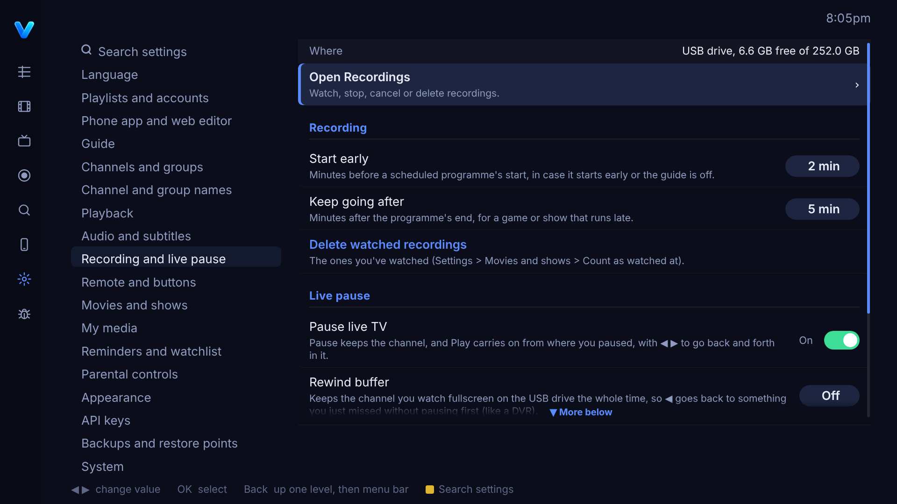

<!-- Generated from docs/USER-GUIDE.md by scripts/wiki/build.js.  Edit the guide, not this page. -->

*Every setting*

Recording to a USB drive in the TV or a network share, pausing live TV, and the rewind buffer.  How they work is in [Recording, live pause and rewind](Recording-live-pause-and-rewind).

| Setting | Choices | What it does |
|---|---|---|
| **USB drive** *(a drive with two or more partitions)* | **the first** · each partition, with its free space | Which partition recordings and live pause use. |
| **Network share** | a My media library | Record (and pause) to a Windows / Samba share or WebDAV folder, chosen from your My media libraries.  No root or USB drive needed.  **Stop recording to a share** goes back to the drive. |
| **Record to** *(a USB drive and a share)* | **USB drive** · Network share | Where new recordings go when both are there. |
| **Open Recordings** | (button) | The Recordings screen: what's recording, scheduled and recorded. |
| **Start early** · **Keep going after** | minutes | How long before a programme starts, and after it ends, a recording runs, so a late or early start isn't cut off. |
| **Delete watched recordings** | Off · after some days | Clears recordings you've watched to the end after that long, to keep room on the drive. |
| **Pause live TV** | **On** · Off | Pause in fullscreen keeps recording the channel to the USB drive or network share (or a short buffer in the TV's own storage), so you carry on where you paused. |
| **Live pause on the network share** *(a share, no USB drive)* | **On** · Off | Off keeps live pause in the TV's own storage (10 minutes) while recordings still go to the share. |
| **Rewind buffer** | **Off** · 30 min · 1 hour · 2 hours | Keeps the channel you watch on the USB drive or network share the whole time, so ◀ goes back to something you just missed. |
| **Remote and buttons** | (opens the section) | Which buttons pause, rewind and record: [Remote and buttons](Settings-Remote-and-buttons). |

---

← [Settings: Audio and subtitles](Settings-Audio-and-subtitles)  ·  [Home](Home)  ·  [Settings: Remote and buttons](Settings-Remote-and-buttons) →
