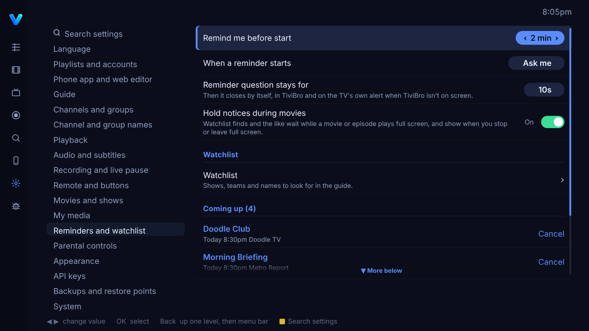

<!-- Generated from docs/USER-GUIDE.md by scripts/wiki/build.js.  Edit the guide, not this page. -->

*Every setting*

How reminders behave, the [watchlist](Watchlist), and every reminder waiting to come up.

| Setting | Choices | What it does |
|---|---|---|
| **Remind me before start** | At start · 1 min · **2 min** · 5 min · 10 min | How early a reminder comes up. |
| **When a reminder starts** | **Ask me** · Switch to the channel | *Ask me* shows **Watch** or **Dismiss**; *Switch* changes channel by itself. |
| **Reminder question stays for** | 10 s · **20 s** · 30 s · 1 min | How long the reminder waits for an answer. |
| **Hold notices during movies** | **On** · Off | Watchlist finds and the like wait while a movie or episode plays full screen, and show when you stop or leave full screen.  Reminders you set still come on time. |
| **Watchlist ›** | | Shows, teams and names to look for in the guide; see [Watchlist](Watchlist).  Inside: **Add a show, team or name…**, **Look ahead** (6 hours · 12 hours · **24 hours** · 2 days), **When something is found** (**Set a reminder** · Just tell me), your words (**OK** to show one in Search or remove it with its reminders), and what's coming up for them (**OK** sets or cancels each reminder). |
| **Coming up** | | Every reminder still to come, soonest first, with its day, time and channel, **on now** when it has started, and the watchlist word or team that set it.  **OK** on one (**Cancel**) asks, then cancels it.  With none: how to set one. |
| **Cancel all reminders** | | With two or more: cancels every reminder, after asking.  Your watchlist stays and sets new ones as programmes come up. |

The phone app's **Reminders** screen and the web editor's **Reminders and watchlist** page list the same reminders, with the same **Cancel** and **Cancel all**.

---

← [Settings: My media](Settings-My-media)  ·  [Home](Home)  ·  [Settings: Parental controls](Settings-Parental-controls) →
