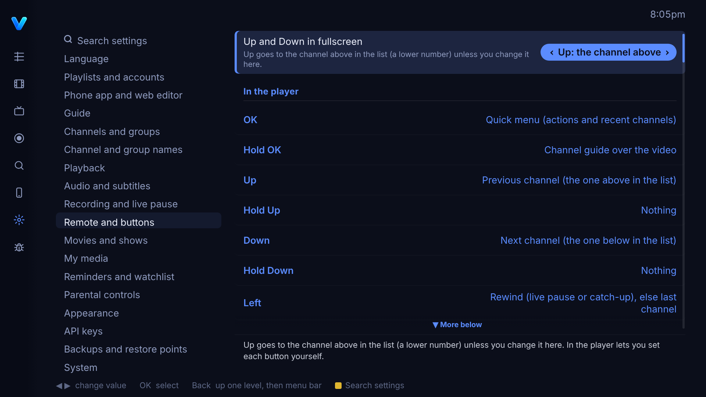
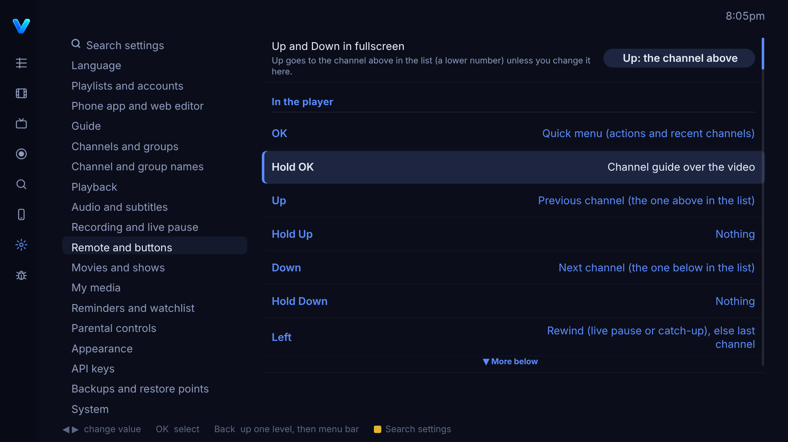
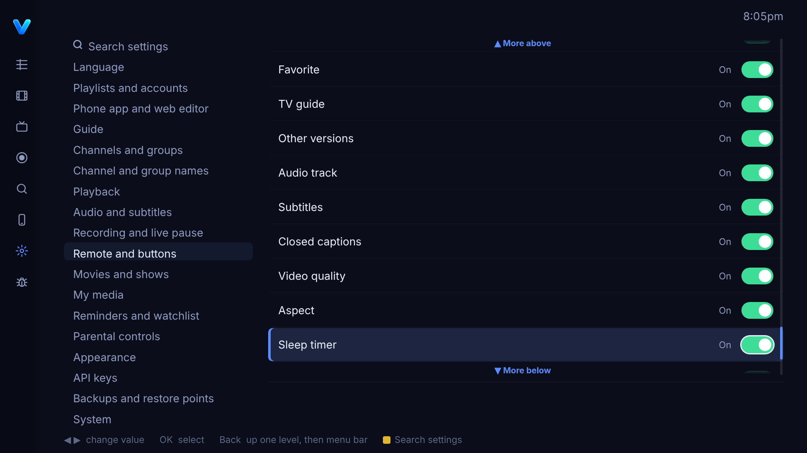

<!-- Generated from docs/USER-GUIDE.md by scripts/wiki/build.js.  Edit the guide, not this page. -->

*Every setting*

Remap any button, choose the quick menu's buttons, and teach TiviBro keys it doesn't know.

  
  
  

| Setting | What it does |
|---|---|
| **Up and Down in fullscreen** | Which way Up and Down change channel in fullscreen: **Up: the channel above** (the default) or Up: the channel below.  The same as setting Up and Down under **In the player**. |
| **In the player ›** | What each button does while watching live TV fullscreen.  Every button has a press and a **Hold** action.  **OK** opens a list of actions to pick from. |
| **In the guide ›** | The same for the guide: the colour buttons, **Play / Pause**, **Info**, **Stop** and **Hold OK**.  Give any of them **Watch fullscreen** if your remote has no Play button.  Arrows, **OK**, **Back**, **CH + / −** and ⏪ ⏩ stay fixed there. |
| **On the Channels screen ›** | The same for the Channels screen.  Arrows, **OK**, **Back** and **CH + / −** stay fixed there. |
| **Quick menu buttons ›** | Switch each quick menu button on or off: Channel guide, Watch from start, Favorite, TV guide, Other versions, Audio track, Subtitles, Closed captions, Video quality, Aspect, Sleep timer, Stream info, Reconnect.  All are on by default; a button only appears when it applies (Audio needs two or more tracks, for example). |
| **Learn a button** *(on the TV)* | Under **Extra buttons**.  For keys TiviBro doesn't know yet (some LG remotes have extras).  Press this, then the button; it then appears in the button pages to assign.  Some buttons belong to the TV itself (Home, Live TV, the TV's own Guide, Input, Settings): webOS acts on them before TiviBro hears them, so they leave TiviBro and can't be learned. |
| **Button tester** *(on the TV)* | Shows the key code the TV sends for the next button you press, and what it does in TiviBro. |
| **Use the Magic Remote buttons** *(a Magic Remote)* | In fullscreen, Hold Red records, Hold Yellow pauses and Hold Blue shows stream info.  Hold Red records in the guide and lists too, and Hold Blue gives a show's details in the guide.  OK in fullscreen has them all as well. |
| **Restore default buttons** | Puts every button back the way it came, after asking.  Each button page also has **Restore defaults for this screen**. |

The buttons and their defaults:

| Button | In the player | In the guide | On the Channels screen |
|---|---|---|---|
| **OK** | Quick menu | (fixed: watch) | (fixed) |
| **Hold OK** | Channel guide over the video | Options menu | Options menu |
| **▲ ▼** | Previous / next channel | (fixed) | (fixed) |
| **◀** | Rewind (catch-up), else last channel | (fixed) | (fixed) |
| **▶** | Show info panel | (fixed) | (fixed) |
| **CH + / CH −** | Next / previous channel | (fixed) | (fixed) |
| **Red** | Options menu | Options menu | Options menu |
| **Green** | TV guide | Channels screen | TV guide |
| **Yellow** | Last channel | Groups | Last channel |
| **Blue** | Audio track | Settings | Settings |
| **Play / Pause** | Play / pause | Watch fullscreen | Nothing |
| **Stop** | Leave fullscreen | Stop the window | Nothing |
| **⏪ Rewind** | Rewind (catch-up), else last channel | (fixed: a screen earlier) | Nothing |
| **⏩ Fast forward** | Nothing | (fixed: a screen later) | Nothing |
| **Info** | Show info panel | About this show (a series), else Options menu | Options menu |
| **Back** | (fixed: leaves fullscreen) | (fixed) | (fixed) |

Actions you can give a button in the player: nothing, quick menu, channel guide over the video, info panel, options menu, next, previous or last channel, rewind, watch from start, play/pause, TV guide, search, Settings, leave fullscreen, add or remove favorite, open Favorites, open Recent channels, change the aspect, audio track, closed captions on or off, sleep timer and reconnect.  In the guide: nothing, watch fullscreen (the channel in the window, else the highlighted one), options menu, about this show, groups, jump to now, jump to a day and time, last channel, stop the window, Channels screen, search, Settings, the web editor, favorite, open Favorites or Recent channels, Movies and Shows.  On the Channels screen: nothing, options menu, last channel, TV guide, search, Settings, favorite, open Favorites, open Recent channels, Movies, Shows and play/pause.  Catch-up and movie playback keep fixed seek buttons so they always behave the same.

---

← [Settings: Recording and live pause](Settings-Recording-and-live-pause)  ·  [Home](Home)  ·  [Settings: Movies and shows](Settings-Movies-and-shows) →
