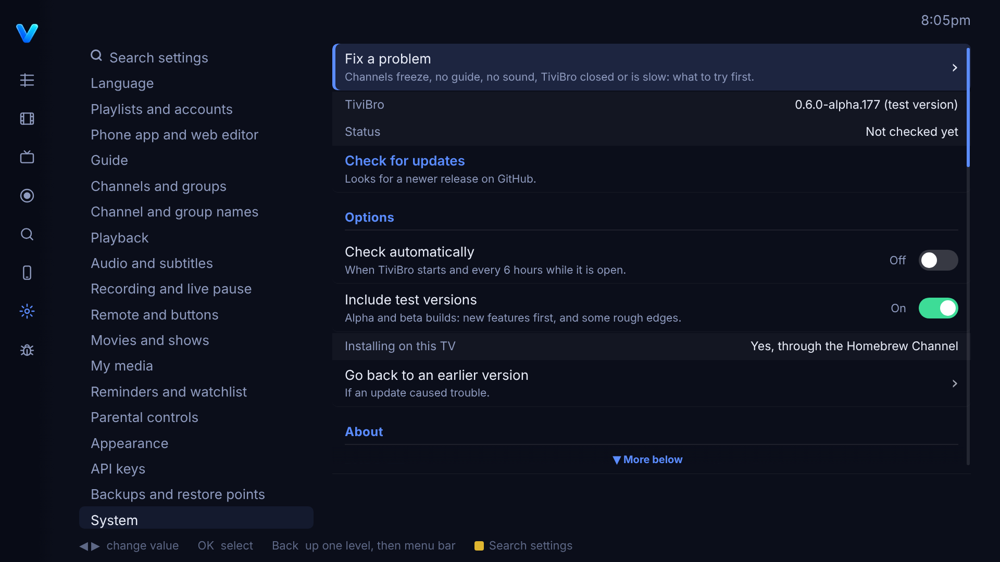
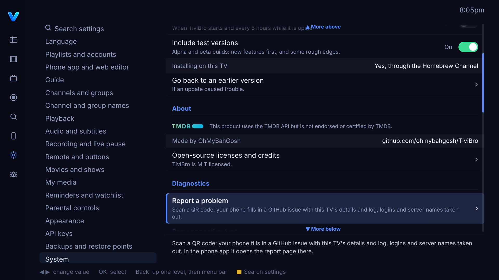
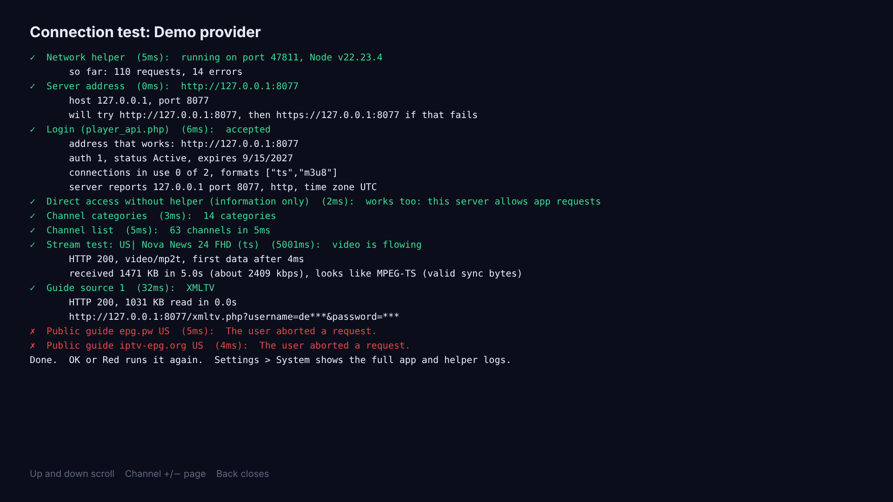
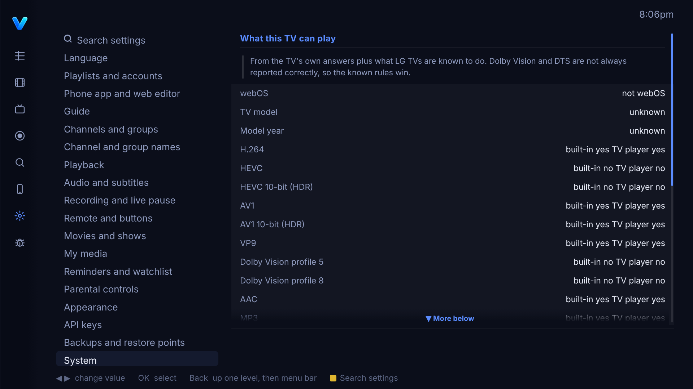
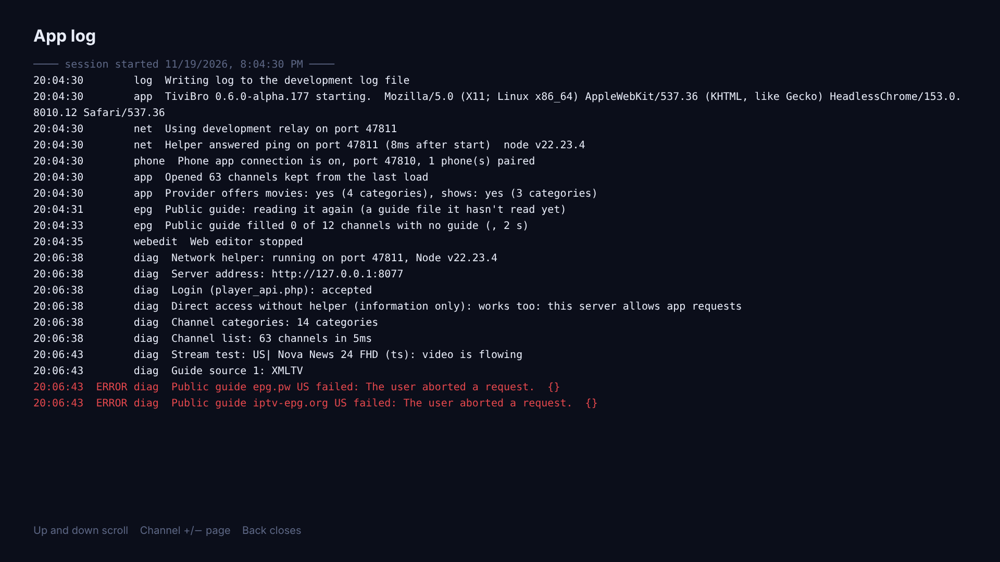
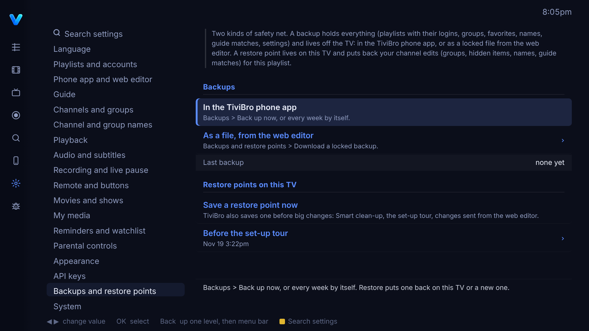

<!-- Generated from docs/USER-GUIDE.md by scripts/wiki/build.js.  Edit the guide, not this page. -->

*Every setting*

Your version, new versions from GitHub, and finding out what's wrong.  See [Updates](Updates).  When an update is ready it is the first row, in green with a **NEW** badge, and **System** has a green dot in the menu.

**Fix a problem** (the first row) lists the common problems: channels freeze or buffer, a channel won't play, no guide or the wrong programmes, no sound or the wrong language, subtitles or captions, movies or shows missing, TiviBro closed by itself or is slow.  Each says what to try first, and lists the settings that matter for it: OK on one goes straight to that setting.

| Setting | Choices | What it does |
|---|---|---|
| **TiviBro**, **Status** | (information) | The version you have (test versions are marked), and whether a newer one is out. |
| **Check for updates** | | Looks for a newer release now. |
| **Install … now** | | On a rooted TV with the Homebrew Channel: downloads the new version, checks its fingerprint, installs it and restarts TiviBro with all your settings.  Other TVs get a note to install it from a computer. |
| **Released**, **What's new** | | When the new version came out and its size, and the changes in it. |
| **Check automatically** | **On** · Off | Under **Options**.  Every time TiviBro starts and every 6 hours while it is open.  A new version found at start is offered right away, with what's new in it: on a rooted TV with the Homebrew Channel, **Install and restart** installs it and TiviBro starts again on it; **Later** asks again next time.  **System** is marked "update ready" until you install it.  Nothing is installed without asking you.  The first time a new version starts, however it was installed, TiviBro shows what's new in it. |
| **Count this TV in the install numbers** | **On** · Off | Once a day, and when a new version first starts (as an install or an update), TiviBro says which version it is and which webOS the TV has.  Nothing else: no address is kept, no ID, nothing about your channels. |
| **Open-source licenses and credits ›** | | Under **About**.  TiviBro's own license (MIT), what it is built with and each one's license (hls.js, mpegts.js, dash.js, FFmpeg for the audio converter and more), and the services and data it credits (TMDB, OpenSubtitles, the logo libraries, the public guides).  The full texts ship with the app in `THIRD-PARTY-NOTICES.md`; the phone app lists its own under the ⓘ at the top of its first screen. |
| **Include test versions** | On · Off (**On** when you are running one) | Also offers alpha and beta builds: new features first, and some rough edges. |
| **Installing on this TV** | (information) | Whether this TV can install updates by itself. |
| **About** | (information) | The TMDB notice, who made TiviBro, and the playback libraries. |

**Diagnostics**, further down the same page:

**On the phone:** the phone app's **Settings** tab has **TiviBro log** at the bottom of the section list (and **View app log** opens it too): the same log as Report a problem (the app's, this and earlier sessions, and the network helper's), with provider, guide and server names taken out.  **Problems only** shows the warnings and errors, and **Share** sends it to a message, an email or a GitHub issue.

  
  
  
  

| Setting | Choices | What it does |
|---|---|---|
| **Report a problem** | | Shows a QR code.  Scan it and your phone opens the web editor's **Report a problem** page (in the phone app it opens that page there): say what happened, read everything the TV adds (version, TV model, a few settings, the app and network helper logs, with logins and server names taken out), save the log file, and **Open the GitHub form** opens a bug report filled in for you.  Drag the log file into it and send.  You need a free GitHub account, or use **Send report** for a public issue without one. |
| **Your problem reports** | | Shows once you have sent a report.  Each report this TV sent (from the TV or the web editor), with its status: open, a reply from the developer, fixed in which version, or closed.  OK on one shows the developer's newest reply, **Update to** the version with the fix, **Still happening** and a code to read it all on your phone.  A long reply scrolls with **▲ ▼**.  This is also where to come back to a reply later, to read it again or press **Still happening**.  **Check now** asks for news straight away; TiviBro also asks every few hours and tells you when there is a reply. |
| **Run connection test** | | Checks, step by step: the network helper, your login, the channel categories and list, a real stream, each guide source and the public guides.  Each step says what worked or what failed and why. |
| **Speed test** | | Your internet speed (a download from Cloudflare's speed test service) and your provider's (part of a movie, or a live channel when there are no movies), and what that's enough for: 4K needs about 25 Mbps, Full HD 8 to 10, HD about 5.  It says whether your internet or the provider is the slow part.  Playback stops while it runs, since many providers allow one stream at a time. |
| **View app log** | | What TiviBro did this session.  **▲ ▼** scroll, **CH + / −** page.  In the phone app it opens the log on the phone. |
| **View app log with earlier sessions** | | Includes the sessions before, useful after a crash or restart. |
| **View network helper log** | | Every request the helper made: status, time, size, and the network error if any. |
| **Report a problem in the menu** | On · **Off** | Release versions: puts **Report a problem** at the bottom of the menu bar, one press from anywhere (test versions always have it). |
| **Detailed logging** | On · **Off** | Also logs every request and buffer event.  Turn it on while chasing a problem.  It stays on until you turn it off. |
| **Clear log** | | Empties the log. |
| **What this TV can play ›** | | Every video, HDR and sound format, and which player handles it on this TV.  It combines the TV's own answers with what LG TVs are known to do (Dolby Vision and DTS aren't always reported correctly).  **Converted sound** says which formats the audio converter turns into Dolby Digital on this TV, and **Audio converter** whether it is there. |
| **Playing now** | (information) | The current stream's format and player. |
| **Status** | (information) | The network helper, where TiviBro stores things, the network setting, the audio converter, your TiviBro version, the browser engine, how many channels are loaded, and the command for debugging from a computer. |
| **Storage** | (information) | Where TiviBro keeps playlists, guides and movie and show lists on the TV, and how much room is left there.  It picks the TV's storage that survives updates and has the most room (app storage on recent LG TVs, not the smaller user data), and keeps it readable by TiviBro only. |

Logs always mask usernames and passwords.

---
#### Settings: Backups and restore points

Two kinds of safety net, on one page.

- **A backup** holds everything: playlists with their logins, groups, favorites, names, guide matches and settings.  It lives off the TV: in the TiviBro phone app, or as a locked file from the web editor (or the phone app).
- **A restore point** lives on this TV and puts back your channel edits for this playlist: groups, hidden items, names and guide matches.  Your playlists and logins stay as they are.  With several playlists on, a point belongs to the first playlist and covers every playlist that was on when it was made (the web editor lists them); restoring it leaves the others as they are.

| Setting | What it does |
|---|---|
| **In the TiviBro phone app** | Under **Backups**.  **Backups > Back up now** in the app, or every week by itself; restore puts one back on this TV or a new one.  Pressed in the phone app, it opens the app's [Backups and restore points](Settings-Playlists-and-accounts#settings-phone-app-and-web-editor) screen. |
| **As a file, from the web editor** | Shows the web editor's code; there, **Backups and restore points > Download a locked backup**, with a passphrase you choose.  In the phone app it opens that page in Edit channels, which hands over to the app's own Backups and restore points screen. |
| **Last backup** | (information) When the last backup was made, or none yet. |
| **Save a restore point now** | Under **Restore points on this TV**.  Asks for a name ("Before hiding sports").  TiviBro also saves one by itself before big changes: Smart clean-up, the set-up tour, and changes sent from the web editor. |
| *(each restore point)* | Newest first, with its date and **saved by itself** for the automatic ones.  **OK** for **Restore it** (your current edits are saved as a restore point first, then it asks) or **Delete it**. |

See also [Backups and restore points](Backups-and-restore-points) in the web editor.

---

← [Settings: Appearance](Settings-Appearance)  ·  [Home](Home)  ·  [Turning on the web editor](Turning-on-the-web-editor) →
