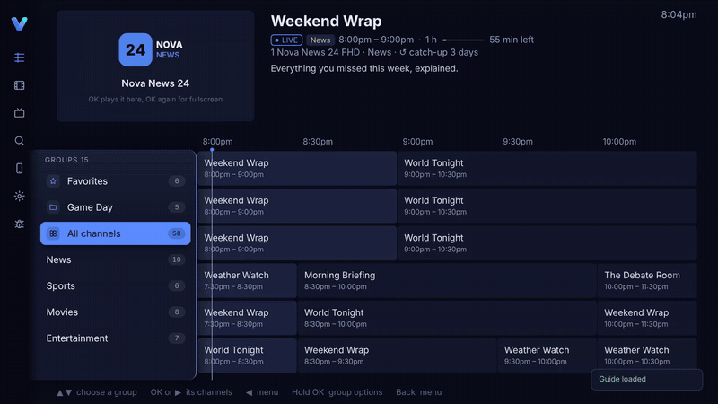
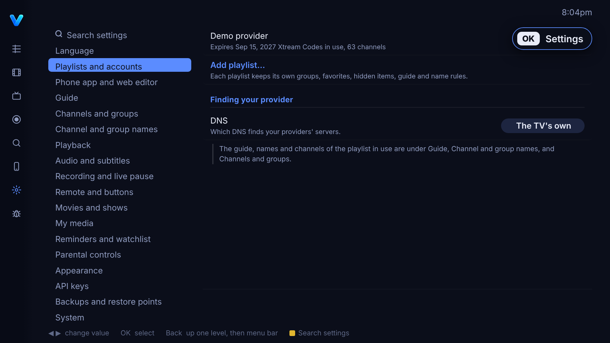
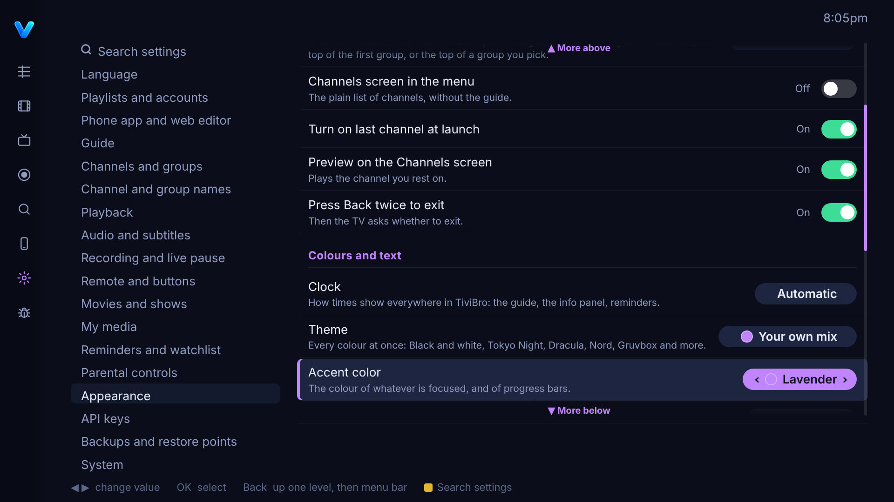

<!-- Generated from docs/USER-GUIDE.md by scripts/wiki/build.js.  Edit the guide, not this page. -->

*On the TV*

**Blue** in the guide, or **Settings** in the menu.  The channel you're watching keeps playing in the top corner, with what's on beside it, and the settings sit below it at full width.  **Hold OK** (or click the picture) goes back to it in fullscreen (on a TV short of memory it stops for a channel list or guide reload, and it always stops for the set-up screen, the tour and the speed test).  **Search settings** (the first row of the menu) or **Yellow** searches every setting: type a word ("subtitle", "clock", "DNS") and pick one to go straight to it.  On a row with a choice, the focused row shows **‹ ›**: **◀ ▶** change it.  Colour rows show a swatch of the colour.  Every option is explained, with its default, in [Every setting](Settings-Language).  The sections:

| Section | What's in it |
|---|---|
| [**Playlists**](Settings-Playlists) | Add and switch playlists, connection and User-Agent, channel list reloads, subscription expiry and connections, the set-up tour, and each playlist's own guide, names and event channels |
| [**Guide**](Settings-Guide) | How your guide is built, provider guide mode and offset, your own guide sources, reloads, public fill-in, guide coverage, assigning a guide, channels with no guide wanted, and how the guide looks (OK on a channel, row size, two-line programmes, what's on now, category colours, channel names, catch-up marks) |
| [**Channels and groups**](Settings-Channels-and-groups) | Manage groups, sort orders, your groups first, Recent and Favorites, My teams, Movies on now, event channels, recently added, your own groups, hidden groups and channels |
| [**Channel and group names**](Settings-Channel-and-group-names) | Name clean-up rules, hiding channels with nothing on, your prefixes and suffixes, group prefixes and suffixes, previews |
| [**Reminders and watchlist**](Settings-Reminders-and-watchlist) | When reminders come up and what they do, the watchlist, and every reminder coming up, with Cancel and Cancel all, and holding notices during movies |
| [**Playback**](Settings-Playback) | Buffer profile and buffer meter, player engine, MPEG-TS or HLS, network helper, HDR and Dolby Vision, aspect, switching channels and what happens when one stops working, catch-up skip steps |
| [**Audio and subtitles**](Settings-Audio-and-subtitles) | Audio language, surround sound, converting sound the TV can't play, subtitles and captions and how they look, subtitles from OpenSubtitles |
| [**Movies and shows**](Settings-Movies-and-shows) | The order of movies and shows, next episode, hiding spoilers, movie and series details from TMDB |
| [**My media**](Settings-My-media) | Add media sources, rescan, fetch details, a link to the TMDB token, sort orders, metadata language, each source |
| [**API keys**](Settings-API-keys) | The TMDB token and the OpenSubtitles key and sign-in, each with Test |
| [**Remote and buttons**](Settings-Remote-and-buttons) | Remap buttons in the player and lists, quick menu buttons, learn a button, button tester |
| [**Appearance and start screen**](Settings-Appearance-and-start-screen) | Settings shown, start screen, where lists open, last channel at launch, preview on the Channels screen, Back twice to exit, clock, theme (Black and white, Tokyo Night, Dracula, Nord, Gruvbox, Catppuccin, Solarized, One Dark, Rosé Pine, Everforest, Kanagawa, Monokai, or your own mix), accent color (twelve presets or your own from a hue and brightness), background (Midnight, Black OLED, Slate, Ocean, Forest, Plum, Mocha, High contrast, Classic), focus style, text size, panel transparency, logos, clock, channel numbers |
| [**Parental controls**](Settings-Parental-controls) | Content filter, PIN, what it protects, blocked groups and channels |
| [**Backups and restore points**](Settings-Backups-and-restore-points) | Where backups live (the phone app, or a locked file), the last backup, and the restore points on this TV |
| [**Phone app and web editor**](Settings-Phone-app-and-web-editor) | Pairing the TiviBro app, paired phones, and the web editor's switch, address, password and port |
| [**Updates, about and diagnostics**](Settings-Updates-about-and-diagnostics) | Your version, check for updates, install an update (rooted TVs), what's new, automatic checks, test versions, report a problem, connection and speed tests, logs, what this TV can play, status |

<a href="https://github.com/ohmybahgosh/TiviBro/raw/main/docs/media/settings.mp4">Watch the MP4</a>

<b>Screenshots</b>

  
  

---

← [Watchlist](Watchlist)  ·  [Home](Home)  ·  [Updates](Updates) →
