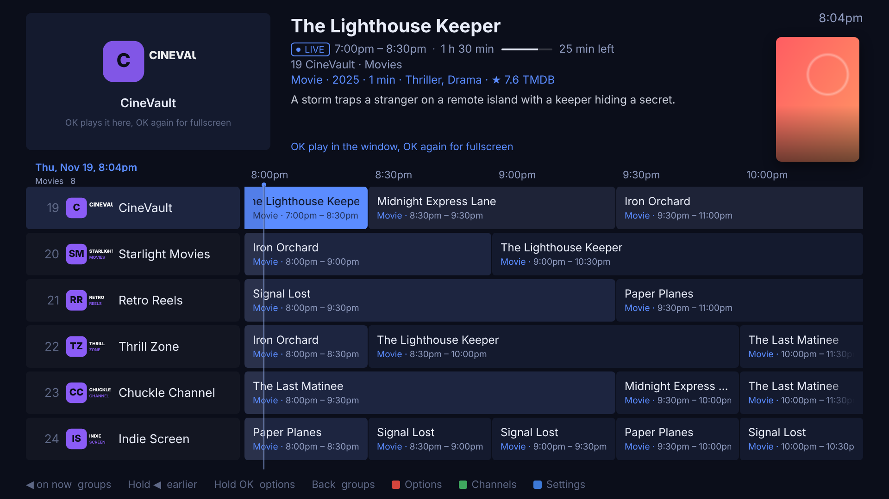
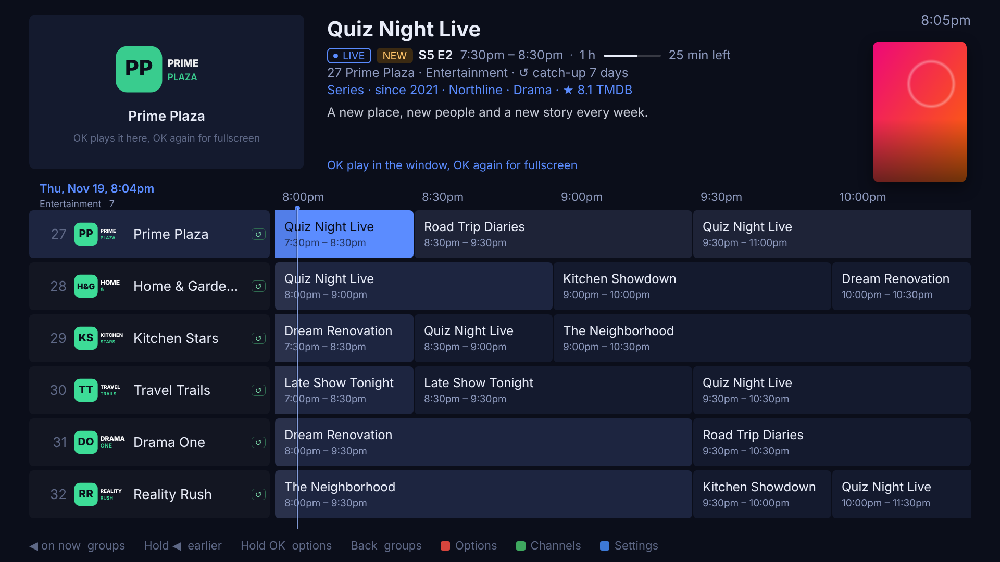
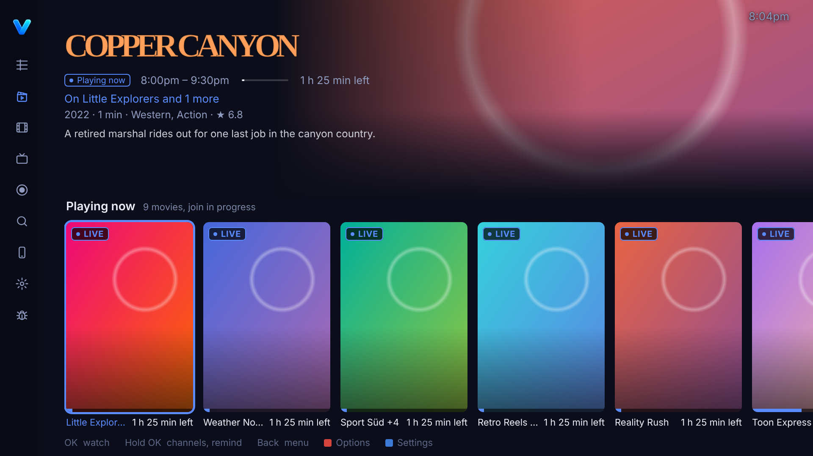
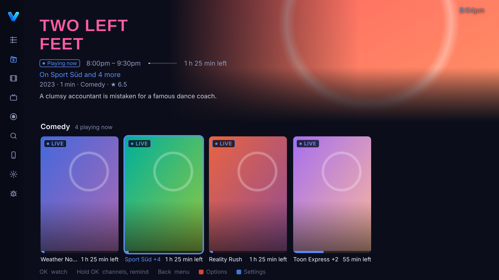

<!-- Generated from docs/USER-GUIDE.md by scripts/wiki/build.js.  Edit the guide, not this page. -->

*On the TV*

The same token fills in TV series (Settings > Movies and shows > **Series details from TMDB**, on by default).  **Without a token**, the same series details come from TheTVDB instead (**Series details from TheTVDB**, on by default), through TiviBro's own service: nothing to set up, and only show names leave the TV.  TheTVDB has no ratings, so those are left out.  Metadata provided by [TheTVDB](https://thetvdb.com).  Either way:

- **In the guide:** land on a series and its details show its poster and a line with when it started, its network, genres and TMDB rating.  When the guide gives the season and episode (S2 E5), the episode's own title is in front of its summary, and TMDB's summary of that episode is shown when the guide's is short.
- **About this show:** **Info** on a series (or **Hold OK > About this show…**) opens a panel with its poster, when it started, its network, how many seasons, whether it's still running, its rating, genres, summary and cast, and its next showings on that channel this week, each with its episode and title.  **Watch now** when it's on, or **Remind me** for the next one.  On anything that isn't a series, **Info** opens the options menu as before.
- **On the Shows screen:** whatever your provider's details leave out comes from TMDB: a poster, a summary, genres, network, rating and cast for a show, and for an episode its summary, a picture from it and when it aired.  What your provider has always comes first (its covers, its episode titles).
- **In the phone app:** a show's details get the same, once the TV has looked it up.

  
  

A show is looked up when you land on it, not ahead of time, and only by its name: a show of exactly that name, the best known one when there are several (a US and a UK version).  News, sport, movies and live programmes are never looked up as series.  Answers are kept for 30 days.

  
  

---

← [Movies on now](Movies-on-now)  ·  [Home](Home)  ·  [My media](My-media) →
