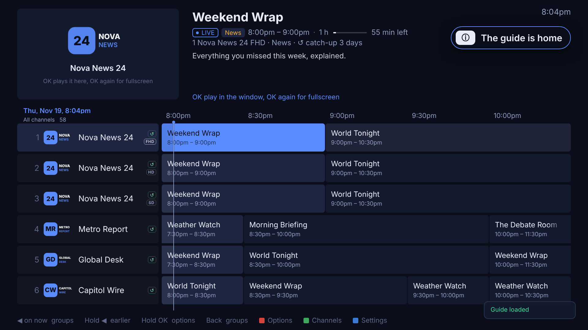
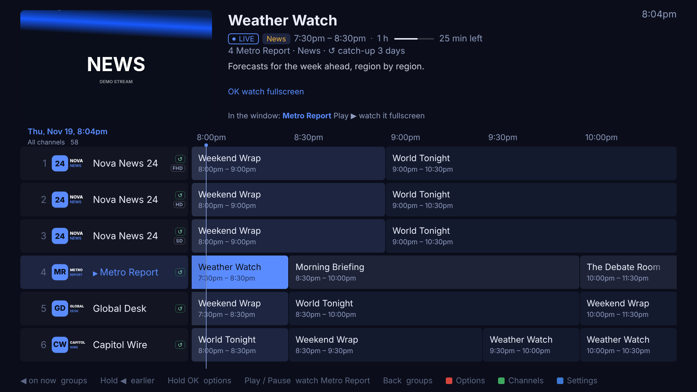

<!-- Generated from docs/USER-GUIDE.md by scripts/wiki/build.js.  Edit the guide, not this page. -->

*On the TV*

The guide is the home screen.  The channel you are on plays in the window at the top left, with the programme details beside it.

- **OK** on a channel previews it in the window.  **OK again** (or **▶ Play**) goes fullscreen.  If you prefer one press, set **Settings > Guide > OK on a channel in the Guide** to *Fullscreen right away*.
- **▶** moves forward in time; **◀** moves back, and on "now" it opens the groups.  Held, they step slowly for the first second so you can stop where you want, then speed up; a held **◀** never opens the groups: it pauses at now, then keeps going back to show what was on, on any channel (playing it needs catch-up).  **Back** returns to now.  Held **▲ ▼** speed up too, three channels at a time after a second and a half.
- **⏩ Fast forward** and **⏪ Rewind** jump a whole screen of the guide (two and a half hours) at a time.  Rewind goes back only as far as the channel's catch-up.  **Back** returns to now.
- When the guide shows another day, the time bar says which ("Tomorrow 8:00pm"), and the day shows at midnight.
- Each group remembers where you were: leave it and come back, and you are on the same channel (and the same time, if you were looking ahead).
- Programmes you can replay carry a **↺** catch-up mark.
- **OK** on a future programme sets a reminder; on a past catch-up programme it replays it.
- **Hold OK** opens: Watch fullscreen, Play in the window, Earlier programmes, Remind me, **Jump to…**, Jump to now, and Channel options (favorite, copy to group, hide, rename).  The channel and time are under its title.
- **Jump to…** goes straight to tonight, late tonight, tomorrow morning or tomorrow night, or any later day the guide has (then a time: morning, midday, afternoon, evening, prime time or late night).  On a channel with catch-up it also lists earlier today and the days before.  It can be put on a button too (Settings > Remote and buttons).
- The details above the guide show the season and episode, and **NEW**, **REMINDER** and the kind of programme (Sports, News, Kids) when your guide says so, or the title or channel makes it plain.  A title too long for its box scrolls across on the programme you are on.
- **Colour by category** (Settings > Guide) gives movies, sports, news and kids' programmes a short coloured bar in the guide, with what each colour means at the top right.
- **No guide for this channel** (in **Hold OK** on a channel with no guide) is for a channel that will never have one: a radio stream, a camera, an event slot.  It stops saying "No guide information" and guide matching and public fill-in leave it out.  **Look for a guide again**, in the same place, undoes it, and **Settings > Guide > Channels with no guide wanted** lists them all.

<a href="https://github.com/ohmybahgosh/TiviBro/raw/main/docs/media/guide.mp4">Watch the MP4</a>

<b>More guide screenshots</b>

  
  

Where the guide comes from (your provider, your own sources, public fill-in, and how channels are matched) is explained at the top of [Settings: Guide](Settings-Guide).  How it looks is under [Settings: Appearance](Settings-Appearance): two-line programmes, dimming past programmes, how "now" is marked, logos only or names too, and catch-up marks.  Where your playlist has the same channel more than once, a small quality tag (**FHD**, **HD**, **SD**, **4K**) tells the copies apart.

**Not playing lately.**  A channel whose last two tries both failed, while the playlist's other channels play, gets a small amber tag: **not playing** in the guide's channel column, **not playing lately** on the Channels screen and in the phone app.  It's usually the provider: the channel may be off air or moved.  The tag goes the moment the channel plays again, and after three days on its own.

---

← [The remote](The-remote)  ·  [Home](Home)  ·  [Groups and the menu](Groups-and-the-menu) →
