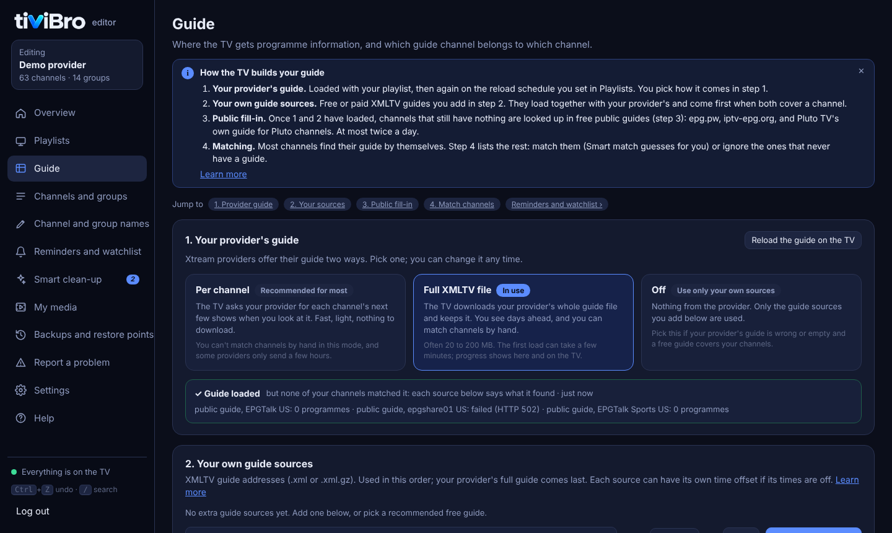
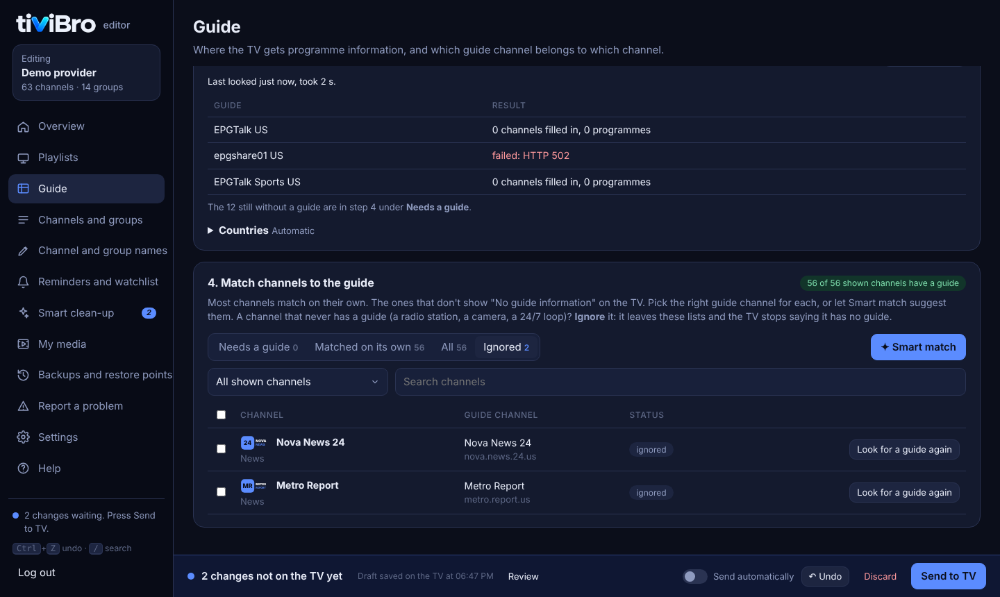
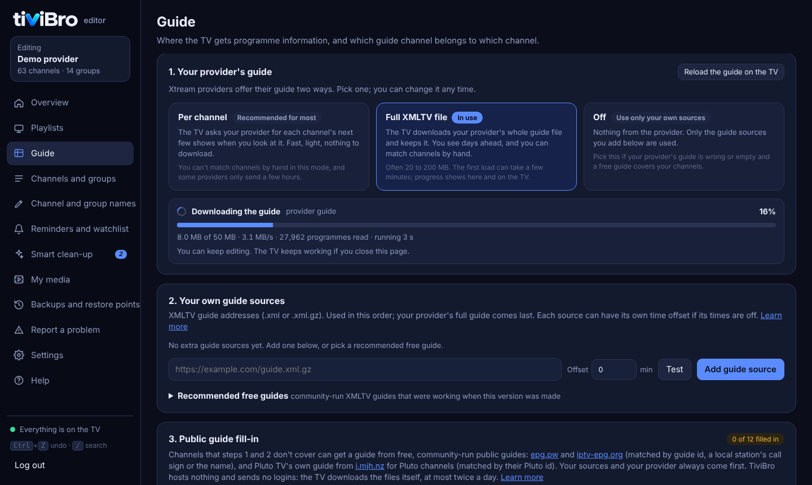
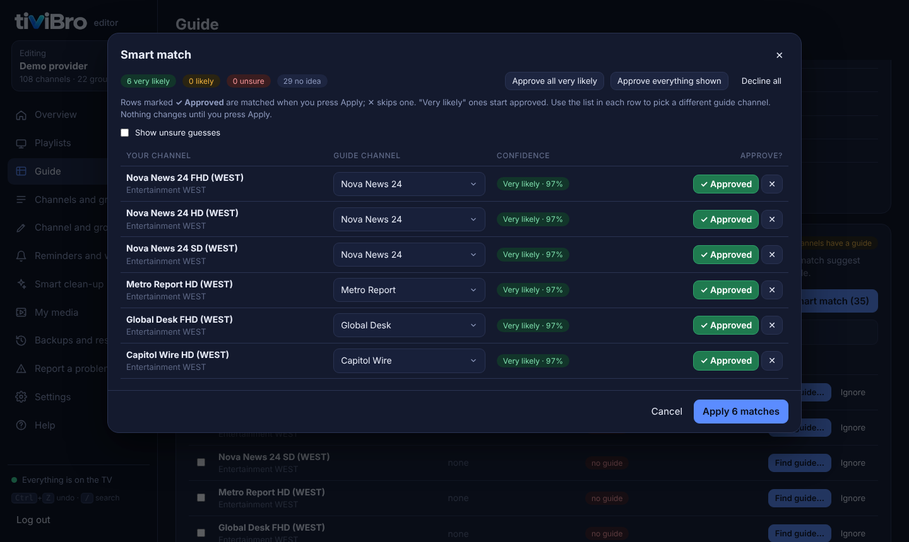

<!-- Generated from docs/USER-GUIDE.md by scripts/wiki/build.js.  Edit the guide, not this page. -->

*Web editor: the web editor*

The editor's **Guide** page starts with **How the TV builds your guide**, the same order as on the TV:

1. **Your provider's guide**, loaded with your playlist and again on the reload schedule you set in Playlists.
2. **Your own guide sources**, which come first when both cover a channel.
3. **Public fill-in**, for channels that still have nothing once 1 and 2 have loaded: epg.pw, iptv-epg.org, epgshare01, and Pluto TV's own guide for Pluto channels.  At most twice a day.
4. **Matching**: most channels find their guide by themselves; step 4 lists the rest, to match or ignore.

The **Jump to** links under it go to each step, and to **Reminders and watchlist**.

**Where it comes from.**  For Xtream providers:

- **Per channel** (recommended for most): the TV asks for each channel's next shows as you browse.  Fast and light.
- **Full XMLTV file**: the TV downloads your provider's whole guide.  Days ahead and manual matching, but files are often 20 to 200 MB.  Live progress (speed, percent, time left) shows in the editor and in the corner of the TV.
- **Off**: only your own sources.

M3U playlists can use the guide address inside the playlist.

**Extra sources.**  Add any `.xml` or `.xml.gz` guide.  Zipped guides work on every TV: the network helper unzips them as they download, and it also unzips provider guides that arrive gzipped.  **Recommended free guides** lists community guides by region (epgshare01, iptv-epg.org, i.mjh.nz for Pluto, Samsung TV Plus, Plex and Roku, and more), each with a one-click **Test**.  The first source in the list wins when two cover the same channel, and **Offset** fixes a guide that is an hour off.

**Public guide fill-in.**  Step 3 on the Guide page (on by default).  After your sources and your provider's guide have loaded, the TV lists the channels that still have nothing and looks them up in free, community-run guides: **epg.pw** (20 countries, lighter files, tried first), **iptv-epg.org** (70 countries, bigger and more complete) and **epgshare01** (about 70 countries, tried last, for what the other two miss).  Channels match by guide id, a US local station's call sign or the name, and only in their own country's guide when TiviBro can tell the country.  Pluto TV channels (guide ids like "US_5ca5…") are also looked up in Pluto's own guide from i.mjh.nz, by id, when there are three or more of them with nothing.  What it finds never replaces a guide you already have.  The card shows how many channels were filled in from each, lets you turn it off, and lets you pick up to eight countries instead of **Automatic** (the countries of the channels that need a guide, up to four).  The TV fetches the files itself, at most twice a day, in the background once your own guide is on screen; iptv-epg.org and epgshare01 need the network helper (Settings > Playback > Connection: Automatic).  **Sports guides** (on by default, with the network helper) add two more community guides for US sports channels: EPGTalk (Big Ten, SEC, ACC, ESPN, FS1, NFL Network, regional sports networks, about six days, plus one channel per team for NFL, NBA, NHL, MLB and college) and epgshare01 (the same networks, about three days).  Sports channels are told by their name or group.  Unlike the rest of the fill-in, a sports network guide also replaces a sports channel's own guide when it reaches at least half a day further ahead, so a provider's two days of Big Ten Network become as many as **Guide days** allows; your own sources and channels you matched by hand are never replaced.  The helper reads these big files as they come in and keeps only the channels it matched.  Programmes from a public guide say "public guide" on the TV, and a wrong match is fixed like any other: Smart match or **Hold OK > Assign guide**.

**Matching channels to the guide** (step 4).  The tabs sort your channels: **Needs a guide**, **Guide is empty**, **Provider only**, **Matched by you**, **Matched on its own**, **Waiting for the TV**, **All** and **Ignored**.  **Smart match** fixes channels showing "No guide information".  It ignores clutter, understands country codes, East and West feeds, numbered channels and US call signs, then shows its best guess with a confidence score.  You approve or decline each one, and nothing changes until you press **Apply**.

**Ignore.**  Radio stations, cameras and 24/7 loops never have a guide.  **Ignore** on a row, or tick several and press **Ignore for the guide**, and they move to the **Ignored** tab: they leave every other tab, the counts and Smart match, public fill-in skips them, and the TV stops saying "No guide information" for them.  **Look for a guide again**, in the Ignored tab, undoes it.  On the TV it's **Hold OK > No guide for this channel** (and **Look for a guide again**), and **Settings > Guide > Channels with no guide wanted** lists them.

  
  
  
  

---

← [Channel and group names](Channel-and-group-names)  ·  [Home](Home)  ·  [Reminders and watchlist](Reminders-and-watchlist) →
