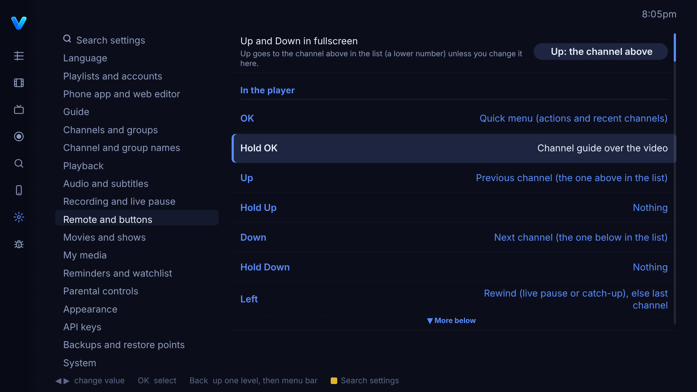
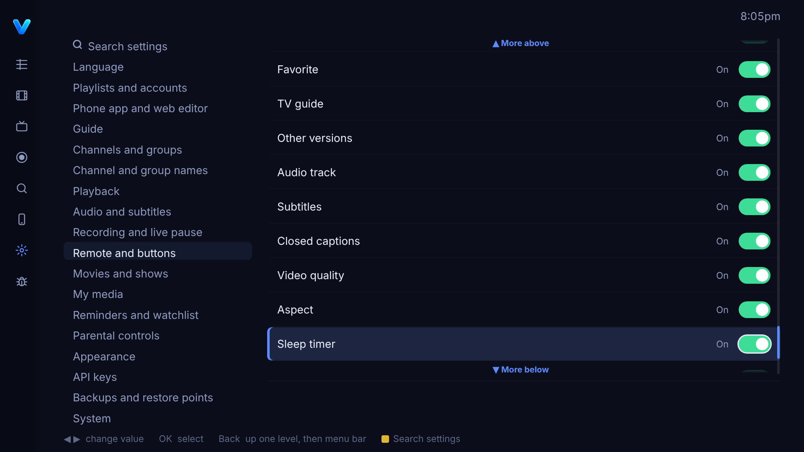

<!-- Generated from docs/USER-GUIDE.md by scripts/wiki/build.js.  Edit the guide, not this page. -->

*On the TV*

TiviBro works with the standard LG remote and the Magic Remote.  With the Magic Remote you can also point, click and scroll on every screen.  A legend at the bottom of each screen always tells you what the buttons do right there.

| Button | In the guide | Watching fullscreen |
|---|---|---|
| **OK** | First OK previews in the window, second goes fullscreen | Quick menu |
| **Hold OK** | Programme and channel options | Channel guide over the video |
| **Red** | Programme and channel options | Options for the channel |
| **Info** | Programme and channel options | Programme details |
| **Hold Info** | | Buffer info: how many seconds are banked and, when the player reports it, the stream's speed.  No Info button (most Magic Remotes): **OK**, then **Stream info** |
| **▲ ▼** | Move between channels | Channel up and down |
| **◀ ▶** | Move through time (◀ on "now" opens the groups; hold ◀ to look back) | ◀ rewind or last channel, ▶ info |
| **CH + / CH −** | Page up and down | Channel up and down |
| **⏪ ⏩** | Jump through time, into the past on catch-up channels | Skip in catch-up and movies |
| **▶ Play** / **❙❙ Pause** | Watch the previewed channel fullscreen | Play only plays and Pause only pauses; a single Play/Pause button switches between them.  Live TV can be paused too. |
| **Green** | Channels screen | Back to the TV guide |
| **Yellow** | Groups | Last channel |
| **Blue** | Settings | Audio track |
| **Back** | Back to now, then the groups | Back to the guide |
| **0 to 9** | Jump to a channel number (at once when no longer number starts with what you typed, otherwise after a short pause) | Jump to a channel number, the same way |

A few things work the way you would guess from other TV apps:

- Lists wrap around: **▲** on the first row goes to the last, and **▼** on the last goes back to the first.  That goes for channel lists, the guide, group lists, Movies and Shows categories, My media shelves and pop-up menus.  Holding an arrow stops at the end instead of flying past it.
- **▲** at the top of a list never opens the menu by surprise.  **◀** or **Back** does.
- **Leaving TiviBro:** press **Back** until the groups show on the home screen; it says **Press Back again to exit**, and one more **Back** closes the app.  The first screen works the same way.
- In a confirmation ("Delete this playlist?"), **Cancel** is selected first, so a stray **OK** never deletes anything.
- With the Magic Remote, clicking outside a pop-up closes it, clicking the progress bar in a movie or catch-up jumps there, and on Settings rows you can click the **‹ ›** arrows to change a value.

Buttons can be remapped under **Settings > Playback > Remote and buttons**, including keys TiviBro does not know yet (**Learn a button**).  **Button tester** shows what the TV sends for each key.  Every button, its default and the actions you can give it are listed in [Settings: Remote and buttons](Settings-Playback#settings-remote-and-buttons).

  
  

---

← [Channel logos](Channel-logos)  ·  [Home](Home)  ·  [The guide](The-guide) →
