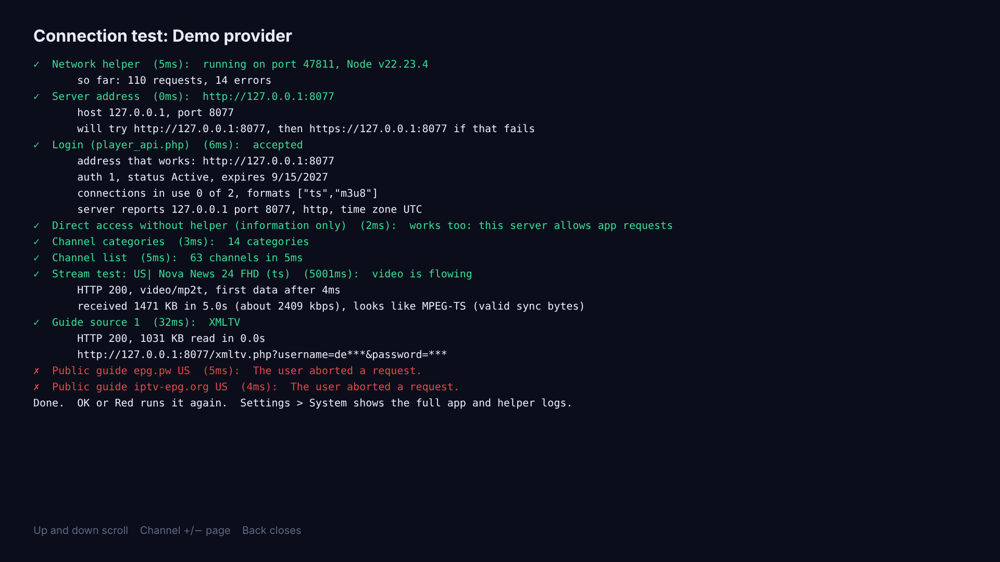

<!-- Generated from docs/USER-GUIDE.md by scripts/wiki/build.js.  Edit the guide, not this page. -->

**Settings > System > Run connection test** is the best first step when something doesn't work: it checks each part in turn and says what failed.

  

**What is the network helper?**  The **network helper** is a part of TiviBro that runs in the background on the TV.  It talks to your provider for the app: it fetches the channel list, the guide and the streams, sends the User-Agent your provider wants, unzips guides, and copes with servers that don't follow the rules.  webOS won't let an app talk to most IPTV servers directly, so TiviBro needs it.  It starts with TiviBro, runs only on the TV, and contacts your own provider, media sources you add and their playback servers (and, if you turn them on, the logo projects).

You'll see it in three places: **Connection** on the first screen and in **Settings > Playback** (leave it on **Automatic**), **Network helper** in Settings > Playback and in the diagnostics status (it should say *running*), and the connection test.  If it says *not running*, restart TiviBro; if that doesn't help, **Settings > System > View network helper log** shows why.

| Problem | Try this |
|---|---|
| A channel won't start or keeps buffering | **OK** on the error message, or **Reconnect** in the quick menu.  Then try **Stream format** HLS instead of MPEG-TS, or a bigger **Buffer profile**. |
| Every channel fails | **Settings > System > Run connection test**.  It checks the [network helper](Troubleshooting#what-is-the-network-helper), your login, the channel list, a stream and the guide, step by step. |
| "No guide information" | Check that **Public guide fill-in** is on (Settings > Guide), and that its countries include the channel's.  Then use **Smart match** in the web editor, or **Hold OK > Assign guide** on the TV.  Or add an extra guide source for your region.  A channel that will never have a guide: **Hold OK > No guide for this channel** (or **Ignore** in the web editor). |
| Guide times are off by an hour | **Provider guide time offset** in Settings, or **Offset** on an extra source in the editor. |
| TiviBro closes after reloading a very big playlist (100,000 channels or more) | A very big list is a lot for a TV to hold, and a reload is the hardest moment.  Set **Settings > Playlists and accounts > the playlist > Reload channel list** to **Only when I ask** and reload when you're not watching, or ask your provider for a smaller list.  TiviBro reloads one list at a time, lets the network helper save it, looks for at most 30,000 channels in the public guides and sends the phone app at most 30,000.  If TiviBro closes twice in a row while loading a playlist, it sets that playlist to **Only when I ask** itself and says so; when nothing of that list is kept yet, the next start asks whether to try it again, change the connection or use another playlist instead of loading it a third time. |
| An M3U list's films and series aren't in Movies and Shows | They come in when the network helper reads the list, so **Reload channels now** once after updating.  Films need a link to `/movie/` or to a video file (`.mp4`, `.mkv` and the like), and episodes a link to `/series/` or a name like "Show S01 E02".  If TiviBro says a list is too big for this TV, ask your provider for a smaller one. |
| A playlist takes forever to load | **Back** on the loading screen offers to stop: change the connection, use another playlist or add one.  During a reload, **Settings > Playlists and accounts > the playlist > Stop reloading** stops it and keeps the channels you had. |
| Most channels won't play, with errors like 404 or 522 | When five or more channels fail with errors from the provider and next to none play, TiviBro says so (once a day).  The login can work and the account be active while the list itself is out of date, or its channels only work from another country (with a VPN).  **Reload the channel list**, or ask your provider. |
| The guide seems stuck loading | Big XMLTV files take minutes on a TV; watch the progress bar.  If it stays at 0, **Test** the address. |
| The web editor says it can't reach the TV | TiviBro was closed or the TV went to sleep.  Open TiviBro; the editor reconnects and your drafts are safe. |
| Changes don't show on the TV | Check the bar at the bottom of the editor.  If it still counts changes, press **Send to TV**. |
| Wrong editor password | It's on the TV under **Settings > Phone app and web editor**.  After five wrong tries, wait a minute. |
| HDR looks grey or washed out | **Settings > Playback > HDR and Dolby Vision > TV player for all HDR**. |
| A movie plays with no sound | It may only have DTS, Dolby TrueHD or FLAC surround sound, which the TV can't play.  Check that **Settings > Playback > Audio and subtitles > Convert audio the TV can't play** is *Automatic* and that **Audio converter** says *Ready* (**Get the converter now** if not).  See [Sound the TV can't play](Sound-the-TV-cant-play). |
| Dolby Vision shows odd green or purple colours | Make sure **HDR and Dolby Vision** isn't set to *Built-in player*. |
| A remote button does nothing | **Settings > Playback > Remote and buttons > Button tester**, then **Learn a button**. |
| Something crashed, or TiviBro closed by itself | The next time it starts, TiviBro asks whether to report it and says what it was doing (loading which guide, playing which channel, how much memory it used).  **Send a report now** sends it from the TV straight away; **Report with my phone** shows the code for your phone so you can add what you were doing.  The report carries the log of the session that closed.  The TV turning off or restarting, and updates, don't count as a crash.  Test builds also have **Report a problem** at the bottom of the menu, and it is always in **Settings > System**.  **View app log with earlier sessions** shows the log on the TV.  Logs mask usernames and passwords.  When the developer answers your report, TiviBro shows the reply; if it still happens, **Still happening** sends a fresh log to the same report. |

---

← [Backups and restore points](Backups-and-restore-points)  ·  [Home](Home)
