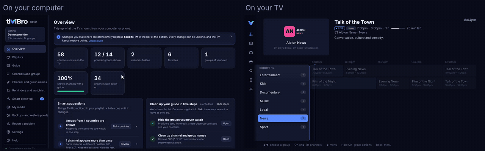
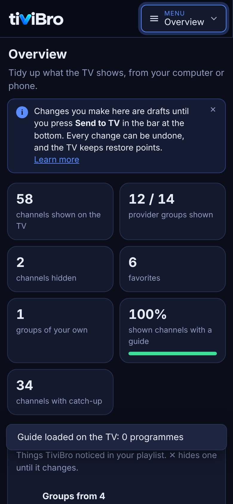
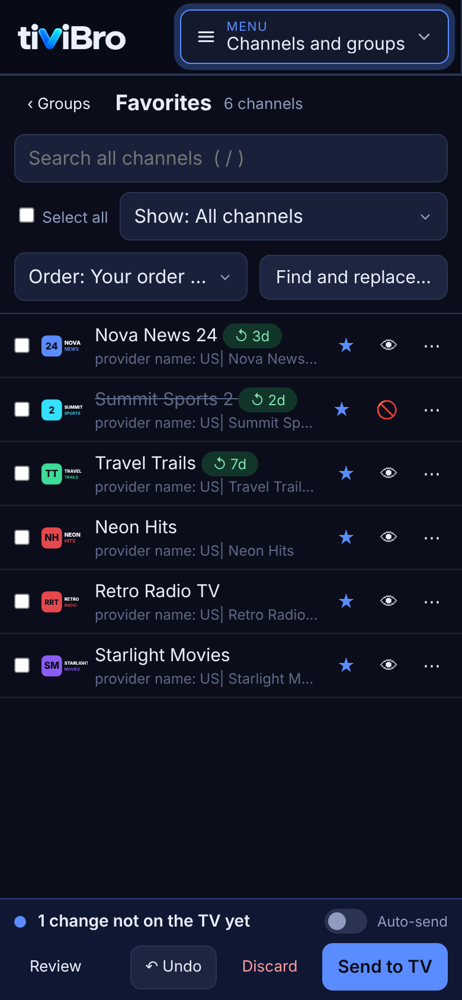
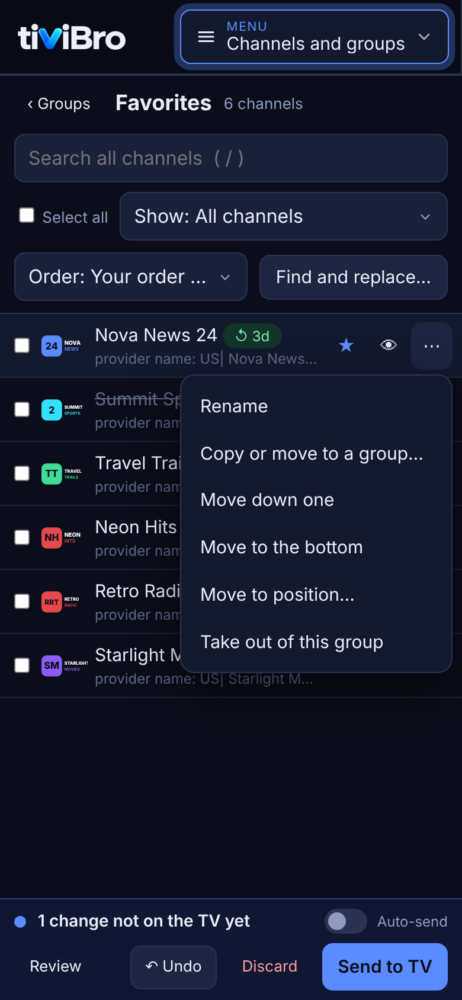
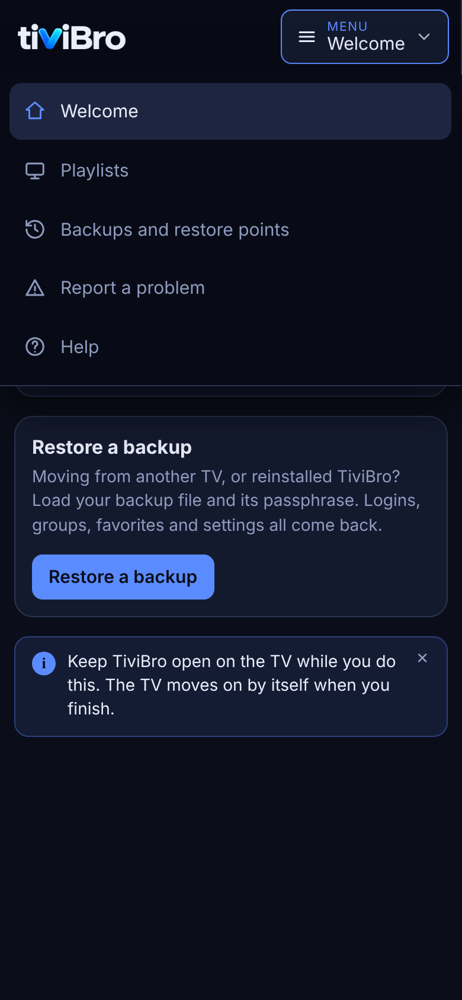
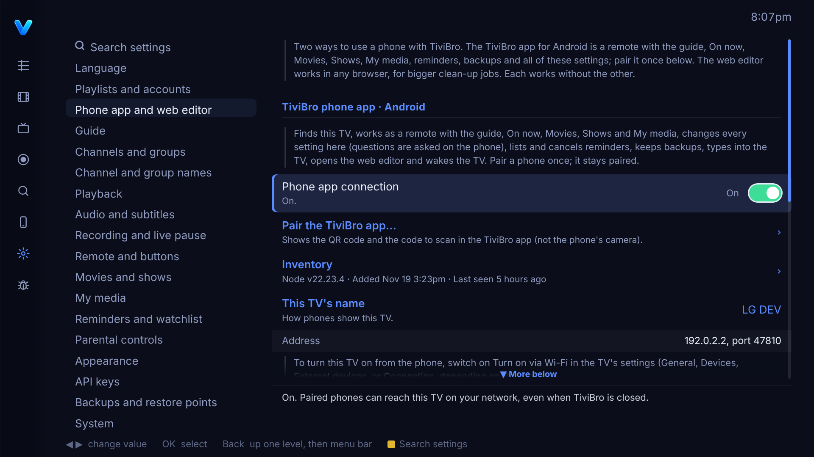
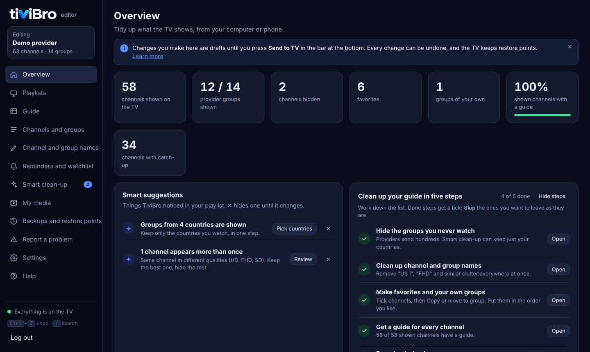
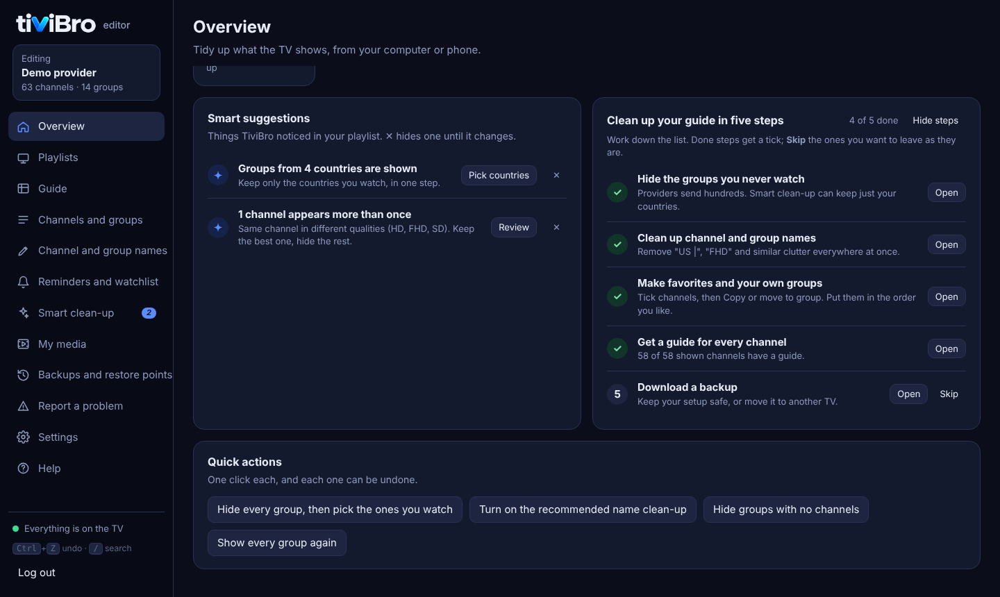

<!-- Generated from docs/USER-GUIDE.md by scripts/wiki/build.js.  Edit the guide, not this page. -->

*Web editor: the web editor*

Cleaning up hundreds of groups with a TV remote is painful.  The web editor does it from any browser on your network, while TiviBro stays open on the TV.

<a href="https://github.com/ohmybahgosh/TiviBro/raw/main/docs/media/live-edit.mp4">Watch the MP4</a>

1. On the TV, open **Edit on phone** in the side menu (◀ from the groups).  It turns the editor on and shows a QR code, the address and the password.  The same panel is under hold OK on any group (**Edit on a phone or computer…**), in **Settings > Phone app and web editor**, and on any remote button you like (Settings > Remote and buttons).  (On a brand-new TV: the first screen already shows the code.)
2. On a phone, scan the code with the camera: the editor opens signed in.  On a computer, open the address, like `http://192.168.1.20:8787`, and type the password.  Dashes and capitals don't matter, and neither do look-alikes: 5 or S, 0 or O, 8 or B all work.  New passwords leave out characters that are easy to misread.
3. **Done** closes the panel and leaves the editor running; **Turn the editor off** stops it.

The editor switches off every time TiviBro closes.  On a brand-new TV with no playlist it starts by itself, for the QR code on the first screen.  After five wrong passwords it locks for a minute.

The pages follow the TV's Settings: **Overview**, **Playlists**, **Guide**, **Channels and groups**, **Channel and group names**, **Reminders and watchlist**, **Smart clean-up**, **My media**, **Backups and restore points**, **Report a problem** and **Help**.

**On a phone.**  The [set-up tour](The-set-up-tour)'s QR code opens the editor signed in; any phone browser works with the address and password too.  On a phone the page name sits in the top bar (tap it for the list of pages), **Channels and groups** shows the groups first and a group's channels on their own screen (**‹ Groups** goes back), **⋯** on a group moves it (up, down, to the top or bottom, or to a position), and **⋯** on a channel has Rename, Copy or move, the same moves and Take out.

**Inside the TiviBro phone app** (**Edit channels**), the editor is the same, except that **My media** and **Backups and restore points** hand over to the app's own screens: a short card with **Open My media settings** or **Open Backups and restore points**.  Your unsent changes from the editor stay on the Backups and restore points page.

  
  
  
  

  

  
  

The **Overview** shows how many channels and groups are on the TV, guide coverage, **Smart suggestions**, and **Clean up your guide in five steps**: hide the groups you never watch, clean up channel and group names, make favorites and your own groups, get a guide for every channel, and download a backup.

- Each step has **Open**, and **Skip** for one you want to leave as it is (**Undo skip** brings it back).  Skips are kept on the TV, so another phone or computer sees them too.
- **Hide steps** folds the card to one line, and **Show steps** opens it again.  Once every step is done or skipped the card folds by itself and says **Guide set up ✓**.

**Tips you can hide.**  Every tip and info box on a page, and each smart suggestion, has a **✕** that hides it in this browser.  A tip comes back by itself when its text changes, and **Show hidden tips** (in **Help**, and under Smart suggestions) brings them all back.  **Help** in the editor explains every page.

---

← [Settings: System](Settings-System)  ·  [Home](Home)  ·  [Drafts and Send to TV](Drafts-and-Send-to-TV) →
