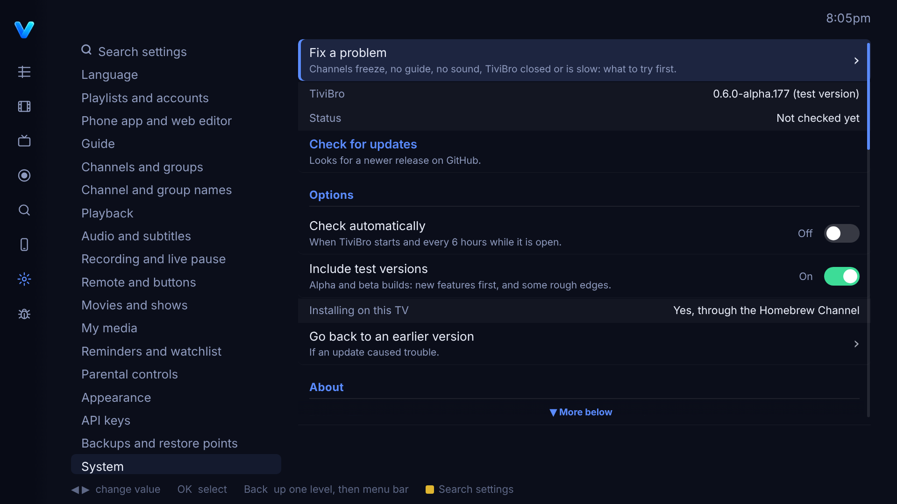

<!-- Generated from docs/USER-GUIDE.md by scripts/wiki/build.js.  Edit the guide, not this page. -->

*On the TV*

**Settings > System** shows your version and checks GitHub for a newer one.  TiviBro also checks by itself once a day and shows a short note when there is an update; nothing is installed without you.

- **Install** (rooted TVs with the Homebrew Channel): downloads the new version, checks its fingerprint, installs it, and restarts TiviBro with all your settings.
- **What's new** lists the changes in that version.
- **Include test versions** also offers alpha and beta builds.  It is on when you are running one.
- On TVs that aren't rooted, the page tells you the new version is out; install it from a computer as before.
- **Go back to an earlier version** (rooted TVs): lists the releases before yours.  Pick one and TiviBro checks it like an update (its fingerprint and TiviBro's signature), saves everything it keeps on the TV first (settings, channel edits, favorites, reminders, plus a restore point), then installs it.  Recordings, your playlist and My media aren't touched.  Automatic update checks turn off so the newer version isn't offered straight back.  After you update again, **Settings saved before going back** puts back exactly what you had.  Releases from before signatures can't be checked, so they aren't offered; the releases page on GitHub has them.

  

---

← [Settings](Settings)  ·  [Home](Home)  ·  [Parental controls](Parental-controls) →
