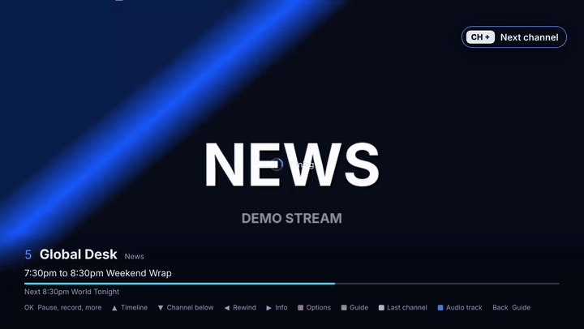
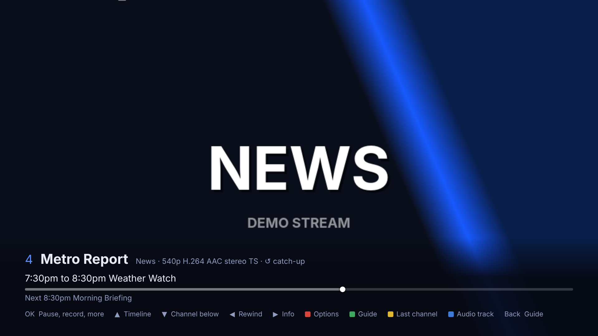
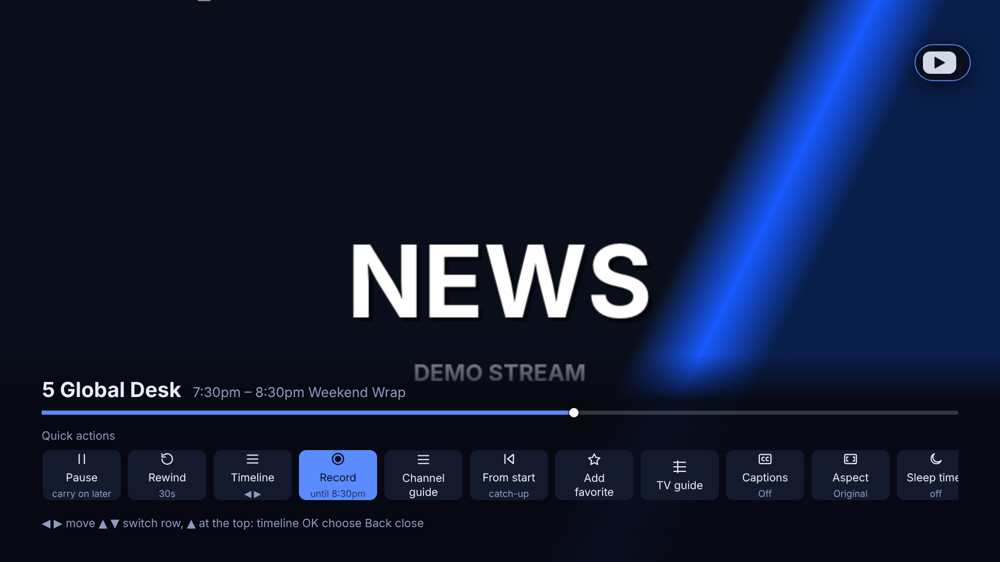
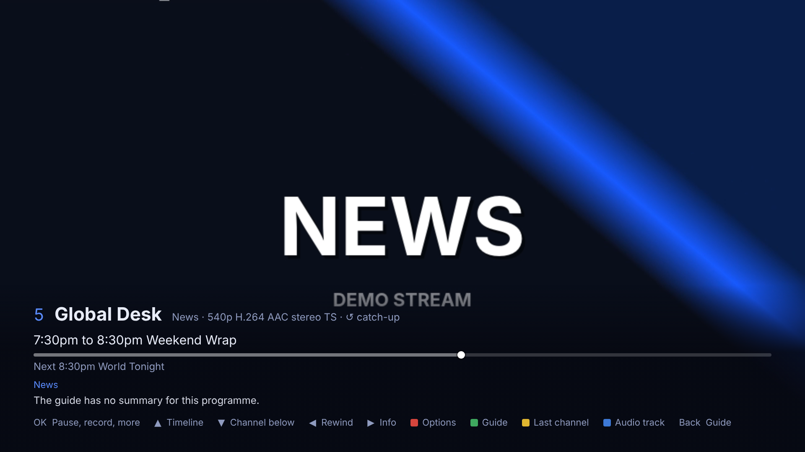
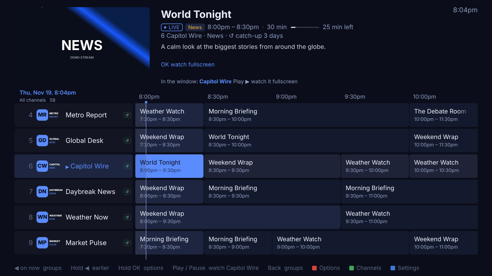
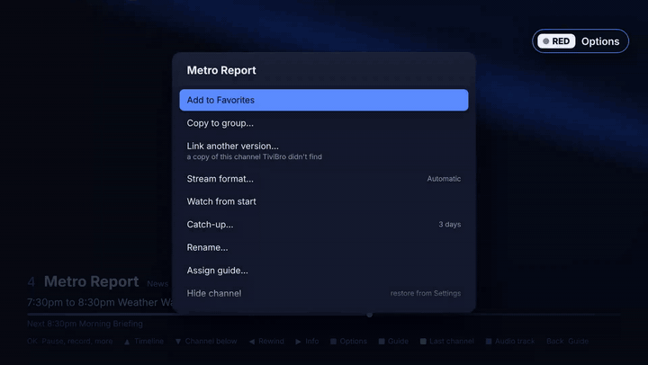
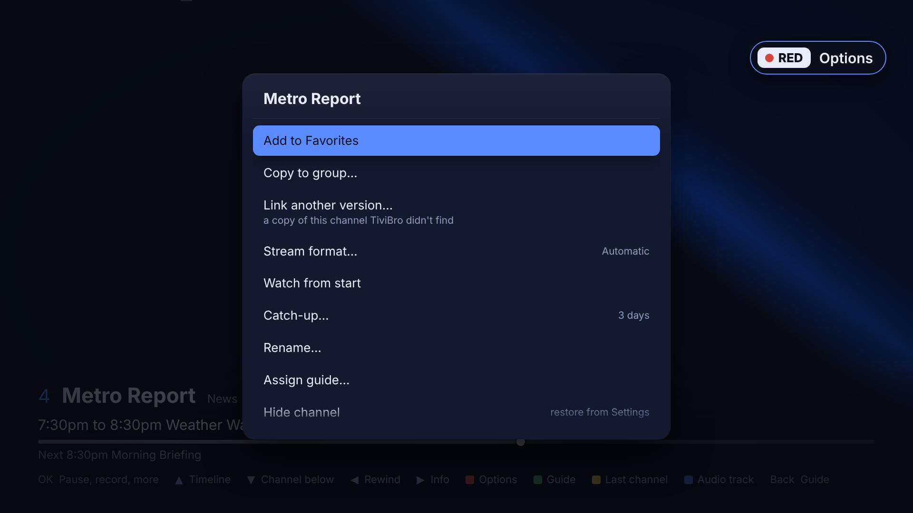
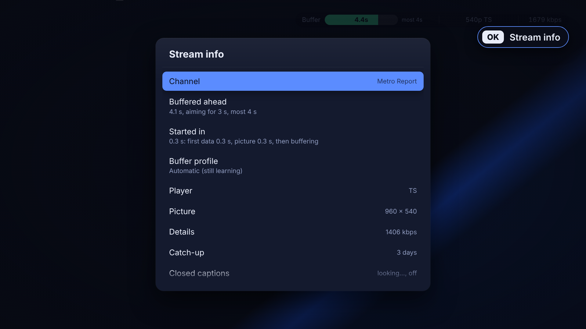
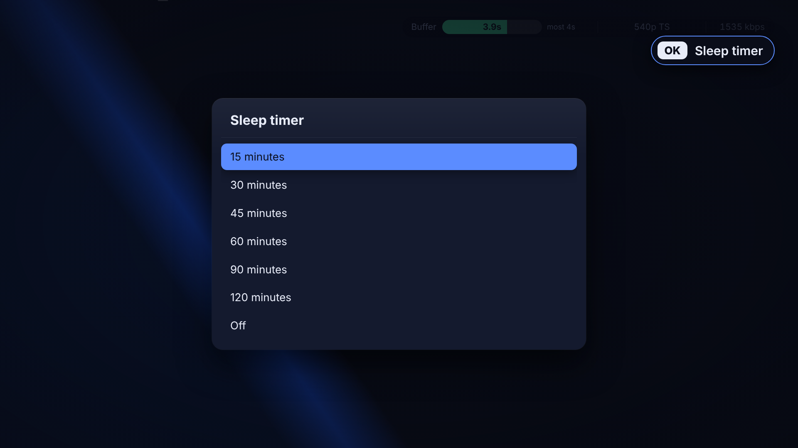
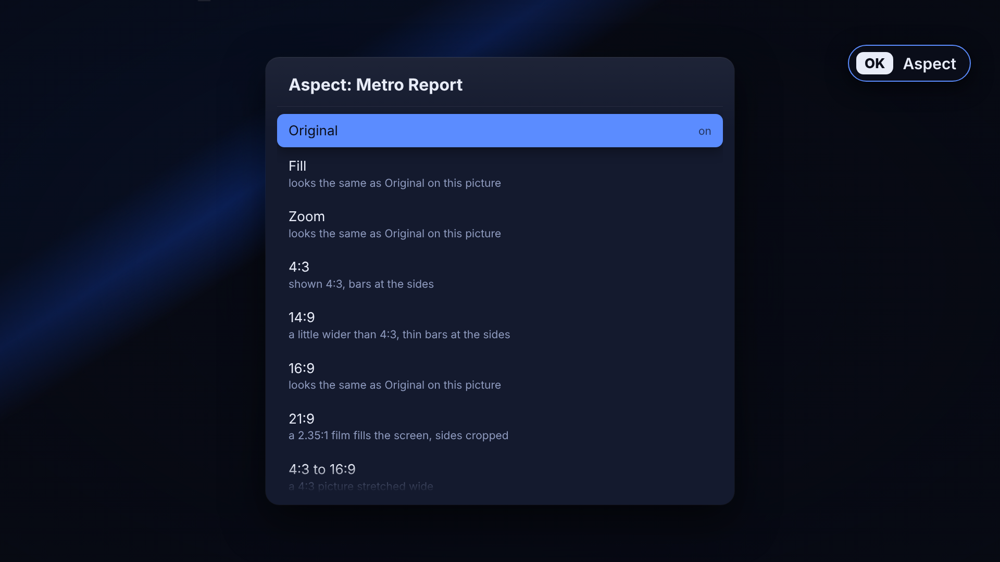

<!-- Generated from docs/USER-GUIDE.md by scripts/wiki/build.js.  Edit the guide, not this page. -->

*On the TV*

- **▲ ▼** or **CH + / CH −** change channel.  An info bar shows the channel, what's on now and next, and how far into the programme you are.
- **The screensaver waits.**  While a channel, a movie or episode, My media or catch-up plays, TiviBro asks the TV to hold off its screensaver (a homebrew one such as Aerial too).  It also waits for a minute and a half after something last played (so a reconnect or a channel that won't play doesn't let it in), and for 3 minutes after you last pressed a button, including on the phone app, whose presses the TV doesn't count.  When nothing plays, playback is paused, or you are in another app, the screensaver comes on as usual.  There is nothing to set.
- **▶** shows the full programme info.  **Yellow** jumps back to the last channel.  **Green** goes back to the TV guide.
- **Hold OK** (or **OK > Channel guide**) lays the channel guide over the video: the group's channels with what's on now.  **OK** on another channel switches to it and keeps the channel guide open so you can keep browsing; **OK** on the channel that's already playing closes it.  **◀ ▶** change group.
- **OK** opens the **quick menu**: Channel guide, From start (catch-up channels), Favorite, TV guide, Other versions (when the channel has them), Scores (while one of your teams is playing: turns your teams' score corner on or off), Captions, Aspect, Sleep timer, Stream info and Reconnect.
- **Closed captions**: **Captions** in the quick menu turns them on or off for every channel, like a TV's CC button (also **Settings > Audio and subtitles > Closed captions**, with a caption size).  They show in fullscreen when the channel sends them, which most US channels do.  Not with the TV player (Settings > Playback > Player engine); **Stream info** says whether this channel has captions.  Pick which buttons appear, and their order, under **Settings > Remote and buttons > Quick menu buttons**: **Hold OK** on one to move it (or drag ≡ in the phone app).  **Options** (Red) lists the same player rows in that order too.
- **Red** opens options for the channel: favorite, copy to group, other versions, watch from start, catch-up, rename, assign guide, hide, aspect and sleep timer.  **Hold OK** opens the channel guide over the video.
- **Stream info** (quick menu) shows the channel, how much is buffered (and the most this channel has reached), how long it took to start (the first video data, the first picture, then the start-up buffer), the buffer profile, the player in use, the picture's resolution, the bitrate and catch-up, updating while it's open, with the buffer gauge at the top right.  Any button can open it: **Stream info and buffer** under **Settings > Remote and buttons**.  **Sleep timer** stops playback after 15 minutes to 2 hours.  **Aspect** sets the shape of the picture for this channel (or this movie or episode), or for all of them:
  - *Original*: the picture's own shape.  *Fill*: stretched to fill the screen.  *Zoom*: fills the screen, edges cropped.
  - *4:3*: shown 4:3 with bars at the sides.  *14:9*: a little wider than 4:3, with thin bars at the sides, for a picture that looks squeezed but not by a whole 16:9.  *16:9*: for a 16:9 picture squashed into 4:3, which some channels send.
  - *21:9*: a 2.35:1 film with black bars above and below fills the screen; the sides are cropped.
  - *4:3 to 16:9*: a 4:3 picture, or a 4:3 picture with black bars at the sides, stretched out to fill a 16:9 screen.
  - *Film shape…*: any other wide film inside the picture fills the screen, sides cropped: 1.85, 1.90 (IMAX), 2.00, 2.20, 2.39 (most wide films) or 2.76, or type your own (from 1.50 to 3.00, or like 64:27).
  - *Stretch wider…*: each pixel drawn wider by a factor (×1.10 to ×1.78, or type your own from 1.05 to 2.00), the height kept, for a picture squeezed sideways whatever its shape says.  Past the screen's width the sides are cropped.
  - Each channel, movie and episode remembers its own choice; **Use this aspect for everything** makes it the default.  The shapes past Zoom need the picture to be scaled by TiviBro; with the TV player (Stream info says which player is in use) some TVs keep the picture as it was, and the menu says so.  On some pictures two shapes come out the same (on a 4:3 picture, Fill, 16:9 and 4:3 to 16:9 all fill the screen); the menu says which, and the Aspect button skips them.

<a href="https://github.com/ohmybahgosh/TiviBro/raw/main/docs/media/zap.mp4">Watch the MP4</a>

<b>Screenshots</b>

  
  
  
  

The options menu, stream info, sleep timer and aspect:

<a href="https://github.com/ohmybahgosh/TiviBro/raw/main/docs/media/options.mp4">Watch the MP4</a>

<b>Screenshots</b>

  
  
  
  

**Smooth playback.**  TiviBro picks a player per stream (MPEG-TS, the TV's own player, or HLS) and falls back automatically if one struggles.  It remembers what each channel needed, after a restart too: a channel that only plays as HLS or on the TV's player starts that way at once, and one that ran dry keeps the bigger cushion it earned.  A channel trickling in at under half its speed is reconnected while there is still a cushion, with the last picture kept on screen.  It watches for frozen pictures and reconnects on its own, with a short wait that grows between tries.  On a channel that keeps running dry it holds a bigger cushion before playing again (shown as *Buffering NN%*), and lets it shrink back once the stream settles.  It also rides out providers that jump their timestamps, briefly refuse connections, or send corrupted data.  If a provider is slow or your Wi-Fi is weak, try **Settings > Playback > Buffer profile**, or switch the **Stream format** between MPEG-TS and HLS: for every channel in Settings > Playback, or for one channel by holding OK on it (or **Options** while it plays) and choosing **Stream format…** (Automatic, HLS or MPEG-TS).  The channel starts again in the format you pick, and Settings > Playback lists the channels that have their own, with a way to clear them.

It tries hard never to just stop:

- **Wi-Fi drops:** it waits for the network ("No network.  Waiting for it to come back") without using up its retries, and reconnects the moment the TV is back online.
- **A channel keeps failing:** it tries the TV's own player and the provider's HLS version of the channel, then keeps retrying with a message on screen (every 6 seconds for the first few minutes, then every 15, for up to 20 minutes), so a channel that comes back after a provider hiccup recovers by itself.
- **A channel stops working for good:** if your playlist has the same channel more than once (in another quality, another group, or a copy you hid), TiviBro switches to the next version and tells you, steadiest quality first: Full HD, HD, unmarked, 4K, then SD.  If every version fails, the provider itself is probably down, so it goes back to the channel you chose and keeps retrying.  Set this under **Settings > Playback > When a channel stops working**: switch by itself, ask you, or just keep retrying.  More in [Other versions of a channel](Other-versions-of-a-channel).
- **A channel never starts:** after a couple of quick retries it says plainly whether the provider is refusing it or the TV can't decode it.  **OK** tries again.
- **Paused live TV:** a short pause carries on where you left off.  After a long pause TiviBro lets the connection go (the provider would drop it anyway) and **Play** brings you back to live.
- **Movies and catch-up** pick up from the same spot after a dropped connection, and when you leave TiviBro (Home button, another input) and come back.

**HDR, Dolby Vision and sound formats.**  TiviBro reads what each stream is before the picture starts: from the HLS playlist, from the MPEG-TS stream, or for movies from your provider's details.  The info panel shows it, for example *4K  HEVC  Dolby Vision 8  E-AC-3 5.1*, and movie details show it before you press play.

- **Dolby Vision** plays through the TV's own player, which switches the screen into Dolby Vision itself.
- **HDR10 and HLG** stay on TiviBro's built-in player by default, for its steadier buffering.  If HDR pictures look grey or washed out, set **Settings > Playback > HDR and Dolby Vision** to *TV player for all HDR*.
- **HEVC, AV1, AAC, Dolby Digital (AC-3) and Dolby Digital Plus (E-AC-3, Atmos)** play on webOS 6 and later TVs.  Anything the built-in player can't decode moves to the TV's player automatically.
- **DTS, Dolby TrueHD and FLAC surround:** some sound the TV can't play at all.  TiviBro converts it for you, see [Sound the TV can't play](Sound-the-TV-cant-play).
- **Settings > System > What this TV can play** lists every format and which player handles it on your TV.

---

← [Groups and the menu](Groups-and-the-menu)  ·  [Home](Home)  ·  [Multiview: two channels side by side](Multiview-two-channels-side-by-side) →
